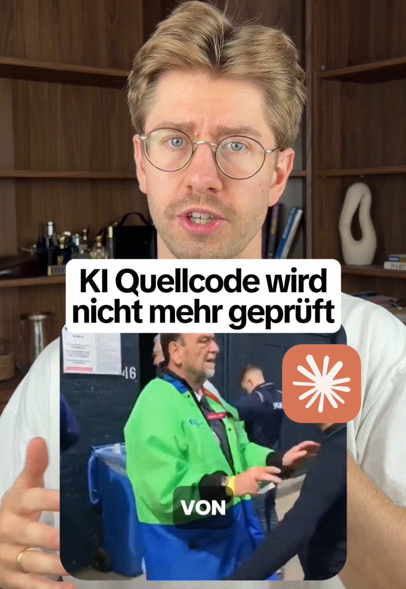

# Über achtzig Prozent des Codes von Claude Code und Codex sieht kein Mensch mehr an.

## Caption

Über achtzig Prozent des Codes von Claude Code und Codex sieht kein Mensch mehr an. Geprüft wird er von einem Agenten. Die Universität Toruń hat über 932.000 Pull Requests ausgewertet: 61,38 Prozent der KI-generierten hatten keine dokumentierte Review, von den geprüften wurden 58,77 Prozent nur von Agenten angesehen und 10,14 Prozent nur von Menschen. Hochgerechnet hat bei rund 84 Prozent kein Mensch draufgeschaut. Ein Agent meldet Fehler seltener, wenn sie im selben Gesprächsverlauf entstanden sind. Übergibst du die Prüfung frisch und mit deiner ursprünglichen Aufgabe, steigt die Endkorrektheit von 71,6 auf 89,7 Prozent. Das prüfende Modell muss dabei mindestens gleich stark sein. Zu den Tests: Nicht jede Änderung braucht einen Test, sondern jedes geänderte Verhalten. Ein Refactoring muss unter den unveränderten Tests grün bleiben. Passt ein Agent die Tests an, damit sie grün werden, ist das der Moment zum Hinsehen. Die Einstellung heißt "Require status checks to pass before merging", zu finden unter Settings, Rules, Rulesets.

## Lokales Video

[Video lokal abspielen](medien/2026-08-14-floknowsai-ueber-achtzig-prozent-des-codes-von-claude-code-und-codex-sieht-kein/02-video.mp4)

## Transkript

Über 80% des Codes von Cloud Code oder Codex schaut sich kein Mensch mehr an und auch du vertraust deinem Agent vermutlich mehr als du solltest. Dieser Trend ist ein echtes Problem für Nutzer und Entwickler, weil Apps nachweislich unsicherer werden und die Wartbarkeit der Software sinkt. Mehrere tausend Zeilen Quellcode am Tag schaut sich natürlich auch niemand mehr an, deswegen führt auch kein Weg an Agenten als Prüfer vorbei. Nur prüft ein Agent seine eigene Arbeit nachweislich schlechter als die von anderen. Hi, ich bin Florian, bei mir lernst du, wie du KI im Software Engineering richtig einsetzt. Folg mir also gern, wenn dich das Thema interessiert. Die Frage ist also, wie muss dein Arbeitsablauf konkret...

aussehen, dass dein Code am Ende wirklich nochmal geprüft wird. Ich habe das über vier Schritte gemacht und die kann dein Agent dir einfach einrichten. Zuerst gibst du die fertige Umsetzung an einen zweiten Agenten zusammen mit der ursprünglichen Aufgabenstellung. Dieser sollte dann drei kritische Reviews durchführen. Erstens ein Code-Review, also die Änderungen durchgehen und schauen, ob da irgendwelche Bugs drin sind. Dann ein Security-Review auf die bekannten Schwachstellen wie SQL-Injection und fehlendes Rate-Limiting und so weiter. Und abschließend ein Testlauf über die Änderungen, dass keine Regressionen drin sind. Über das Thema Testing habe ich übrigens schon mal ein eigenes Video gemacht. Wenn dein Agent also fertig ist und alle Fehler...

behoben sind, machst du erst danach ein Pull-Request. Und dort lässt du dann GitHub Actions laufen, also Prüfungen, die bei jedem Pull-Request automatisch starten. Dort sollten dann typischerweise Tests für statische Code-Analyse durchgeführt werden. Also sowas wie Linting, Formatierung, Typprüfung und gegebenenfalls auch noch deine Testsuite. Solche Fehler kann dein Agent natürlich auch finden, nur eben nicht jedes Mal, wenn du ihn nicht explizit darauf anweist. Deshalb gehst du danach in GitHub in die Einstellung deines Repositories und machst diese Prüfung zur Pflicht. Denn dann lässt sich kein Pull-Request mehr merchen, solange einer dieser Prüfungen fehlgeschlagen ist. Die Agenten sind dabei ja nicht das Problem, denn...

In den richtigen Händen sind sie eine enorme Beschleunigung. Aber du trägst die Verantwortung für deinen Code. Also musst du dich damit auseinandersetzen, wie dein Arbeitsablauf aussieht, damit jede Zeile Quellcode gereviewt wird.
