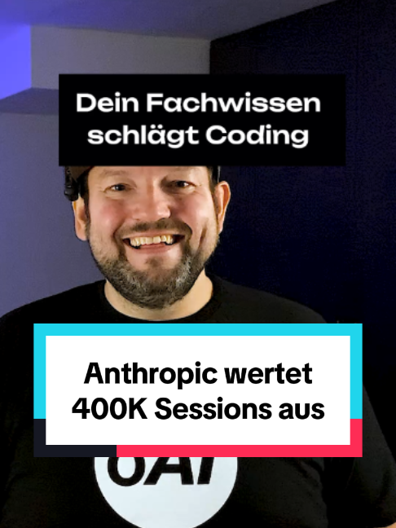

# Du brauchst keinen Entwickler, um mit KI etwas zu bauen.

## Caption

Du brauchst keinen Entwickler, um mit KI etwas zu bauen. Anthropic hat 400.000 Sessions mit Claude Code ausgewertet und dabei kam heraus, dass Software-Entwickler auf 30 Prozent voll erfolgreiche Sessions kommen und alle anderen Berufe auf 29 Prozent. Was den Unterschied macht ist dein Fachwissen. Bei Leuten mit Erfahrung in ihrem Bereich erledigt die KI pro Anweisung rund zwölf Arbeitsschritte, bei Anfängern sind es fünf. Wenn bei dir jemand seit fünfzehn Jahren die Angebote schreibt, dann ist genau der dein bester KI-Anwender. In unseren Workshops sehe ich das jedes Mal. Die besten Ergebnisse kommen von den Leuten, die den Vorgang seit Jahren im Kopf haben. Die Studie findest du unter https://www.anthropic.com/research/claude-code-expertise Traust du dir das ohne Entwickler zu?

## Lokales Video

[Video lokal abspielen](medien/2026-09-13-stefanantonelli-du-brauchst-keinen-entwickler-um-mit-ki-etwas-zu-bauen/02-video.mp4)

## Transkript

Habe die Ehre. Du brauchst keinen Entwickler, um mit KI was zu bauen. Das sagt jetzt sogar eine Studie mit 400.000 Sessions. Anthropic hat ausgewertet, wie Leute mit Cloud Code arbeiten. Cloud Code ist der Rapper für Cloud, der zum Entwickeln gedacht ist. Das Teil gibt's auch für normale Aufgaben und heißt dann Coburg. Ich bin übrigens Stefan, ich hab 20 Jahre lang selbst Software gemacht und jetzt hab ich Bock auf KI. Lass gerne ein Follow da und speichere das Video, dann siehst du in Zukunft mehr davon. Software-Entwickler kommen auf rund 30% erfolgreiche Sessions, alle anderen Berufe auf 29%. Der Unterschied ist also quasi nicht vorhanden. Was den Unterschied macht, ist, ob du in deinem Fachgebiet was drauf hast. Bei Leuten mit Erfahrung erledigt die KI pro Anweisung rund 12 Arbeitsschritte. Bei Anfängern sind es gerade mal 5. Wenn bei dir jemand seit 15 Jahren die Angebote schreibt, dann ist genau der dein bester KI-Anwender, nicht der AI-Bro aus der IT. In unseren Workshops sehe ich das genau jedes Mal.

Die besten Ergebnisse kommen von den Leuten, die den Vorgang seit Jahren im Kopf haben. Und noch was Beruhigendes, zwischen Mittelmaß und Profi ist der Abstand gering. Du musst also nicht jahrelang üben, bis was Gutes dabei rauskommt. Den Link zur Studie packe ich dir unter das Video. Traust du dir das ohne Entwickler zu? Ab in die Kommentare.
