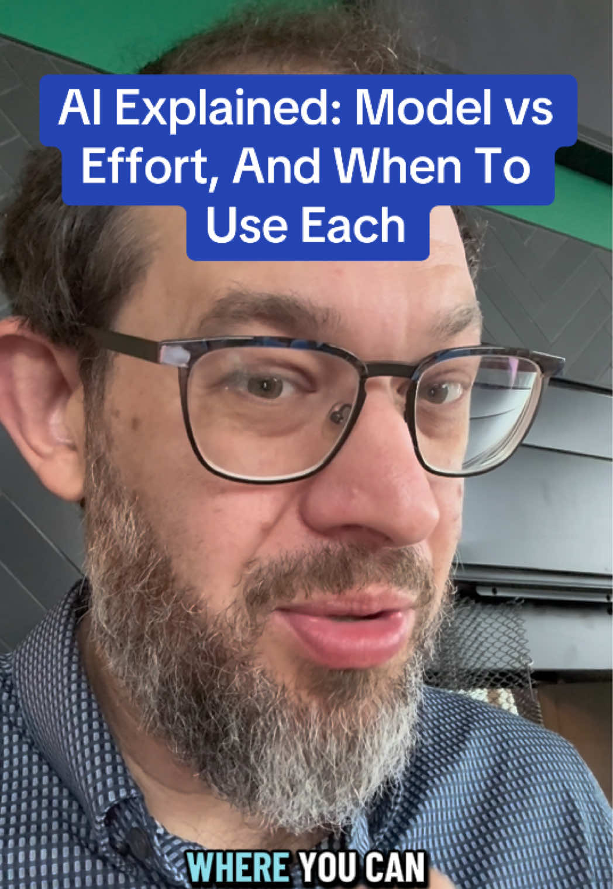

# That’s model vs effort in plain English.

## Transkript

So when do you select model and when do you select effort? We are not in a world where you can just say, go and do it. If you wanna solve an interesting problem or do work with AI, you have to pick a model, you have to pick an effort. And those sometimes feel like the same thing. Here's the difference. The model is what you pick when you want to decide how hard the problem is. And so if it's an especially difficult problem, you have to pick a harder model. So if it's at this point, a basic thing where it's like, just build me this particular Powerpoint or just do this Excel spreadsheet or, please help me craft this email, you can pick the dumbest model you want. It'll be okay if it is, I need this Powerpoint to look professional. And you have to think about the design really hard. Or I have to think through this problem and you have to help me develop an outline. And then I wanna argue with you about it, which I do a lot. As I argue, it's a. It's a secret superpower. Uh, then you want to be in a position where you can ask a hard model. And so that's kind of the rational. Like, if it's a harder problem and yours may be different, right? You may be encoding, you may be, uh, figuring out household logistics that are complicated. It just depends.

The effort. Is different. The effort is, how hard do you want that model to think about it? How much effort does it put in? And what it feels like when you use effort is it feels like giving the car more gas.

And so instead of picking a different car, you're giving the car more gas. And so the gas enables the model to go farther on the problem, to do more steps, to plan and execute a longer task. And so I sometimes dial the effort back, because I find that when you ask the model to do that, it will, but it sometimes oversolves the problem and produces a lot of detail and unnecessary complexity that you don't need. And so you have to be thoughtful about when you use effort and model. But I hope that gives you a sense of it. Cheers. Let me know sort of how that landed and whether that works. Think of it as picking a car versus sort of how much gas you put in.

## Lokales Video

[Video lokal abspielen](medien/2026-10-09-natebjones-thats-model-vs-effort-in-plain-english/02-video.mp4)
