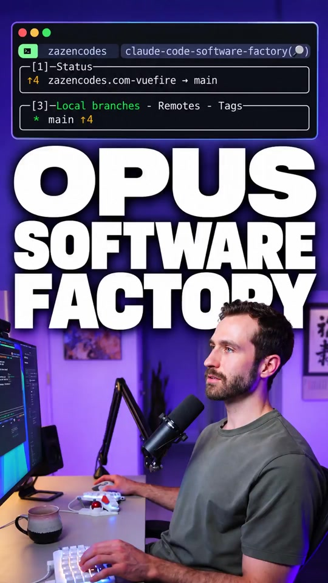

# Here's how to build a Claude Code software factory...

## Caption

Here's how to build a Claude Code software factory... Here I'm building a real feature on my production site. The factory includes subagents that review UX, UI, security and code quality. Here the factory escalated the result for me to review before merging. Watch more in my "Build Your Own AI Software Factory with Claude Code" video on YouTube This video is sponsored by Anthropic. Try Claude Code: http://clau.de/ZazenCodes

## Transkript

Factory works in this loop a feature comes through the spec writer which goes into the builder, which then gets verified by various review agents and once those are done, if we need changes, this happens in a loop and then we go to the approver which either merges to main the feature or we get a human review. And this is a system we can use repeatedly every time we wanna build a new feature for our project. And we could imagine in the future we want you know, we can bring in data sources from the outside world. Let's see if our factory can handle this feature inside my actual website. This is my production site that we're working in right now. And now we can see we're starting to use our subagents. Here's the first one. We're creating a spec using the spec writer background agent and I can see our builder has just started working on this. Okay, sweet. We just went to review and we just kicked off all of our review subagents. So these guys are representing our review. They're doing it. Okay, the UX round finished the UI round finished and they passed. But we're doing the security over here considering. Okay, that's done code review. This is this is epic. Oh, look at this you guys. We can even see the little icons. It's deciding if this feature should be pulled in or not. I'm actually blown away. This is this is How I want to develop features now.

Why have I not done this yet? So what's Opus deciding? It's escalating. So I think it'll go to the human review. There it is. So it's sitting in the human review phase. And now I need to approve this. Click on this. Okay. I can get all sorts of information from the dashboard. Escalate, why the build is clean, every acceptance criteria for the human, if both.

So here's how I would approve it. I would need to know the ID of this feature and then I could run factory approve. Let me do that in a new session. So I'm gonna clear this and I'm gonna say factory approve. And then this. And we're done. It has merged it into my actual code. This is what it did. So it went off onto a branch. It did a few different commits. It kind of built out our feature and then it merged it back. And that merge was done when I approved it. Very cool.

## Lokales Video

[Video lokal abspielen](medien/2026-10-19-zazencodes-factory-works-in-this-loop-a-feature-comes-through-the-spec-writer-which/02-video.mp4)
