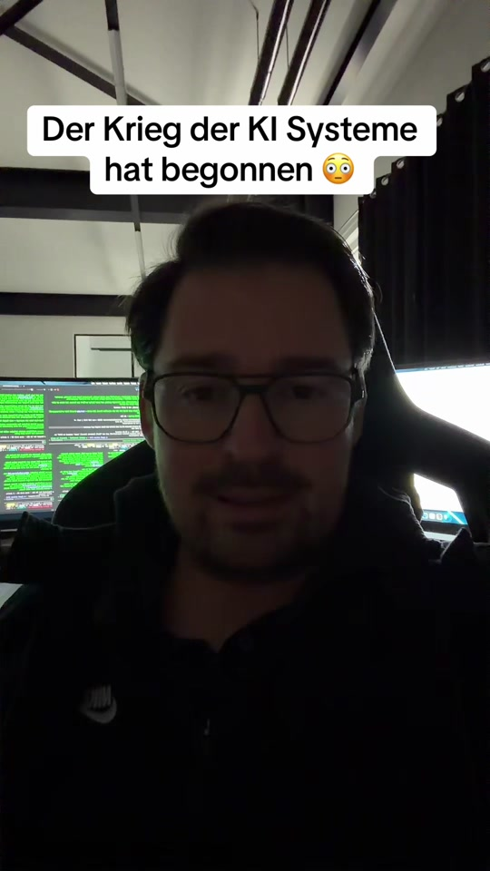

# Sam Oldman der ähm CEO von Open AI wurde im Interview gefragt wie das Thema mit …

## Transkript

Sam Oldman der ähm CEO von Open AI wurde im Interview gefragt wie das Thema mit den AI Security Themen aussieht.

also wie wird es in Zukunft Sicherheits äh Modelle mit KI geben äh weil im Augenblick schaffen die KIs ja alle möglichen Bugs zu finden und zwar Zero Day Bugs. Bugs die schon immer da waren. und er sagt aber das wird nicht reichen. irgendwann werden alle KI Modelle alle bestehenden äh Hacker Vektoren, angriffsvektoren und Bugs gefunden haben.

dann wird es ne ganz neue Art von äh Defense Strategie geben müssen, weil die Kais

äh Hacking Strategien entwickeln werden, wenn man die so trainiert ähm die quasi gar kein Mensch ausdenken kann und die Kais werden die Kais überlisten.

gesagt es wird selbstlande KI Mechanismen geben müssen die und Organisationen, Banken und It Systeme schützen

ähm das heißt KI ist die einzige Waffe um die KI Aus auszuschließen. was sagt ihr? ist es die Zeit wo wir einfach aufhören müssen KI zu entwickeln oder ist die wie heißt das schon der der Geist ist Aus der Flasche, wir kommen nicht mehr

zurück, die Büchse der Pandora ist geöffnet. wir müssen die KI Modelle jetzt mit KI Modellen bekämpfen.

beginnt dieser

cyberkrieg jetzt tatsächlich oder dieser Krieg gegen die KI mit der KI schon jetzt im Internet und wird sich dann irgendwann ausweiten? was ist eure Meinung dazu?

## Lokales Video

[Video lokal abspielen](medien/2026-10-23-promptgefluester-sam-oldman-der-aehm-ceo-von-open-ai-wurde-im-interview-gefragt-wie-das/02-video.mp4)
