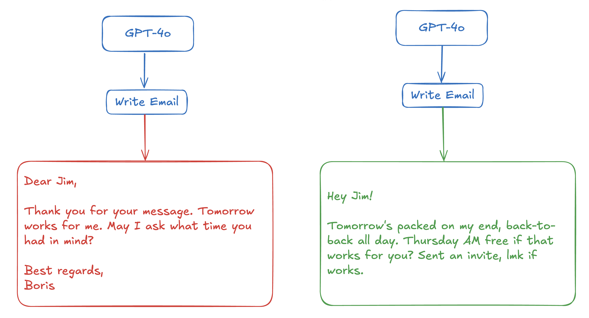
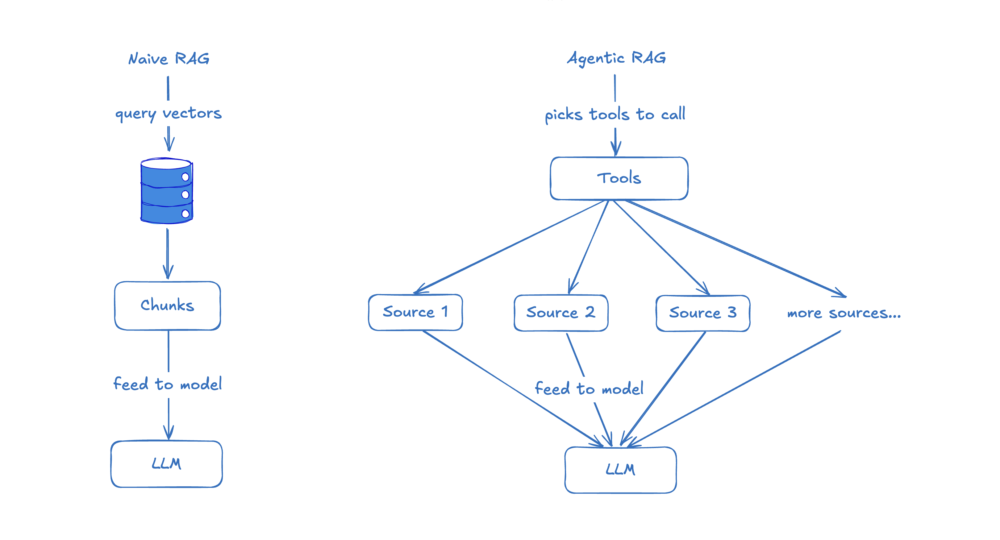
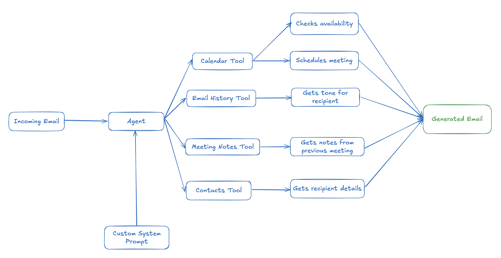

# Context engineering is what makes AI magical

> Automatisch per `python ai.py ingest` erfasst. Quelle: [https://boristane.com/blog/context-engineering/](https://boristane.com/blog/context-engineering/)

## Inhalt

## Context engineering is what makes AI magical

- agents

Everyone’s busy tweaking prompts, swapping models, chaining tools. Yeah, models are getting better. Tools are getting fancier. But none of that matters if your context sucks .

Here’s the uncomfortable truth: the main thing that really matters when building AI agents is the quality of the context you give the model. Models are so good that most SOTA models can do most things with outstanding quality.

Two products could be doing the exact same thing, but one feels magical and the other feels like a cheap demo. The difference? Context.

### What is context?

Context is everything the model sees before it produces tokens. It includes:

- the system prompt (what you tell the model it is)

- the user message (what the user is asking)

- any external information , tools, or retrieved documents you stuff in before the call

- implicit context like who the user is , what they’ve done before, what they want right now, etc.

The better this context, the better the model performs. Garbage in, garbage out, still true in 2025.

### Context > Model

Models are already better than most of us at most tasks. But most AI tools still underperform, not because the model is bad, but because we’re feeding it a half-baked view of the world.

Let’s look at RAG as an example.

Naive RAG just dumps the top 3 chunks into the prompt and hopes for the best. Useful, sometimes. But the moment you move beyond toy examples, this starts to fall apart.

Agentic RAG, builds a contextual snapshot that includes data from multiple sources:

- the question

- related documents

- source structure

- metadata

- and critically, the user’s intent and environment

For example, a coding agent shouldn’t just embed source files and search them. It should know:

- how to find and read any file in your repository

- which files were changed recently

- which files are open in your IDE

- what the LSP says about types and errors

- even what production logs and metrics say

That’s context. And that’s the difference between “meh” and “wow”.

### Email example: the magic of good context

Let’s say you’re a CTO at a startup. You get an email:

> Hey Boris, just checking if you’re around for a quick sync tomorrow. Would love to chat through a few ideas from our last call.

Hey Boris, just checking if you’re around for a quick sync tomorrow. Would love to chat through a few ideas from our last call.

A decent AI email tool will reply like:

> Dear Jim,

Dear Jim,

> Thank you for your message. Tomorrow works for me. May I ask what time you had in mind?

Thank you for your message. Tomorrow works for me. May I ask what time you had in mind?

> Best regards,
Boris

Best regards,
Boris

Who writes emails like this?

A magical agent will do a few things first:

- check your calendar : you’re in back-to-back calls all day.

- look at previous emails to this person : you’re friendly, informal.

- scan recent meeting notes : this person is pitching a joint partnership.

- pull in your contact list : they’re a senior PM at a partner org.

- apply your system prompt customisation : “be concise, decisive, warm”

And finally generate and autonomously send an email that actually is helpful:

> Hey Jim! Tomorrow’s packed on my end, back-to-back all day. Thursday AM free if that works for you? Sent an invite, lmk if works.

Hey Jim! Tomorrow’s packed on my end, back-to-back all day. Thursday AM free if that works for you? Sent an invite, lmk if works.

That’s magic. Not because the model is smarter, but because the context is richer.

### Build context like it’s your product

You wouldn’t build a product without thinking deeply about state, user intent, and interaction history. So why treat your AI agent like a stateless chatbot?

Context engineering is the new prompt engineering.

It means:

- Designing the right structure and format for context

- Knowing what context actually helps the model perform

- Building pipelines to fetch, transform and deliver this context at runtime

- Constantly improving context quality with feedback loops

### TL;DR

- Models are great.

- But context is king .

- Context is the difference between a dumb assistant and a superpowered teammate.

- Build your agents like you build your products: obsess over what they know, when they know it, and how they use it.

If your agent isn’t magical yet, don’t swap the model, fix your context.

I'm also building Polylane , because all software should be self-improving.

## Bilder

