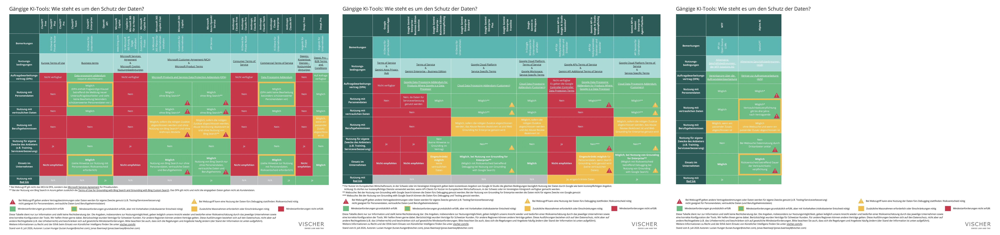
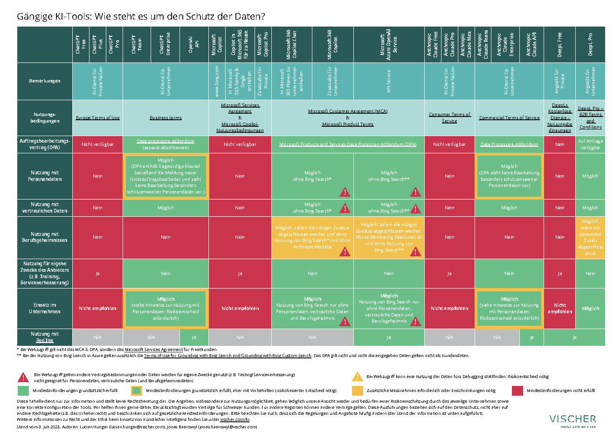
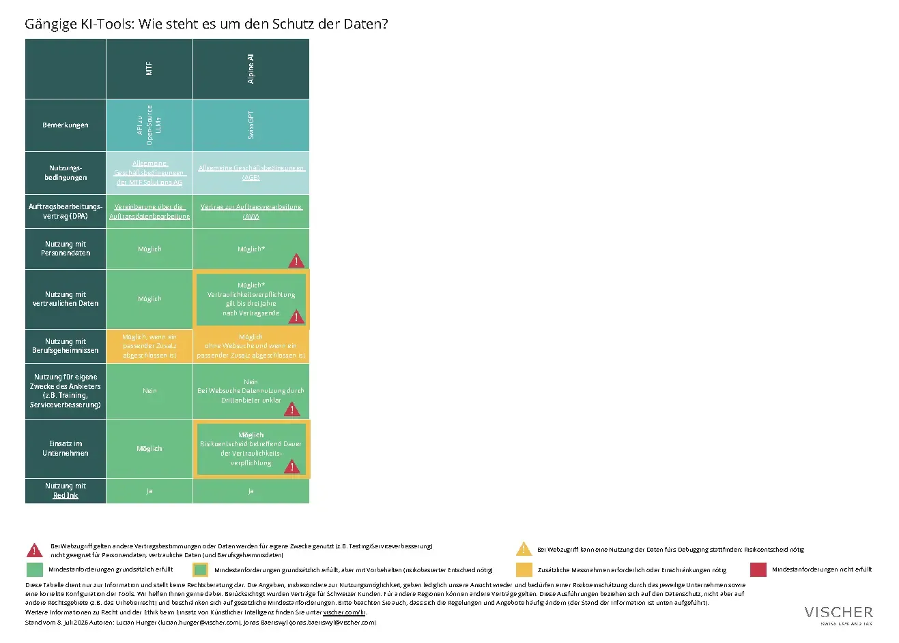

# Teil 31: KI-Tools - Wie es um den Schutz der Daten steht (2026)

> Automatisch per `python ai.py ingest` erfasst. Quelle: [https://www.vischer.com/de/insights/teil-31-ki-tools-wie-es-um-den-schutz-der-daten-steht-2026](https://www.vischer.com/de/insights/teil-31-ki-tools-wie-es-um-den-schutz-der-daten-steht-2026)

## Inhalt

14. Juli 2026

### Teil 31: KI-Tools - Wie es um den Schutz der Daten steht (2026)

Welches KI-Tool dürfen Unternehmen ihren Mitarbeitenden aus Sicht des Datenschutzes und der Geheimhaltung zur Verfügung stellen? Unsere beliebte Übersicht wurde komplexer und grösser. Neu ist Anthropic mit von der Partie, während altbekannte Player ihre Hausaufgaben leider immer noch nicht vollständig gemacht haben. Für Teil 31 unserer KI-Blog-Serie haben wir die beliebtesten Angebote erneut unter die Lupe genommen.

Die Tabelle ist hier zu finden.

Die Angebotsvielfalt an verschiedenen KI-Tools der bisher auf unserer Übersicht vertretenen Anbieter ist auch in den vergangenen 15 Monaten seit unserem letzten Update deutlich gewachsen. Als wichtigster neuer Player neben den drei grossen Anbietern OpenAI, Microsoft und Google ist Anthropic hinzugekommen. Ausserdem ergänzten wir die Übersicht um Angebote von DeepL und einigen Anbietern aus unserem Heimmarkt. Die Aufstellung ist nicht abschliessend, und wir werden sicher Rückfragen bekommen, warum wir nicht auch europäische Angebote wie zum Beispiel Mistral aufführen. Der Grund ist einfach: Wir begegnen ihnen bei den vielen Unternehmen, die wir in diesen Fragen beraten, schlicht nicht. Auch chinesische Anbieter von Sprachmodellen fehlen auf der Liste, weil deren Angebote zwar genutzt werden, aber eben nicht als Dienstleistung. Stattdessen werden ihre (mitunter sehr leistungsfähigen) Open-Source-Modelle auf eigener Infrastruktur oder jener nationaler Provider eingesetzt. Dies ist datenrechtlich die sicherste Variante und es lässt sich bei entsprechender Hardwareausstattung auch gut damit arbeiten – nur scheuen viele Unternehmen nach wie vor die Investitionen für die entsprechende Infrastruktur (von CHF 20k oder mehr).

Bei den schon bisher verzeichneten KI-Tools hat sich in der Gesamtbetrachtung im Ergebnis erstaunlicherweise nichts geändert: Es gibt Lösungen, die sich für den Einsatz im Unternehmen eignen. Nach wie vor gilt dies jedoch nicht für alle KI-Tools und nicht für alle Daten im Unternehmen. Weil die Angebote immer zahlreicher werden, die dazugehörigen vertraglichen Bestimmungen ständig ändern und regelmässig Anbieter- oder gar KI-Tool-spezifische Spezialprobleme dazukommen, bleibt die Compliance-Beurteilung aus Kundensicht eine echte Herausforderung. Die meisten Unternehmen sind damit völlig überfordert. Gleichzeitig ist der Druck aus dem "Business", das Tool X oder Y einzusetzen, so gross, dass auch Lösungen und Optionen zum Einsatz kommen, die rechtlich mangelhaft sind.

Für viel Gesprächsstoff sorgt weiterhin Microsoft, deren "Copilot" für Microsoft 365 sowie Azure OpenAI Services nach wie vor keine aus rechtlicher Sicht befriedigende Lösung für die Internet-Suche (sog. Web-Grounding ) anbietet. Wir können nicht nachvollziehen, warum Microsoft hier keine wirklich datenschutzkonforme Lösung anbieten kann, so wie das zum Beispiel Konkurrent Google macht.

Bei keinem Cloud-Anbieter ist zudem der Abschluss von Verträgen, die den Vorgaben des Berufsgeheimnisses entsprechen, zusammen mit dem Opt-out beim Abuse Monitoring, befriedigend gelöst. Unseres Erachtens stellt in diesem Zusammenhang das menschliche Abuse Monitoring durch die Provider ein Problem dar, im Rahmen dessen diese die Daten beispielsweise zur Überprüfung der Einhaltung der Verträge oder zur allfälligen Meldung an Behörden überwachen. Eine rein automatisierte Vorkehrung, welche mittels rein technischer Massnahmen die KI daran hindert, auf gewisse Anfragen zu antworten oder gewisse Outputs zu filtern, ist aus unserer Sicht im Hinblick auf das Berufsgeheimnis (oder den Datenschutz) nicht problematisch. Sie stellt einen Teil des Services dar, den der Provider dem Kunden zur Verfügung stellt, auch damit dieser nicht selbst Massnahmen (z.B. gewisse Filter) zur konformen Nutzung von KI treffen muss und ist von seinem Auftrag und von seiner Kontrolle gedeckt. Bleibt etwas im Filter "hängen", passiert im doppelten Sinn des Wortes nichts. Solange der Provider die Daten im Klartext nicht einsieht und für weitere Zwecke weiterbearbeitet, ist ein in dieser Art implementiertes Abuse Monitoring unseres Erachtens vertretbar. Anders verhält es sich beim manuellen Abuse Monitoring, wo ein Mitarbeitender des Providers in dessen Auftrag den Sachverhalt zur Kenntnis nimmt. Der Kunde hat keinen Einfluss darauf, welche konkrete Person die Daten wie sichtet, wie diese Person die Daten bewertet und welche Folgemassnahmen (z.B. Kontosperrung, Meldung an Behörden) der Provider ergreift. Es liegt hier typischerweise keine weisungsgebundene Hilfstätigkeit vor. Ist für ein Unternehmen ein Opt-out vom menschlichen Abuse Monitoring bei den Hyperscalern nicht möglich, bieten sich als Alternative lokale Provider an, die mit Open-Source-Modellen zwar nicht ganz so viele Funktionalitäten und Power bieten können, aber trotz allem ein konkurrenzfähiges Angebot haben.

Wenn wir in der Folge über die datenschutzrechtliche Zulässigkeit sprechen, so tun wir dies im Falle internationaler Cloud-Anbieter aus Sicht der EU-Datenschutz-Grundverordnung ( DSGVO ) und dem Schweizer Datenschutzgesetz ( DSG ) und, bei Schweizer Anbietern, aus Sicht des DSG. Die Ausführungen zum Berufs- und Amtsgeheimnis beziehen sich auf die Rechtslage in der Schweiz. Hier finden sich dazu weitere Ausführungen; diese gelten sowohl für das Berufs- als auch das Amtsgeheimnis.

In Bezug auf den öffentlichen Sektor spielt die Rechtslage gegenwärtig allerdings eine nur untergeordnete Rolle, da für die öffentliche Verwaltung der Bezug von KI-Services der Cloud-Anbieter derzeit jedenfalls für jene Stellen, die nicht "unter dem Radar fliegen" können, politisch leider tabu ist. Hierzu haben vor allem die Hardliner unter den kantonalen Datenschutzbehörden beigetragen, die mit aus unserer Sicht rechtlich fragwürdigen Behauptungen etwa zum U.S. CLOUD Act die Ansicht verbreiten, der Einsatz der Cloud sei für Amtsgeheimnisdaten illegal und der risikobasierte Ansatz gelte nicht, was natürlich nicht stimmt. Das hat leider zu einer erheblichen Verunsicherung geführt; wir gehen davon aus, dass es noch ein oder zwei Jahre dauert, bis realisiert wird, dass diese Blockadehaltung auch für den Datenschutz kontraproduktiv ist. Nebst dem Thema des ausländischen Behördenzugriffs ( Foreign Lawful Access ) prägt insbesondere auch der Aspekt der digitalen Souveränität die Diskussion im öffentlichen Sektor. Im privaten Sektor werden diese Fragen wesentlich sachlicher diskutiert (siehe zum Ganzen hier ).

## OPENAI (GPT)

Bei OpenAI hat sich seit dem letzten Update unserer Tabelle im Grundsatz vertraglich nichts verändert. Wir haben unsere Tabelle jedoch etwas detaillierter ausgestaltet und weisen neu auf weitere Risiken hin, die für Unternehmen relevant sind:

- Für Unternehmen sind weiterhin (und wie bei allen Anbietern) die Angebote für Unternehmen zu nutzen. Angebote für Privatkunden sind für einen Einsatz im Unternehmen nicht ausgelegt und auch nicht geeignet.

- Wir weisen in der Tabelle neu darauf hin, dass der Auftragsbearbeitungsvertrag von OpenAI ( OpenAI DPA ) nur auf die Bearbeitung von Personendaten ausgelegt ist, die nicht als besonders schützenswert gelten (dasselbe gilt im Übrigen auch für das DPA von Anthropic). Das ist aus unserer Sicht der Versuch, sich aus der Verantwortung zu nehmen für einen entsprechend erhöhten Standard bei der Datensicherheit. Die meisten Kunden werden dies nicht realisieren, weshalb fraglich ist, ob dieser "Trick" aus Sicht OpenAI (und Anthropic) datenschutzrechtlich funktioniert.

- Zu berücksichtigen ist auch, dass das OpenAI DPA eine fragwürdige Klausel zur Information über den Beizug neuer Unterauftragsbearbeiter enthält. So gibt OpenAI an, dass sie Kunden über alle Änderungen an der Liste der Unterauftragsverarbeiter " per Blogbeitrag, Benachrichtigung innerhalb der Dienste oder auf andere angemessene Weise oder per E-Mail, wenn der Kunde E-Mail-Benachrichtigungen auf der Website der Liste der Unterauftragsverarbeiter abonniert hat ", benachrichtigen. Da diese Kanäle alle alternativ durch OpenAI gewählt werden können, kann der Kunde sich nicht darauf verlassen, dass er die Meldung per E-Mail oder sonst einer Benachrichtigung erhält, denn es könnte auch nur eine Information in einem Blog aufgeschaltet werden. Das führt dazu, dass Kunden, um über Änderungen von Unterauftragsbearbeitern informiert zu werden, diese Kanäle (inkl. Blogs von OpenAI) aktiv überwachen müssen. Diese Regelung ist somit in der Praxis für Kunden nicht nur unpraktikabel, sondern es bestünde im Falle der Mitteilung über blosse Blogposts ein hohes Risiko, dass neue Unterauftragsbearbeiter ohne Wissen des Kunden beigezogen werden und dieser somit seinen Prüfpflichten nicht nachkommen kann.

- OpenAI bietet in ihren Angeboten ebenfalls die Möglichkeit der Websuche an. In den online verfügbaren und in unserer Tabelle verlinkten Standardverträgen sind keine Ausnahmen der Anwendbarkeit der Verträge ersichtlich, weshalb wir davon ausgehen, dass deren Bestimmungen auch auf die Websuche Anwendung finden. Dennoch könnten Ausnahmen gelten, z.B. wenn ein Service zusätzlich genutzt wird, für welchen separate Bedingungen gelten. Den uns von einem Wettbewerber zugetragenen Angaben zufolge setzt OpenAI dieselbe Bing-Websuche wie Microsoft ein und ist damit gar nicht in der Lage, ihre Zusicherungen gemäss Open AI DPA zu erfüllen (gemäss welchen Daten nur mittels Unterauftragsbearbeiter bearbeitet würden), weil Microsoft die Bing-Suche nicht im Rahmen einer Auftragsbearbeitung zur Verfügung stellt. Wir können dies nicht nachprüfen. Es wäre aus unserer Sicht sinnvoll, wenn eine zuständige Aufsichtsbehörde hier, stellvertretend für die vielen Nutzer von OpenAI, einige kritische Fragen stellt, die OpenAI dann auch beantworten müsste.

Selbstverständlich haben auch wir OpenAI kontaktiert, um unter anderem auszuloten, ob eine berufsgeheimniskonforme Nutzung ihrer KI-Tools ermöglicht werden könnte. Wir haben entweder keine oder nicht sachdienliche Antworten eines KI-Roboters erhalten. OpenAI scheint hier kein Interesse an einer aus Kundensicht zufriedenstellenden Lösung zu haben. Für Berufs- und Amtsgeheimnisträger kommt OpenAI somit aus unserer Sicht nicht in Frage, und auch sonst sind Vorbehalte da.

## MICROSOFT (COPILOT, AZURE OPENAI SERVICES)

Microsoft hat seit dem letzten Blogbeitrag die Namensgebung bei Copilot beibehalten. Copilot ist weiterhin in zahlreichen Ausführungen zu haben. Es ist heute schwieriger, Copilot auszuschalten, als diesen Service aktiviert zu lassen, was mitunter erklärt, warum er in Unternehmen heute weit verbreitet ist. Wir haben uns für die vorliegende Übersicht "nur" ausgewählte Varianten für und rund um Office angeschaut, das heisst den in vielen Microsoft 365-Angeboten integrierten Microsoft 365 Copilot Chat sowie die kostenpflichtige Zusatzversion Microsoft 365 Copilot, also nicht etwa Copilot in Tools wie Copilot Studio oder GitHub.

Während die Privatkundenangebote von Microsoft für Unternehmen weiterhin nicht zu empfehlen sind (vgl. dazu Blog 2 ), hat sich die Situation bei Microsoft 365 Copilot Chat (in vielen Microsoft 365-Setups für Geschäftskunden automatisch mit enthalten) und Microsoft 365 Copilot (als Zusatzlizenz) nicht relevant verändert.

- Für die Nutzung der beiden genannten Copilot-Varianten gelten grundsätzlich dieselben Verträge für Geschäftskunden, unter welchen ein Unternehmen auch sonst Microsoft 365 oder Azure-Dienste bezieht. Diese sind mit den allenfalls nötigen Länder- oder Berufs- und Amtsgeheimniszusätzen aus datenrechtlicher Sicht grundsätzlich in Ordnung.

- Sobald aber Copilot, unabhängig von der Version, auf Bing Search (Websuche oder auch Web Grounding genannt) zurückgreift, kommen nicht mehr die für Geschäftskunden üblichen Vertragselemente zur Anwendung, so z.B. das Microsoft Customer Agreement ( MCA ) und Microsofts Auftragsdatenbearbeitungsvertrag ( Microsoft DPA ). Statt der darin erhaltenen Zusicherungen gelten andere Verträge, die auch für Privatkunden gelten. Microsoft hat diese Problematik seit dem letzten Erscheinen unserer Übersicht um zusätzliche Zusicherungen ergänzt, die für die Suchabfragen (sogenannte "Query Data") gelten. Diese Zusicherungen ändern an der rechtlichen Beurteilung in den relevanten Punkten aber nur wenig. Positiv ist, dass Microsoft im Rahmen dieser vertraglichen Ergänzungen verspricht, Kundendaten nicht zur Verbesserung der Services, zum Training von KI-Modellen oder zum Ausspielen von Werbung zu nutzen. Auch wird festgehalten, dass diese Daten als "confidential information" angesehen werden. Was das genau bedeutet, ist unklar. Nötig wäre eine klare Zusicherung, dass diese vertraulichen Informationen auch tatsächlich vertraulich behandelt werden. Diese gibt Microsoft bisher nicht ab. Hinzu kommt, dass in solchen Verträgen jeweils Begriffe zur einheitlichen Verwendung definiert und in den englischen Sprachversionen der Verträge definierte Begriffe gross geschrieben werden. Im MCA wird ein definierter Begriff verwendet: Microsoft verpflichtet sich, " C onfidential I nformation" vertraulich zu behandeln. Selbst wenn also das MCA anwendbar wäre, wäre die Vertraulichkeitsklausel aus dem MCA dabei im Zweifel nicht anwendbar, da in den Web-Grounding-Zusicherungen nicht der definierte Begriff (sondern "confidential information") verwendet wird. Darüber hinaus gilt auch das Microsoft DPA nicht, d.h. Microsoft sieht sich für den Teil, der die Bing-Suche ausführt, als Verantwortlicher und nicht – wie es sein müsste – als Auftragsbearbeiter. Wir gehen davon aus, dass Microsoft entweder nicht in der Lage oder nicht willens ist, ihren Kunden die Zusicherungen eines Auftragsbearbeiters zu geben. Weil Microsoft sich so hartnäckig weigert, dies zu tun, obwohl unzählige Kunden dies verlangen, müssen wir daraus schliessen, dass die Web-Suche bei Copilot (und auch bei Azure OpenAI Services, wo dasselbe Problem besteht) nicht den Anforderungen des Datenschutzes und schon gar nicht des Berufs- und Amtsgeheimnisses genügt und mit den Daten unter Umständen etwas getan wird, das wir als Benutzer nicht wollen. Vorbehalte sind auch in Bezug auf Geschäftsgeheimnisse zu machen und speziell im Bereich des "Legal Privilege", welches voraussetzt, dass Unternehmen entsprechende Daten (z.B. Rechtsrat in einem Rechtsstreit) Dritten nur gegen eine entsprechende Vertraulichkeitszusicherung zugänglich machen, die wir hier nicht haben. Zwar wird Microsoft nicht müde, das Problem kleinzureden und bietet inzwischen bestimmten Kunden auch die Möglichkeit, die Protokollierung der Suchabfragen abzuschalten ("Zero Query Logging"). Dies beseitigt die Schutzlücken und rechtlichen Mängel jedoch nicht. Microsoft hat hier noch Hausaufgaben zu machen, denn ihr Konkurrent Google hat dieses Problem gelöst.

Welche Optionen haben Unternehmen? Eine Möglichkeit besteht darin, die Web-Suche für alle Nutzer auszuschalten. Manche Unternehmen entscheiden sich für diesen Schritt, was allerdings die Attraktivität des Tools massiv mindert. Einzig bei der kostenpflichtigen Zusatzlizenz Microsoft 365 Copilot ist es zudem möglich, dass der Nutzer selbst die Websuche im Einzelfall deaktivieren kann, wobei dies nicht wirklich benutzerfreundlich gelöst ist. Die Einstellung dazu versteckt sich in einem Kontextmenü. Hinzu kommt, dass die Unterscheidung zwischen "web" und "work" bei der Nutzung der aufpreispflichtigen Lizenz verwirrend ist, weil viele Benutzer "work" so verstehen, dass die problematische Web-Suche hier nicht stattfindet, was aber nicht richtig ist. Aber auch im Modus "work" kann diese Websuche nach unserem Kenntnisstand erfolgen, ausser die Websuche wurde vom Administrator für alle oder durch den Nutzer im Einzelfall deaktiviert.

Andere Unternehmen weisen ihre Mitarbeitenden an, bei Abfragen von Copilot keine Personendaten und keine vertraulichen Informationen zu nutzen. Rechtlich ist die Situation zwar vergleichbar mit dem Fall, dass Mitarbeitende eine Abfrage in einer Internet-Suchmaschine machen. Auch die Suchmaschinenanbieter sind keine Auftragsbearbeiter und Vertraulichkeit sichern sie meist auch nicht zu. Allerdings ist es dort der einzelne Benutzer, der kontrolliert, welche Suchbegriffe er eingibt, und der Service wird nicht vom Arbeitgeber bzw. Unternehmen bereitgestellt, sondern vom Mitarbeitenden aus dem Internet aufgerufen. Bei Tools wie Copilot kann der Benutzer nicht steuern und weiss in aller Regel nicht einmal, welche Teile seiner Anfrage an die Suchmaschine übergeben werden, was das Schutzniveau beeinträchtigt. Das wird zwar bei vielen Abfragen kein wirkliches Problem sein, aber auch unsere Tests zeigen, dass durchaus sensitive Informationen via Web-Suche in den nicht hinreichend geschützten Bereich gelangen können. Wir hoffen, dass Microsoft die Defizite bei ihrem weitverbreiteten Tool zeitnah löst.

Copilot zeigt übrigens auch, wie sehr die Nutzer von Cloud-Lösungen bei der Konfiguration ihrer Dienste auf der Hut sein müssen: So führte Microsoft aufgrund von Performance-Problemen zum Ärger vieler Datenschutzstellen vor Kurzem die Funktion "Flex Routing" ein, bei welcher KI-Antworten für einen besseren Lastenausgleich nicht mehr ausschliesslich in Europa generiert werden, sondern auch in Rechenzentren auf der ganzen Welt bearbeitet werden können. Datenschutzrechtlich ist das nicht zu beanstanden, für Berufsgeheimnisse beispielsweise wäre es aus unserer Sicht aber nicht akzeptabel. Heikel an dieser Sache ist, dass die vertraglichen Regelungen durch den Umstand ausgehebelt werden, dass die Bearbeitung ausserhalb der "EU Data Boundary" im Kleid einer "Dienstleistung" umgesetzt und Berichten zufolge mitunter sogar stillschweigend aktiviert wurde. Es bekräftigt unsere Empfehlungen, dass die Konfigurationen von Cloud-Services regelmässig zu überprüfen sind.

Bei der Nutzung von Azure OpenAI Services über einen Geschäftskundenvertrag gelten grundsätzlich die geschäftlichen Verträge und eine Nutzung im Unternehmen ist möglich. Auch hier macht Microsoft dieselbe Ausnahme wie vorstehend eingehend beschrieben, sobald Bing Search genutzt wird: Auch in diesem Fall gilt das Microsoft DPA nicht mehr, wobei die eingegebenen sowie die generierten Daten nicht mehr als Kundendaten im Sinne des MCA gelten und nicht durch eine hinreichende Vertraulichkeitsverpflichtung geschützt sind. Wir verweisen auf unsere obigen Ausführungen. Ob ein Web-Zugriff durch das Modell erfolgt, wird bei einer API-Schnittstelle über den Aufruf des Sprachmodells von der Anwendung gesteuert, welche die Schnittstelle nutzt. Das Unternehmen kann also kontrollieren, ob die Web-Suche zum Einsatz kommt. Kommt sie zum Einsatz, liegt es allerdings wieder alleine am Modell, wie es aus der Anfrage an das Sprachmodell und dem gelieferten Kontext die Suchabfrage formuliert.

Bei Microsoft ist eine Nutzung von Copilot und Azure OpenAI Services mit Berufs- und Amtsgeheimnissen möglich, sofern die nötigen Zusätze abgeschlossen sind, ein allfälliges Abuse Monitoring deaktiviert ist und zudem die Bing-Suche nicht mit Daten genutzt wird, die dem Berufs- oder Amtsgeheimnis unterliegen. Positiv zu vermerken ist, dass es auch für kleinere und mittlere Unternehmen ohne Weiteres möglich ist, an die erwähnten Vertragszusätze zu gelangen. Es sei diesbezüglich auch auf die Ausführungen in den vorangegangenen Blogs verwiesen ( Blog 2 , Blog 25 ). Zusätzlich zu berücksichtigen ist bei einem Bezug der Microsoft-Dienstleistungen über einen Cloud Solution Provider ( CSP ), dass die für das Berufs- und Amtsgeheimnis notwendigen Zusätze (und auch die weiteren Vertragszusätze) nicht in einem formellen Prozess abgeschlossen werden, weshalb Unternehmen unseren Workaround für die fehlende Unterschrift bei Microsoft-Cloud-Verträgen anwenden sollten. Weniger positiv ist, dass das bei der Nutzung der OpenAI Services erforderliche Abuse-Monitoring-Opt-out bei Microsoft derzeit nur den Kunden offensteht, welche von Microsoft direkt betreut werden. Microsoft ist jedoch daran, einen neuen Prozess zu erproben und hoffentlich einzuführen, mit welchem jedenfalls bestimmte Berufsgruppen wie etwa Anwaltskanzleien auch dann das Abuse-Monitoring-Opt-out erhalten, wenn sie "nur" über einen CSP ihre Microsoft-Dienstleistungen beziehen (und nicht direkt von Microsoft).

Neu ist zudem anzumerken, dass im Microsoft-DPA für den Beizug neuer Unterauftragsbearbeiter, welche KI-Dienste erbringen, nur noch eine Ankündigungsfrist von 30 Tagen gilt und nicht mehr die bisher bei Microsoft übliche Ankündigungsfrist von sechs Monaten. Immerhin bietet Microsoft den Kunden an, den Einsatz eines solchen Unterauftragsbearbeiters für mindestens sechs Monate nach der Ankündigung zu deaktivieren.

## ANTHROPIC (CLAUDE)

Neu aufgenommen in die Tabelle haben wir die Anthropic Claude Modelle, einerseits diverse Angebote für Private und anderseits die drei Business-Angebote "Team", "Enterprise" und "API". Wie bei allen anderen Angeboten der anderen Anbieter sind auch bei Anthropic die Angebote für Privatkunden nicht für Unternehmen geeignet. Die geschäftlichen Angebote hingegen verfügen über einen Auftragsdatenbearbeitungsvertrag ( Anthropic DPA ), eine entsprechende Vertraulichkeitsverpflichtung und eine Zusicherung, dass die Daten nicht fürs Training oder zur Serviceverbesserung genutzt werden. Ein Einsatz im Unternehmen ist somit aus unserer Sicht grundsätzlich möglich, wobei Folgendes zu beachten ist:

- Das Anthropic DPA sieht nur die Bearbeitung von nicht besonders schützenswerten Personendaten vor. Für die Bearbeitung von besonders schützenswerten Personendaten im Sinne des DSG sind die Claude-Modelle mit der online verfügbaren Version des Anthropic DPA somit nicht geeignet; es gilt dasselbe wie für OpenAI. Selbst bei klaren Anweisungen an die Mitarbeitenden kann es vorkommen, dass Mitarbeitende (versehentlich oder absichtlich) Anthropic-Dienste mit besonders schützenswerten Personendaten nutzen. Jede Organisation muss schlussendlich für sich entscheiden, ob sie die damit verbundenen Risiken eingehen will. Wie schon OpenAI scheint auch Anthropic kein Bedürfnis zu haben, ein für besonders schützenswerte Personendaten hinreichend hohes Datenschutzniveau zu bieten. Hier zeigen sich bei OpenAI wie auch bei Anthropic die nach unserer Ansicht geringere Maturität der "Newcomer" in Sachen Datenschutz und Datensicherheit im Vergleich zu den Hyperscalern Microsoft, AWS und Google. Wir empfehlen daher für sensible Anwendungen ausschliesslich die Verwendung der Wunschmodelle dieser Anbieter auf den Systemen der etablierten Hyperscaler, da sie die Modelle von OpenAI wie auch von Anthropic ebenfalls anbieten (dazu unten).

- Für Berufs- und Amtsgeheimnisdaten sind auch die Geschäftsverträge nicht ausreichend und uns sind keine Vertragszusätze oder andere Lösungsansätze bekannt, welche eine Nutzung mit solchen Daten ermöglichen würden. Wir beobachten zwar eine hohe Nachfrage nach den Modellen von Anthropic, aber für Anwendungen im Bereich des Berufs- oder Amtsgeheimnisses sollten sie nicht von Anthropic, sondern von den Hyperscalern bezogen werden (dazu unten). Anthropic selbst war bisher ebenfalls nicht bereit, Gespräche zum Thema zu führen.

## DEEPL

Neu aufgenommen in unsere Übersicht haben wir auch DeepL, wobei wir die Versionen DeepL Free und DeepL Pro berücksichtigt haben. Wenig überraschend ist auch bei DeepL die kostenlose Version im Unternehmen nicht empfohlen, zumal die eingegebenen Daten von DeepL für diverse eigene Zwecke genutzt werden dürfen. Sollen Texte mit Personendaten oder sonst vertraulichen Daten übersetzt werden, ist hierfür ein DeepL Pro Abonnement nötig.

Für DeepL sind uns jedoch auch keine Standard-Zusätze für Berufs- und Amtsgeheimnisdaten bekannt. Ohne besondere Vereinbarung muss damit gerechnet werden, dass DeepL Daten auch ausserhalb Europas, insbesondere auf Rechenzentren in den USA, bearbeitet. Nach unserer Erfahrung ist es jedoch bei entsprechendem Vertragsvolumen möglich, Anpassungen an den Verträgen zu verhandeln und so auch Bestimmungen zur Nutzung mit Berufs- und Amtsgeheimnisdaten abzuschliessen.

Hier ist die ganze Tabelle zu finden.

## GOOGLE (GEMINI)

Google hat weitere neue Angebote herausgebracht, so insbesondere Google Gemini Enterprise in diversen unterschiedlichen Versionen, und bestehende Angebote umbenannt. Kurz gesagt, sind auch bei Google die Versionen für Private, aber auch kostenlose Versionen für Geschäftskunden (z.B. Google Gemini Enterprise – Business Edition kostenlos) nicht für den Einsatz im Unternehmen geeignet, da sie entweder unter einem Privatkunden-Vertrag bezogen werden oder aber eine Nutzung der Daten für eigene Zwecke von Google stattfindet. Für Unternehmen grundsätzlich geeignet sind Angebote, die Teil der Google Cloud Platform ( GCP ) sind und so unter den "Google Cloud Terms of Service" ( GCP-Vertrag ) bezogen werden. Anzumerken ist in diesem Zusammenhang, dass gewisse Angebote für Unternehmen nicht unter dem GCP-Vertrag bezogen werden, sondern unter verschiedenen anderen Verträgen, die jeweils im Detail geprüft werden müssen.

Auch bei den Diensten, die unter dem GCP-Vertrag bezogen werden, sind jeweils nicht alle für jeden Einsatz geeignet und gerade bei der Nutzung von Web Grounding (d.h. Web-Suche) über die Gemini-Angebote können die Daten in gewissen Varianten für das Debugging durch Google gespeichert werden. Immerhin bietet Google anders als Microsoft auch eine "Enterprise"-Version des Web Grounding ( Web Grounding for Enterprise ) bei der Nutzung der Gemini-Modelle via API an, wobei keine Speicherung für das Debugging erfolgt und der Einsatz mit Berufs- und Amtsgeheimnisdaten möglich ist, sofern die weiteren Voraussetzungen hierzu erfüllt sind (siehe dazu die nachfolgenden Ausführungen zum Berufs- und Amtsgeheimnis). Unseres Wissens ist Google damit bisher der einzige Anbieter, der dies tut. Einmal mehr zeigt sich, dass die service-spezifischen Bedingungen der Hyperscaler jeweils im Detail zu prüfen sind.

Die Angebote von Google können über das Web oder als App ( Nutzung über das UI ) genutzt werden (so beispielsweise Google Gemini Enterprise) oder integriert in Google Workspace. Ausserdem sind sie als API-Dienst verfügbar, sodass die KI-Modelle in eigenen Systemen genutzt werden können (so beispielsweise mit " Red Ink "). Wie nachfolgend dargelegt, gilt es zu beachten, dass dabei nicht alle Angebote wirklich für einen Einsatz im Unternehmen geeignet sind, auch wenn die Bezeichnung des Services diese Erwartung weckt.

Bei der Nutzung über das UI sowie bei Google Workspace sind folgende Hinweise zu beachten:

- Google Gemini Enterprise – Business Edition : Bei der kostenlosen Version ("Unpaid"), die nicht unter dem GCP-Vertrag bezogen wird, können die Daten durch Google für eigene Zwecke genutzt werden. Bei der kostenpflichtigen Version gab es leider eine Verschlechterung des Angebots. Bisher stand im Vertrag: " For Paid Services and during the Trial Period, Google will not use Your Content to improve our products. " Diese ausdrückliche Zusicherung wurde leider entfernt. Während in Bezug auf "Paid Services" weiterhin aus dem Vertrag hervorgeht, dass die Daten nicht zur Serviceverbesserung genutzt werden, ist dies im Vertragstext für allfällige Testzeiträume nicht mehr klar geregelt. Es gibt auch keine allgemeine Geheimhaltungsklausel, weshalb die Eignung für vertrauliche Daten nicht gegeben ist – damit fällt das Angebot für den Unternehmenseinsatz bereits durch. Ein Data Processing Addendum gibt es zwar, welches auf eine Liste mit Datenkategorien verweist. In dieser Liste werden für diverse Services Datenkategorien definiert, aber nicht für die "Google Gemini Enterprise – Business Edition". Dies bedeutet zusammengefasst: Auch wenn der Service "Business Edition" heisst, ist er weder in der kostenlosen noch in der kostenpflichtigen Version wirklich für den Einsatz im Unternehmen geeignet.

- Google Gemini Enterprise Standard, Plus oder Frontline : Dieses Angebot wird unter dem GCP-Vertrag bezogen und ist grundsätzlich für einen Einsatz im Unternehmen geeignet. Bei der Nutzung der Websuche ( Grounding with Google Search ) kann Google jedoch die Daten für drei Tage für eigene Debugging-Zwecke speichern. Diese Nutzung für eigene Zwecke durch Google wird zwar über eine im Vertrag vorformulierte Weisung formal zum Teil der Dienstleistung erklärt und damit von Google als Bearbeitung für den Kunden angesehen. Datenschutzrechtlich wird dies für manche aber problematisch sein, weil sie die Bearbeitung ihrer Personendaten nur für ihre eigenen Zwecke (d.h. Zwecke des Kunden) zulassen wollen. Gelöst werden könnte dies durch die Nutzung von Web Grounding for Enterprise; für uns ist jedoch nicht klar, ob dieser Service bei Gemini Enterprise Standard, Plus oder Frontline zur Verfügung steht.

- Google hat, wie bereits in Blog 25 ausgeführt, ihre KI Gemini (inkl. Search Grounding) auch in Workspace integriert. Bisher bot Google dieses Angebot unter spezifischen Google Workspace Terms of Service an; neu gilt für diese Services auch der GCP-Vertrag und eine Nutzung im Unternehmen ist grundsätzlich möglich. Für Google Workspace gibt es aber separate Service Specific Terms, welche interessanterweise für die Nutzung von Search Grounding keine Hinweise auf eine Nutzung für Googles eigene Zwecke (z.B. Debugging, Testing) enthalten (siehe auch dazu die Ausführungen in Blog 25 .

Auch bei der Nutzung von API-Diensten gibt es gewisse Aspekte zu beachten:

- Bei der Nutzung der Gemini API in Google AI Studio gibt es eine kostenlose und eine kostenpflichtige Variante; in beiden Fällen ist nicht der GCP-Vertrag anwendbar (siehe dazu auch Blog 25 ). In der kostenlosen Version können die Daten für eigene Zwecke von Google genutzt werden, wobei aber für Nutzer im Europäischen Wirtschaftsraum, in der Schweiz und im Vereinigten Königreich auch bei der Nutzung der kostenlosen Version die Bedingungen der kostenpflichtigen Version gelten. In der kostenpflichtigen Version kommt ein Data Processing Addendum zur Anwendung, jedoch fehlt eine allgemeine Vertraulichkeitsklausel, sodass die Eignung für vertrauliche Daten entfällt. Hinzu kommt, dass bei der Nutzung von Grounding mit Google Search bei diesem Service die Daten nicht nur für das Debugging, sondern auch für das Testing genutzt werden und somit eine weitergehende Nutzung der Daten für eigene Zwecke von Google stattfindet als bei der Nutzung über das UI. Die Services sind somit für vertrauliche Daten nicht geeignet und ebenso wenig für Personendaten, zumindest so lange auch die Websuche genutzt wird. Unternehmen sollten daher besser auf andere Angebote ausweichen, welche eine uneingeschränkte Nutzung ermöglichen.

- Die Nutzung der Gemini API über die Gemini Enterprise Agent Platform (ehemals Vertex AI) erfolgt im Gegensatz zum Google AI Studio unter dem GCP-Vertrag und ist somit grundsätzlich für eine Nutzung im Unternehmen geeignet. Bei der API stehen zudem die beiden Grounding-Optionen zur Verfügung, einmal Grounding mit Google Search, bei welchem eine Speicherung der Abfragen für das Debugging vorbehalten bleibt (siehe oben) sowie auch die Möglichkeit der Nutzung von Web Grounding for Enterprise, bei welchem diese Speicherung der Webabfragen und Nutzung für das Debugging gemäss Vertrag nicht stattfindet. Somit steht bei der API eine Art des Web Groundings zur Verfügung, welche datenschutzkonform sowie mit Berufs- und Amtsgeheimnisdaten (siehe nachfolgend) konform genutzt werden kann.

Sofern ein Zusatzvertrag für das Berufs- und Amtsgeheimnis abgeschlossen wurde, das Abuse Monitoring deaktiviert ist und Web Grounding nicht genutzt wird (oder, sofern verfügbar, Web Grounding for Enterprise genutzt wird), ist auch eine Nutzung mit Berufs- und Amtsgeheimnisdaten grundsätzlich möglich. Als weitere Massnahme sollte die Datenspeicherung im eigenen Land und für die Datenbearbeitung im Ausland eine Zero Data Retention (keine Speicherung der Anfragen an die KI) vorgesehen werden. Die Zero Data Retention setzt bei Google voraus, dass das Caching deaktiviert wird. Ferner empfehlen wir die Einrichtung von "Access Approval", d.h. Zugriffe durch Mitarbeitende von Google erfolgen grundsätzlich nur mit Genehmigung des Kunden (das Pendant zur "Customer Lockbox" bei Microsoft). Die verbleibende Wahrscheinlichkeit eines Foreign Lawful Access ist separat zu beurteilen. Bei Google wie auch Microsoft setzt sich dabei der Trend weg von national festgelegten Bearbeitungsorten fort: Konnten ursprünglich die Top-Modelle noch in der Schweiz bezogen werden, wurden sie in der Folge nur noch in ausgewählten Rechenzentren im EU-Ausland angeboten. Inzwischen bietet Google seine Modelle teilweise nur noch so an, dass sie irgendwo in der EU laufen, um auf diese Weise die Last besser zu verteilen.

Ein Zusatz für das Berufs- und Amtsgeheimnis ist bei Google allerdings nicht so einfach zu erhalten wie bei Microsoft (wo jeder Reseller, d.h. jeder CSP, diesen vermitteln kann). Zwar kann der "gewöhnliche" Vertrag für die Google Cloud Platform online abgeschlossen werden. Für den erwähnten Zusatz braucht es jedoch einen Vertrag mit sog. Offline-Billing, d.h. einen manuell vermittelten Vertrag, den Google üblicherweise nur grösseren Kunden anbietet. Will eine kleinere Institution (wie z.B. eine Anwaltskanzlei) einen solchen Vertrag erhalten, ist dies normalerweise nur über entsprechende Kontakte möglich und kann mehrere Monate dauern. Immerhin konnten wir bereits etliche solche Verträge vermitteln (siehe dazu hier ). Wir hoffen, dass dieser manuelle, informelle Prozess in Zukunft in der einen oder anderen Weise automatisiert oder schneller gestaltet werden kann. Heute ist es jedoch leider so, dass es für Berufs- und Amtsgeheimnisträger zwar über Kniffe möglich jedoch sehr beschwerlich ist, an entsprechende KI-Verträge der Hyperscaler zu gelangen.

AWS – der Dritte im Bunde – hat bisher übrigens für kleinere Institutionen noch kein offizielles Angebot; wir sind aber auch mit AWS in Kontakt mit dem Ziel, eine Lösung zu finden. Generell dauern solche Bemühungen bei allen drei Hyperscalern leider oft Monate oder Jahre, was in den meisten Fällen vor allem mit Bürokratie und weniger geschäftlichen oder rechtlichen Aspekten zu tun hat.

Hier ist die ganze Tabelle zu finden.

## ANTHROPIC VIA HYPERSCALER

Alle drei Hyperscaler – Microsoft, AWS und Google – bieten ihren Kunden auch die Möglichkeit, die Modelle von Anthropic zu nutzen. Diese laufen dann entweder auf den Rechenzentren der Hyperscaler oder Anthropic wird vom betreffenden Hyperscaler als Unterauftragsbearbeiter (z.B. im Falle von Microsoft Copilot) eingesetzt.

Bei Microsoft kommt diese Variante derzeit beispielsweise bei Copilot zum Tragen, wo Kunden die Möglichkeit gegeben wird, Anthropic-Modelle als Alternative zu den GPT-Modellen für Copilot zu nutzen. Derzeit findet dann die Bearbeitung der Daten bei Anthropic auf Systemen in den USA statt. Das ist datenschutzrechtlich nicht zu beanstanden, da Microsoft sich gegenüber dem Kunden über ihr Microsoft DPA verpflichtet, für den nötigen Schutz der Daten zu sorgen und die entsprechenden Pflichten auch den Unterauftragsbearbeitern zu überbinden. Daran ändert auch der Umstand nichts, dass Anthropic nicht unter dem Data Privacy Framework ( DPF ) zertifiziert ist; Microsoft ist vertraglich und über das DPF verpflichtet, Anthropic richtig vertraglich einzubinden. Für Berufs- und Amtsgeheimnisse kommt diese Variante allerdings nicht in Frage. Immerhin haben wir vernommen, dass geplant sei, dass Anthropic seine Modelle gegen Ende Jahr auch auf Rechenzentren in Europa betreiben will.

Bei Hyperscalern werden die Anthropic-Modelle bei gewissen Angeboten quasi als Kopie auf deren Rechenzentren betrieben. Das ermöglicht den Bezug unter den Verträgen der Hyperscaler, die für sensible Anwendungen geeigneter und für Berufs- und Amtsgeheimnisdaten mit den nötigen Zusätzen auch tatsächlich möglich sind – und dies je nach Fall auch in Europa (wenngleich zu verhältnismässig hohen Preisen). Die Situation mit AWS und Microsoft Azure haben wir nicht näher geprüft, im Falle von Google kommt die Vertragsbeziehung jedoch mit Google zustande, auch wenn der Kunde zustimmt, die Anthropic Terms of Service zu "befolgen", wenn der Zugang zu den Anthropic-Modellen aktiviert wird. Wir gehen davon aus, dass Anthropic dies den Hyperscalern so vorgibt, um sicherzustellen, dass ihre Modelle wie von ihr vorgegeben genutzt werden. Gemäss Anthropics Angaben in ihren Service Specific Terms hat Anthropic zumindest im Falle von Google weder Zugriff auf die Google Cloud-Plattformumgebung des Kunden noch auf die dort bearbeiteten Inputs und Outputs. Anthropic sieht und überwacht die Daten des Kunden und deren Bearbeitung demnach nicht, wenn ihre Modelle über Google bezogen werden – dies erfolgt in diesen Fällen im Rahmen des Abuse Monitorings nur (aber immerhin) durch Google. Davon ausgenommen sind nach unserem Verständnis sogenannte Covered Models, bei welchen Anthropic auch bei der Nutzung ihrer Dienste über einen Hyperscaler Zugriff auf Kundendaten hat (z.B. für das Abuse Monitoring), und sich dabei zur Einhaltung des Anthropic DPA verpflichtet. Ferner werden bei der Nutzung von Anthropic-Diensten teilweise spezifische Funktionen wie die Websuche unterstützt. Dabei muss jeweils im Einzelfall geprüft werden, welche datenrechtlichen Zusicherungen die Anbieter machen (und, vor allem, welche sie nicht machen).

## SCHWEIZER ANBIETER

Neu haben wir auch erste Schweizer Anbieter in unserer Tabelle mitaufgenommen, die angeben, die Anforderungen im Bereich von Berufs- und Amtsgeheimnissen zu erfüllen. Als Grundlage haben wir die von den Anbietern online publizierten Verträge analysiert. Für das Berufs- und Amtsgeheimnis haben wir einen standardisierten Vertragszusatz entworfen, der von den Schweizer Providern verlangt werden sollte. Er ergänzt den Auftragsdatenbearbeitungsvertrag und die allgemeinen Vertragsbedingungen. Dieser Vertragszusatz ist hier kostenlos zu beziehen.

Hier ist die ganze Tabelle zu finden.

## WAS TUN WIR?

Wir als Kanzlei haben uns bewusst gegen die gängigen Tools insbesondere auch gegen ChatGPT und Copilot entschieden, weil uns diese Produkte entweder nicht den nötigen Schutz unserer Daten bieten (ChatGPT) oder funktional und in Bezug auf ihre Leistung nicht überzeugen (Copilot). Wir setzen das von uns entwickelte Schweizer Produkt "Red Ink" ein, welches die Nutzung aller gängigen Modelle, auch on-prem, ermöglicht, unter anderem in Microsoft Office integriert ist und dort wesentlich mehr als die anderen Produkte bietet (mehr Informationen hier ). Wir setzen die Gemini-Modelle von Google unter einem Google-Vertrag mit Berufs- und Amtsgeheimniszusatz und Abuse Monitoring Opt-out sowie Zero Data Retention auf Rechenzentren in der EU ein, einschliesslich uneingeschränkter Web-Suche. Daneben nutzen wir Microsoft Azure OpenAI Services als "second source" mit den aktuellen GPT-Modellen – ebenfalls mit einem berufs- und amtsgeheimniskonformen Vertrag und Abuse-Monitoring-Opt-out (dort allerdings ohne Web-Suche). Weiter bieten wir unseren Mitarbeitenden den Zugang zu Perplexity, OpenAI (direkt) und Anthropic an, allerdings nicht für sensible Daten. Indem wir die KI direkt über eine API nach dem Pay-as-you-go-Verfahren beziehen, fahren wir punkto Kosten wesentlich günstiger als andere Unternehmen, und können den Zugang auch besser steuern. Wir haben unsere Lösung allerdings auch mit leistungsfähigen Open-Source-Modellen getestet (auf Systemen des Schweizer Anbieters onprem.ai ) und waren positiv überrascht über die hohe Geschwindigkeit und Qualität, die sich mittlerweile erreichen lässt, wenn die Modelle richtig konfiguriert und auf geeigneten Systemen eingesetzt werden.

## WAS GILT ES SONST NOCH ZU BEACHTEN?

Nebst dem Zugang zu den Sprachmodellen erinnern wir daran, dass einerseits auch die Datensicherheits- und Datenschutzkonformität der verwendeten Software zu berücksichtigen ist (insbesondere im agentischen Betriebsmodus) und andererseits der Zugriff auf weitere Datenquellen datenschutz- und datensicherheitsrelevant sein kann. Wir werden uns zu diesem Thema noch separat äussern; es stellt heute jedoch nach unserer Beobachtung oft einen blinden Fleck beim Einsatz von KI dar. Denn: Die oben erwähnte Problematik bei der Web-Suche von Copilot stellt sich im Grunde bei jedem KI-System, welches auf fremde Datenquellen (z.B. MCP-Server bzw. Konnektoren) zugreift. Auch der unkontrollierte Bezug von Daten wirft datenschutzrechtliche Fragen auf. Es genügt mit anderen Worten nicht mehr, sich nur mit dem datenschutzkonformen Bezug von KI-Leistungen zu befassen – es muss das gesamte Ökosystem im Blick behalten werden.

Dieser Beitrag ist Teil einer Serie über den verantwortungsvollen Einsatz von KI im Unternehmen:

- Teil 1: KI am Arbeitsplatz: Die drei wichtigsten Punkte für Mitarbeitende

- Teil 2: Gängige KI-Tools: Wie steht es um den Datenschutz?

- Teil 3: KI: 11 Grundsätze – und eine Weisung für Mitarbeitende

- Teil 4: So beurteilen Sie Risiken von kleinen und grossen KI-Projekten

- Teil 5: KI-Governance im Unternehmen – wer ist verantwortlich?

- Teil 6: Die andere Seite der Medaille: Wo wir KI vor Angreifern schützen müssen

- Teil 7: Der EU AI Act – und was er für die meisten Unternehmen bedeutet

- Teil 8: KI im Finanzinstitut – Chancen und Herausforderungen

- Teil 9: KI im Marketing: 4 wettbewerbsrechtliche Fallstricke

- Teil 10: Urheberrecht und KI: Verantwortlichkeit von Anbietern und Nutzern

- Teil 11: Fair Play mit KI: Wie Sportorganisationen Athletendaten nutzen dürfen

- Teil 12: Datenfutter für KI: So gelingt die Kommerzialisierung von Datensätzen

- Teil 13: KI im Personalwesen

- Teil 14: Urheberrecht und KI: Schutzmassnahmen in der Praxis

- Teil 15: Worauf rechtlich beim Einsatz von KI-Providern zu achten ist

- Teil 16: Wie Unternehmen beim Einsatz von KI Transparenz gewährleisten können

- Teil 17: Was in einem KI-Modell steckt und wie es funktioniert

- Teil 18: Die wichtigsten Compliance-Vorgaben für KI

- Teil 19: Sprachmodelle mit und ohne personenbezogene Daten

- Teil 20: Risiko-basierter Ansatz: Nicht alle KI-Anwendungen bergen hohe Risiken

- Teil 21: Das Auskunftsrecht bei grossen Sprachmodellen

- Teil 22: Leitsätze für den Einsatz künstlicher Intelligenz in Finanzinstituten (FINMA)

- Teil 23: Schweiz: Was konkret an KI-Regulierung zu erwarten ist - VISCHER

- Teil 24: Fünf Trigger-Fragen für mehr KI-Compliance

- Teil 25: KI-Tools – wie es um den Schutz der Daten steht

- Teil 26: Training von KI: Was Urheberrecht, Datenschutz & Co. erlauben

- Teil 27: Wie kleine und mittlere Unternehmen KI rechtskonform einsetzen

- Teil 28: KI-Regulierung als Zwickmühle - am Beispiel der Schweizer Medien

- Teil 29: Die Nutzerakzeptanz als Herausforderung beim Einsatz von KI

- Teil 30: Teil 30: Überblick über die wichtigsten EU-Digitalverordnungen

- Teil 31: KI-Tools - Wie es um den Schutz der Daten steht (2026)

- ... wird fortgesetzt

Wir unterstützen Sie bei allen Fragen zu Recht und Ethik beim Einsatz von künstlicher Intelligenz. Wir reden nicht nur über KI, sondern setzen sie auch selbst ein. Weitere Hilfsmittel und Publikationen von uns zum Thema finden Sie hier .

Artikel teilen auf:

#### Enthaltene Dienstleistung(en):

#### Nehmen Sie Kontakt mit unseren Autorinnen und Autoren auf und profitieren Sie von deren Expertise:

##### David Rosenthal

david.rosenthal@vischer.com

+41 58 211 36 05

##### Lucian Hunger

lucian.hunger@vischer.com

+41 58 211 36 12

##### Jonas Baeriswyl

jonas.baeriswyl@vischer.com

+41 58 211 34 57

### Unser Newsletter

## Bilder

