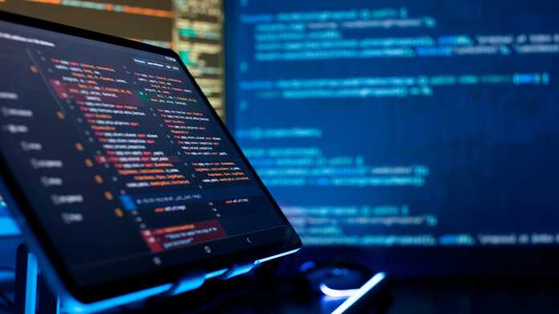

# Dekompilierung per KI: Warum Closed Source laut Raymond am Ende ist

> Automatisch per `python ai.py ingest` erfasst. Quelle: [https://www.heise.de/news/Open-Source-Papst-Raymond-KI-setzt-Closed-Source-Software-ein-Ende-11480624.html](https://www.heise.de/news/Open-Source-Papst-Raymond-KI-setzt-Closed-Source-Software-ein-Ende-11480624.html)

## Inhalt

Open-Source-Mitbegründer Eric S. Raymond erklärt Closed-Source-Software per KI-gestütztem Reverse Engineering für faktisch am Ende.

Für Eric S. Raymond ist der Befund klar: Closed Source ist nahezu am Ende. Für den Mitbegründer der Open Source Initiative und Vordenker der Open-Source-Bewegung sind Large Language Models der Todesstoß für das Softwaregeheimnis. Das Aus von Closed Source habe er zwar schon immer erwartet. Aber eigentlich sei er von einer langsamen Erosion ausgegangen. Und er habe überdies damit gerechnet, dass einige Nischen verbleiben – doch selbst das sei nicht mehr so. Der streitbare Aktivist erklärte jetzt in einem Meinungsbeitrag, dass nur Patente und Software, die in der Cloud laufe (Software as a Service), proprietäre Geschäftsmodelle noch schützen würden. Er erwartet einen harten Kollaps. Überleben könnte allenfalls Steuersoftware: Deren Wert liege nicht im Code, sondern im Pflegen eines sich ständig ändernden Regelwerks durch Fachleute des Herstellers.

Der Post, den Raymond auf X veröffentlicht hat , erhielt viel Beachtung und löste Diskussionen aus. Tags darauf legte Raymond mit der Behauptung nach, ein Photoshop-Ersatz sei per Dekompilierung entstanden – belegt ist das bislang nicht. Debatten, wie KI die Softwarelandschaft verändert, konzentrieren sich zumeist auf das Neuerschaffen von Programmen per Vibe-Coding oder KI-assistiertes Programmieren . Dabei könnte sich KI auch auf vorhandene Software und ihren Schutz deutlich auswirken. Während einige Raymond zustimmen, halten andere seine Einschätzung der aktuellen KI-Fähigkeiten für übertrieben. Weitgehend einig ist man sich aber, dass es für geschlossene Software perspektivisch eng werden dürfte.

### DOS-Spiel als Denkanstoß

Raymond macht seine Aussage an einem persönlichen Experiment fest: Per KI-Assistent dekompilierte er das DOS-Shareware-Spiel „Firefighter“ und übertrug es anschließend in die Programmiersprache Rust. Das Spiel liefert er in seiner „Heritage Games Collection“ aus. Raymond schreibt, die KI habe anhand des Datenlayouts erkannt, dass das Programm in Borland Pascal geschrieben war, und habe lesbaren Pascal-Code mit sinnvollen Funktions- und Variablennamen ausgegeben. Das Experiment hielt Raymond zunächst für einen Spaß. Dass sich die Technik auf große, reale Programme skalieren lässt, habe er nicht geglaubt. Inzwischen habe er aber gehört, dass dies auch schon mit ganzen Triple-A-Spielen gelungen sei, also großen bekannten Titeln.

Rechtlich sieht Raymond, bezogen auf die USA, einen gangbaren Weg: Wer eine Binärdatei zunächst in eine Spezifikation überführe und daraus neuen Code erzeuge, ohne den dekompilierten Code anzusehen, bewege sich auf sicherem Boden, so wie einst Phoenix Technologies beim Nachbau des IBM-PC-BIOS. Mit LLMs dauere das nur noch einen Tag, und bei der Verbreitung sei es kaum praktikabel, jeden zu verfolgen, der den Zwischenschritt überspringe. Bei Patenten sieht er keine Lücke, verweist aber auf die Praxis von Linux, patentbehaftete Codecs nicht mitzuliefern, sondern nachladen zu lassen. In der EU ist die Lage strenger. Hier erlaubt die EU-Softwarerichtlinie das Dekompilieren im Wesentlichen nur, soweit es für die Interoperabilität mit anderen Programmen nötig ist – und laut einem EuGH-Urteil von 2021 auch zur Fehlerberichtigung.

### Umzug in die Cloud hilft nur bedingt

Ausgerechnet Spiele hielt Raymond für einen der Bereiche, in denen sich geschlossene Software am längsten halten würde. Und wenn es gelinge, diese zurückzuverwandeln, dann sei gar nichts mehr vor Reverse Engineering sicher. Auch den Versuch großer Softwarefirmen wie Adobe und Microsoft, Standalone-Software in die Cloud zu verschieben, sieht er mit großer Skepsis. Nutzer lehnten sich dagegen auf und für manche Anwendung, etwa bei Medizingeräten oder Werkzeugmaschinen, seien Netzausfälle und andere damit verbundene Risiken einfach nicht hinnehmbar. Wie weit diese Strategie bei Microsoft inzwischen reicht, zeigt sich auch an dessen neu entdeckter Open-Source-Liebe , die vor allem Kunden zu den hauseigenen Clouddiensten lotsen soll.

Sicherheitsforscher sehen die Lage differenzierter. Der Schutz durch Obfuskierung, also das absichtliche Verschleiern von Code, wird durch LLMs zwar billiger zu umgehen, verliert aber nicht jeden Wert. Codesignierung und Secure Boot verhindern zudem nicht das Lesen, wohl aber das Ausführen veränderter Software auf gesperrter Hardware.

„Wir betreten eine neue Welt, in der viele alte, bequeme Annahmen über den Haufen geworfen werden. Es wird spannend sein, das zu beobachten“, so Raymond.  Er rechne etwa damit, dass durch das Reverse Engineering auch einiges an „schmutziger Wäsche“ zum Vorschein komme. Als Beispiel nennt er Grafikkartenhersteller: Es halte sich seit Langem das Gerücht, sie seien deshalb so verschwiegen, weil sie sich seit Jahrzehnten gegenseitig in großem Stil geistiges Eigentum gestohlen hätten. Stimme das, werde es nun auffliegen – und die folgenden Klagen würden unterhaltsam.

## Bilder

(Bild: Zakharchuk / Shutterstock.com)
