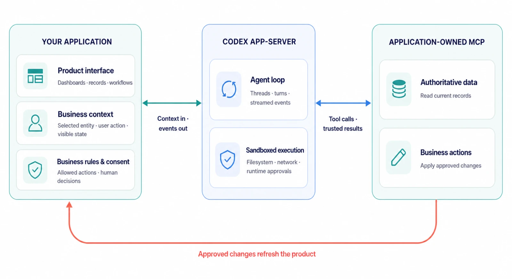
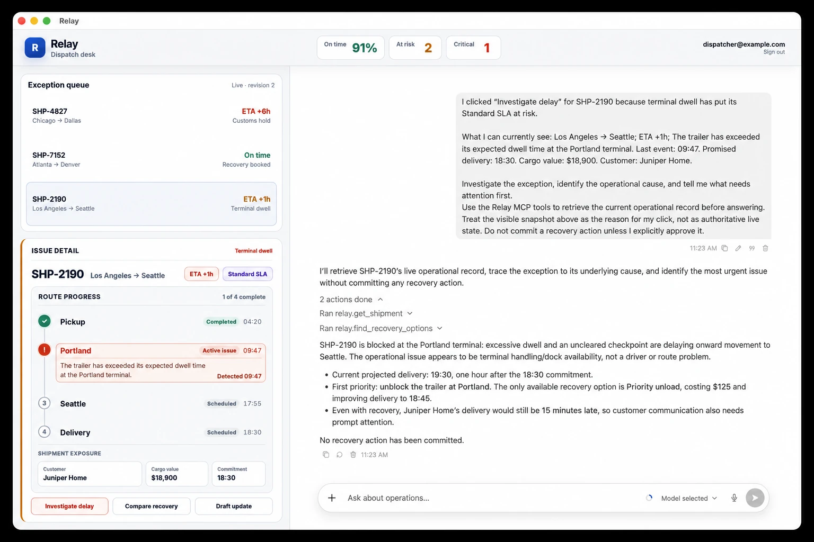

# Codex as a platform: build on the open agent harness | OpenAI Developers

> Automatisch per `python ai.py ingest` erfasst. Quelle: [https://developers.openai.com/blog/codex-as-a-platform](https://developers.openai.com/blog/codex-as-a-platform)

## Inhalt

Most people know Codex through the App , Command-Line Interface , or IDE Extension . Those experiences are important, but they are only a few of the ways the same underlying system can be used.

The open-source Codex harness is what powers all these experiences. It helps models gather context, reason through tasks, use tools, operate within configured boundaries, request approval, and carry work forward.

That changes what developers can build. Instead of asking every team to move its work into a general-purpose coding assistant, you can bring the agent into software designed around the actual job: an engineering workflow, an operations dashboard, a security investigation, a customer-support console, or an internal application built for one specialized team.

### The reusable part is the agent loop

A capable agent is more than a prompt and a model response. It needs a way to understand a task, maintain context over time, inspect relevant information, call tools, expose progress, handle failures, request human approval when necessary, and return a useful result.

That surrounding execution system is the harness.

Harness design can materially change results: on ARC-AGI-3 , retained reasoning and context compaction raised GPT-5.6 Sol’s score from 13.3% to 38.3% while reducing output tokens sixfold.

We built the Codex harness to manage conversation state, stream execution, use tools, enforce configured sandbox and approval policies, and carry work across turns. With Codex app-server , we expose those capabilities through a documented client protocol: applications can create threads, start turns, receive events, and handle approval requests.

If you are building software that needs an agent, you can start with Codex instead of inventing a new runtime, then decide what the surrounding application should own.

### An open harness developers can inspect and adapt

Because the harness is open source, you can inspect the layer between your application and the model, understand how it behaves, and adapt the integration to fit your product.

That gives developers control over the parts that make the agent fit their product:

- The interface. A team can keep its existing dashboards, editors, queues, maps, records, and approval flows instead of forcing every interaction into a generic chat window.

The interface. A team can keep its existing dashboards, editors, queues, maps, records, and approval flows instead of forcing every interaction into a generic chat window.

- Context and tools. An application can expose the systems, documents, data, and actions that matter for a particular workflow, including application-owned MCP services .

Context and tools. An application can expose the systems, documents, data, and actions that matter for a particular workflow, including application-owned MCP services .

- Operational boundaries. The host application can decide where an agent runs, which files or tools it can access, which actions require approval, how work is observed, and how results return to the system of record.

Operational boundaries. The host application can decide where an agent runs, which files or tools it can access, which actions require approval, how work is observed, and how results return to the system of record.

We publish the Codex CLI , app-server , and official Codex SDK as open-source components. Our open-source components guide lists what is available and where each component lives.

The open-source layer is the harness and integration surface; model access and managed services remain separate.

### Choose the right integration layer

Building on Codex does not require the same integration for every use case.

- For a script, CI job, or one-off background task, codex exec can run a bounded agent workflow and return structured output.

For a script, CI job, or one-off background task, codex exec can run a bounded agent workflow and return structured output.

- For application code that needs to start, resume, or stream Codex tasks, the official Codex SDK provides a direct programmatic interface.

For application code that needs to start, resume, or stream Codex tasks, the official Codex SDK provides a direct programmatic interface.

For a runnable example, see the Codex SDK documentation .

Use Codex app-server when the agent is part of the product itself. It lets your application connect to a local Codex process, keep conversations open, stream events, interrupt work, expose tools, and respond to approval requests. The SDK simplifies common programmatic workflows; app-server gives product teams direct control over the lifecycle and user experience.

### Build software around the workflow

The most interesting opportunity is not to reproduce the Codex app with a different logo, but to build software that reflects how a specific person or team already works:

A security analyst might need an investigation queue, recent alerts, affected services, and an approval step before opening a remediation ticket. A support engineer might need account history, product logs, internal documentation, and a draft response. A product team might want a task board where moving an issue into a ready state begins a scoped implementation workflow.

In each example, the interface is an important part of the experience. It tells the agent what the user is looking at, gives it the right tools, and gives the user a place to review what happens next.

Figure 1. Your application owns product context, business rules, and tools;
Codex app-server provides the agent loop and sandboxed execution.

### Example: Relay

We built Relay as a sample operations application on Codex app-server. It places an agent beside a fictional shipment dashboard, connects it to application-owned MCP tools, and requires human approval before a shipment is rebooked.

The user does not start by writing a prompt from scratch. They select a shipment and click an action such as Compare recovery . The application supplies the relevant context, Codex retrieves the latest sample operational data, the agent explains the available options, and any consequential write requires approval.

Codex can then use the application’s MCP tools to fetch current data before recommending—or, after approval, taking—an action. When a tool changes the underlying record, the application refreshes its business view. The harness handles the agent loop, conversation state, streamed activity, and tool interaction; the product continues to own its dashboard, records, and controls.

Relay uses fictional seeded data, but the integration pattern is general. The same pattern could power incident response, account operations, research workflows, or other applications where an agent should work inside an existing product experience.

Figure 2. Relay embeds Codex in a shipment operations dashboard, with
application-owned MCP tools and human approval for consequential actions.

### What developers are building

This pattern is already showing up in public implementations:

- GitHub and JetBrains bring Codex into existing IDE workflows.

GitHub and JetBrains bring Codex into existing IDE workflows.

- Cisco uses the Codex SDK in App Builder inside Cisco Cloud Control.

Cisco uses the Codex SDK in App Builder inside Cisco Cloud Control.

- Thrive Holdings and Crete use Codex in a tax-preparation workflow that incorporates practitioner feedback. Their pilot processed 7,000 returns and reduced preparation time by about a third.

Thrive Holdings and Crete use Codex in a tax-preparation workflow that incorporates practitioner feedback. Their pilot processed 7,000 returns and reduced preparation time by about a third.

These examples are not limited to engineering: the same pattern applies to support teams investigating customer issues, operations teams coordinating workflows, security teams triaging incidents, sales teams researching accounts, and marketing teams developing campaigns. In each case, the application provides the context, tools, and approvals, while Codex powers the underlying agent loop.

### Build beyond the obvious

For many kinds of work, the essential context is grounded in a dashboard, a timeline, a map, a document, or a system record. Those views are not there to be pretty: it is how people actually understand what is happening, make decisions, and stay in control.

The opportunity is not to replace those interfaces with a universal chat box, but to make them more capable by giving them an agent that can understand the work, investigate the right context, propose a next step, and take an approved action.

The Codex app, CLI, and IDE extension show what the harness can do. By making the harness open source, we give developers a way to inspect those capabilities, integrate them, and adapt them to their own products and workflows.

If you want to build with the Codex harness, start with the open-source Codex repository , then choose the integration that fits your product: codex exec for noninteractive jobs, the Codex SDK for programmatic agent workflows, or Codex app-server for applications that need persistent conversations, streamed events, and approval handling.

## Bilder

