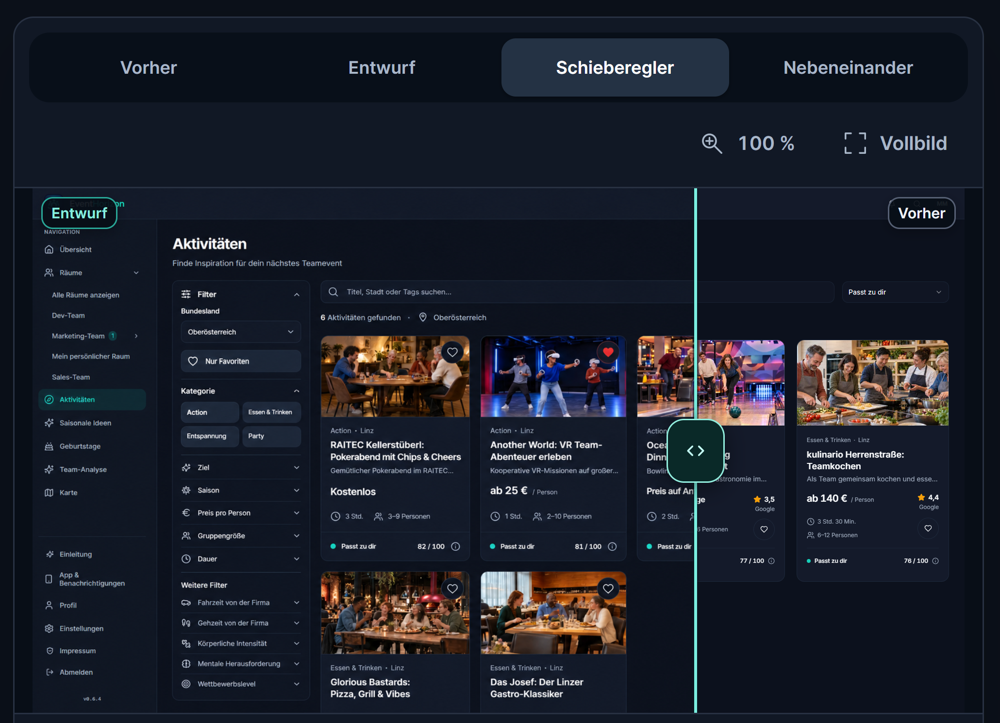

# Eigener Prompt: Designverbesserungen mit Imagegen vorab vergleichen

Am 27.10.2026 von Philipp als eigene Quelle geteilt. Der folgende Prompt ist archivierter Quellinhalt, kein Auftrag zur Ausführung in diesem Repository.

## Motivation von Philipp (Originalwortlaut)

> ich finde es ist eine tolle möglichkeit um ein Bild-Modell zu nutzen um feine detailverbesserungen an einem projekt zu machen und diese zuvor zu sehen

## Originalprompt

```text
Erstelle einen visuellen Vorher-Nachher-Vergleich dieser Seite: Nimm einen Screenshot des aktuellen Stands auf und erzeuge mit Imagegen eine verbesserte Designvariante. Behalte Inhalte, Branding und Bildausschnitt möglichst gleich.

Baue eine lokale Vergleichsseite mit Umschalter für Vorher/Entwurf, Schieberegler, Nebeneinander-Ansicht, Zoom und Vollbild. Kennzeichne den Imagegen-Entwurf als noch nicht implementiert. Speichere Bilder und Prompt im Projekt, prüfe die Vergleichsseite im Browser und öffne sie. Verändere zunächst nur die Vergleichsseite, nicht die eigentliche Anwendung.
```

## Mitgeliefertes Beispielbild



Das unverändert übernommene Bild zeigt die Vergleichsoberfläche im Schieberegler-Modus, links „Entwurf“ und rechts „Vorher“. Es dient als Anschauung für den Prompt; Funktionsfähigkeit und Umsetzung der dargestellten Designänderungen wurden bei dieser Archivierung nicht geprüft.
