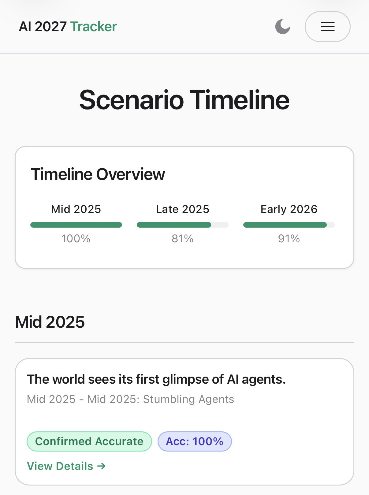
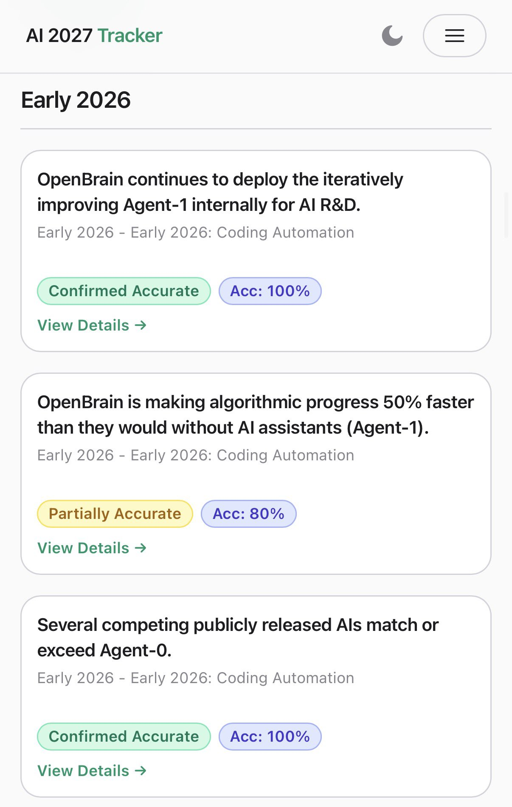
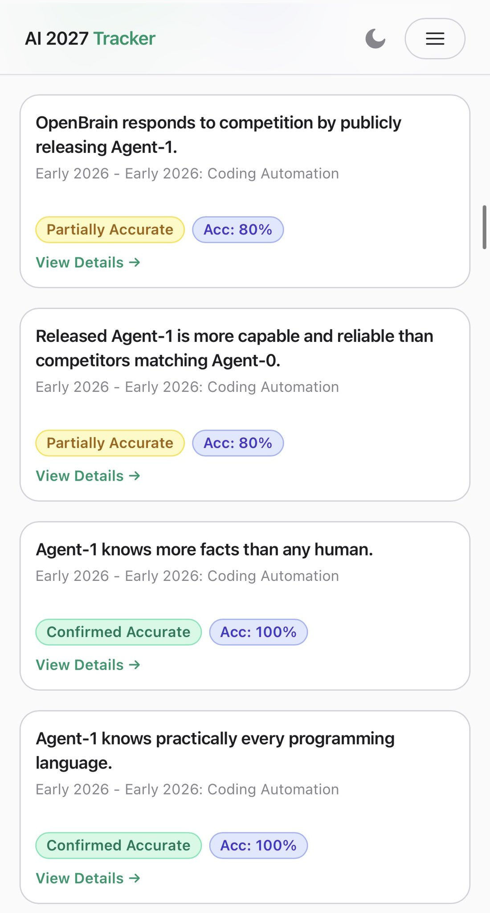

# Chubby♨️ (@kimmonismus)

> Automatisch per `npm run ingest:x` erfasst. Quelle: [x.com/kimmonismus/status/2087452378299564147](https://x.com/kimmonismus/status/2087452378299564147)

## Bilder

<!-- Reihenfolge wie von der API geliefert (Cover zuerst). Die Position im Artikeltext gibt die API nicht mit. -->

**photo**

**photo**

**photo**

## Post-Text

Almost all the predictions from the 2025 prediction blog "AI 2027" have come true. 

19 out of 24 predictions have materialized, and we are well on track for the majority of them to prove accurate.

They predicted for this and next Frage:

By late 2026, increasingly capable and affordable AI agents begin replacing junior software engineers and reshaping the economy. 

In 2027, superhuman coding agents automate AI research itself, triggering an intelligence explosion that could produce artificial superintelligence- and a severe alignment crisis - by year’s end.

Sounds to me we are very much aligned with that timeline. Crazy.

## Links

- [pic.x.com/o6k75jWCiD](https://x.com/kimmonismus/status/2087452378299564147/photo/1)
