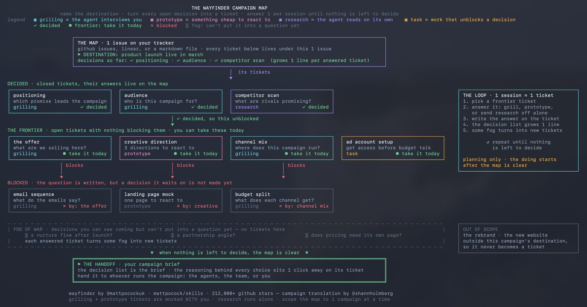

# Shann³ (@shannholmberg)

> Automatisch per `npm run ingest:x` erfasst. Quelle: [x.com/shannholmberg/status/2087539757052285200](https://x.com/shannholmberg/status/2087539757052285200)

## Bilder

<!-- Reihenfolge wie von der API geliefert (Cover zuerst). Die Position im Artikeltext gibt die API nicht mit. -->

**photo**

## Post-Text

how to plan a full marketing campaign with @mattpocockuk's wayfinder skill

wayfinder is a claude code skill (or other harnesses, codex..) for planning work too big for 1 session. matt built it for engineering, and it fits campaign planning just as well

the idea: on a big campaign you know the end goal, and every decision between now and launch is still open. you know "product launch live in march", without yet knowing the offer, the channels, the creative direction, or what depends on what

wayfinder charts that as a map. the map is 1 issue on your tracker (github issues, linear, or a markdown file), and every open question on the campaign becomes a decision ticket, a sub issue holding 1 question to decide

the 4 ticket types in campaign terms:

> grilling: the agent interviews you until a decision is made. the positioning, the offer, who this campaign is for
> prototype: something to react to. 3 creative directions, a landing page mock, a draft email
> research: an agent goes reading on its own. competitor campaigns, channel benchmarks
> task: work that unblocks a decision. set up the ad account, get analytics access

then come the 2 parts I like most

fog of war: the decisions you can see coming but can't put into a question yet. you know an email sequence is coming, but you can't decide it until the offer is locked, so it waits on the map as fog, a marked spot with no ticket written yet

the frontier: tickets you can take right now, with nothing blocking them. tickets block each other the way campaign decisions block each other, the offer blocks the emails and the audience decision blocks the creative, so your tracker shows you which decisions you can make today

you answer 1 ticket per session, the answer gets written on the ticket, and a decision list on the map grows a line at a time. by the time the map is clear, that list is your campaign brief, and the reasoning behind every choice sits one click away on its ticket

one warning from running it: scope the map to a single campaign. a whole-strategy map goes stale, because the decisions at the end rest on assumptions the early ones change.

matt's own phrase for the fix is "prototypemaxxing, not planmaxxing", decide by reacting to cheap drafts
