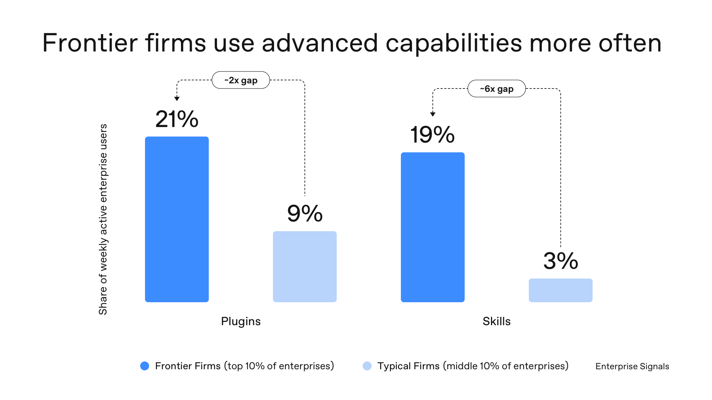

# OpenAI (@OpenAI)

> Automatisch per `npm run ingest:x` erfasst. Quelle: [x.com/OpenAI/status/2087912623883051300](https://x.com/OpenAI/status/2087912623883051300)

## Bilder

<!-- Reihenfolge wie von der API geliefert (Cover zuerst). Die Position im Artikeltext gibt die API nicht mit. -->

**photo**

## Post-Text

The top 10% of enterprises use plugins twice as often and skills six times as often as typical firms. 

These frontier firms are not ahead by accident. https://t.co/wbiwGW1rKg

## Links

- [pic.x.com/wbiwGW1rKg](https://x.com/OpenAI/status/2087912623883051300/photo/1)
