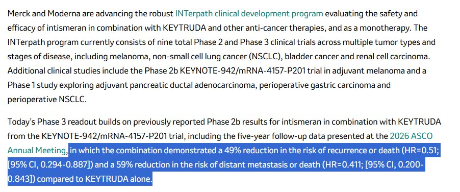
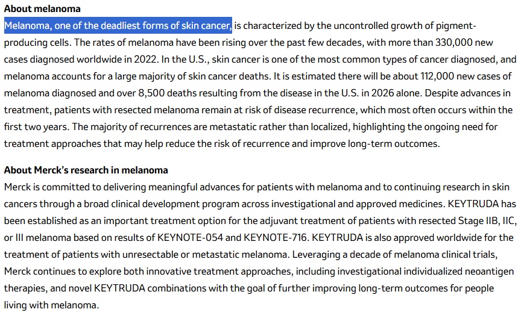

# Chubby♨️ (@kimmonismus)

> Automatisch per `npm run ingest:x` erfasst. Quelle: [x.com/kimmonismus/status/2090082088087150979](https://x.com/kimmonismus/status/2090082088087150979)

## Bilder

<!-- Reihenfolge wie von der API geliefert (Cover zuerst). Die Position im Artikeltext gibt die API nicht mit. -->

**photo**

**photo**

## Post-Text

This is freaking huge: For the first time, a AI-assisted personalized mRNA cancer treatment has succeeded in a Phase 3 trial.

Moderna and Merck sequence each patient’s tumor and compare it with their healthy DNA. AI then helps identify which of the tumor’s mutations are most likely to trigger an immune response.

From those targets, Moderna produces an individual mRNA treatment encoding up to 34 neoantigens, The earlier Phase 2 trial followed patients with surgically removed high-risk melanoma for five years:

- 68.8% remained cancer-free, compared with 49.1% on Keytruda alone
- 49% lower risk of recurrence or death
- 59% lower risk of distant metastasis or death

Now the much larger Phase 3 trial involving 1,137 patients has also succeeded.

Absolutely incredible. Dario was right: cancer will be cured in just a few years!

## Links

- [pic.x.com/SS7FSxubHR](https://x.com/kimmonismus/status/2090082088087150979/photo/1)
