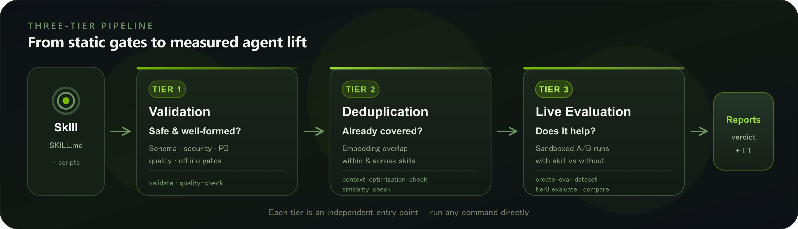

# NVIDIA AI (@NVIDIAAI)

> Automatisch per `npm run ingest:x` erfasst. Quelle: [x.com/NVIDIAAI/status/2090113635683340622](https://x.com/NVIDIAAI/status/2090113635683340622)

## Bilder

<!-- Reihenfolge wie von der API geliefert (Cover zuerst). Die Position im Artikeltext gibt die API nicht mit. -->

**photo**

## Post-Text

We benchmarked 300+ NVIDIA verified skills to see how much they actually help agents on real tasks.

Same task, same model, same setup. The only difference was whether the agent had the skill.

Across the benchmarks, skills improved correctness by 41 points, effectiveness by 39, and efficiency by 35.

SkillEvaluator is open source if you want to test your own skills before you ship them.

## Links

- [pic.x.com/gsG5OSYOLN](https://x.com/NVIDIAAI/status/2090113635683340622/photo/1)
