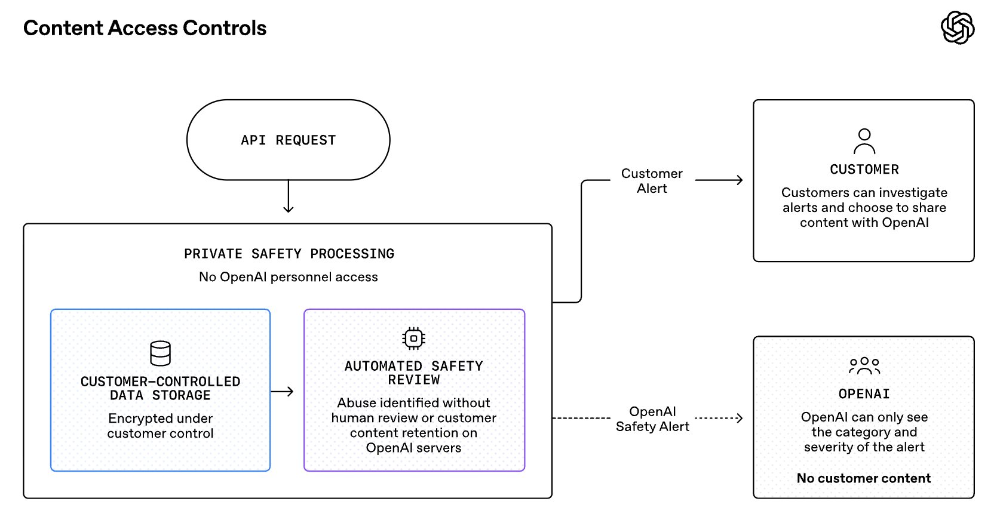

# OpenAI (@OpenAI)

> Automatisch per `npm run ingest:x` erfasst. Quelle: [x.com/OpenAI/status/2090165328290701800](https://x.com/OpenAI/status/2090165328290701800)

## Bilder

<!-- Reihenfolge wie von der API geliefert (Cover zuerst). Die Position im Artikeltext gibt die API nicht mit. -->

**photo**

## Post-Text

We will continue to offer Zero Data Retention for frontier models.

As AI takes on longer, more autonomous work and delivers greater value to businesses, safety systems also need to identify risks across related interactions. 

To help address those risks, we're previewing Private Safety Processing, which is designed to improve safety without giving OpenAI personnel access to the underlying content.

## Links

- [pic.x.com/PTEVBS4p3Q](https://x.com/OpenAI/status/2090165328290701800/photo/1)
