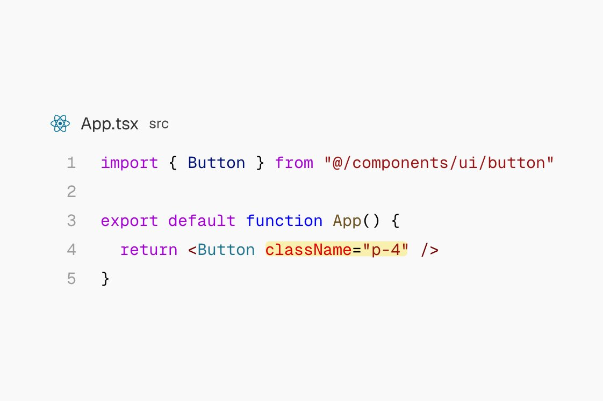
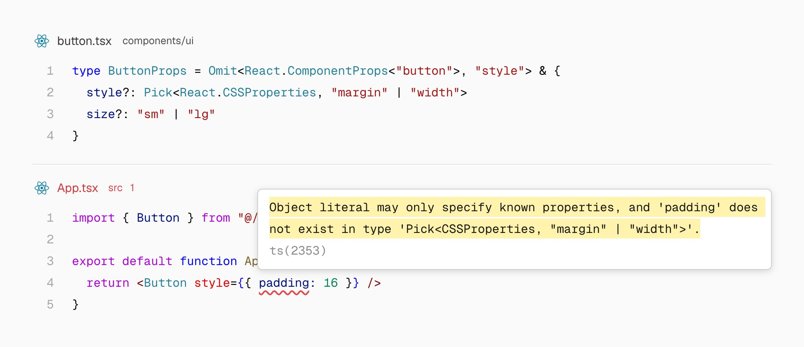
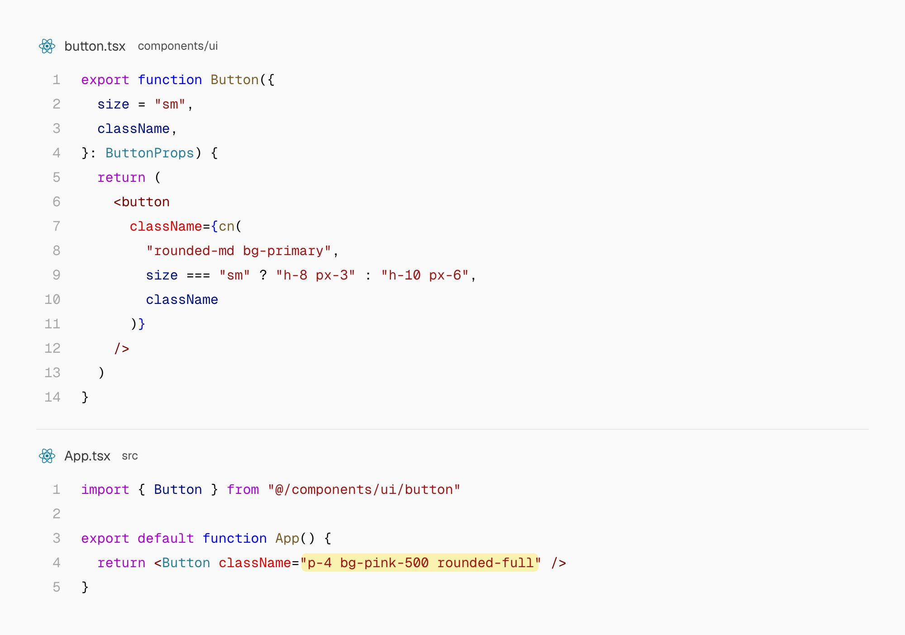
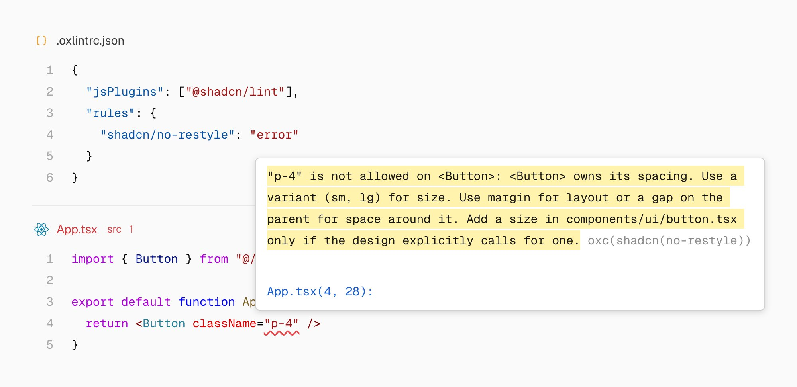
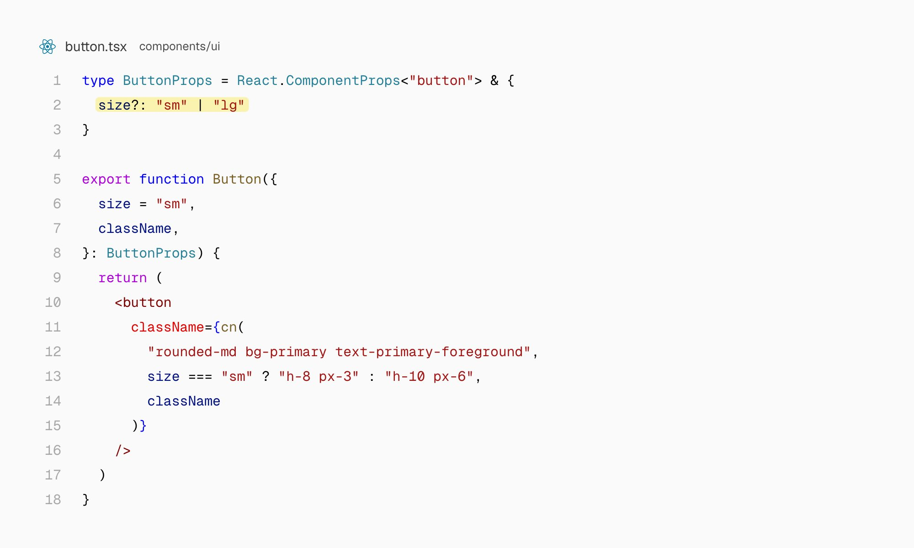
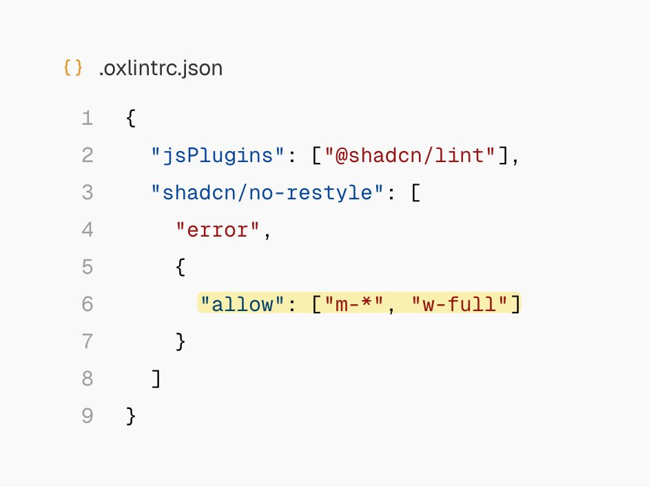
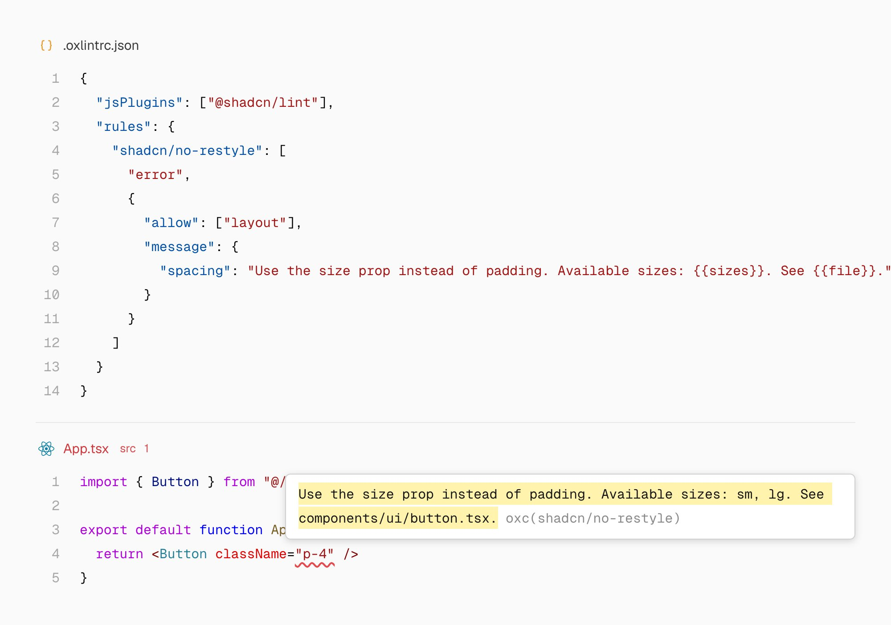
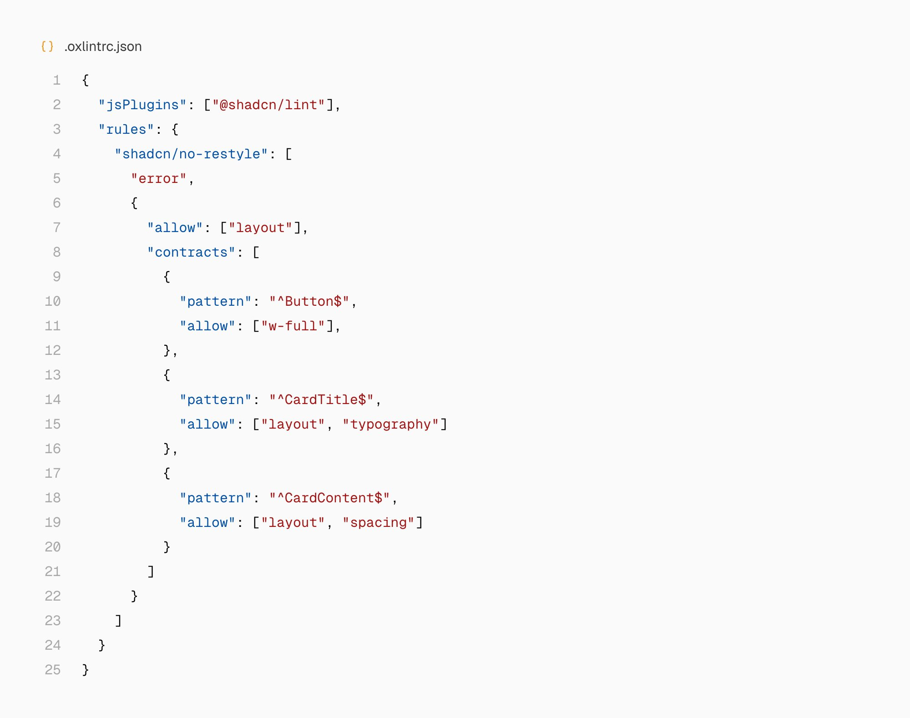
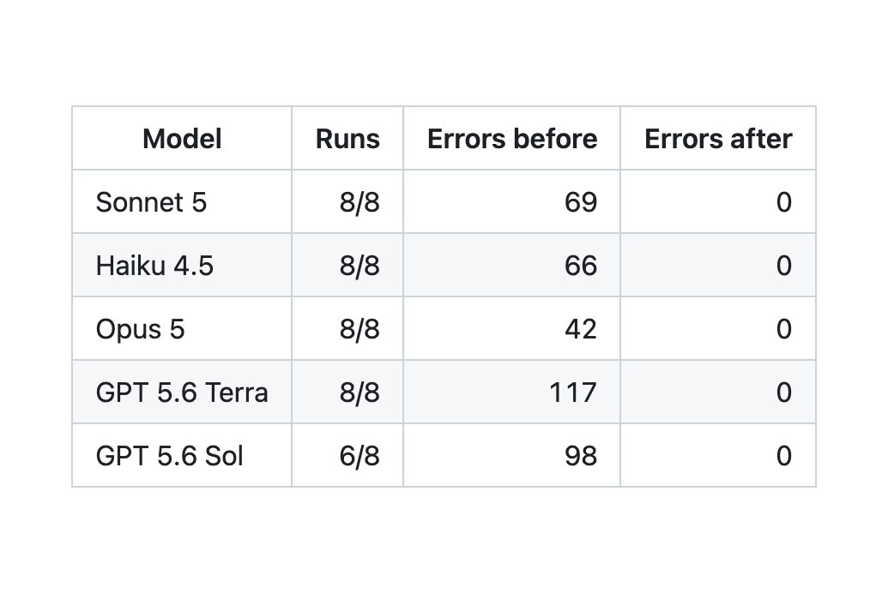

# shadcn (@shadcn)

> Automatisch per `npm run ingest:x` erfasst. Quelle: [x.com/shadcn/status/2099534231114314145](https://x.com/shadcn/status/2099534231114314145)

## Post-Text

Introducing shadcn/lint. An agent-first linter for Tailwind design systems.

You define what’s allowed. When an agent breaks a rule, the error explains what’s wrong and how to fix it using your components, variants and theme.

There’s a lot you can do with this. Let me show you ↓

https://t.co/PMOkfk1jPB

## Links

- [github.com/shadcn-ui/lint](https://github.com/shadcn-ui/lint)

## Thread

### 1/13

Introducing shadcn/lint. An agent-first linter for Tailwind design systems.

You define what’s allowed. When an agent breaks a rule, the error explains what’s wrong and how to fix it using your components, variants and theme.

There’s a lot you can do with this. Let me show you ↓

https://t.co/PMOkfk1jPB

### 2/13

Agents write good code. When the code can be verified. 

An agent adds p-4 to a Button that already has a size prop. The code compiles. The button renders.

But it just broke your design system. https://t.co/pd2bSVpcki

### 3/13

Code is verified by the toolchain, not by convention. What's the toolchain we’re all familiar with? TypeScript.

We can restrict a Button’s style prop to margin and width. If an agent tries to change its padding, it gets a type error. https://t.co/0a4Xo76gtz

### 4/13

Take a look at the error message.

The error tells the agent that padding is not allowed. But what should it do instead?

Rules in types tell the agent something is wrong. They do not tell the agent how to fix it. https://t.co/47d5D1HNO5

### 5/13

TypeScript works, but we don’t want to write css in js. We want to write Tailwind. Agents want to write Tailwind.

But className in Tailwind is a string. Anything goes. An agent can override padding, colors, or shape without an error. https://t.co/qFzLomDvfJ

### 6/13

Let’s make Tailwind verifiable.

Enable shadcn/no-restyle, and that padding override becomes a lint error.

An error that tells the agent what is wrong, suggests fixes and where to find them. 

It reads that information from your actual Button component. https://t.co/qHmhwLAiYD

### 7/13

shadcn/lint reads your components, variants, and theme to suggest fixes. Add a size or variant to your component, and it can suggest it automatically. https://t.co/c19UPOEPjB

### 8/13

You decide what can change.

Allow the layout category, and agents can use margin, width, and positioning classes but not restyling classes.

Here's a rule that allows a Button to be w-full and positioned with margin but cannot be restyled. https://t.co/hIQtukrGCV

### 9/13

You can write your own error messages, too.

Add placeholders like {{variants}} and {{file}}, and the message includes your component’s available variants and where to find them.

Your  instructions, with context from your design system and design team. https://t.co/xMi6y7s6Pk

### 10/13

Contracts let you give each component its own rules.

Let Button accept full width, but keep its shape. Let CardTitle change typography. Let CardContent change spacing.

Each contract can have its own error message, so agents know what’s allowed and how to fix a violation. https://t.co/jIOYpwsgfA

### 11/13

And it works. In our evals, almost every task reached zero violations and corrections took only one round compared to up to 3 rounds without shadcn/lint.

And it’s cheaper too. Fixes cost 10–48% less with shadcn/lint than with AGENTS.md rules alone. https://t.co/96yp4kMkbJ

### 12/13

shadcn/lint works with your existing Tailwind components and theme. shadcn/ui is not required. Available for both Oxlint and ESlint.

You can add one rule one component at a time. 

Try it out. Make your design system verifiable.

https://t.co/PDHhI4wEdf

### 13/13

@tomhacks Yes. You can also bring your own merge functions.

## Archivierte Bilder aus dem Thread

### Post 2099534239272177747

Original: https://pbs.twimg.com/media/HSMGWVjXEAAXIFX.jpg

### Post 2099534245869793300

Original: https://pbs.twimg.com/media/HSMGazMWIAAfQMu.jpg

### Post 2099534254476517469

Original: https://pbs.twimg.com/media/HSMGglyWwAExQ8u.jpg

### Post 2099534265260142761

Original: https://pbs.twimg.com/media/HSMGjleX0AAgtH1.jpg

### Post 2099534274563084368

Original: https://pbs.twimg.com/media/HSMGnKMXYAAFmlX.jpg

### Post 2099534283035508996

Original: https://pbs.twimg.com/media/HSMGsHIWoAAOkvf.jpg

### Post 2099534291176677577

Original: https://pbs.twimg.com/media/HSMGvlcWEAA1CPo.jpg

### Post 2099534300810993860

Original: https://pbs.twimg.com/media/HSMGzneW8AAhV3i.jpg

### Post 2099534310571196564

Original: https://pbs.twimg.com/media/HSMG2u9WcAAplu0.jpg

### Post 2099534325024739496

Original: https://pbs.twimg.com/media/HSMG5gnXsAAsPPa.jpg

