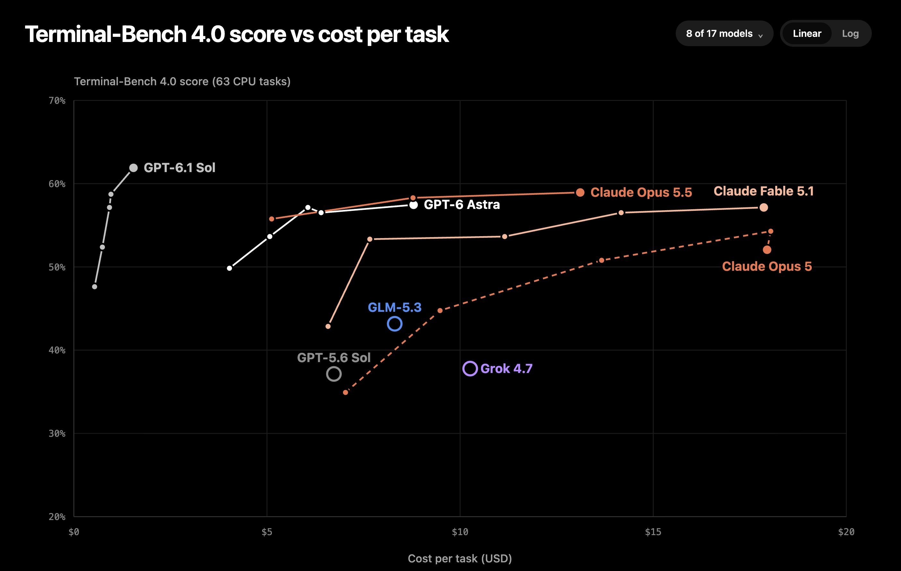

# Theo - t3.gg (@theo)

> Automatisch per `npm run ingest:x` erfasst. Quelle: [x.com/theo/status/2105063015712465094](https://x.com/theo/status/2105063015712465094)

## Bilder

<!-- Reihenfolge wie von der API geliefert (Cover zuerst). Die Position im Artikeltext gibt die API nicht mit. -->

**photo**

## Post-Text

Updated run just finished. GPT-6.1 Sol still crushes. Turns out it performs WAY better in Codex than in mini-swe (what Artificial Analysis uses) https://t.co/nNj9JcQQvK https://t.co/dr11vvGtW3

## Links

- [pic.x.com/nNj9JcQQvK](https://x.com/theo/status/2105063015712465094/photo/1)
- [x.com/theo/status/21…](https://twitter.com/theo/status/2105000888192663582)

## Thread

### 1/3

Updated run just finished. GPT-6.1 Sol still crushes. Turns out it performs WAY better in Codex than in mini-swe (what Artificial Analysis uses) https://t.co/nNj9JcQQvK https://t.co/dr11vvGtW3

### 2/3

The other numbers come from Harbor Hub, which ran each model using the official harness:

https://t.co/QiFp6zRV4c

All models see a bump compared to AA, but 6.1 Sol sees the biggest bump moving from mini-swe to codex

### 3/3 · Geprüfte Ergänzung des Autors

@ArtificialAnlys Do your miniswe runs have access to vision/image tools? That made a huge difference in my runs. Can move this convo to our Slack if you prefer

## Erfassungsnachweis vom 24.10.2026

Angefragter Post: https://x.com/theo/status/2105063015712465094

Im geprüften API-Abruf enthalten: 3 Post(s). Die Zahl ist kein Nachweis eines vollständigen Threads.

- [Post 2105063015712465094](https://x.com/theo/status/2105063015712465094)
- [Post 2105063128023388516](https://x.com/theo/status/2105063128023388516)
- [Post 2105378240760262924](https://x.com/theo/status/2105378240760262924)
