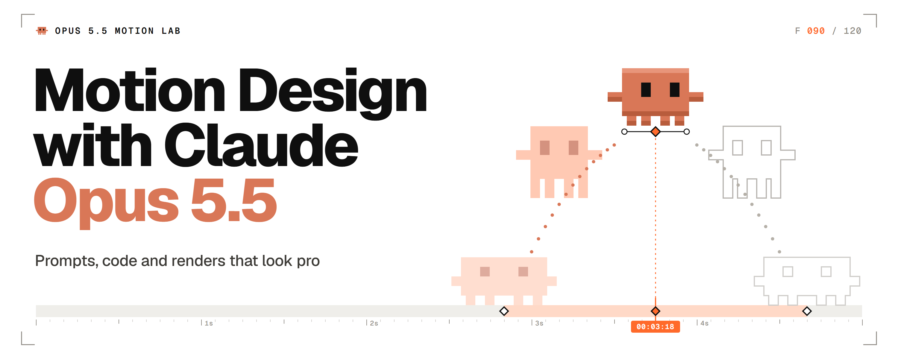
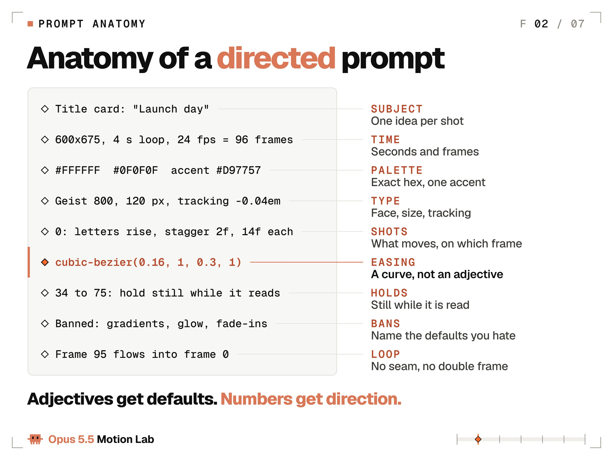
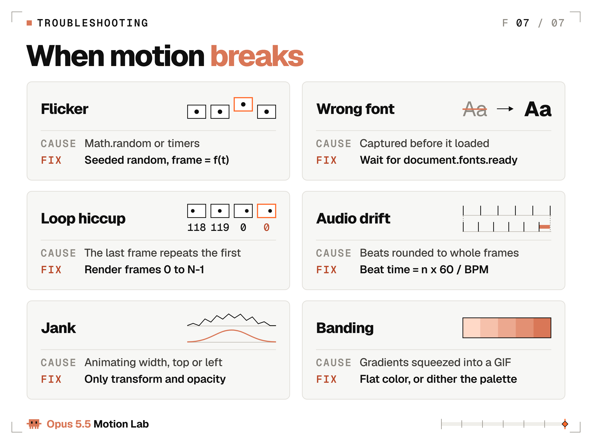
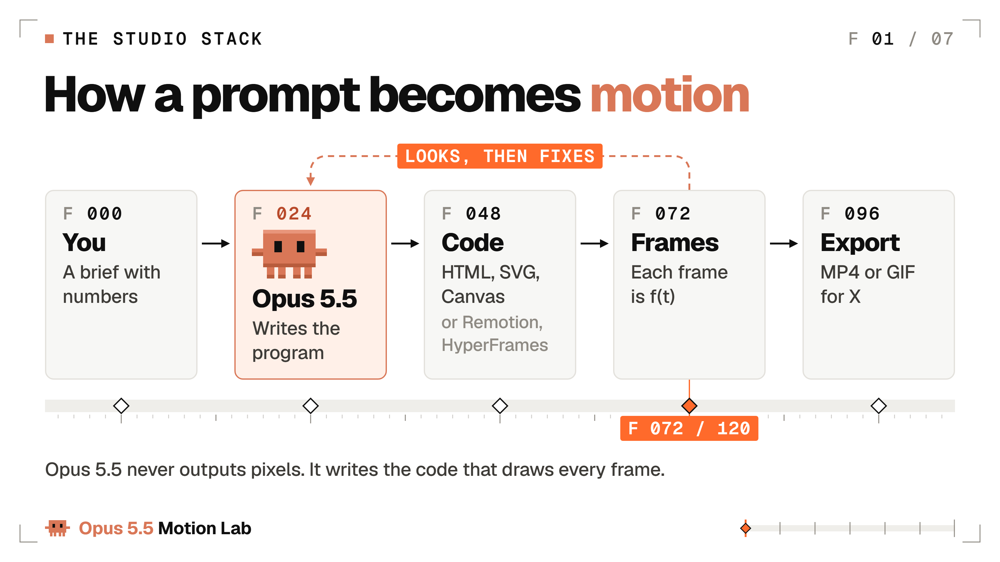
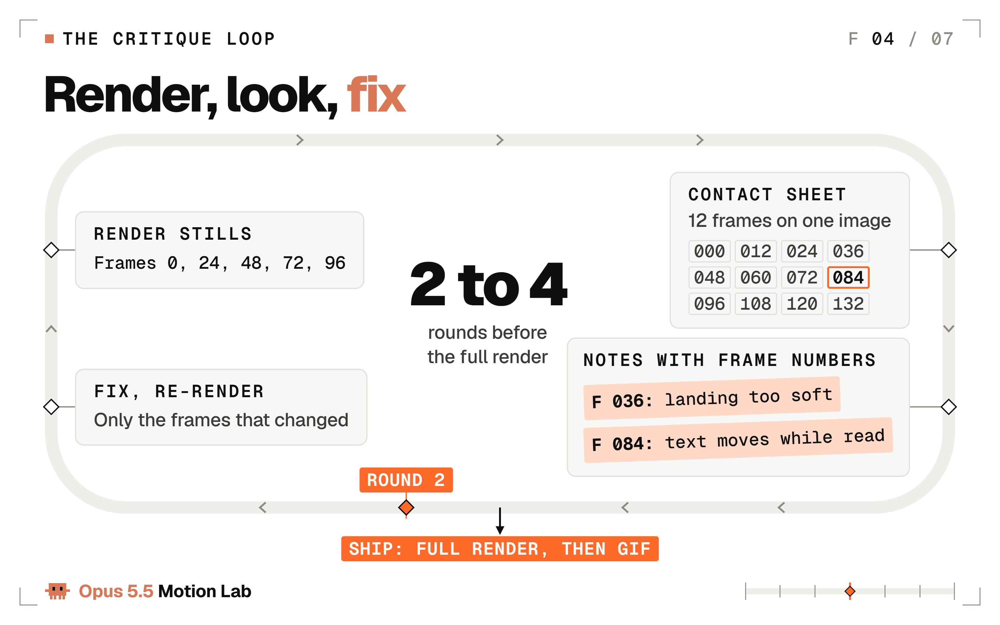
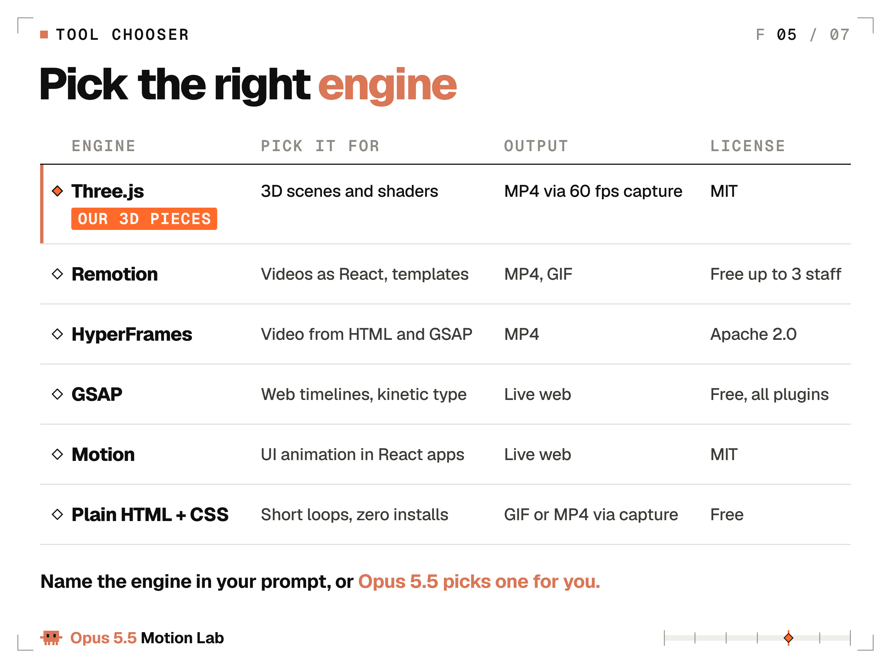
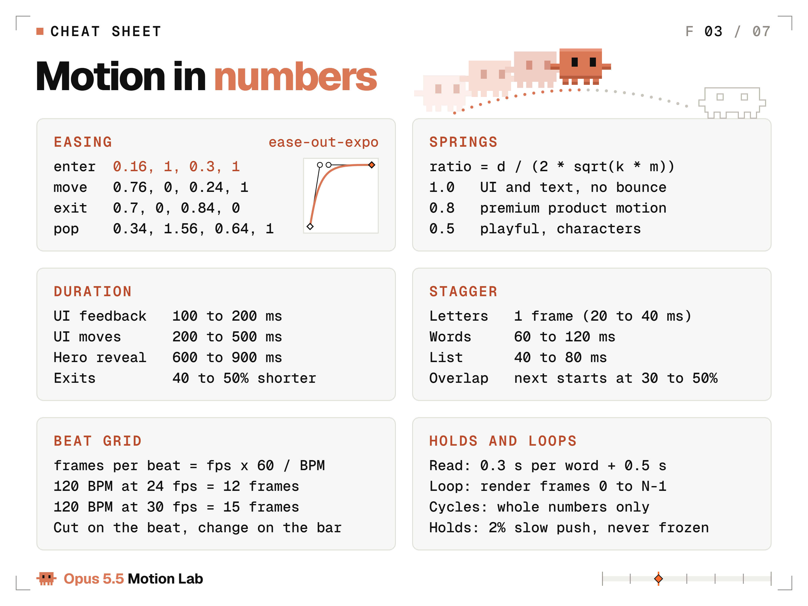
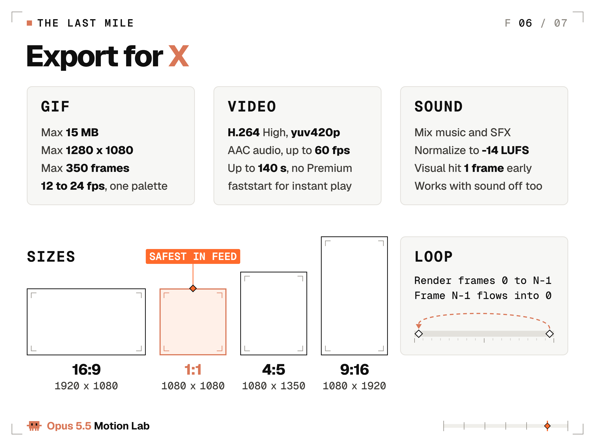

# Opus 5.5 Motion Lab: Make Claude Animate Like a Studio

> Automatisch per `npm run ingest:x` erfasst. Quelle: [x.com/flxrnc/status/2105311836190978392](https://x.com/flxrnc/status/2105311836190978392)

## Artikel-Volltext

Every animation in this lab was made by Claude Opus 5.5, and each one comes with the exact prompt that made it plus every follow-up it needed. No fake one-shots. Just motion design with receipts.
Since Opus 5.5 launched on September 22, the feed has filled with motion pieces captioned "one prompt". Some really were one line. The most viewed music video was five minutes of talking and a 12-hour run. Almost nobody posts the middle part: the second prompt, the third, the note that says "frame 84 peaks late".
This article is the lab notebook for that middle part. Three animations made by Opus 5.5, picture and sound, with every prompt and every follow-up printed. The numbers that made them work. The setup that takes you from an empty folder to a loop you can post on X.
The opening shot: liquid chrome that pours itself into a title, from a prompt full of numbers.
 
Six seconds, one loop: a chrome blob squashes, stretches and pinches into 7 drops, each drop pours into its letter, a glint sweeps the word, and the letters melt back into one wobbling blob. The liquid is a single raymarched shape drawn in a shader, the letters are real three.js TextGeometry, and the GPU rendered every frame at 60 fps with motion blur blended from subframes.
The exact prompt, pasted into Opus 5.5 as is:
 
One line in it comes from a real three.js trap. In r160, TextGeometry reads "height" for the extrusion depth, and a "depth" parameter is overwritten with 50, so letters meant to be 0.12 deep come out 50 deep. Pin the version, name the right parameter, and the trap is gone.
Follow-ups: 10, printed below exactly as they were sent. The first build already had the whole choreography, blob to drops to letters and back. Follow-ups 1 to 5 fixed what stills and measurements showed: white plastic instead of chrome, a glint that erased the P, bevels that fused the letters, drops that left the frame. Follow-ups 6 to 9 came from checking 12 transitions frame by frame and caught things like a bump that popped onto the blob at frame 85. The last one added a horizon line for the letter faces to reflect, so they read as chrome instead of flat charcoal.
 
Then the sound, from one more prompt. Opus 5.5 can't hear, so it scored the loop from frame numbers: every sound synthesized in code with the Web Audio API, no samples, and each hit landing 1 frame after its picture. It took 5 sound follow-ups, all from measuring the decoded audio, none from listening: the first hits peaked 8 to 11 ms late, the levels over the bed were uneven, the limiter squashed the final gloop, and the codec added 16 ms of padding at the seam.
 
The result: about 2 hours from the first prompt to the finished loop, including the 12 transition checks, plus about 45 minutes for the sound. The wobble that ends the loop runs straight through frame 0, so the seam never shows.
Every drop, light and camera move in that loop came from a number in the prompt or in a follow-up. That's the whole lab in one loop.
What's inside:
Experiment 1: the same 3D product shot from a vague prompt and a directed one, side by side
How it works: why Opus 5.5 writes code instead of pixels, and why that helps you
Setup from zero: no install, Mac or Windows
Prompt anatomy: the lines a directed motion prompt needs
The numbers: easing, springs, durations, stagger, beat grid
Experiment 2: anticipation, squash and stretch, overlapping action, follow-through and arcs on a 3D mascot
The lab loop: how Opus 5.5 checks its own frames
Equipment: Remotion, HyperFrames, GSAP, Motion, Three.js
The last mile: sound, perfect loops, export for X
Fixes: the failures you will hit, each with the prompt that fixes it
No After Effects needed. A browser and Claude are enough to start.
 
Experiment 1: Vague prompt vs directed prompt
The most copied motion prompt of launch week is 26 words long: make a 15-second showreel that proves "what an incredible motion designer you are". It comes from kirill sh, who posted it on September 24 with Opus 5.5 and GPT 6 Astra side by side, from an account with 885 followers. It passed 1.8 million views.
 
This is the original post. Many reruns followed within days. It makes a great model demo because the subject is the model itself: there is no brief to miss, so nothing can come out wrong.
Now point the same trick at your own launch. A showreel is a genre with known rules and no client. Your product, your words and your timing can all come out wrong, and a one-liner says nothing about any of them.
The other end of the scale is the most viewed Opus 5.5 music video, made by Donald. Credit where it's due: the song "Claude-Pop" and its first video are by deckard, posted on September 9, before Opus 5.5 existed. Donald made the Opus 5.5 version.
 
It crossed 3.6 million views. Donald calls it one prompt, and in the same post he says he spoke to his computer for five minutes and Claude worked for 12 hours. The one prompt was a spoken brief plus 12 hours of autonomous work: direction did the heavy lifting.
So the lab ran a controlled test. Same model, same subject (a pair of wireless earbuds), same technical line: one HTML file, three.js, 960x1080 per side, a 6-second loop. Only the direction changes.
 
Watch one full loop of each side before you read the prompts. The left is what three adjectives buy. The right is what 448 words of direction buy.
Prompt A, vague (left side):
 
Prompt B, directed (right side):
 
Follow-ups: left side 0, by design. It is the untouched first output of a separate context that saw only Prompt A, and it came back as dark navy space, a glowing halo ring, bloom, particles, spinning buds and a made-up tagline: most of Prompt B's banned list. Right side: 15 follow-ups in 4 review rounds, printed below exactly as they were sent. The labels and the split were added after rendering.
 
The sound, one more prompt with the same rules: one soundtrack for the split screen, with every hit on the directed side's beats. It took 12 sound follow-ups in 4 rounds, all from measurements: the first mix put 80% of its energy under 60 Hz, where phone speakers play nothing, and the hits sat only 0.5 to 1.6 dB over the bed.
 
The result: about 30 minutes for the left side and about 90 for the right, review rounds included, plus about 90 minutes for the sound. The last picture note is the kind of error only a frame-by-frame check catches: one extra held frame on the beat.
What changed between A and B:
"Premium" became materials: satin ceramic at roughness 0.38 with a 0.35 clearcoat, chrome at roughness 0.05, and Claude orange only on the deck.
"Cool" became a studio: a key, a fill and a rim light with exact colors and strengths, reflections from a studio built in code, soft contact shadows. No glow anywhere.
"Modern" became a camera: a 30-degree field of view, a camera that never parks, an orbit from 34 to 10 degrees and one push-in on easeOutExpo at 2.0 s.
"Animation" became beats and springs: 120 BPM, a 3-frame anticipation before the lid springs open at damping ratio 0.6, then buds rising at 0.7 with a looser 0.5 follow-through.
The defaults got named: bloom, glow orbs, neon, particles, spinning turntables, dark backgrounds and text, banned by name. The left side shows almost every one of them.
Adjectives are where the default look lives. Every adjective you replace with a number is a decision you take back from the model.
 
How Claude Opus 5.5 actually makes motion
Opus 5.5 outputs text. Every motion design clip in the feed is a program that draws frames, and a browser records them. Gideon Frost of OrcaRouter said it in one line: "Claude Opus 5.5 does not generate pixels. It writes code that paints pixels."
In practice the program is usually one HTML file. Open it in a browser and it plays. Point a headless browser at it, freeze it at each frame, save the PNGs, and ffmpeg stitches them into a GIF or an MP4.
Code instead of pixels has three consequences you can use:
Every frame is reproducible. Eric Kang's rule on the Hugging Face blog: "Every pixel is a pure function of t." Render frame 84 twice and you get the same image twice.
Edits are cheap. You change one number and re-render. No re-rolling a video model and hoping.
Opus 5.5 can check its own work. Anthropic says that even at its lowest effort setting it reads dense charts more accurately than Opus 5 did at its highest, and that it is better at seeing what changed between two versions of a diagram. A contact sheet of your animation is exactly that kind of image.
 
 
Posted on launch day by Kevin Ngo: "Claude Opus 5.5 drew every frame of this animation in JavaScript." It is a 28-second story in which a whole town sends Claude requests, and it passed 640K views. Code-drawn frames can carry a character and a story too.
The render contract. Paste it under any motion prompt so every frame can be rendered, checked and fixed:
 
Each line closes one way a render goes wrong. A clock or a timer makes frame 84 come out different on every run. Unseeded randomness makes shapes jitter from frame to frame.
Rendering frame N of a loop shows the first frame twice, which is the hiccup at the seam. All three are in the fixes table near the end, because all three will happen to you at least once.
 
Set up the Opus 5.5 lab from zero (no install, Mac or Windows)
Three ways in. Pick by how much you want to install.
Path 1: no install, in the Claude app
Open Claude and pick Opus 5.5 in the model menu.
Paste the opening-shot prompt from the top of this article.
Claude writes the HTML and plays it in the preview panel.
Ask for fixes with frame numbers, for example "the punch at frame 84 peaks late, move it 2 frames earlier".
Download the file, open it in Chrome and record the screen (Cmd+Shift+5 on a Mac, the Snipping Tool's video mode on Windows).
One tip for the app: ask for a frame counter in a corner and a space bar that pauses, so your notes can name exact frames. Remove both before the final recording.
A screen recording is fine for a first post. It isn't frame-exact and can drop frames, so for anything that goes in a portfolio, use path 2 or 3.
Paths 2 and 3: Claude Code on Mac or Windows
Claude Code can render frames, open them and fix the code without you copying anything around. Install it with the one-line installer from Anthropic's Claude Code docs, then set up the lab:
 
 
Two Windows notes. Windows PowerShell 5.1 has no &&, which is why the commands use a semicolon. If PowerShell refuses to run npx, type npx.cmd instead.
Then save this renderer as render.mjs. It opens your HTML in a headless browser, freezes it at every frame and saves the PNGs. It builds the file URL with pathToFileURL, so Windows paths work too.
 
One command, node render.mjs anim.html 6 24, and 144 PNGs land in out/frames. The ffmpeg line at the bottom turns them into an MP4. Every frame is exact because every PNG is the page frozen at one precise t, however slow your machine is.
The 3D showcase pieces in this lab use the same renderer idea with two upgrades. The browser renders on the real GPU (an RTX 4060 Ti here) instead of in software, at 60 fps. And every output frame averages several subframes spread over half a frame, blended in linear light, which is how a 180-degree film shutter records motion blur.
From then on you rarely type commands yourself. Tell Claude Code "render anim.html with render.mjs, open frames 0, 24 and 48, and tell me what you see before you change anything", and it runs the loop from there.
Now the effort setting. Opus 5.5 starts at medium. Anthropic says medium matches or beats Opus 5 at high on its coding and knowledge-work evals, and recommends keeping xhigh and max for work where you measured a gain. Lab rule: medium for everything; raise it only when a from-scratch piece misses twice.
Fast mode (/fast in Claude Code) runs up to 2.5x faster at $8 and $40 per million tokens instead of $4 and $20. On Pro, Max, Team and Enterprise plans it bills from usage credits, not from your plan's limits. It's for iteration sprints, when speed matters more than cost.
 
Shikhar's 3D browser world passed 1.75 million views. He built it from Blender assets, generated images and Three.js, and captioned it "Third iteration with Opus 5.5 medium." Medium effort and a third iteration made one of the biggest pieces of launch week.
 
Anatomy of a directed motion prompt
A directed prompt isn't long for its own sake. Each line removes one decision the model would otherwise make for you, and the model's own decisions are the default look.
Anthropic's Opus 5.5 prompting guide says this directly: without design direction, Opus 5.5 "falls back on a few default styles", and a general line like "avoid a generic AI look" mostly swaps one default for another. What works is naming the exact patterns to avoid, checking which defaults the first result used, and extending the list.
 
The template. Fill every line before you press enter:
 
Prompt B in Experiment 1 is this template filled in, plus MODEL and CAMERA lines for 3D.
Write GOAL first. If you can't say in one sentence what the viewer should feel or do, Opus can't animate it, and no easing curve will rescue the piece. Then TIME, because every other number hangs off the frame count.
SHOTS is where the story lives. Give each shot a frame range, one hero move and a handoff: a hard cut on the beat, a match cut where one shape becomes the next, or a mask wipe. Default to the cut. A transition should be a decision.
The QA line matters more than it looks. It makes Opus check stills before it renders the whole clip, and that is where the lab loop below starts.
The motion ban list the lab starts from:
purple or blue gradients, glow, lens flares
floating particles as decoration
everything fading in at once
fade-and-slide-up on every element (Anthropic's frontend-design skill calls this the generic default that reads as AI-generated)
centered-everything layouts
text that moves while it is being read
Keep the list alive. After every first render, name what the model used anyway and add it. That's Anthropic's own advice, and it works on motion the same way it works on web pages.
One hero per shot. The same skill puts it well: a single orchestrated moment lands better than scattered effects. Everything else waits, dims to 40%, or holds still.
Then give the rest a rank. Secondary moves travel 50 to 70% as far as the hero and start 100 to 200 ms after it. Ambient motion stays under 5% of the hero's travel, runs on a slow sine and never stops.
Rexan Wong, whose breakdown of the trend reached about 600K views: "the context you give it is what makes it look pro."
 
The motion numbers cheat sheet
Motion designers talk in curves and frames, so give Opus 5.5 curves and frames. Here are the numbers and where each one comes from.
Easing. The values below come from the standard Easings reference by Andrey Sitnik.
 
The rules: enter with ease-out, exit with ease-in and make exits 40 to 50% shorter (Material 3 pairs a 400 ms entrance with a 200 ms exit), move across the screen with ease-in-out. Linear only for rotation, progress bars and the phase of a loop. Linear easing on a move is the fastest way to make a render look like a render.
Springs. Every library names its knobs differently. One number translates between all of them: the damping ratio (the formula is in the code below). 1.0 never bounces. 0.7 to 0.85 feels premium. 0.4 to 0.6 is playful. Under 0.3 is a cartoon.
Remotion's default spring (mass 1, damping 10, stiffness 100) works out to 0.5; react-spring's default (tension 170, friction 26) to 1.0. Material 3's rule is worth stealing: position and size may bounce, opacity and color never do.
 
The spring function needs no simulation. It returns the progress at any t directly, so frame 84 renders on its own without computing frames 0 to 83, which is exactly what the render contract asks for. Hand the file to Opus 5.5 with one line: use only these tokens, no inline numbers.
Durations and stagger. UI feedback takes 100 to 200 ms (Nielsen Norman Group: 100 ms feels instant). The rest are the lab's starting points: UI moves 200 to 500 ms, hero reveals 600 to 900 ms, letters 1 frame apart, words 60 to 120 ms, list items 40 to 80 ms. Start the next element when the previous one is 30 to 50% done: fully sequential looks robotic, all at once looks cheap.
For video, say it in frames. At 24 fps one frame is about 42 ms, so a 400 ms move is 10 frames and a 750 ms reveal is 18.
Beat grid. Frames per beat = fps x 60 / BPM. At 120 BPM and 24 fps that's 12 frames. At 128 BPM and 30 fps it's 14.06, so compute every beat from time and round each one. Adding a rounded 14 again and again drifts off the music: after 32 beats you are 2 frames off.
Cut on the beat and change the layout on the bar, every 4 beats. Changing everything on every beat wears the viewer out.
Holds. On-screen text stays at least 0.3 s per word plus 0.5 s, so a two-word title needs 1.1 s. During a hold, a slow 2% push keeps the frame alive while the words stay readable.
Camera. Camera moves get the softest curves, like ease-in-out-quart; objects get the snappier ones. For parallax, start with speeds of 1.0 for the foreground, 0.5 for the middle and 0.2 for the background.
Contrast and flashes. Keep text at 4.5:1 contrast on every frame, including over moving backgrounds, and never flash more than 3 times per second. Both numbers come from WCAG, the web's accessibility standard.
 
Screenshot this one.
 
Experiment 2: Five animation principles on a 3D mascot
Frank Thomas and Ollie Johnston wrote down Disney's 12 principles of animation in The Illusion of Life (1981). Five of them do most of the work in a short loop, and every one of them can be written as frames and sizes. This experiment gives Opus 5.5 the pixel Claude mascot rebuilt in voxels, a miniature studio and nothing but numbers.
 
Eight seconds, one loop: three studio lights click on, the mascot hops pad to pad along a floor that is a motion-tool timeline, then flips back to the first pad along a dotted arc. Each principle's label lights on the frame it happens, and a playhead tag tracks the frame. It is built in three.js and rendered on the GPU at 60 fps with motion blur blended from subframes.
The exact prompt:
 
Follow-ups: 4, printed below exactly as they were sent. The first build already had everything the prompt lists: the voxel mascot, the timeline, 5 diamonds, the playhead, 3 light stands, the labels, the arc and the flip. The follow-ups fixed the look and the framing: a washed-out grade, props crossing the label block, a rim light seen edge-on and a top light whose click didn't read. Separately, a numeric audit read the live scene on all 480 frames and compared it with the prompt's numbers: 71 checks, from the blink on frame 432 to the feet touching each pad. The first run failed 6, and all 6 were fixed before the final render.
 
The sound, one more prompt with the same rules. No sound follow-ups were needed: the first build already matched the prompt's numbers. The technical fixes, like a Web Audio gain node that starts at full volume and a compressor that adds 6 ms of delay, are logged separately.
 
The result: about 2 hours from the first prompt to the finished loop, renders included, plus about 70 minutes for the sound. All 71 checks pass: every label lights on its printed frame, and every landing touches its pad on the planned frame.
The five principles on the checklist, plus the two that ride along with every move, written the way the prompt writes them:
 
The labels double as a test. The prompt pins each one to a frame (69, 140, 200, 285 and 303), so a move that runs late shows up on screen as a label that lights before its move.
The prompt also says what may not change. The mascot keeps its pixel proportions exactly: a 14x10 body, 3x2 arms, 2x3 legs and 2x3 eyes, built from 0.1 voxels and 8 deep. That line is the guardrail that keeps the character recognizable in 3D. Every style you care about needs a line like that.
The set is the lesson. Motion tools show keyframes and a playhead so animators can check timing. Here they are the floor, and the playhead crosses each diamond on its landing frame. For your own pieces, ask Opus for a playhead and frame labels while you iterate, then switch them off for the final render.
The rest of the twelve still apply. Staging is the one-hero rule from the prompt anatomy. Exaggeration matters more at phone size: push key poses 10 to 30% further than feels right, because the feed shrinks everything.
 
The lab loop: render, look, fix
The first render is a draft. The loop that finishes it: render stills, look at them, write notes with frame numbers, fix, and re-render only what changed. Two to four rounds is normal.
 
The trick that makes the loop cheap: freeze any frame by its URL. Paste this right before the closing body tag, open anim.html?t=2.5, and you are looking at the exact frame at 2.5 seconds. Opus can screenshot it and read it.
 
For the whole clip at once, a contact sheet puts 12 frames on one image. Opus reads it like a storyboard:
 
Two views borrowed from animators make the notes sharper. An onion skin stacks frames at low opacity: even spacing means robotic motion, and spacing that tightens near the keys means the easing works. A speed graph plots position per frame: straight lines are linear motion, sharp corners are dead starts and stops. Opus 5.5 can draw both and read both.
The follow-ups that work best, ready to paste. Each one points at frames, not feelings:
 
Pick one or two per round. Pasting all seven at once turns a fix into a rewrite.
When a note reaches you as a feeling, translate it before you send it:
"Make it pop": scale 1.0 to 1.08 to 1.0 over 6 frames, peak on the beat.
"Make it feel premium": ease-out-quint on entrances, springs at damping ratio 0.8, no overshoot on text.
"It drags": shorten each hold by 12 frames, one beat at 120 BPM and 24 fps, so every cut stays on the grid.
"It feels busy": one hero move at a time; everything else starts 150 ms later at 60% of its travel.
"It looks like AI": list the defaults it used by name, ban each one, and render again.
The lab's receipts, straight from the logs:
 
A creative follow-up is any note that changes how the piece looks or moves. Technical fixes, like a capture hook or font loading, are logged too, in a separate list, and they don't count here.
Sound came last, one prompt per piece written against the frame numbers: 5 sound follow-ups for the chrome loop, 12 for Experiment 1 and 0 for the mascot, all printed with their videos.
Other people's numbers look the same once they are honest about them.
 
Miles runs a design studio. His launch video took 3 prompts and passed 590K views, and he calls Opus 5.5 "insanely good" at motion design. Pros count prompts, and 3 is a good number.
 
Vox asked Opus 5.5 to explain gravitational lensing: one prompt, then three overnight polish rounds, 5 hours 28 minutes end to end, about $90 at API prices. The polish rounds are the product.
Count your follow-ups and post every prompt with the work. Receipts convince people; "one prompt" makes them suspicious.
 
Lab equipment: pick your engine
Opus 5.5 can write for every engine below. Name the one you want in the prompt, or it will choose for you.
 
Three.js is what this lab's three showcase pieces use: 3D scenes, lights, materials and shaders on WebGL, drawn by the GPU (r186 shipped September 24). For video, drive time from the frame number, never the clock. Give the camera numbers too: a field of view of 35 to 50 degrees is a good starting point.
Remotion turns video into React components, frame-exact, with official Agent Skills for Claude Code. Free for individuals and companies of up to 3 employees; bigger companies need a company license.
HyperFrames by HeyGen was open-sourced on April 17, 2026 under Apache 2.0. Agents write HTML, CSS and GSAP timelines, and its CLI renders the MP4. No company-license rule.
GSAP is the web's timeline library and is now 100% free, including SplitText, MorphSVG, DrawSVG and ScrollTrigger. Its license only bars building a no-code animation builder that competes with Webflow.
Motion (formerly Framer Motion) animates React apps under the MIT license. It animates live interfaces and has no video renderer.
Plain HTML and CSS needs zero installs and covers 2D loops under 10 seconds: type, shapes and UI. The renderer above turns it into a GIF or an MP4.
 
The lab's rule of thumb: one idea under 10 seconds, plain HTML. A series, a template or a data-driven video, Remotion. If you think in web pages and GSAP, HyperFrames. Anything 3D, Three.js. And when the motion lives inside a product instead of a video, Motion or GSAP.
Then put the engine in the OUTPUT line of the template, with its numbers. "A Remotion composition, 1920 x 1080, 30 fps, 450 frames" leaves Opus nothing to guess.
 
Chubby's 3-minute history of AI: "every frame is rendered from code", made with Claude Code and Remotion, about 7,400 lines of React and TypeScript, no stock footage, no image or video generators. About 196K views. The same approach scales from a 6-second loop to a 3-minute film.
 
Meng To's playable boat ride through Japanese scenery, with weather, day and night, and water reflections, built in Three.js and seen about 473K times. When the piece is 3D, name Three.js and let Opus build the scene.
 
The last mile: sound, loops and export for X
The part tutorials usually skip, and the part viewers notice first.
Sound. The feed plays video muted until someone taps, so the picture has to work in silence first. When you add sound, mix music and effects, normalize to -14 LUFS (a common loudness target for web video) and put each visual hit 1 frame before its sound, never after.
A sound that arrives before its picture feels wrong sooner than one that arrives a little late. Real life runs in the same order: light beats sound.
The three lab videos follow that rule to the sample: every sound synthesized in code with the Web Audio API, each hit peaking 1 frame after its picture, mixed to -14 LUFS with peaks at -1 dBTP. Opus 5.5 can't listen, so it checked the sync by decoding the finished MP4 and lining each hit up with its frame.
 
Loops. Render frames 0 to N-1, never N. Frame N is frame 0 again, and showing it twice is the hiccup people see at the seam. Drive every loop from phase = frame / N with whole-number cycles.
A square that turns exactly 90 degrees per loop, or a wave that completes exactly 2 cycles, lands back on its first frame. For organic drift, sample noise along a circle, so it comes back to where it started.
Make frame 0 a finished composition, too. It's the first thing on screen while a GIF loads.
Export. MP4 for posts, GIF for X Articles and inline loops. One palette for the whole GIF keeps colors from flickering between frames.
 
The X limits that matter, from X's media docs and Help Center:
 
At 24 fps, the 350-frame cap means a GIF tops out at about 14.5 seconds. A 4 to 6 second loop is 96 to 144 frames, well under it.
One timing trap in GIF exports: delays are stored in hundredths of a second, so a 24 fps frame (41.7 ms) can't be stored exactly. Round every frame to 40 ms and the loop runs 4% fast, off your beat grid. The fix: five frames at 40 ms, then one at 50 ms, which keeps a 6-second loop at exactly 6.00 seconds.
Pick the canvas before the first frame, because changing it later means re-directing every shot. The common sizes: 1920 x 1080 for 16:9, 1080 x 1080 for 1:1, 1080 x 1350 for 4:5 and 1080 x 1920 for 9:16. X accepts video between 1:3 and 3:1.
 
 
Leon Lin asked Claude Code on Opus 5.5 for a launch video for a made-up calendar app: name, logo, UI, animation, soundtrack and sound effects, all in code, from one prompt in about 8 hours. It passed 85K views. Sound can be code too.
 
When an experiment breaks
The same failures come back in every project. Here they are, each with the prompt that fixes it.
 
 
If a fix doesn't hold, ask Opus to render the two frames on either side of the problem and describe the difference. Spotting what changed between two images is exactly what its sharper vision is for.
 
When a fix works, add it to the render contract. The contract is the lab's memory: every line in it is a failure you never have to see again.
 
Experiment 3 is yours
The lab is open. Tonight's run:
Copy the opening-shot prompt and swap its words for your product or your name.
Run it on Opus 5.5 at medium effort, in the Claude app or in Claude Code.
Render stills at frames 0, 24, 48, 72 and 96, and write two notes with frame numbers.
Fix, re-render, and repeat until you run out of notes.
Export with the GIF command and post it with your prompt and every follow-up in the first reply.
Keep the numbers on the first run and change only the words. On the second run, change one number at a time, so you can see what each one does.
The model is the same for everyone. The numbers you give it are yours.
I post every new piece with its exact prompt and every follow-up, picture and sound. No fake one-shots. 
Follow @flxrnc so the next one lands in your feed, and bookmark this article so the numbers are here when you need them.

## Bilder

<!-- Reihenfolge wie von der API geliefert (Cover zuerst). Die Position im Artikeltext gibt die API nicht mit. -->

**Cover**

**video**

**photo**

**video**

**video**

**photo**

**photo**

**photo**

**photo**

**photo**

**photo**

## Post-Text

https://t.co/FdP7CWkLzE

## Links

- [x.com/i/article/2105…](https://x.com/i/article/2105052379590578176)

## Thread

### 1/2

https://t.co/FdP7CWkLzE

### 2/2 · Geprüfte Ergänzung des Autors

@thestevenochs next step for this: let Opus 5.5 cut it in code so every cut lands on the beat. at 120 BPM and 60 fps that's one hit every 30 frames
