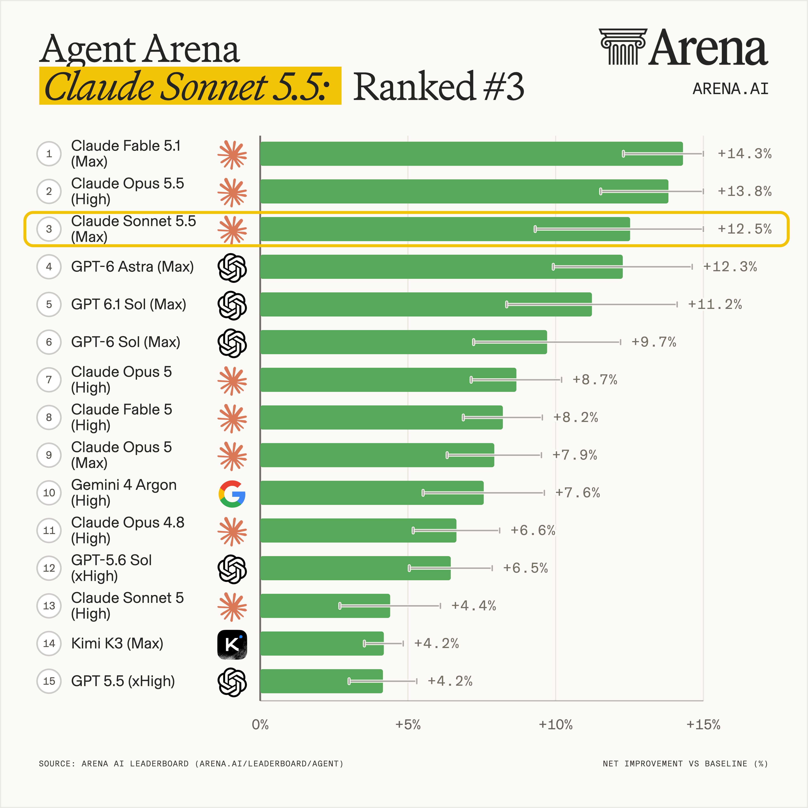

# Arena.ai (@arena)

> Automatisch per `npm run ingest:x` erfasst. Quelle: [x.com/arena/status/2106104809514516541](https://x.com/arena/status/2106104809514516541)

## Bilder

<!-- Reihenfolge wie von der API geliefert (Cover zuerst). Die Position im Artikeltext gibt die API nicht mit. -->

**photo**

## Post-Text

Exciting news: Claude Sonnet 5.5 (Max) by @AnthropicAI has debuted at #3 in the Agent Arena with +12.5% net improvement!

This release is a 8.1 percentage-point increase over Claude Sonnet 5 (High), which ranks #13 with +4.4% net improvement. By category, Claude Sonnet 5.5 secured the #1 spot in Chat (+15.6%) above both Fable 5.1 (+11.49%) and Opus 5.5 (+10.29%).

This performance comes with a higher cost: Claude Sonnet 5.5 (Max) has a median cost of $2.74 per task, about 73% higher than #2 Claude Opus 5.5 (High) at $1.58.

@AnthropicAI models now hold all three top positions in Agent Arena. Congrats to the team!

## Thread

### 1/2

Exciting news: Claude Sonnet 5.5 (Max) by @AnthropicAI has debuted at #3 in the Agent Arena with +12.5% net improvement!

This release is a 8.1 percentage-point increase over Claude Sonnet 5 (High), which ranks #13 with +4.4% net improvement. By category, Claude Sonnet 5.5 secured the #1 spot in Chat (+15.6%) above both Fable 5.1 (+11.49%) and Opus 5.5 (+10.29%).

This performance comes with a higher cost: Claude Sonnet 5.5 (Max) has a median cost of $2.74 per task, about 73% higher than #2 Claude Opus 5.5 (High) at $1.58.

@AnthropicAI models now hold all three top positions in Agent Arena. Congrats to the team!

### 2/2

Dive into the Code Arena: WebDev leaderboard at https://t.co/CY0WQfSRRg

## Erfassungsnachweis vom 24.10.2026

Angefragter Post: https://x.com/arena/status/2106104809514516541

Im geprüften API-Abruf enthalten: 2 Post(s). Die Zahl ist kein Nachweis eines vollständigen Threads.

- [Post 2106104809514516541](https://x.com/arena/status/2106104809514516541)
- [Post 2106104813230739745](https://x.com/arena/status/2106104813230739745)
