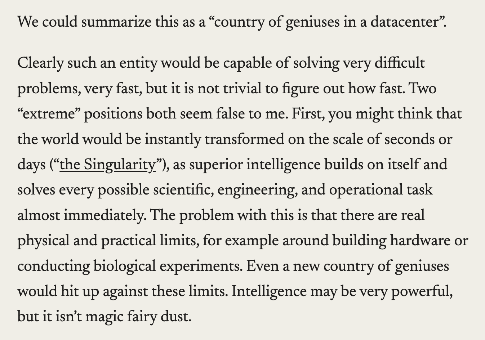
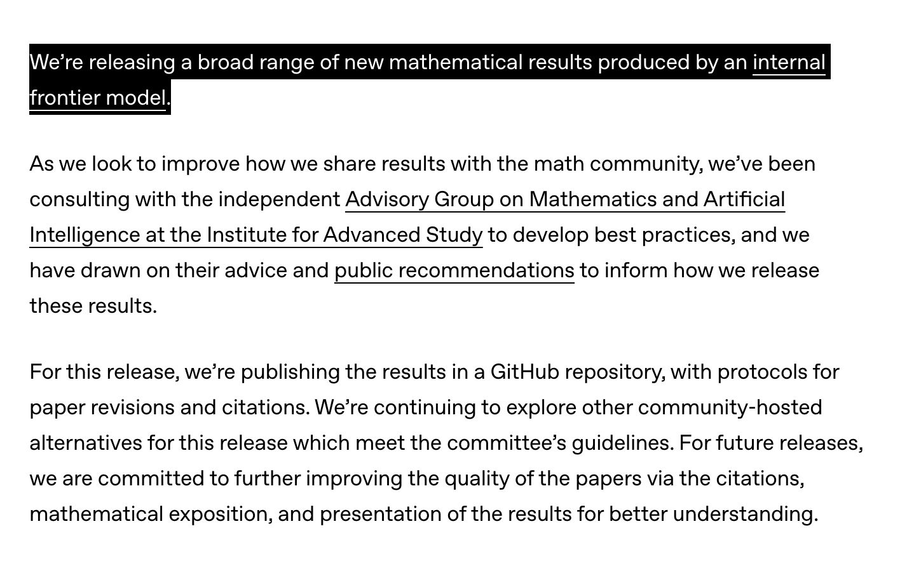
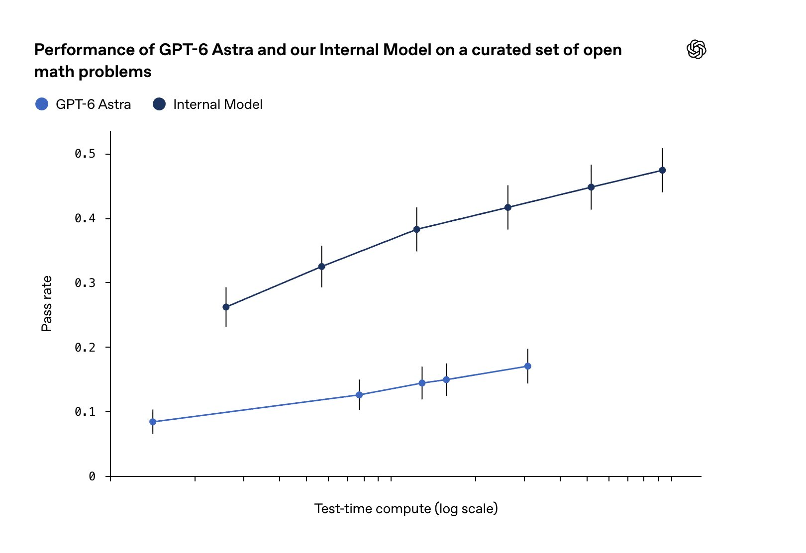

# Chubby♨️ (@kimmonismus)

> Automatisch per `npm run ingest:x` erfasst. Quelle: [x.com/kimmonismus/status/2107804082106782041](https://x.com/kimmonismus/status/2107804082106782041)

## Bilder

<!-- Reihenfolge wie von der API geliefert (Cover zuerst). Die Position im Artikeltext gibt die API nicht mit. -->

**photo**

**photo**

**photo**

## Post-Text

A few thoughts on OpenAI’s latest mathematics announcements.

History was made yesterday. I say that without exaggeration, even though I am not a mathematician myself, because numerous mathematicians have confirmed it. Leading experts in their fields see this as a historic breakthrough.

Hundreds of problems that had remained unsolved for decades, problems that some of the brightest minds had wrestled with, were solved in a remarkably short time by OpenAI’s new internal model. OpenAI’s repository contains 722 manuscripts grouped into 372 result families. 

Two things are particularly important here:

-OpenAI attributes its earlier reported solution to the Navier-Stokes Millennium Prize Problem and its subsequent mathematical results to the new internal model whose training began on August 28. OpenAI’s September update

OpenAI describes this model as significantly more capable than GPT-6 Astra and says its performance continued to improve during training. That supports the claim of substantial progress.

I would expect further improvements since those announcements. But the timing figures need care.

- For Navier-Stokes, OpenAI reports that the group which produced the result involved around 10,000 concurrent agents. The result arrived about 88 hours after the first agents were launched, followed by another 17 hours for Lean formalization and verification. 

For the new collection, OpenAI reports an average compute cost equivalent to roughly three hours of ChatGPT Pro thinking per result. That hints to an immense increase in efficiency and capabilities within a very short period of time.

I am convinced that we have now entered the age of the intelligence explosion. I mean that without exaggeration and with complete conviction.

We can see it. Anyone with eyes can see it. Anyone with ears can hear it.

Anthropic and OpenAI are competing to publish the biggest scientific breakthroughs as quickly as possible. And there is something we should keep in mind:

To me, the message is: There is no wall. There is no end in sight.

None of the scientists working there has even remotely suggested that these models are now hitting a limit or reaching a plateau. Quite the opposite: they all say the models are becoming faster and more capable.

Of course, that also raises questions about safety. But that is not what I want to discuss today. Instead, I want to draw attention to two things.

1. What is OpenAI’s current focus?

I mean this neither unkindly nor as an accusation.

OpenAI has explicitly identified building an automated AI researcher as a goal. It also discontinued Sora’s web and app experiences on April 26, 2026. I read that decision as a sign of greater focus, although the discontinuation alone does not establish the company’s broader priorities. OpenAI’s stated goals, Sora discontinuation

Against that backdrop, I wonder how releases such as its always-on agents fit alongside these significant research advances. OpenAI’s agent announcement

Some of the presentation feels childish and playful to me, and unnecessary in comparison with Anthropic. It makes me wonder whether OpenAI risks drifting off course again and directing important resources elsewhere.

That is a concern, not an established account of how the company allocates its resources. More a question than an answer.

2. 2026 feels like the turning point

Regardless of that, one thing is clear to me: this year feels like a turning point.

2026 is the year of agents.

Claude Code helped pave the way. Its public research preview launched on February 24, 2025 and got its big hype by end of 2025, and by 2026, agents were becoming increasingly embedded in research workflows. Claude Code’s launch, OpenAI’s research experience

I expect agents to become even more capable in 2027. My prediction is that 2027 will also be the year when superintelligence becomes a reality. That is a forecast I believe in.

I am reminded of Dario Amodei’s essay Machines of Loving Grace. He described the possibility of powerful AI arriving as early as 2026, while explicitly acknowledging that it could take much longer, but to me it seems his forecast was acorrect.

If we already think this year has been completely wild and almost impossible to keep up with, then I believe 2027 will be the year when we find ourselves in a constant state of amazement.

Now is the time to talk about the future. It will not wait for us.

We need to consider what a new society could look like. AI agents will take over work, first in white-collar occupations and then increasingly elsewhere.

We need to discuss how we understand work and, above all, how wealth will be distributed if jobs disappear without being replaced. I do believe that will happen.

That does not have to be entirely negative. It could also be an opportunity, because I believe people will always find meaning for themselves.

A simple example: anyone can buy chairs at IKEA. Yet plenty of people still build their own in their spare time.

People find meaning in their work, even without paid employment. But for many, paid employment will be the first thing to disappear.

These are thoughts I would like to discuss.

The future is now. Everything will change. There is no going back.

## Links

- [pic.x.com/jlIGhbeuGo](https://x.com/kimmonismus/status/2107804082106782041/photo/1)

## Erfassungsnachweis vom 24.10.2026

Angefragter Post: https://x.com/kimmonismus/status/2107804082106782041

Im geprüften API-Abruf enthalten: 5 Post(s). Die Zahl ist kein Nachweis eines vollständigen Threads.

- [Post 2107804082106782041](https://x.com/kimmonismus/status/2107804082106782041)
