# Motion Engineering with Opus 5.5: Build Launch Videos You Can Sell

> Automatisch per `npm run ingest:x` erfasst. Quelle: [x.com/beamnxw/status/2108616740846420354](https://x.com/beamnxw/status/2108616740846420354)

## Artikel-Volltext

Tell Opus when the card should land, when the product should respond, and how long the headline should stay readable.
Assign frame numbers to the reveal, entrance, reading hold, and cursor action so each can be edited separately.
For a short film built around one product action, keep the copy, assets, and movement decisions in a brief.
 
 
Give the reference a job
 
Choose a reference for one thing you want to understand.
A card entrance with a controlled landing.
A transition that keeps the product in view.
A cursor action that makes the result obvious.
Follow the main object from its first visible position to its landing and note what the movement reveals.
Mark when the text becomes readable and when the next event pulls attention away.
You are collecting decisions you can use in your own scene:
How the shot introduces the product.
What moves first.
Where the eye should land.
How much time the result receives.
Use the card's entrance with your own logo, copy, and product screen.
Sample two images per second for an overview, then inspect consecutive source frames and timestamps around important events.
Paste this into Claude Code with your reference available as reference.mp4:
 
Check important positions against the extracted images because Claude's spatial estimates are approximate. Claude vision guidance
 
Choose an available typeface and adapt size relationships from the reference to fit your own words.
 
Write the shot as an event
A product shot should have something the viewer can follow.
Show the starting state.
Put the cursor on the action.
Register the press.
Reveal the result.
For example, an export demonstration can move from a filled report to a button press, then show the finished file.
Hold the finished file on screen long enough to read its name before the next cut.
The product scene in the worked example uses this timeline:
 
Use these values for the first preview, then adjust any interval that feels rushed or empty.
At 30 frames per second, the press at 6.5 seconds lands on frame 195. The closing shot begins at frame 420.
Keep the reference's timestamps labeled with its source frame rate.
At 30 frames per second, a half-second move takes 15 frames; in a 60-frame-per-second reference, it takes 30.
 
Five decisions belong in the brief
 
Save this worked example in BRIEF.md, replacing bracketed fields with real assets and copy.
Coordinates, colors, and timing are starting choices for this exercise; review them against your product screens.
 
Use a short opening line and let the product demonstration carry the explanation.
Move any explanation that needs several sentences into its own scene.
 
Check the longest version of the copy
Use the longest headline you expect to reuse when checking the opening layout.
If it wraps onto three lines, pause the motion pass. Shorten the copy, widen the text box, or move supporting information into another shot.
Record the layout limits alongside the styling:
Available width for the headline.
Maximum number of lines.
Space reserved for the logo.
Final positions of the text and product card.
Keep explicit line breaks only where they improve the intended reading.
Check the actual font in the rendered image, including its weight and spacing.
When changing the headline => render its landing frame again before reviewing the entrance in playback.
Apply the same check to the closing action, especially when replacing a short product name with a longer one.
 
Make every frame reproducible
Remotion uses React components and the current frame number to render the moment you choose. Remotion fundamentals
 
 
Drive movement through `useCurrentFrame()` with interpolation or a spring for the changing values.
Drive animation with the current frame number to avoid flicker from independent Cascading Style Sheets (CSS) transitions. Animation guidance
 
Derive any random variation from a fixed seed so the selected frame remains consistent. Seeded randomness
Write scene timing in seconds first, then convert it to frames at the chosen frame rate.
A 0.6-second entrance takes 18 frames at 30 frames per second.
Store the entrance offset, destination, duration, and landing settings together so a revision touches one set of values.
 
Motion needs a purpose inside the shot
 
Entrance: introduce the main object.
Hold: leave time to read and understand it.
Cursor movement: identify the next action.
Transition: carry the viewer into the next state.
Tune the card's approach and landing with `spring()` duration, damping, stiffness, and overshoot controls. Spring settings
Keep the destination fixed while changing one parameter and replaying the entrance.
Start with the main object, then bring in supporting information after a small delay.
Try a 0.1-second offset between a headline and its supporting label, then tune the order in playback.
Specify a scale change from 1.00 to 1.03 over three seconds if you want a subtle push.
Constant percentage changes compound across frames.
During a reading hold, keep supporting movement quiet enough for the text to remain the focal point.
 
Decide what owns the screen
Keep attention on the button until its response appears, then let the result own the reading window.
If the cursor crosses a headline during a card entrance, delay one event or change the cursor path.
Count the reading window from the point where the words are legible.
A hold lasting eight frames at 30 frames per second gives the viewer about 0.27 seconds.
Play at normal speed and read aloud; extend any hold that ends before you finish.
Check interface labels at phone size.
For a fast card move, decide what blur should contribute to that specific entrance.
Inspect the sampled animation states blended by Remotion's motion-blur tools for smeared text and persistent trails. Motion blur
 
Give the agent a bounded request: apply blur during the card's entrance, let it settle with the movement, and keep the reading hold clear.
Render the entrance and adjacent cut, checking for a clean scene boundary and readable text after the card settles.
 
Three images can direct the next pass
Render an opening frame, a frame showing the product result and the closing card.
Inspect the message and composition before adding detail to the movement.
- Is the main text readable?
- Is the product result visible?
- Are elements cropped or overlapping?
- Does the closing action have enough space?
For the example `Launch` composition, use:
 
Choose the product-result frame with `--frame` and change frame 240 if it lands elsewhere in your timeline. Still rendering
 
Increase the gap where the headline touches the card. Reposition a result hidden behind another element.
Render the interval around the scene boundary and watch how attention transfers across it.
 
At 30 frames per second, this two-second range spans the opening's end and the product scene's beginning. Partial rendering
 
Give the agent an edit it can execute
 
Use four fields in a correction: location, observed problem, change, and what should remain fixed.
 
Fix missing information and unreadable text, then timing, then visual detail.
For an independent critique, open another session with the brief, images, and extracted frames.
Review up to five frame-specific corrections and send the accepted edits to the builder.
An effective repair loop stays local:
 
Label scene-local frames explicitly: local frame 30 in a sequence starting at global frame 120 corresponds to global frame 150. Sequence frame offsets
 
Sound has an event frame
Place the click on the visible press and the reveal sound's strongest hit on the visual reveal.
A soft lead-in or opening silence can shift the audible hit away from the file's start.
Use the waveform and playback to locate that hit, then offset the clip accordingly.
Write the cues beside the visual events:
 
Use your actual event frames for the cue list.
Keep sounds and music in separate tracks with adjustable placement and volume. Remotion audio
 
Check the loudest event, quietest useful cue, and ending through headphones and a phone speaker.
 
Put the tools in place
 
Install Node.js, Claude Code, FFmpeg, and FFprobe before creating the Remotion project.
Create the project and start its preview:
 
Select Claude Code in the skills installer, then start the model in a second terminal inside `launch-video`:
 
The skill installer configures implementation guidance for the selected coding agent. Remotion setup + Claude model selection
Put product assets under `public/`, the reference at `reference.mp4`, and the brief at `BRIEF.md`.
Create `frames/` for reference images and `out/` for exported previews.
Extract the reference overview:
 
This samples two images per second at a width of 960 pixels, preserving the aspect ratio. FFmpeg filters
 
Paste this into Claude Code after saving the brief:
 
Inspect the opening still before asking for the remaining scenes, using the earlier commands to review each new scene.
 
Export the film you actually approved
Once the picture and sound passes are accepted, render the whole composition:
 
Watch the exported file at normal speed, following the first message, product action, and ending.
Then inspect the metadata:
 
For the example brief, expect 1080 by 1080 pixels, a frame rate of `30/1`, and approximately 20 seconds of video. FFprobe metadata
Keep the approved render with its brief, scene timing, and audio cue list.
 
Longer films need scene boundaries
Give each scene an incoming state and an outgoing state.
For a continuous transition, use the card's ending position, scale, and highlighted field as the next scene's starting state.
Keep fonts, palette, spacing, and recurring elements in shared settings, with any deliberate scene exceptions recorded explicitly.
Work on one scene or a small related group, giving each task its assets, purpose, and boundary states.
When transitions overlap scenes, account for that overlap in the total duration. Remotion transitions
After a local edit, inspect both neighboring boundaries before watching the assembled film.
Save accepted entrance, cursor, and text components for the next launch; review their timing when the assets or copy change.
 
Your first product: the Launch Clip
 
Package the 20-second exercise as a launch clip for a developer releasing one feature.
For the export example, show a real report, animate the export action, and hold the finished file on screen.
The buyer receives a video they can attach to their launch post or place on their product page.
Keep the first package small:
- One feature and one approved script.
- One 20-second video at 1080 by 1080 pixels.
- One cover image taken from an approved frame.
- One revision round covering timing, copy, and sound.
Use $150 as an illustrative pilot price to test against your workload and buyer feedback.
Here is a draft offer you can adapt:
 
 
Make the sample before offering the package
Build one complete example with your own assets or a product whose owner has agreed to the demonstration.
Put the export beside its opening, action, and closing stills so a buyer can inspect the finished work.
Time the entire job, including asset preparation, feedback, rendering, and delivery.
 
Find a buyer with an upcoming launch
 
Choose a developer who has a working feature and a release date.
Identify one action their audience should understand, then draft a specific proposal: “Your export feature could be the entire 20-second clip.”
Share the sample and package details with a suitable prospect, then ask which feature they want to show.
Before starting, agree on the script, assets, deadline, payment terms, and revision scope.
Record where the client can use the final video and whether you may include it in your portfolio.
During production, send the three stills for direction approval, followed by the moving preview and final export.
Keep feedback tied to frame numbers so the included revision has a clear list of edits.
Remotion permits commercial video creation for users covered by its license; check the terms for your version. Remotion license
 
Save this so you don't lose it
Follow @beamnxw for more alpha :)
=> my substack
=> my telegram channel

## Bilder

<!-- Reihenfolge wie von der API geliefert (Cover zuerst). Die Position im Artikeltext gibt die API nicht mit. -->

**Cover**

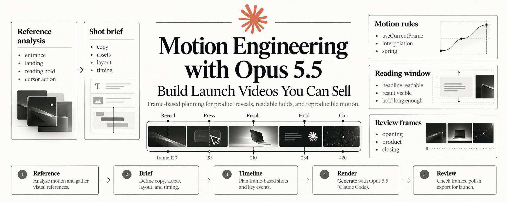

**photo**

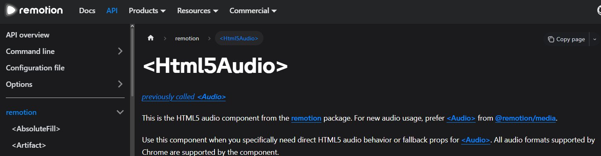

**photo**

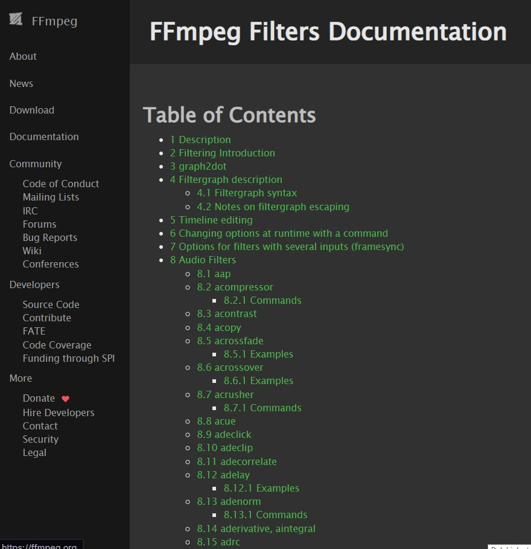

**photo**

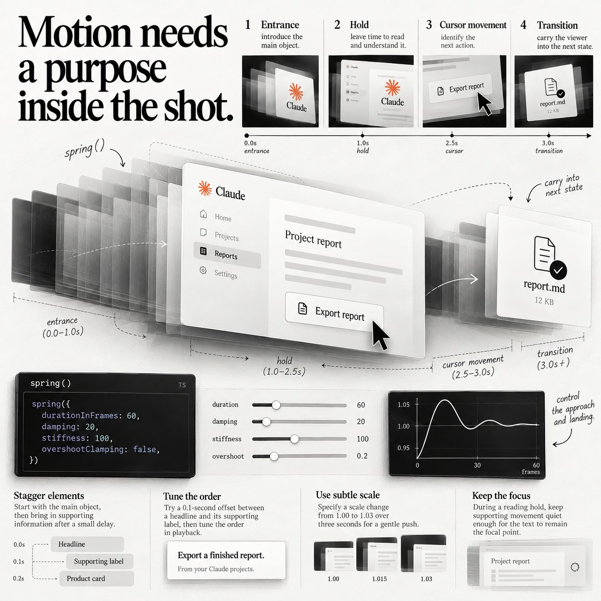

**photo**

**photo**

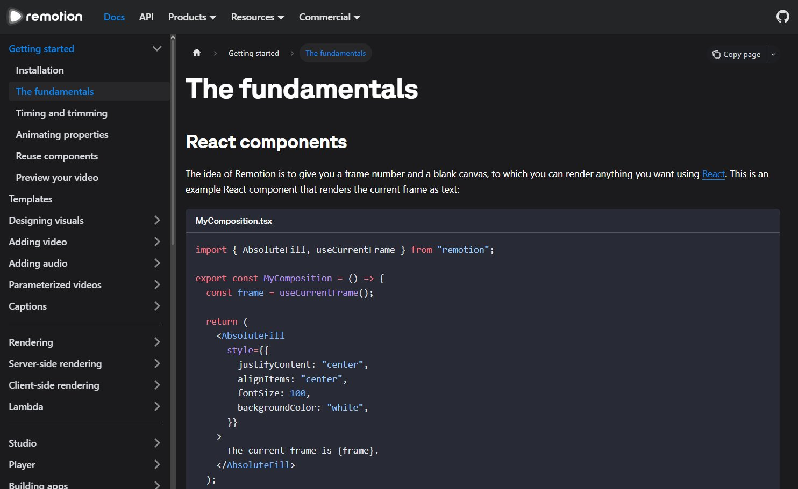

**photo**

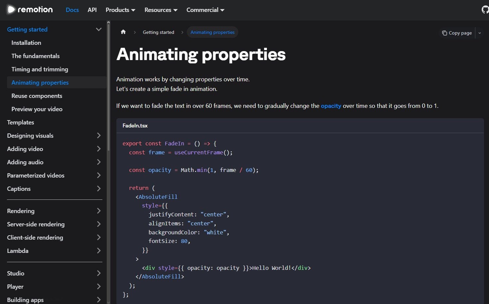

**photo**

**photo**

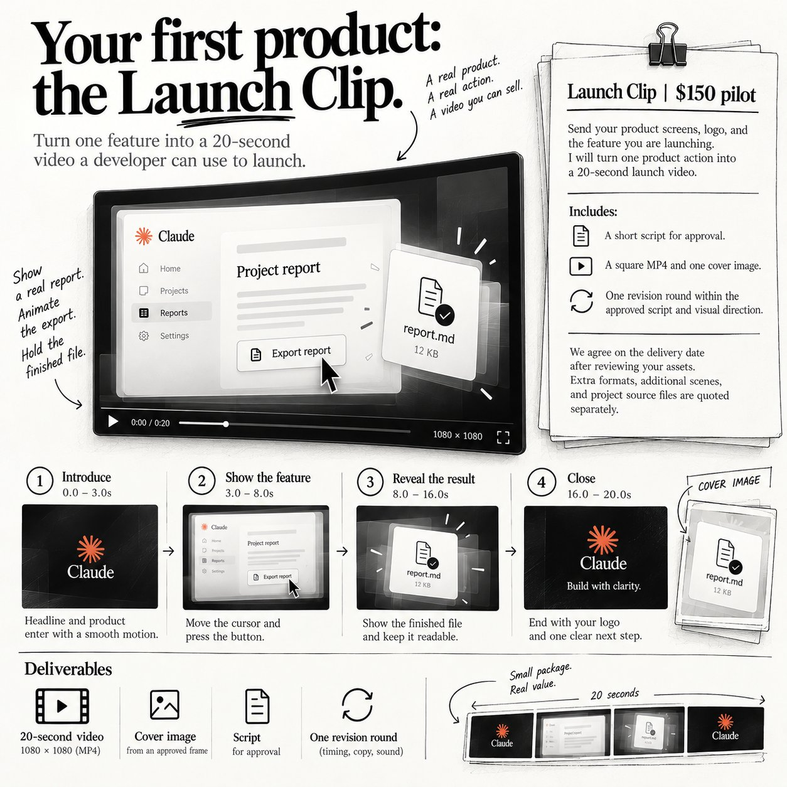

**photo**

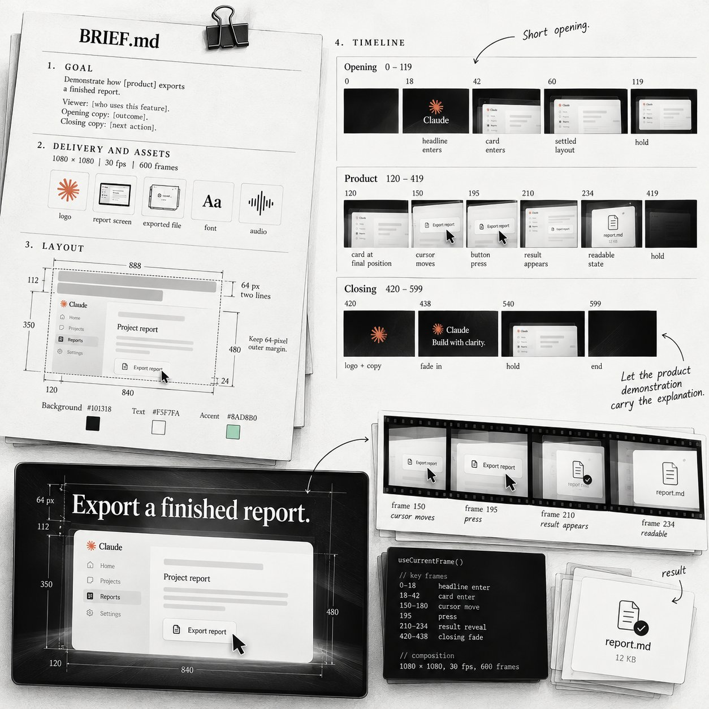

**photo**

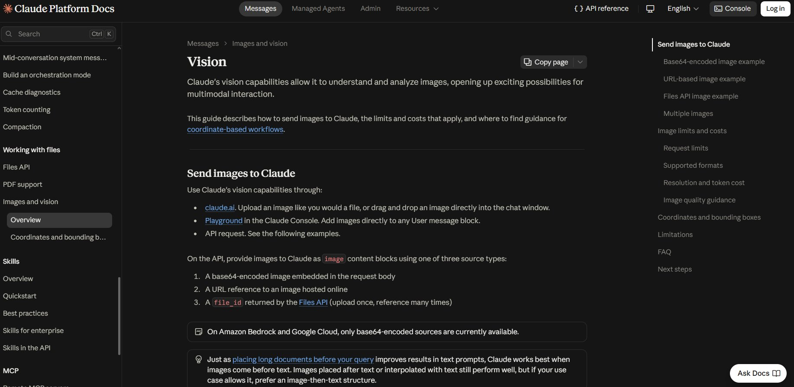

**photo**

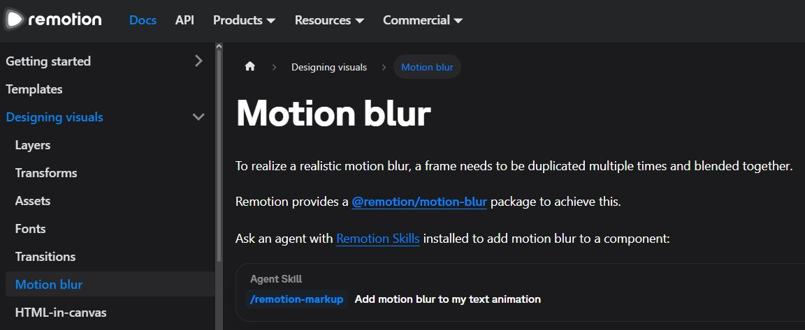

**photo**

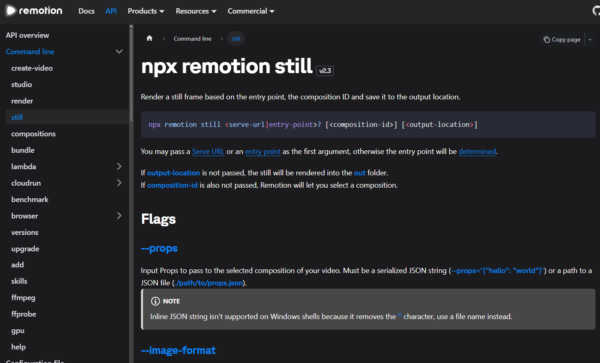

**photo**

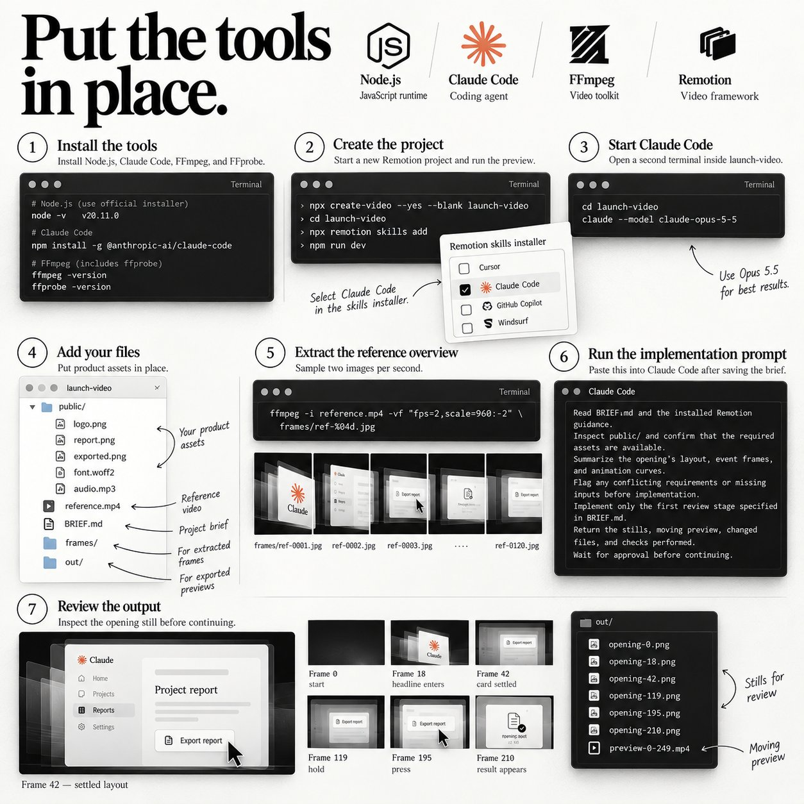

**photo**

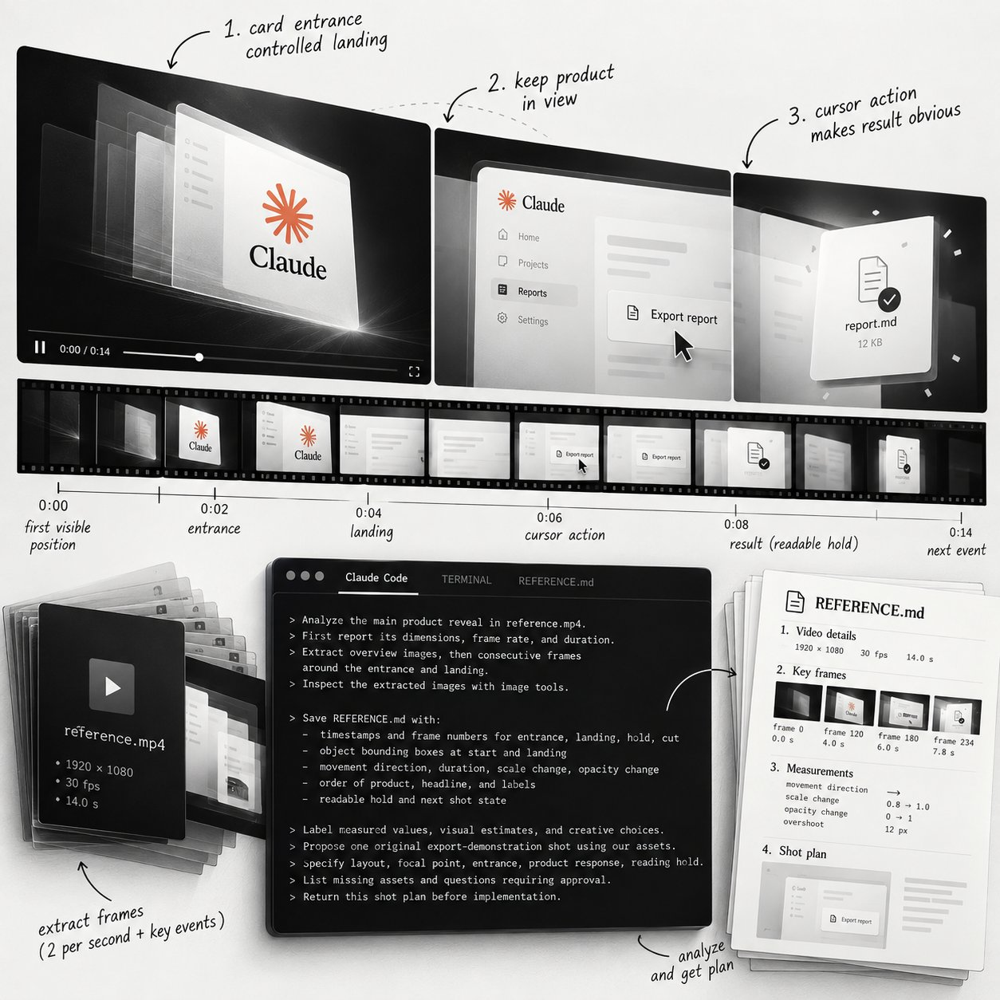

## Post-Text

Opus 5.5 can run a whole motion design studio

Sell a 20-second launch clip built from real product screens

Copy the motion engineering prompts and delivery process

Build your offer before the next product launch ↓ https://t.co/KjiDrYRDjQ

## Links

- [x.com/i/article/2108…](https://x.com/i/article/2108585693232455681)

## Thread

### 1/2

Opus 5.5 can run a whole motion design studio

Sell a 20-second launch clip built from real product screens

Copy the motion engineering prompts and delivery process

Build your offer before the next product launch ↓ https://t.co/KjiDrYRDjQ

### 2/2

my substack: https://t.co/zr0hXwkzJa :)
