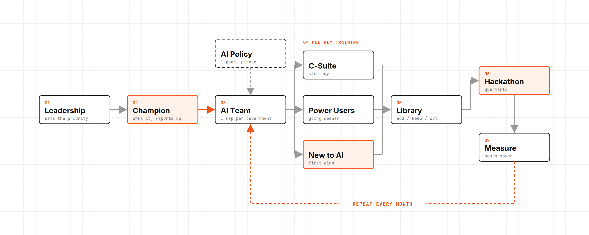

# The Full Guide to Making Your Team AI Native

> Automatisch per `npm run ingest:x` erfasst. Quelle: [x.com/lukepierceops/status/2108655186080342138](https://x.com/lukepierceops/status/2108655186080342138)

## Artikel-Volltext

Every company we talk to now asks for the same thing. They want their team AI native.
It used to come up after the build. Now it's often the first thing an executive brings up, before we've talked about a single departmental system.
Here's the full playbook for getting a team there and keeping it there with all of the new Ai launches and tool changes every week. Save this one so you have it when you start.
I got off a call earlier today with one of our long-term clients. They just closed a merger, so overnight they have two companies, two sets of tools, and two very different levels of comfort with AI.
He wants a series of workshops: one for the C-suite, one for the power users, and one for the people who've barely touched it. The power users are in these tools every day, but they aren't sure they're using them correctly. The people with no experience don't know where to start, so they don't. Leadership needs to understand it well enough to lead the change.
That call is a good picture of where companies are right now. Everyone wants their team AI native, and very few have a plan for getting there.
Quick disclaimer before we get into it: nothing in here is a guarantee of results. How fast your team gets there depends on your people, your tools, your industry, and how consistently you run this. Everything here comes from what we've seen across 80+ client companies at Boom, and yours will look different. Treat it as a framework, and nothing in it is legal, HR, or financial advice.
Why licenses and a lunch-and-learn don't stick
The usual first move is buying everyone a ChatGPT or Claude seat and running one workshop. Usage spikes for a week. A month later, a handful of people use it every day and everyone else is back to the old way.
What was missing was an owner. Someone showing the team how AI fits into the work they actually do, and someone keeping up as the tools moved. Getting a team AI native is an ongoing function you run, closer to how you run sales training than to a one-time software rollout.
What AI native actually looks like
The term gets thrown around a lot, so here's how we define it with clients.
Your team uses AI in its daily work without being told to. They stay current as the tools change. When someone spots a task that eats hours every week, they either build the fix themselves or bring it to the right person already scoped. And leadership uses it out in the open, so everyone else knows it's expected.
You'll know you're there when the best ideas start coming from the team instead of the top.
Step 1: Name a champion
Every company we've seen get this right has one person who owns it.
The champion is usually a curious operator the team already respects, often someone from ops. They don't have to be the most technical person in the building. In fact, the most technical person tends to build things nobody else can use. You want someone who can learn a new tool fast and then explain it to the person who's been doing the job the same way for ten years.
Here's what the champion owns:
Watching new tools as they drop and testing the ones that matter for your business.
Running the monthly training.
Building and updating the training modules.
Collecting use cases from the team and logging them.
Being the first stop when someone gets stuck.
Two things make or break the role. The time has to be real, written into their job instead of squeezed in after hours. They report to someone in leadership, so when they ask a department to change how it works, it carries weight.
Step 2: Build a continuous AI team
One of our clients put it well on a call recently. They're building what they call a continuous AI team, because the work never finishes. The tools keep moving, so the team has to keep moving with them.
The structure is simple. The champion leads it, and every department sends one rep: sales, operations, finance, customer service, whatever your org chart looks like. The group meets every two weeks.
That team owns four things:
The use-case backlog. Every idea from anyone in the company gets logged and ranked by how many hours it would save.
The library. Every training, guide, and prompt the company relies on.
The AI policy. What's allowed, what isn't, and who to ask.
The training calendar. What gets taught next month, and to whom.
The department reps are how this reaches every corner of the company. The champion can't sit in every team meeting, but the rep is already there.
Step 3: Write the rules so people feel safe using it
One of the biggest blockers we see is fear. People don't know what they're allowed to put into these tools, so they put in nothing.
Fix it with a one-page AI use policy. It should cover which tools and accounts are approved (company accounts, never personal ones), what data can go in and what can't (client data, financials, HR records), when a human has to review the output before it goes out, and who to ask when something isn't covered.
Keep it short, keep it in plain language, and pin it somewhere everyone sees it. Giving people clear permission is part of enabling them.
Step 4: Run a monthly training around real work
One hour a month, with the whole team or one department at a time.
Split it by level. One training for everyone loses half the room. Run separate tracks: one for leadership, on strategy and what to expect from the team; one for power users, on going deeper and checking they're using it correctly; and one for beginners, on getting their first few wins in their own role.
The format that works best for us is simple. Pick a workflow the team already runs every week. Show the AI version of it live. Then have them rebuild it themselves before the call ends, so nobody leaves without having done it once. Record the whole thing.
Generic "intro to AI" content is everywhere, and your team has probably already seen it. What changes behavior is seeing AI applied to their own work, with their own tools, by someone who knows how the job actually gets done.
Step 5: Build a library that stays current
Every training gets recorded, and those recordings become the start of an internal library. Add short how-to videos, SOPs, and a prompt library organized by role, so a new salesperson can find the prompts the best salesperson uses.
The library only works if it stays current. Once a month, the champion goes through it and sorts everything into three buckets. Add covers anything new that changes how the team works. Keep covers what's still true and still used. Cut covers what's outdated, and it gets removed the same week.
One test makes the cut decision easy: if it would confuse someone next quarter, it goes.
Step 6: Make it competitive
This is the step that turns a training program into something the team actually cares about.
Run a hackathon. Group departments into teams and have each one build the most useful AI workflow for their own job. Leadership judges it, and the winners get something real, like budget for their team, a day off, or a moment at the next all-hands. You walk away with a building full of people who've built something themselves and want to see it used.
For smaller teams, run a challenge instead. Two weeks, everyone in, and the goal is to find the biggest time savings in their own role.
Start a wins channel. A dedicated Slack or Teams channel where people post what they built and how much time it saved. It's free, and it spreads ideas faster than any training.
Add five minutes of show-and-tell to an existing team meeting. One person shows one thing they did with AI that week. It takes almost no time, and it makes using AI visible and normal.
Step 7: Protect the time
People won't learn something new on top of a full workload. If AI is a priority, it needs time on the calendar.
Two things work well. A weekly AI hour, blocked for everyone, where people work through the library or try something new on their own work. And champion office hours, where anyone can drop in with a question or an idea instead of waiting for the next training.
Step 8: Bake it into hiring and onboarding
If AI only lives in the training program, it stays optional. Put it into the parts of the business that already shape how people work.
New hires get the library and the AI policy in their first week, so they learn the AI-native way of doing the job from day one. Job descriptions mention it. Performance reviews ask one question: how have you used AI to improve your work this quarter?
And leadership goes first. When the CEO shares how they used AI this week, the team stops wondering whether it's really expected.
Step 9: Measure it
Track a few numbers so everyone can see it working. The continuous AI team reviews these every meeting, and leadership looks at them every quarter:
Active usage by person and by department.
Workflows rebuilt with AI.
Hours saved per workflow, timed before and after.
Ideas in the backlog, and how many shipped.
Training attendance.
Hours saved is the number leadership will care about most, because it's the one that shows up on the P&L.
Where an outside partner fits
You can run all of this internally. Where a partner helps is speed, and the systems themselves.
At Boom, every engagement now includes the build plus an enablement layer: monthly live sessions built around how your team works, a recorded library we review and update every month, and lifetime access for your team. We work alongside your champion until they can run it without us. For bigger teams, we add a hackathon and an on-site visit.
The goal is that by the end, your team can keep up without us.
If you want help building this for your team, apply at boomautomations.com/apply.
The checklist
Save this so you have it when you start, and work through it over the next 90 days.
Name a champion and protect real time for the role.
Stand up a continuous AI team with one rep from every department.
Publish a one-page AI use policy.
Run one hour-long training a month on real workflows, and record it.
Build a library and review it monthly: add, keep, cut.
Run a hackathon, or a two-week challenge for smaller teams.
Start a wins channel and five-minute show-and-tells.
Put a weekly AI hour and champion office hours on the calendar.
Add AI to onboarding, job descriptions, and reviews.
Track usage, hours saved, and workflows shipped.

## Bilder

<!-- Reihenfolge wie von der API geliefert (Cover zuerst). Die Position im Artikeltext gibt die API nicht mit. -->

**Cover**

## Post-Text

https://t.co/4JPO3Yzah8

## Links

- [x.com/i/article/2108…](https://x.com/i/article/2108653254766698496)

## Thread

### 1/1

https://t.co/4JPO3Yzah8
