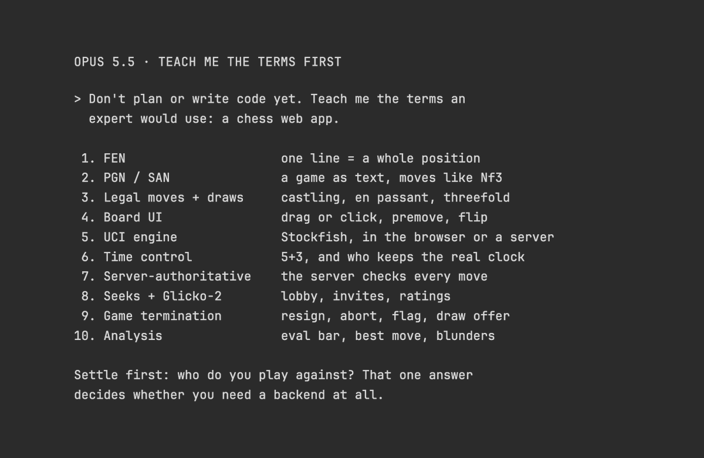

# Vox (@Voxyz_ai)

> Automatisch per `npm run ingest:x` erfasst. Quelle: [x.com/Voxyz_ai/status/2108663797091127377](https://x.com/Voxyz_ai/status/2108663797091127377)

## Bilder

<!-- Reihenfolge wie von der API geliefert (Cover zuerst). Die Position im Artikeltext gibt die API nicht mit. -->

**photo**

## Post-Text

Best thing I found this week for starting something you've always wanted to build but don't know much about: before you start, have Opus 5.5 teach you 𝟭𝟬 𝗲𝘅𝗽𝗲𝗿𝘁 𝘁𝗲𝗿𝗺𝘀 like this, then tell you which question to settle first.

Someone says a guy he knows burned 4 billion tokens building a chess web app. Thariq from Anthropic's Claude Code team quoted it and said this is the most common failure he sees: people outside their field can't say precisely what they want, so they go back and forth round after round.

Say you want to build a chess web app. It tells you the first thing to settle is who plays whom: online against other people, against the computer, or two players on one screen. That one choice decides 𝘄𝗵𝗲𝘁𝗵𝗲𝗿 𝘆𝗼𝘂 𝗻𝗲𝗲𝗱 𝗮 𝘀𝗲𝗿𝘃𝗲𝗿 𝗮𝘁 𝗮𝗹𝗹.

Save this and send it to Opus 5.5 before your next unfamiliar build 👇

"Don't plan or write any code yet. First teach me the terms an expert in this field would use, so I can spec it precisely: <what you're building>.

Give me 10 terms. For each one: one line on what it means, and one line on how it changes what I should ask you for. Then tell me which question I should settle first, and what it decides."

## Links

- [pic.x.com/S2eTt5SZjL](https://x.com/Voxyz_ai/status/2108663797091127377/photo/1)

## Thread

### 1/1

Best thing I found this week for starting something you've always wanted to build but don't know much about: before you start, have Opus 5.5 teach you 𝟭𝟬 𝗲𝘅𝗽𝗲𝗿𝘁 𝘁𝗲𝗿𝗺𝘀 like this, then tell you which question to settle first.

Someone says a guy he knows burned 4 billion tokens building a chess web app. Thariq from Anthropic's Claude Code team quoted it and said this is the most common failure he sees: people outside their field can't say precisely what they want, so they go back and forth round after round.

Say you want to build a chess web app. It tells you the first thing to settle is who plays whom: online against other people, against the computer, or two players on one screen. That one choice decides 𝘄𝗵𝗲𝘁𝗵𝗲𝗿 𝘆𝗼𝘂 𝗻𝗲𝗲𝗱 𝗮 𝘀𝗲𝗿𝘃𝗲𝗿 𝗮𝘁 𝗮𝗹𝗹.

Save this and send it to Opus 5.5 before your next unfamiliar build 👇

"Don't plan or write any code yet. First teach me the terms an expert in this field would use, so I can spec it precisely: <what you're building>.

Give me 10 terms. For each one: one line on what it means, and one line on how it changes what I should ask you for. Then tell me which question I should settle first, and what it decides."
