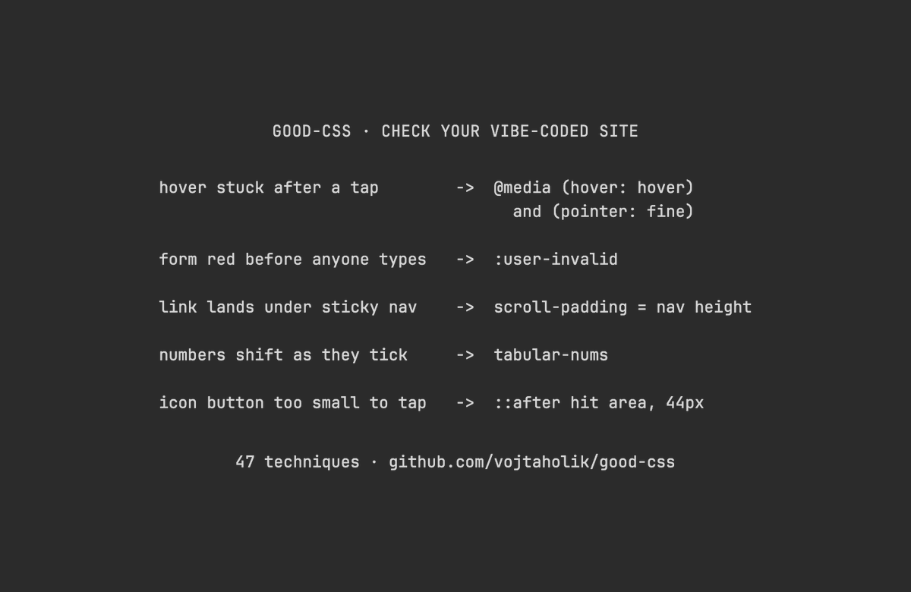

# Vox (@Voxyz_ai)

> Automatisch per `npm run ingest:x` erfasst. Quelle: [x.com/Voxyz_ai/status/2108875199164871053](https://x.com/Voxyz_ai/status/2108875199164871053)

## Bilder

<!-- Reihenfolge wie von der API geliefert (Cover zuerst). Die Position im Artikeltext gibt die API nicht mit. -->

**photo**

## Post-Text

Highly recommend installing 𝗴𝗼𝗼𝗱-𝗰𝘀𝘀 in Claude Code or Codex, then having Opus 5.5 use it to 𝗰𝗵𝗲𝗰𝗸 𝘁𝗵𝗲 𝘀𝗶𝘁𝗲 𝘆𝗼𝘂 𝘃𝗶𝗯𝗲-𝗰𝗼𝗱𝗲𝗱. It holds 47 modern CSS techniques, and with it installed, your agent tries them first whenever it writes styles.

A few on the list you can check right away:
→ Tap a button on your phone and 𝘁𝗵𝗲 𝗵𝗼𝘃𝗲𝗿 𝗲𝗳𝗳𝗲𝗰𝘁 𝗴𝗲𝘁𝘀 𝘀𝘁𝘂𝗰𝗸. Put hover styles inside (hover: hover) and (pointer: fine) so only devices with a mouse get them
→ Open a form and every required field is already red. Switch to :user-invalid so a field turns red only after someone edits it or hits submit
→ Click an in-page link and the heading lands under your sticky nav. Give html a scroll-padding as tall as the nav, and the jump lands just below it
→ A price or timer ticks and the text next to it shifts. Add tabular-nums so every digit is the same width
→ An icon button is too small to tap. Use a pseudo-element to grow the tap area to 44px without changing how it looks

Send this prompt to Opus 5.5 👇

"Install good-css following the README at https://t.co/dXWbMbn7eF, then read its SKILL.md and the reference files you need.

Then use it to check this project's existing styles (CSS files and Tailwind classes in components both count) for three kinds of problems:
1. Things that break on phones: hover states that stick after a tap, and tap areas smaller than 44px.
2. Things CSS can do that were built with scripts or a pile of breakpoints: dropdown menus, popovers, accordions, and layouts stitched together from several breakpoints.
3. Details: in-page links that land under the sticky nav, forms that open already full of red borders, ticking numbers that shift the text next to them, and focus rings that were removed.

Report only these three kinds and skip any the project doesn't have. Components that come from a component library don't count. For each issue, quote the original code, explain what goes wrong on which device, and suggest the smallest change, ranked by impact. Also note which browsers don't support a technique you use yet.

Show me the list of issues first. Don't change any code."

## Links

- [github.com/vojtaholik/goo…](https://github.com/vojtaholik/good-css)

## Thread

### 1/1

Highly recommend installing 𝗴𝗼𝗼𝗱-𝗰𝘀𝘀 in Claude Code or Codex, then having Opus 5.5 use it to 𝗰𝗵𝗲𝗰𝗸 𝘁𝗵𝗲 𝘀𝗶𝘁𝗲 𝘆𝗼𝘂 𝘃𝗶𝗯𝗲-𝗰𝗼𝗱𝗲𝗱. It holds 47 modern CSS techniques, and with it installed, your agent tries them first whenever it writes styles.

A few on the list you can check right away:
→ Tap a button on your phone and 𝘁𝗵𝗲 𝗵𝗼𝘃𝗲𝗿 𝗲𝗳𝗳𝗲𝗰𝘁 𝗴𝗲𝘁𝘀 𝘀𝘁𝘂𝗰𝗸. Put hover styles inside (hover: hover) and (pointer: fine) so only devices with a mouse get them
→ Open a form and every required field is already red. Switch to :user-invalid so a field turns red only after someone edits it or hits submit
→ Click an in-page link and the heading lands under your sticky nav. Give html a scroll-padding as tall as the nav, and the jump lands just below it
→ A price or timer ticks and the text next to it shifts. Add tabular-nums so every digit is the same width
→ An icon button is too small to tap. Use a pseudo-element to grow the tap area to 44px without changing how it looks

Send this prompt to Opus 5.5 👇

"Install good-css following the README at https://t.co/dXWbMbn7eF, then read its SKILL.md and the reference files you need.

Then use it to check this project's existing styles (CSS files and Tailwind classes in components both count) for three kinds of problems:
1. Things that break on phones: hover states that stick after a tap, and tap areas smaller than 44px.
2. Things CSS can do that were built with scripts or a pile of breakpoints: dropdown menus, popovers, accordions, and layouts stitched together from several breakpoints.
3. Details: in-page links that land under the sticky nav, forms that open already full of red borders, ticking numbers that shift the text next to them, and focus rings that were removed.

Report only these three kinds and skip any the project doesn't have. Components that come from a component library don't count. For each issue, quote the original code, explain what goes wrong on which device, and suggest the smallest change, ranked by impact. Also note which browsers don't support a technique you use yet.

Show me the list of issues first. Don't change any code."
