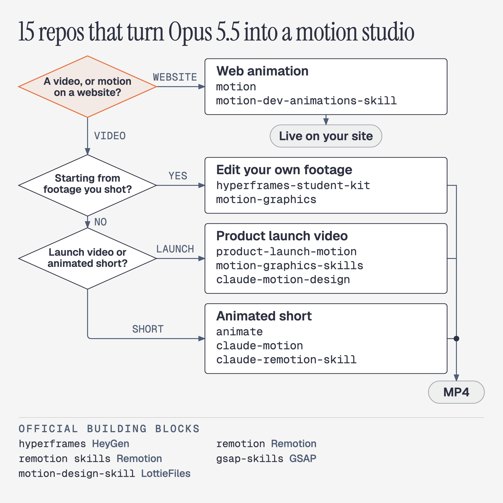

# Vox (@Voxyz_ai)

> Automatisch per `npm run ingest:x` erfasst. Quelle: [x.com/Voxyz_ai/status/2108905392776360333](https://x.com/Voxyz_ai/status/2108905392776360333)

## Bilder

<!-- Reihenfolge wie von der API geliefert (Cover zuerst). Die Position im Artikeltext gibt die API nicht mit. -->

**photo**

## Post-Text

These 15 GitHub repos turn your Opus 5.5 into 𝗮𝗻 𝗲𝗻𝘁𝗶𝗿𝗲 𝗺𝗼𝘁𝗶𝗼𝗻 𝘀𝘁𝘂𝗱𝗶𝗼.

Even the teams behind HeyGen, Remotion, GSAP and LottieFiles have stepped in to 𝘁𝗲𝗮𝗰𝗵 𝗔𝗜 𝗺𝗼𝘁𝗶𝗼𝗻 𝗱𝗲𝘀𝗶𝗴𝗻 𝘁𝗵𝗲𝗺𝘀𝗲𝗹𝘃𝗲𝘀.

I picked them from official and community repos and sorted them by use. Install them and you can make launch videos, edit your own footage and create animated shorts:

Product launch videos
→ product-launch-motion: hand it your product and it writes the script, adds a voice-over, moves the camera and grades the color, all the way to a finished launch video
https://t.co/EgWzdfxajZ
→ motion-graphics-skills: 13 skills for launch videos, animated charts and short videos. The author suggests switching to Opus 5.5 first
https://t.co/aF8dPpF3ej
→ claude-motion-design: picture and sound land on the beat of the music. The author made their own launch video with it on Opus 5.5 in 5 rounds
https://t.co/kaEVAx4sJk

Edit your own footage
→ hyperframes-student-kit: hand it your footage and it cuts the pauses and flubs, tightens the story, then adds motion graphics
https://t.co/qPWwGc6nPA
→ motion-graphics: wherever you're talking, it drops in an animation right there. It can also cut a person out of the background
https://t.co/JbPZQtLlUZ

Animated shorts
→ animate: short explainers in 7 styles, like cut paper, riso print and pixel art, and it shows you the storyboard before it starts
https://t.co/Js0VTnXowi
→ claude-motion: teaches AI taste, has it look back over its own frames to catch problems, and lets it make its own sound effects
https://t.co/7RyLYMaNKr
→ claude-remotion-skill: AI-made videos tend to move stiffly. This one fixes that
https://t.co/2M3t4rL2wU

Web animation
→ motion: makes the buttons, cards and page transitions on your site move
https://t.co/oIApRQWuY8
→ motion-dev-animations-skill: one sentence and Claude Code adds animation to your site
https://t.co/1pe81Ip4rj

Official
→ hyperframes: open-sourced by HeyGen and built for AI. AI writes a web page, and it turns the page into a video
https://t.co/ylWd5iZWhQ
→ remotion: Remotion itself, now built around letting your AI turn an idea straight into a video
https://t.co/5yr43o76WO
→ remotion skills: Remotion's official manual for AI
https://t.co/MuiBDy6VRk
→ gsap-skills: the official skill for GSAP, the long-running animation library the launch-video and editing kits above both rely on
https://t.co/NWMA5l7HlL
→ motion-design-skill: LottieFiles adapted Disney's animation principles for AI: how fast things move and what moves first. It works with any tool
https://t.co/q9aaOhsDJu

Save this and come back when you need to make a video.

## Links

- [github.com/AbubakrChan/pr…](http://github.com/AbubakrChan/product-launch-motion)
- [github.com/charlie947/mot…](http://github.com/charlie947/motion-graphics-skills)
- [github.com/howseen-ai/cla…](http://github.com/howseen-ai/claude-motion-design)
- [github.com/nateherkai/hyp…](http://github.com/nateherkai/hyperframes-student-kit)
- [github.com/Barty-Bart/mot…](http://github.com/Barty-Bart/motion-graphics)
- [github.com/cth9191/animate](http://github.com/cth9191/animate)
- [github.com/whaleyxbt/clau…](http://github.com/whaleyxbt/claude-motion)
- [github.com/haidrrrry/clau…](http://github.com/haidrrrry/claude-remotion-skill)
- [github.com/motiondivision…](http://github.com/motiondivision/motion)
- [github.com/199-biotechnol…](http://github.com/199-biotechnologies/motion-dev-animations-skill)
- [github.com/heygen-com/hyp…](http://github.com/heygen-com/hyperframes)
- [github.com/remotion-dev/r…](http://github.com/remotion-dev/remotion)
- [github.com/remotion-dev/s…](http://github.com/remotion-dev/skills)
- [github.com/greensock/gsap…](http://github.com/greensock/gsap-skills)
- [github.com/LottieFiles/mo…](http://github.com/LottieFiles/motion-design-skill)

## Thread

### 1/2

These 15 GitHub repos turn your Opus 5.5 into 𝗮𝗻 𝗲𝗻𝘁𝗶𝗿𝗲 𝗺𝗼𝘁𝗶𝗼𝗻 𝘀𝘁𝘂𝗱𝗶𝗼.

Even the teams behind HeyGen, Remotion, GSAP and LottieFiles have stepped in to 𝘁𝗲𝗮𝗰𝗵 𝗔𝗜 𝗺𝗼𝘁𝗶𝗼𝗻 𝗱𝗲𝘀𝗶𝗴𝗻 𝘁𝗵𝗲𝗺𝘀𝗲𝗹𝘃𝗲𝘀.

I picked them from official and community repos and sorted them by use. Install them and you can make launch videos, edit your own footage and create animated shorts:

Product launch videos
→ product-launch-motion: hand it your product and it writes the script, adds a voice-over, moves the camera and grades the color, all the way to a finished launch video
https://t.co/EgWzdfxajZ
→ motion-graphics-skills: 13 skills for launch videos, animated charts and short videos. The author suggests switching to Opus 5.5 first
https://t.co/aF8dPpF3ej
→ claude-motion-design: picture and sound land on the beat of the music. The author made their own launch video with it on Opus 5.5 in 5 rounds
https://t.co/kaEVAx4sJk

Edit your own footage
→ hyperframes-student-kit: hand it your footage and it cuts the pauses and flubs, tightens the story, then adds motion graphics
https://t.co/qPWwGc6nPA
→ motion-graphics: wherever you're talking, it drops in an animation right there. It can also cut a person out of the background
https://t.co/JbPZQtLlUZ

Animated shorts
→ animate: short explainers in 7 styles, like cut paper, riso print and pixel art, and it shows you the storyboard before it starts
https://t.co/Js0VTnXowi
→ claude-motion: teaches AI taste, has it look back over its own frames to catch problems, and lets it make its own sound effects
https://t.co/7RyLYMaNKr
→ claude-remotion-skill: AI-made videos tend to move stiffly. This one fixes that
https://t.co/2M3t4rL2wU

Web animation
→ motion: makes the buttons, cards and page transitions on your site move
https://t.co/oIApRQWuY8
→ motion-dev-animations-skill: one sentence and Claude Code adds animation to your site
https://t.co/1pe81Ip4rj

Official
→ hyperframes: open-sourced by HeyGen and built for AI. AI writes a web page, and it turns the page into a video
https://t.co/ylWd5iZWhQ
→ remotion: Remotion itself, now built around letting your AI turn an idea straight into a video
https://t.co/5yr43o76WO
→ remotion skills: Remotion's official manual for AI
https://t.co/MuiBDy6VRk
→ gsap-skills: the official skill for GSAP, the long-running animation library the launch-video and editing kits above both rely on
https://t.co/NWMA5l7HlL
→ motion-design-skill: LottieFiles adapted Disney's animation principles for AI: how fast things move and what moves first. It works with any tool
https://t.co/q9aaOhsDJu

Save this and come back when you need to make a video.

### 2/2

@kepochnik ❤️
