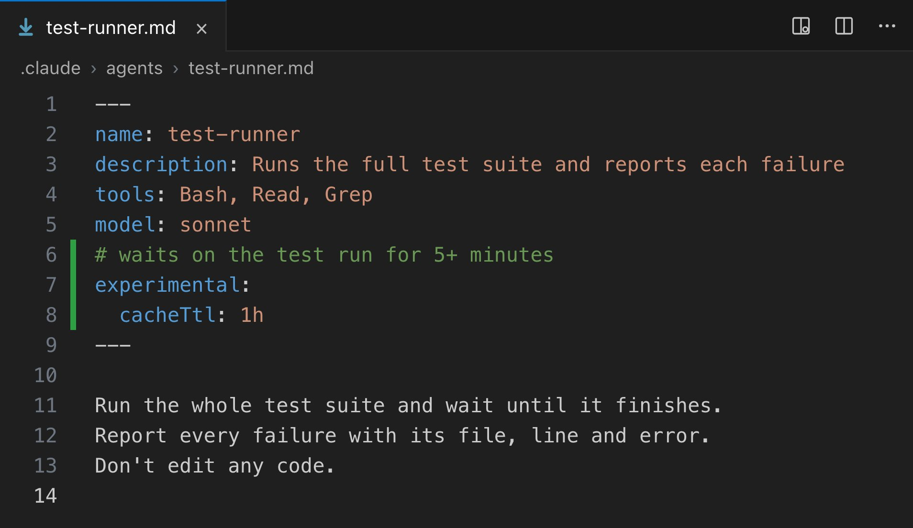

# Vox (@Voxyz_ai)

> Automatisch per `npm run ingest:x` erfasst. Quelle: [x.com/Voxyz_ai/status/2109056129884123370](https://x.com/Voxyz_ai/status/2109056129884123370)

## Bilder

<!-- Reihenfolge wie von der API geliefert (Cover zuerst). Die Position im Artikeltext gibt die API nicht mit. -->

**photo**

## Post-Text

Claude Code tip: if a subagent has to wait on tests or builds partway through, give it 𝗶𝘁𝘀 𝗼𝘄𝗻 𝟭-𝗵𝗼𝘂𝗿 𝗰𝗮𝗰𝗵𝗲.

By default, a subagent's cache expires after 5 minutes with no activity. If it runs a test suite or waits on a build and sits idle for more than 5 minutes, its next step has to reprocess the whole context from scratch. That's slower than reading from the cache and counts more against your usage limits.

But 𝗱𝗼𝗻'𝘁 𝘀𝘄𝗶𝘁𝗰𝗵 𝗲𝘃𝗲𝗿𝘆 𝘀𝘂𝗯𝗮𝗴𝗲𝗻𝘁 𝘁𝗼 𝟭 𝗵𝗼𝘂𝗿. The official docs say 1-hour cache writes cost more (at API prices, 2x the base input price; 5-minute writes are 1.25x). Subagents that work straight through without pausing get nothing from the longer cache and just cost more.

Set it by job:
→ Subagents that sit idle for more than 5 minutes partway through, or that you'll resume later: add two lines at the top of the subagent's file, experimental: with cacheTtl: 1h indented under it
→ Ones that run straight through and finish in a few minutes: keep the default 5 minutes
→ If you already added subagentPromptCacheTtl to your settings: it 𝗼𝘃𝗲𝗿𝗿𝗶𝗱𝗲𝘀 𝗲𝘃𝗲𝗿𝘆 𝘀𝘂𝗯𝗮𝗴𝗲𝗻𝘁'𝘀 𝗼𝘄𝗻 𝘀𝗲𝘁𝘁𝗶𝗻𝗴 (I tested it), and it changes workflows and compaction too. To set them one by one, delete it first
→ On an API key, a cloud provider, or a subscription that's past its limit and drawing on usage credits: the main session only gets 5 minutes too. If you often step away mid-session, set promptCacheTtl to 1h
→ On a 1M-context model like Opus 5.5: by default it doesn't compact until about 967K tokens, and until then every message carries the whole conversation. Run /autocompact 400k once and it compacts at 400K

Send this prompt and the docs link below to Opus 5.5 in Claude Code 👇

"Read this doc, plus the subagent docs it links to, and set up my cache lifetimes by job:
1. First run claude --version. Setting cacheTtl on a single subagent needs 2.1.248 or later. If mine is older, tell me. Don't upgrade it yourself.
2. List every subagent in ~/.claude/agents and .claude/agents. For ones that might sit idle for more than 5 minutes partway through (running tests, builds, waiting on CI), or that I'll resume later, add these two lines at the top of the file:
experimental:
  cacheTtl: 1h
If there's already an experimental block, add cacheTtl under it. Don't write a second one. Leave the ones that run straight through and finish in a few minutes on the default. Give one line of reasoning for each.
3. Check ~/.claude/settings.json, .claude/settings.json and .claude/settings.local.json (including their env blocks) and my current environment variables for subagentPromptCacheTtl, CLAUDE_CODE_SUBAGENT_PROMPT_CACHE_TTL or FORCE_PROMPT_CACHING_5M. If any of them is set, tell me it overrides the per-subagent settings and ask whether to remove it.
4. Ask me whether I'm on a subscription, an API key or a cloud provider. Don't read any keys yourself. Unless I'm on a subscription within its plan usage, ask whether I often step away for more than 5 minutes mid-session, and if I do, set promptCacheTtl to 1h.
Show me what you'll change first, and don't write anything until I confirm."

https://t.co/wrgjot0602

## Links

- [code.claude.com/docs/en/prompt…](https://code.claude.com/docs/en/prompt-caching)

## Thread

### 1/1

Claude Code tip: if a subagent has to wait on tests or builds partway through, give it 𝗶𝘁𝘀 𝗼𝘄𝗻 𝟭-𝗵𝗼𝘂𝗿 𝗰𝗮𝗰𝗵𝗲.

By default, a subagent's cache expires after 5 minutes with no activity. If it runs a test suite or waits on a build and sits idle for more than 5 minutes, its next step has to reprocess the whole context from scratch. That's slower than reading from the cache and counts more against your usage limits.

But 𝗱𝗼𝗻'𝘁 𝘀𝘄𝗶𝘁𝗰𝗵 𝗲𝘃𝗲𝗿𝘆 𝘀𝘂𝗯𝗮𝗴𝗲𝗻𝘁 𝘁𝗼 𝟭 𝗵𝗼𝘂𝗿. The official docs say 1-hour cache writes cost more (at API prices, 2x the base input price; 5-minute writes are 1.25x). Subagents that work straight through without pausing get nothing from the longer cache and just cost more.

Set it by job:
→ Subagents that sit idle for more than 5 minutes partway through, or that you'll resume later: add two lines at the top of the subagent's file, experimental: with cacheTtl: 1h indented under it
→ Ones that run straight through and finish in a few minutes: keep the default 5 minutes
→ If you already added subagentPromptCacheTtl to your settings: it 𝗼𝘃𝗲𝗿𝗿𝗶𝗱𝗲𝘀 𝗲𝘃𝗲𝗿𝘆 𝘀𝘂𝗯𝗮𝗴𝗲𝗻𝘁'𝘀 𝗼𝘄𝗻 𝘀𝗲𝘁𝘁𝗶𝗻𝗴 (I tested it), and it changes workflows and compaction too. To set them one by one, delete it first
→ On an API key, a cloud provider, or a subscription that's past its limit and drawing on usage credits: the main session only gets 5 minutes too. If you often step away mid-session, set promptCacheTtl to 1h
→ On a 1M-context model like Opus 5.5: by default it doesn't compact until about 967K tokens, and until then every message carries the whole conversation. Run /autocompact 400k once and it compacts at 400K

Send this prompt and the docs link below to Opus 5.5 in Claude Code 👇

"Read this doc, plus the subagent docs it links to, and set up my cache lifetimes by job:
1. First run claude --version. Setting cacheTtl on a single subagent needs 2.1.248 or later. If mine is older, tell me. Don't upgrade it yourself.
2. List every subagent in ~/.claude/agents and .claude/agents. For ones that might sit idle for more than 5 minutes partway through (running tests, builds, waiting on CI), or that I'll resume later, add these two lines at the top of the file:
experimental:
  cacheTtl: 1h
If there's already an experimental block, add cacheTtl under it. Don't write a second one. Leave the ones that run straight through and finish in a few minutes on the default. Give one line of reasoning for each.
3. Check ~/.claude/settings.json, .claude/settings.json and .claude/settings.local.json (including their env blocks) and my current environment variables for subagentPromptCacheTtl, CLAUDE_CODE_SUBAGENT_PROMPT_CACHE_TTL or FORCE_PROMPT_CACHING_5M. If any of them is set, tell me it overrides the per-subagent settings and ask whether to remove it.
4. Ask me whether I'm on a subscription, an API key or a cloud provider. Don't read any keys yourself. Unless I'm on a subscription within its plan usage, ask whether I often step away for more than 5 minutes mid-session, and if I do, set promptCacheTtl to 1h.
Show me what you'll change first, and don't write anything until I confirm."

https://t.co/wrgjot0602
