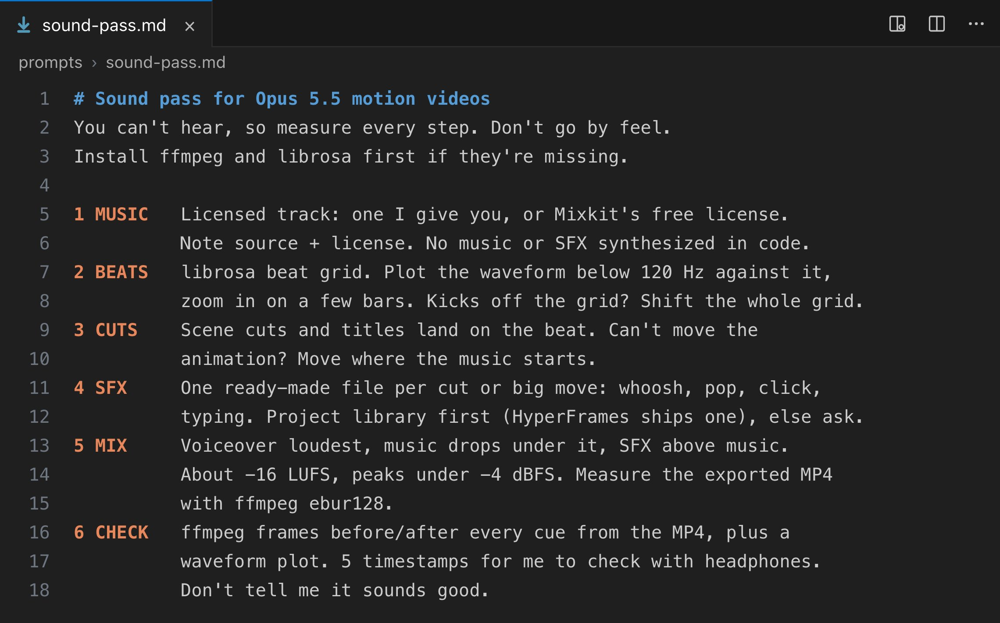

# Vox (@Voxyz_ai)

> Automatisch per `npm run ingest:x` erfasst. Quelle: [x.com/Voxyz_ai/status/2109358372873183564](https://x.com/Voxyz_ai/status/2109358372873183564)

## Bilder

<!-- Reihenfolge wie von der API geliefert (Cover zuerst). Die Position im Artikeltext gibt die API nicht mit. -->

**photo**

## Post-Text

If you still think Opus 5.5's motion videos 𝘀𝗼𝘂𝗻𝗱 𝗹𝗶𝗸𝗲 𝗰𝗵𝗲𝗮𝗽 𝗲𝗹𝗲𝗰𝘁𝗿𝗼𝗻𝗶𝗰 𝗯𝗲𝗲𝗽𝘀, try this:

"Add sound to this video. You can't hear, so measure every step and don't go by feel. Install ffmpeg and librosa first if they're missing.
1. Use licensed music: a track I give you, or one under Mixkit's free license. Note the source and the license. Don't synthesize the music or the sound effects in code.
2. Find the beats with librosa. It sometimes locks onto the off-beat, so plot the waveform below 120 Hz against the beat grid and zoom in on a few bars. If the kick drums don't line up, shift the whole grid.
3. Put the big moves, like scene cuts and titles appearing, on the beat. If you can change the animation, change it. If you can't, move where the music starts.
4. Give every cut and big move one ready-made sound effect file: whoosh for movement, pop for things appearing, click for clicks, typing sounds for typing. Use the project's existing sound library first, like the one HyperFrames ships with, and ask me if there isn't one.
5. If there's a voiceover, it's the loudest thing, and the music drops while someone talks. Sound effects sit above the music. Aim for about -16 LUFS overall with peaks below -4 dBFS, so nothing clips after AAC compression or on a phone speaker in mono. Measure the exported MP4 with ffmpeg's ebur128. Don't measure the WAV.
6. Use ffmpeg to grab one frame before and after every cue from the exported MP4, and plot a waveform to compare. Then pick 5 timestamps for me to check with headphones. Don't tell me it sounds good."

A few days ago I was scoring a video and librosa locked onto the off-beat. The whole beat grid was 𝟬.𝟮𝟮 𝘀𝗲𝗰𝗼𝗻𝗱𝘀 𝗼𝗳𝗳, and I only caught it by plotting the waveform below 120 Hz against the grid.

## Links

- [pic.x.com/N950X9B50P](https://x.com/Voxyz_ai/status/2109358372873183564/photo/1)
- [x.com/Voxyz_ai/statu…](https://twitter.com/Voxyz_ai/status/2108543002830360775)

## Thread

### 1/1

If you still think Opus 5.5's motion videos 𝘀𝗼𝘂𝗻𝗱 𝗹𝗶𝗸𝗲 𝗰𝗵𝗲𝗮𝗽 𝗲𝗹𝗲𝗰𝘁𝗿𝗼𝗻𝗶𝗰 𝗯𝗲𝗲𝗽𝘀, try this:

"Add sound to this video. You can't hear, so measure every step and don't go by feel. Install ffmpeg and librosa first if they're missing.
1. Use licensed music: a track I give you, or one under Mixkit's free license. Note the source and the license. Don't synthesize the music or the sound effects in code.
2. Find the beats with librosa. It sometimes locks onto the off-beat, so plot the waveform below 120 Hz against the beat grid and zoom in on a few bars. If the kick drums don't line up, shift the whole grid.
3. Put the big moves, like scene cuts and titles appearing, on the beat. If you can change the animation, change it. If you can't, move where the music starts.
4. Give every cut and big move one ready-made sound effect file: whoosh for movement, pop for things appearing, click for clicks, typing sounds for typing. Use the project's existing sound library first, like the one HyperFrames ships with, and ask me if there isn't one.
5. If there's a voiceover, it's the loudest thing, and the music drops while someone talks. Sound effects sit above the music. Aim for about -16 LUFS overall with peaks below -4 dBFS, so nothing clips after AAC compression or on a phone speaker in mono. Measure the exported MP4 with ffmpeg's ebur128. Don't measure the WAV.
6. Use ffmpeg to grab one frame before and after every cue from the exported MP4, and plot a waveform to compare. Then pick 5 timestamps for me to check with headphones. Don't tell me it sounds good."

A few days ago I was scoring a video and librosa locked onto the off-beat. The whole beat grid was 𝟬.𝟮𝟮 𝘀𝗲𝗰𝗼𝗻𝗱𝘀 𝗼𝗳𝗳, and I only caught it by plotting the waveform below 120 Hz against the grid.
