# Reverse Engineering: How to Get Anything for FREE With Most Dangerous Repo & Opus 5.5 (Full Course)

> Automatisch per `npm run ingest:x` erfasst. Quelle: [x.com/0xCodila/status/2109623431763292649](https://x.com/0xCodila/status/2109623431763292649)

## Artikel-Volltext

REA is the most dangerous thing on the internet right now, and 99% of people have no idea how to use it

You pay every month for apps whose features are already sitting on your computer
Motion design apps. Office. TradingView. Your notes app and others - All of it is just code on your disk
And every company is betting on one thing: that you will never look inside
Now one open-source repo gives your Claude Code the same skill in one command

before the alpha - subscribe to my substack for more fresh alpha -
https://substack.com/@0xcodila
 
 
This 3 days it went everywhere. "Software is done". "Closed source is dead"
 
Most people saw the screenshots, bookmarked them, and never tried it
So in this full course I'll show you everything in simple words:
what reverse engineering actually is
what REA can read, from desktop apps to games
the honest answer to "isn't this just stealing?"
how to install it step by step, straight from the official docs
what people already rebuilt: Adobe, Office, TradingView, games
how a normal person and a pro use it every day
a pack of copy-paste prompts
So bookmark it, open your terminal, and go step by step
 
Part 1 - Understand
01. What Is Reverse Engineering (and What Is REA)
Reverse engineering is simple actually
You look at a finished app and figure out how it works inside, without its source code
That's it. You want to understand a feature well enough to explain it, change it, or build your own version
REA (Reverse Engineer Anything) does exactly that, with your AI agent doing the hard part. The official README says it in one line:
"See a feature you like. Understand how it works, down to the binary level."
Here's what it is technically:
an MCP server + CLI that plugs into Claude Code, Codex, Cursor, Gemini CLI and other agents
it runs locally. Your apps never get uploaded anywhere
every conclusion comes with evidence: the function, the file, the call, and what is still unknown
You ask in plain English. REA inspects the program. Your agent explains it, builds your version, and tests it REA repo
 
The best example is on the official site
For example: why does Windows Calculator show 220 when you type 200 + 10%?
Without REA you'd decode branches and trace calls by hand. With REA you just ask
The answer from the code: after +, the % button takes a percentage of the first number. 10% of 200 is 20, so 200 + 20 = 220. After ×, 10% simply becomes 0.1

-  rea.tools
Or why the Chrome dinosaur game gets faster: speed starts at 6, adds 0.001 every update, and stops at 13
You don't read the code. You ask a question, and you get the rule
REA is open source under MIT, built by @morluto 

The first release came out on July 12, 2026. Three months later it has 100K+ GitHub stars
 
 
02. What REA Can Read
This is the official list, translated into normal words What you can analyze
Desktop apps built on JavaScript/Electron (Notion, Slack, Discord, Obsidian and many more). Nothing extra to install
Websites: page structure, scripts, network requests. You need a Chrome-family browser
Saved network traffic (HAR files from your browser)
Programs and games (.exe, Mac apps, old DOS games): pseudocode, assembly, strings, calls. You need Ghidra, Hopper or IDA
.NET apps: no extra tools
Android apps (APK): you need a JDK and JADX
Smart contract bytecode: Linux x64
Firmware, WASM, Go binaries and more
Here's the part almost nobody talks about:
Many Unity games ship their game logic as .NET code. And REA reads .NET without any extra tools
This is how one person took a Steam game he had bought and got it open in Unity in under 30 minutes:
 
so agent now does the whole job for you
 

 
03. Wait... Isn't This Just Stealing?
Let's talk about the elephant in the room!
The moment REA went viral, half of X screamed "piracy" and the other half screamed "software is dead"
Chamath even said on All-In that people "decompiled" the whole Adobe suite
 
And here's the funny part. That clip got a Community Note
The Adobe alternatives were not decompiled. Their developer calls them clean-room reimplementations
That one note explains the whole legal game. So let me explain clean room, because once you get it, everything clicks
Clean room is a 40-year-old trick
Step 1: one team studies the original and writes down what it does. Not the code. The behavior
Step 2: a different team builds a new product from that description only. They never see the original code
The result does the same thing, but contains zero of the original's code Clean-room design
This is how the PC industry was born. In the early 80s, Compaq rebuilt IBM's BIOS this way, at a cost of about $1 million. That's why "IBM compatible" PCs from other brands exist at all
And the courts kept backing reverse engineering:
1992, Sega v. Accolade. Accolade took apart Sega Genesis games to make their own compatible games. The court said taking apart code can be fair use when it's the only way to understand how it works Sega v. Accolade
2000, Sony v. Connectix. Sony lost 3-0. The final emulator contained none of Sony's code
And then there's the other side of history
In 2010-2011 hackers broke the PS3's security and published its root key. Sony sued George Hotz (geohot), and in April 2011 he settled and agreed to stop hacking Sony products TechSpot
So here's my honest take
Reading the app on your own computer to understand it, that's learning
Rebuilding a feature from its behavior, in your own code, that's how the industry has always worked
Copying their code, cracking paid features, or publishing someone else's decompiled source, that's the part that gets you sued
Even the REA team says it plainly: it's for lawful research, education, interoperability, software preservation, and software you own or are allowed to examine Disclaimer
Study the original. Ship your own. That's the rule for everything in this article
 
 
Part 2 · Install
03. Install REA in 5 Minutes
Follow it in order Get started
Step 1. Check Node.js
Open your terminal and run:
 
You need Node 22.19+, 24.11+, or 26+. Versions 23 and 25 are not supported
If it's older or "command not found", install Node 24 LTS:
macOS (with Homebrew):
 
macOS (without Homebrew):

curl -fsSL https://fnm.vercel.app/install | bash
Close Terminal, open it again, then:
 
Windows (PowerShell):
 
Type Y if it asks. Close PowerShell, open it again, run node -v
If Windows later says "running scripts is disabled", run this once:
 
Step 2. Have an agent
I use Claude Code. It needs a paid Claude plan. Setup page: code.claude.com/docs/en/setup
Codex, Cursor, Gemini CLI, OpenCode and others work too
Step 3. Run REA setup
The easiest way: paste this into Claude Code and let it do everything:
 
Or run it yourself:
 
What happens next:
npm asks to download the package. Say yes
REA shows a list of agents. Pick Claude Code
REA shows a plan of every change it will make. Nothing changes until you approve. It also backs up your current config
It adds the MCP connection plus a matching investigation skill
Setup will also offer Hopper, a separate engine for reading programs. On a Mac it downloads the official installer and opens it, and you pick demo mode. It's optional, you can say no for now
Step 4. Restart your agent
Claude Code in terminal: exit and start a new session
Desktop apps (Claude Desktop, Cursor): quit completely with ⌘Q. Closing the window is not enough
Step 5. Check
 
doctor only checks things, it never changes anything. If something failed, it tells you the next step
Want the short rea command forever:
Your result: Claude Code now has REA tools. Ask it "what REA tools do you have?" and it will list them
 

 
 
04. Your First Reverse Engineering in 2 Minutes
Don't start with something huge. REA has an official practice app for this First investigation
It's a tiny "Notes" app with an Export notes button. Your job: find out where the export goes
Paste this into Claude Code:
 
Then ask:
 
What you should get back, the full path of one click:
The page (renderer.js) handles the button
The bridge (preload.js) sends a notes:export message
The handler (main.js) writes notes.csv into your Downloads folder with id and title
Congrats. That's reverse engineering
You just traced a feature through an app you didn't write, and every step came with proof
Now the fun part. Every Electron app on your computer works the same way, and you know where it lives:
Mac: /Applications/<App>.app/Contents/Resources/app.asar (right-click the app → Show Package Contents)
Windows: C:\Users\<you>\AppData\Local\Programs\<App>\resources\app.asar
Linux: often /opt/<App>/resources/app.asar
And you can analyze it straight from the terminal, without running the app:
 
Tip: on Mac, hold Option, right-click a folder and choose "Copy as Pathname". Or just drag the folder into your terminal
 
 
05. Add the Right Engine for What You Want to Read
Desktop JavaScript apps need nothing more. For everything else, add one engine
Programs and games: Ghidra (free, made by the NSA)
You need Ghidra 12.1.x and JDK 21 or newer
macOS / Linux:
 
Windows PowerShell:
 
Windows support is still experimental and read-only
Then look at any function:
 
Programs and games: Hopper (Mac/Linux, commercial with a demo)
Just run setup again. It finds Hopper or offers to install it. On Mac, pick demo mode or your license on first launch
Programs and games: IDA (if you already own it)
Verified on Windows through an existing IDA MCP setup Get started
Android apps: a full JDK 17+ and jadx-headless-mcp 0.7.1 Android guide
 
Websites: any Chrome-family browser
Smart contracts: Linux x64
Keep it updated (REA ships fixes almost every day):
 
or npx rea-agents@latest setup. To remove it: rea uninstall
If your agent doesn't see REA: restart it, then run doctor --client claude_code --json again
 
 
 
Part 3 - What People Already Rebuilt
06. Adobe, Office, TradingView and Games
This is where it gets crazy
AI didn't just learn to read software. People are already rebuilding entire products
Adobe
ArtCraft rebuilt seven Adobe apps as free, open-source alternatives: Photoshop, Illustrator, Premiere, Lightroom, After Effects, InDesign and Acrobat. Built in Rust with help from Claude Opus 5.5
 
Remember the clean room? This is it. ArtCraft calls these clean-room reimplementations, without Adobe's source code. They're still early alpha, but they exist, and they're free
Microsoft Office
Then they went after Office. WordCraft, GridCraft and DeckCraft: Word, Excel and PowerPoint
 
TradingView
This one I love. Map how the platform behaves, turn it into a spec with Opus 5.5, then build your own charting engine and backtester with your own code
 
One honest note: building your own terminal is fine. Using someone's paid indicators for free is not. Build yours
Games
This is where AI reverse engineering exploded first
A Super Mario Sunshine native PC port: about 365 agent hours and 17.3B tokens, using both Claude and Codex Repo
 
The PS1 game Tomba! now runs on PC through a static recompiler. Its builder had no prior experience and used Claude Code + Ghidra for about three weeks Write-up
And on the official REA blog, one person with AI agents rebuilt a Touhou game: 697 functions, 696 exact matches, playable in about 12 days The industrial revolution in reverse engineering
Kotaku even reported browser versions of Halo, GTA: Vice City and The Simpsons: Hit & Run attributed to AI-assisted decompiling. Those are unofficial and likely to get takedowns, which is exactly the line from the chapter above Kotaku
How to repeat any of this: pick a tool you pay for or a game you own, ask REA how one feature works, write the spec, build your own version. The prompts are in Step 10
 
 
Part 4 - Use It Every Day
Reverse engineering was invented for compatibility, security and preservation
But here's how I'd use it in normal life
07. For Beginners
1. "What is this app really doing on my phone?"
Take the APK of any Android app: your broker, your exchange, that "free signals" app from Telegram. Ask:
 
Official proof this works: REA took apart the Aegis authenticator app (3,077 classes), found exactly how it makes its 6-digit login codes, and rebuilt it. The rebuild matched all 133 test cases Aegis case
2. "Is this file safe?"
Reverse engineering is how people catch malware. When a fake 113 GB "GTA 6 build" went around, someone who took the files apart found it was fake and full of malware
 
3. "Is this token a scam?"
Most memecoins don't publish their source. REA reads the raw contract bytecode and recovers its functions EVM guide
 
Then ask:
 
Function names here are guesses from the bytecode, so treat a red flag as "check deeper". And this command runs on Linux x64 for now
4. "I want that paid feature"
Don't crack it. Rebuild it. Ask REA how the feature works, then let Claude build your own version from public data and open-source parts
 
08. For Pros
REA ships guided workflows that almost nobody knows about. They're built into the MCP server Guided prompts:
investigate_feature: trace a feature from discovery to the exact functions
compare_application_versions: compare two releases of an app and see what really changed in the update
verify_reconstruction: check your rebuild against the saved evidence
trace_crash: connect a crash to the code paths behind it
audit_residual_unknowns: list what is still unproven
prepare_bounded_process_capture: plan a safe, limited runtime experiment before you run anything
The pro loop is investigate → spec → build → verify
 
How far this goes, from the official showcases:
DX-Ball (1996): REA recovered the sound-pan function and rebuilt it in C. It passes 3,205 original-x86 test cases and reproduces all 63 compiled bytes DX-Ball
Notion: REA traced how copy works, from the page through the IPC bridge to the system clipboard Notion
And the lessons from the Touhou rebuild are gold for anyone doing this seriously:
give the agent a clear goal and clear acceptance criteria
keep notes and checks in git so the next session can continue
treat every explanation from the agent as a hypothesis to test
test your tests. A broken comparison once let a wrong function pass
Security people are already running this at scale. One researcher built an AI pipeline with 8 MCP servers, 300+ tools, Ghidra, radare2 and Frida, and says it paid for itself through bug bounties:
 
Where the money is: security research and bug bounties, moving old software to new systems, making tools talk to each other, and helping companies understand software they lost the source code for
 
09. What REA Can't Do
I want you to trust this article, so here are the real limits
It can't touch the server. It reads what's on your machine. The code that runs on a company's servers was never shipped to you. It won't hack a bank or move money Why it can't hack your bank
Decompiled code is not the original source. It's a reconstruction. That's why the verify step matters
Hard targets are still hard. Stripped C++ binaries are much tougher than Unity .NET games
Your agent may refuse. Some firmware and console targets hit the model's safety rules
Commercial tools need real licenses. REA gives you no IDA, Hopper or JEB license, and cracked copies are not allowed
 
10. The Prompt Pack
Save this. Every prompt works in Claude Code once REA is installed
Setup:
 
Your first test
 
The universal one:
 
Real-time features:
 
The calculator:
 
 
The game:
 
Reconstruct a game:
 
Clone a website:
 
Phone app audit:
 
Token check:
 
Pro rebuild:
 
What changed in the update:
 
Your One-Evening Protocol
Don't just bookmark this. Do this tonight:
Install REA with the setup prompt (5 min)
Practice on the official Notes example (2 min)
Pick one app on your computer that you use every day
Ask one question about one feature you love
Get the spec: what it does, step by step, with proof
Build your version from the spec in a new folder
That's it. One evening, and you'll never look at software the same way again
The shift
Closed source used to mean "you'll never know" → now it means "show me the evidence"
 
REA is not a hacking tool
It's a reading tool for software you didn't write
And the real alpha is not the 100K stars or the viral screenshots
The real alpha is that every feature you envy in someone else's app is now something you can understand:
Let REA find the feature and the proof
Let Claude write the spec and build your version
Let the tests prove it works
Most people will keep paying for features they could understand in an afternoon
The few who learn to read software will build anything they want - absolutely for free.
Bookmark this course before your next build → @0xCodila

## Bilder

<!-- Reihenfolge wie von der API geliefert (Cover zuerst). Die Position im Artikeltext gibt die API nicht mit. -->

**Cover**


**photo**

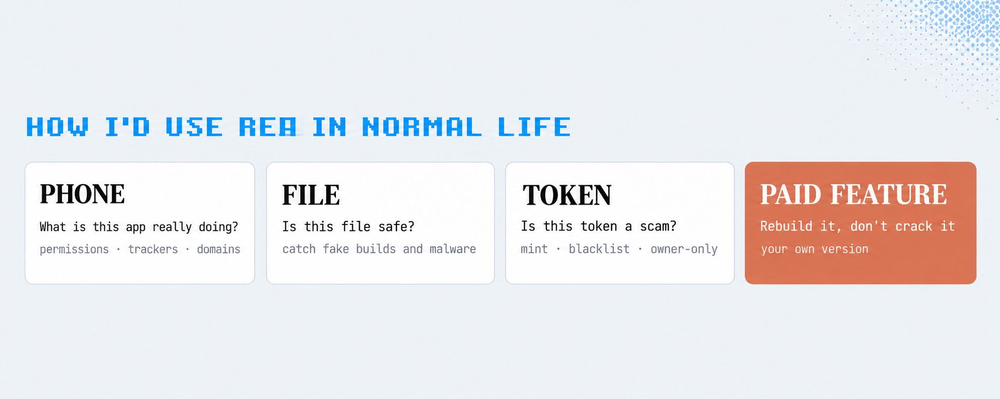

**photo**

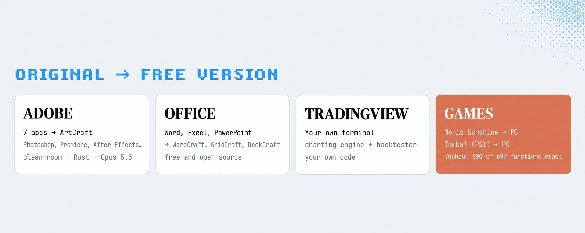

**photo**

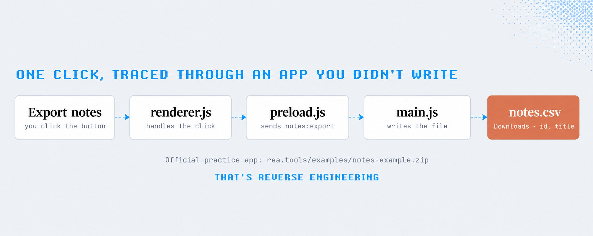

**photo**

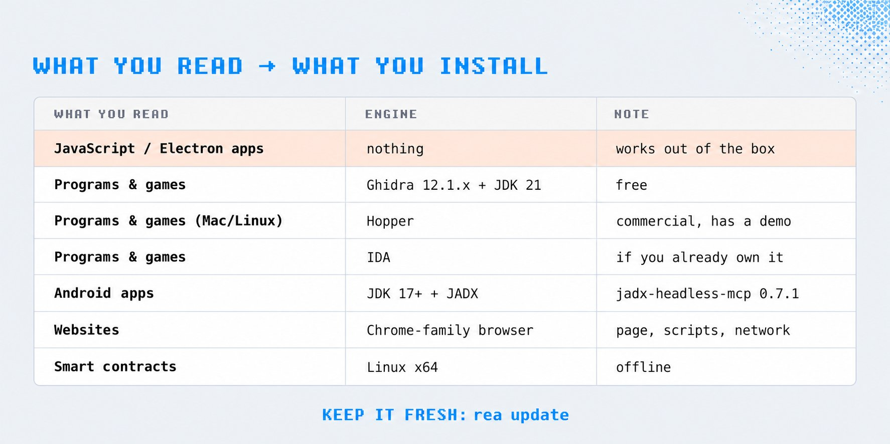

**photo**

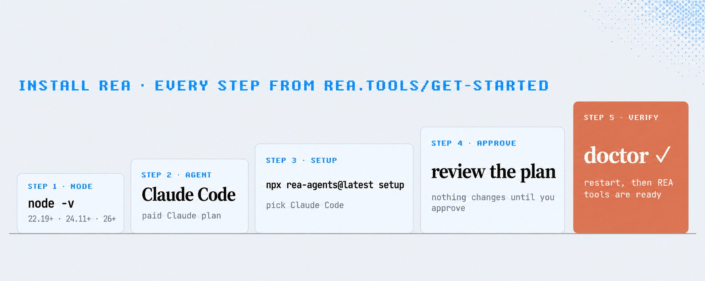

**photo**

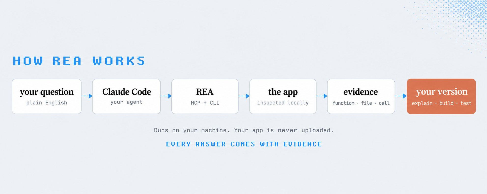

**photo**


**photo**

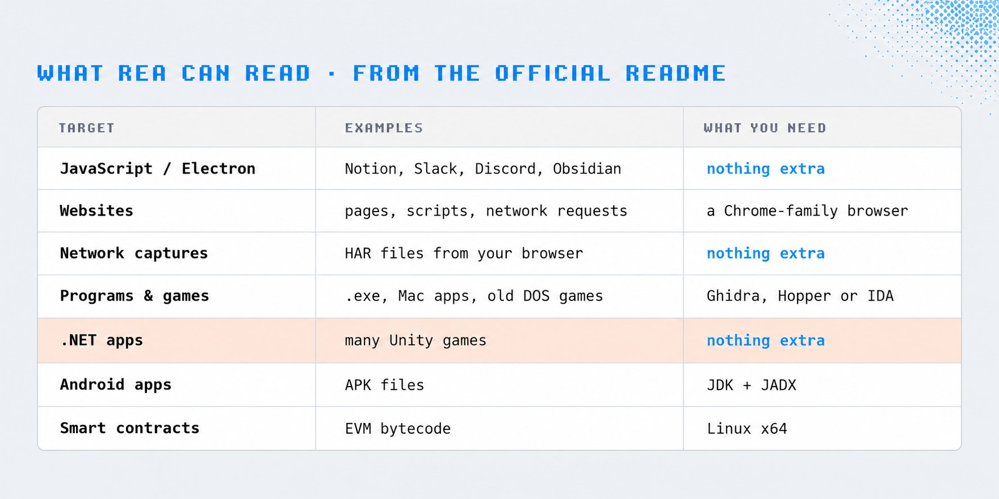

**photo**

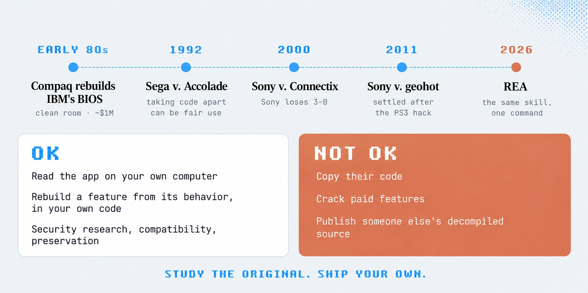

**photo**


## Post-Text

REA is most dangerous thing on the internet right now...

It lets your AI agent reverse engineer any app, down to the binary

If you use it correctly, you can rebuild any feature you pay for, for FREE

In this article, I show you how: https://t.co/3P1FNXiXzl

## Links

- [x.com/i/article/2109…](https://x.com/i/article/2109398658751856642)

## Ergänzungen aus Artikel-Entities

Die folgenden Originalbestandteile wurden aus den X-API-Entities ergänzt. Die API liefert keine verlässlichen Positionen für Code-Blöcke, Bilder und eingebettete Tweets im Artikeltext; sie stehen deshalb separat. Die Reihenfolge folgt den gelieferten Entities und rekonstruiert keine Artikelpositionen. Videos werden lokal archiviert, aber nicht transkribiert.

### Code- und Prompt-Blöcke

Originalblock 1/34

```
export REA_JADX_MCP_JAR=/absolute/path/jadx-headless-mcp-0.7.1-all.jar
rea inspect-android-package /path/App.apk

```

Originalblock 2/34

```
Use REA on this APK. List every permission, every analytics or tracking SDK, and every domain the app talks to. Show the class and method for each finding.

```

Originalblock 3/34

```
Figure out how Discord shows who's typing in real time, show me the proof, and build something similar for my project.

```

Originalblock 4/34

```
brew install node

```

Originalblock 5/34

```
Understand how search works in the Notes app, show me the evidence, and build a similar feature for my project.

```

Originalblock 6/34

```
export GHIDRA_INSTALL_DIR=/absolute/path/to/ghidra_12.1.4_PUBLIC
export JAVA_HOME=/absolute/path/to/jdk-21
npx -y rea-agents@latest doctor --provider ghidra --json
npx rea-agents@latest setup

```

Originalblock 7/34

```
node -v
npm -v

```

Originalblock 8/34

```
Set-ExecutionPolicy -Scope CurrentUser RemoteSigned

```

Originalblock 9/34

```
npx -y rea-agents@latest analyze-javascript-application /absolute/path/to/app --json

```

Originalblock 10/34

```
Use REA to investigate how [feature] works in [app]. Write SPEC.md: behavior, inputs, outputs, edge cases, no copied code. Then build it from SPEC.md in ./my-version, write tests from the observed behavior, and run them until they pass.

```

Originalblock 11/34

```
rea update

```

Originalblock 12/34

```
fnm install 24
fnm default 24
```

Originalblock 13/34

```
Clone the rea.tools website.

```

Originalblock 14/34

```
Download https://rea.tools/examples/notes-example.zip into a new example folder and unpack it. Use REA to find what happens when I click Export notes.

```

Originalblock 15/34

```
Use REA on this APK. List every permission, every analytics or tracking SDK, and every domain the app talks to. Show the class and method for each finding.

```

Originalblock 16/34

```
Use REA's compare_application_versions workflow on [old version] and [new version] of [app]. Tell me what actually changed, with evidence.

```

Originalblock 17/34

```
Download https://rea.tools/examples/notes-example.zip into a new example folder and unpack it. Use REA to find what happens when I click Export notes.

```

Originalblock 18/34

```
Use REA on this contract bytecode. List every function that can change state. Flag anything that looks like mint, blacklist, pause, fee change or owner-only transfer. Mark what is confirmed and what is inferred.

```

Originalblock 19/34

```
Use REA to inspect Windows Calculator's % button. Recover the rules after + and ×, then build a small calculator that uses both.

```

Originalblock 20/34

```
Reconstruct a game from its executable and test it against the original.

```

Originalblock 21/34

```
Show where notes.csv is written, which fields it contains, and the relevant files and lines.

```

Originalblock 22/34

```
winget install OpenJS.NodeJS.LTS

```

Originalblock 23/34

```
Use REA on this APK. List every permission, every analytics or tracking SDK, and every domain the app talks to. Show the class and method for each finding.

```

Originalblock 24/34

```
npm install --global rea-agents
rea --help

```

Originalblock 25/34

```
rea inspect-evm-interface ./runtime.hex hex --json

```

Originalblock 26/34

```
npx -y rea-agents@latest function /absolute/path/to/program main --provider ghidra --json

```

Originalblock 27/34

```
Install REA and connect it to this coding agent using npx rea-agents@latest setup. Show me the setup plan for approval, then verify the installation.

```

Originalblock 28/34

```
Use REA to investigate how [feature] works in [app]. Write SPEC.md: behavior, inputs, outputs, edge cases, no copied code. Then build it from SPEC.md in ./my-version, write tests from the observed behavior, and run them until they pass.

```

Originalblock 29/34

```
Inspect the dinosaur game and build a version with adjustable speed.

```

Originalblock 30/34

```
npx -y rea-agents@latest doctor --client claude_code --json

```

Originalblock 31/34

```
npx rea-agents@latest setup
```

Originalblock 32/34

```
$env:GHIDRA_INSTALL_DIR = "C:/tools/ghidra_12.1.4_PUBLIC"
$env:JAVA_HOME = "C:/tools/jdk-21"
npx -y rea-agents@latest doctor --provider ghidra --json
npx rea-agents@latest setup
```

Originalblock 33/34

```
Use REA on this contract bytecode. List every function that can change state. Flag anything that looks like mint, blacklist, pause, fee change or owner-only transfer. Mark what is confirmed and what is inferred.

```

Originalblock 34/34

```
Install REA and connect it to this coding agent using npx rea-agents@latest setup. Show me the setup plan for approval, then verify the installation.

```

### Links aus den Artikel-Entities

- https://substack.com/@0xcodila
- rea.tools
- https://fnm.vercel.app/install
- code.claude.com/docs/en/setup
- https://rea.tools/first-investigation/?utm_source=chatgpt.com
- https://github.com/morluto/rea/blob/main/docs/mcp-prompts.md
- https://x.com/@0xCodila
- https://rafaelroman.com/articles/ai-reverse-engineering-cant-hack-your-bank/
- https://en.wikipedia.org/wiki/Clean-room_design
- https://github.com/morluto/rea/blob/main/docs/android-analysis.md
- https://rea.tools/blog/touhou-reconstruction/?utm_source=chatgpt.com
- https://1379.tech/i-built-a-ps1-static-recompiler-with-no-prior-experience-and-claude-code/
- https://rea.tools/showcase/aegis/?utm_source=chatgpt.com
- https://en.wikipedia.org/wiki/Sega_v._Accolade
- https://github.com/morluto/rea?utm_source=chatgpt.com
- https://github.com/morluto/rea#what-you-can-analyze
- https://rea.tools/get-started/?utm_source=chatgpt.com
- https://rea.tools/get-started/?utm_source=chatgpt.com
- https://kotaku.com/we-might-be-cooked-as-these-vibe-coded-web-browser-ports-of-halo-the-simpsons-hit-and-run-and-gta-vice-city-seem-to-work-perfectly-2000743300
- https://www.techspot.com/news/43246-sony-and-geohot-settle-over-ps3-hacking-lawsuit.html
- https://rea.tools/showcase/dx-ball/
- https://github.com/chasem-dev/sms-pc-port
- https://substack.com/@0xcodila
- https://code.claude.com/docs/en/setup?utm_source=chatgpt.com
- https://rea.tools/showcase/notion/
- https://github.com/morluto/rea#disclaimer
- https://rea.tools/
- https://github.com/morluto/rea/blob/main/docs/evm-bytecode.md

## Eingebettete Tweets

Zusatzquellen anderer Autoren; ihre Aussagen sind nicht dem Hauptautor zuzuordnen.

### @Pirat_Nation · 2109358375209427301

Quelle: https://x.com/Pirat_Nation/status/2109358375209427301 · Datum: 2026-10-11T19:00:01.000Z

The developer behind free, open-source alternatives to Adobe software is now taking on Microsoft Office.

Brandon Thomas, the creator of the ArtCraft project, has unveiled three more tools designed to replicate Microsoft’s most popular apps:

>WordCraft – an alternative to Microsoft Word.
>GridCraft – an alternative to Microsoft Excel.
>DeckCraft – an alternative to Microsoft PowerPoint.

he wants to give people free alternatives to expensive software subscriptions using AI

And he’s not stopping at Microsoft and Adobe. Autodesk alternatives and other subscription-based software could also be part of the plan.

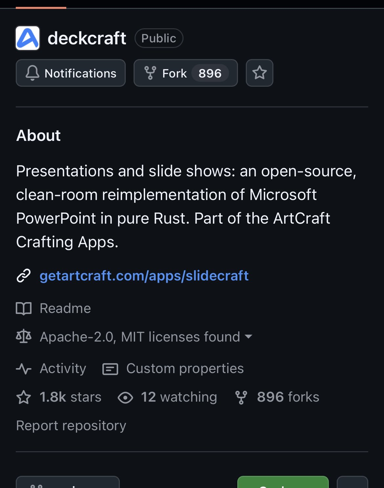

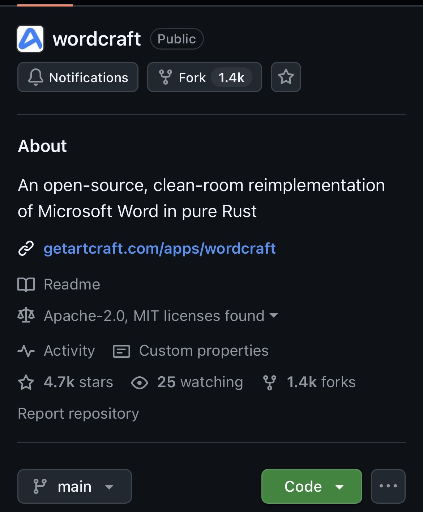

Links des Posts:

- https://x.com/Pirat_Nation/status/2109358375209427301/photo/1

### @celineodier · 2109281121749856655

Quelle: https://x.com/celineodier/status/2109281121749856655 · Datum: 2026-10-11T13:53:02.000Z

OCTOBER’S MOST TRENDING GITHUB REPO: REA (Reverse Engineer Anything).

86.7K ⭐️ on GitHub, +25K just today.

It lets your AI agent take apart almost any app and tell you how it works. Free and open source.

Here’s the idea:
You see a feature you like in some app.
You ask your agent “how did they build this?”
It digs into the app and explains it to you, with proof, without needing the source code.

What it can open:
→ Mac, Linux and Windows apps
→ JavaScript and Electron apps
→ Android apps and websites

→ Everything runs on your computer, nothing gets uploaded
→ Works with Claude Code, Codex, Cursor, Gemini CLI and OpenCode

Try something like:
“Figure out how Discord shows who’s typing in real time, show me the proof, and build something similar for my project.”

Heads up: it won’t give you the app’s original code or clone it. And knowing how something works doesn’t mean you’re allowed to copy it.

How I’d use it: see how another tool solves a problem I have in my own app, find out which APIs it uses… the rest is up to your imagination.

share this if you found it useful ♻️

and save it before you lose it 🔖

Repo ↓

[Video lokal: 01-video.mp4](medien/2026-10-12-0xcodila-2109623431763292649/eingebettet/2109281121749856655/01-video.mp4)

Links des Posts:

- https://x.com/celineodier/status/2109281121749856655/video/1

### Nicht abrufbarer eingebetteter Post 2091221918561317355

Original: https://x.com/i/status/2091221918561317355

Die X-API verweigert den Abruf (Authorization Error). Text und Medien dieses Posts fehlen; die Ursache ist nicht näher belegt.

### @karpathy · 2109361546505966046

Quelle: https://x.com/karpathy/status/2109361546505966046 · Datum: 2026-10-11T19:12:37.000Z

Dusting off this tweet from April because this gap in shared understanding of LLM capability is *widening*. It's now less "two groups of people speaking past each other" and more a sharp funnel.

- Napkin math somewhere around 6B people (~75% of the population) have barely come in contact with LLMs at all.
- Around 1-2B (~20%) are casual and infrequent users of free-tier ChatGPT-like products. This group sees derpy chatbots and treats them a bit like a better Google search, a writing aid, or etc. Maybe an agent tries to book you a flight. I have non-tech friends who (reasonably, imo) say they have not much use for it at all. Even many professionals outside of math&code are in this tier. For example, execs and many other functions spend a lot of their time talking to other people, so while they understand what is happening intellectually, it is still second-hand and a bit abstract.
- Now we get to professional use of frontier-grade LLMs in math&code. Somewhere around 20M people (0.2%) see first-hand that large, complex projects that used to take them weeks/months can now be completed by agents with a prompt. Building apps, copying apps, translating apps, decompiling apps from binaries... This has all happened very quickly and recently - less than 1 year ago, I was writing code manually by hand, typing memorized computer code commands into a code editor character by character, occasionally pressing Tab to autocomplete a little chunk of code.
- And finally we get to the ~5,000 people (~0.00006%) with access to frontier-grade systems internally. The external world has seen the preview. It looks like swarms of thousands of agents collaborating over weeks on software mega projects: minting zero days, running cyber attacks and defenses at machine speeds, discovering new science, advancing the frontier of mathematics. Things that would have taken top professionals in the industry years of work. Meanwhile, human review and comprehension are starting to fall behind. For example, people are still involved in the "archeology" of the OpenAI-HF incident from many months ago. Mathematicians may be poring over the 722 manuscripts on frontier mathematics for a while.

The funnel is driven by a combination of factors:
1. The impact scales with ambition, problem size, and horizon. A question with a paragraph answer barely stresses the system. You need a reservoir of big, difficult problems that you really care about. This aspect drives the consumer / professional dimension of the funnel.
2. The jaggedness of the system (which I have written about a lot separately). Capability peaks in domains that are digital, verifiable and economically valuable. This is because LLM capability emerges from reinforcement learning on verifiable rewards on a curated environment mixture driven by revenue potential. This aspect primarily drives the area (e.g. math&code) dimension of the funnel.
3. Access. Free-tier, paid-tier, internal.

So this is the weirdness of the moment. The general public has mostly not interacted with these systems. When they have, it looks like a derpy chatbot. The majority of professionals still see only a modest uplift. And a small sliver of professionals are experiencing the vertigo of the curve going vertical. And it is all happening at the same time.

Links des Posts:

- https://twitter.com/karpathy/status/2042334451611693415

Referenzierte Posts:

- quoted: https://x.com/i/status/2042334451611693415

### @AIWarper · 2109060856466264566

Quelle: https://x.com/AIWarper/status/2109060856466264566 · Datum: 2026-10-10T23:17:47.000Z

I just tried out that Reverse Engineer Anything trending git repo.

It decompiled a steam game I had previously purchased and launched it in Unity in less than 30 minutes using OPUS 5.5 on medium reasoning.

Absolutely cracked tbh…. Fully decompiled to C#

### @Pirat_Nation · 2108437553615425881

Quelle: https://x.com/Pirat_Nation/status/2108437553615425881 · Datum: 2026-10-09T06:01:00.000Z

AI is now being used to recreate Adobe’s software, a developer has released seven free, open-source apps as clean-room alternatives to Adobe’s main tools:

- PhotoCraft → Photoshop
- VectorCraft → Illustrator
- FilmCraft → Premiere Pro
- LightCraft → Lightroom
- EffectCraft → After Effects
- DesignCraft → InDesign
- PrintCraft → Acrobat Pro

Built in Rust with help from Claude Opus 5.5, they run on Windows, Linux, and macOS under MIT/Apache licenses without using Adobe’s source code.

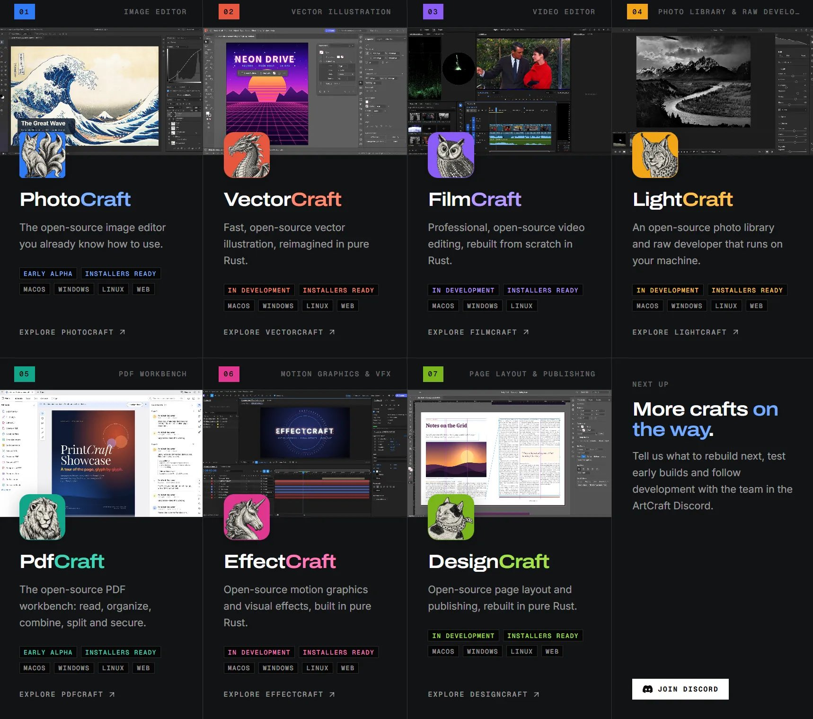

Links des Posts:

- https://x.com/Pirat_Nation/status/2108437553615425881/photo/1

### @chasemdev · 2102957888477995067

Quelle: https://x.com/chasemdev/status/2102957888477995067 · Datum: 2026-09-24T03:06:46.000Z

~365 agent hours, 17.3B tokens, provides a work in progress native PC port for Super Mario Sunshine GMSE01 (USA Rev 0). Only 32 bit is supported, Windows + Linux. Open Source! https://t.co/XPhuRKxIfo
Used both Claude and Codex! https://t.co/ZzjfPeogRF

[Video lokal: 01-video.mp4](medien/2026-10-12-0xcodila-2109623431763292649/eingebettet/2102957888477995067/01-video.mp4)

Links des Posts:

- https://github.com/chasem-dev/sms-pc-port
- https://x.com/chasemdev/status/2102957888477995067/video/1

### @cr3ghost · 2098033761317446083

Quelle: https://x.com/cr3ghost/status/2098033761317446083 · Datum: 2026-09-10T13:00:02.000Z

Vulnerability researchers, exploit devs and reverse engineers: before paying for another AI security course, read these two FREE posts by @ZephrFish.

This is what AI-assisted vulnerability research looks like when you build an actual pipeline around the LLM.

MCP:
8 MCP servers. 300+ tools. Patch diffing. Fuzzing. Crash triage. Ghidra. radare2. Frida. WinDbg/GDB. RAG. Proxmox. Exploit dev. CVE/disclosure workflows.

https://t.co/R98PxJUM0c

Harness:
Agent orchestration. Model routing. Persistent state. Scoped context. Validation gates. Knowledge reuse. Verification. Less token waste.

https://t.co/ivRzHAMqED

The interesting part isn't 'AI found a bug'.

It's turning years of human vulnerability-research knowledge and tooling into a repeatable system that can assist with 0-day hunting, 1-day analysis, RE and fuzzing without blindly trusting the model.

And yes, the workflow has produced validated findings and paid for itself through bounty payouts.

FREE content. Serious rabbit hole. Bookmark both.

#VulnerabilityResearch #ReverseEngineering #AISecurity

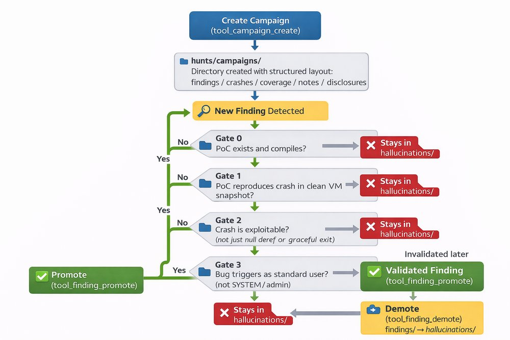

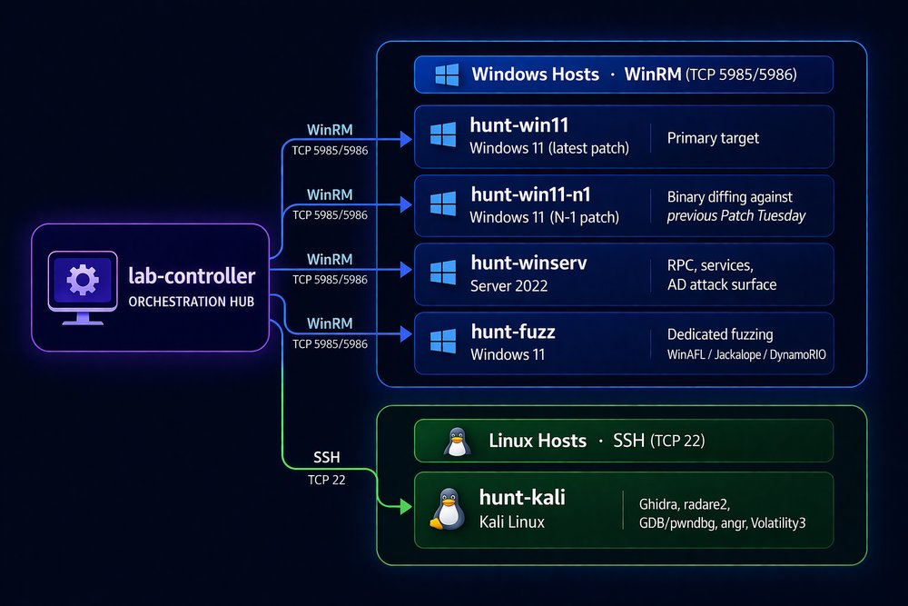

Links des Posts:

- https://blog.zsec.uk/bullyingllms/
- https://blog.zsec.uk/harnessing-harnesses/

### @firesidealpha · 2108761607857992104

Quelle: https://x.com/firesidealpha/status/2108761607857992104 · Datum: 2026-10-10T03:28:40.000Z

Chamath says IP and software were "effectively rendered worthless" this week, after people decompiled Adobe's core products and published open-source versions, as every service goes headless

"The more important point I want to make though, is I sent this to Nick, there's been a couple things that happened in the last couple days, which I think are incredibly important."

"There have been people that decompiled the entire, the entire big five. What is the big five? Adobe has five very, very important products in their product suite. Freeberg may know them all, but I just know Photoshop. There's like a bunch of others. Okay."

"And these folks decompiled it, distilled it, and published open source versions of these things. And Rust, yeah. And I was so shocked, because I was like, hold on a second, these are like profound products that have existed and have had moats for years, and now they're just open source versions."

"And then Nikita was, I think, trolling, and he was building on that idea, and just talking about GTA, because it's about to get released. I think GTA 6 is about to come out, and we'll reconstruct this."

"Why is this important?"

"I think that IP and software was effectively rendered worthless two days ago."

"Because if you think about it, when everything is headless, so when Elon makes his services headless, Benioff made Salesforce headless a few months earlier, when all of these things are headless, and you can wrap them in agent tools, and you can connect them via MCP to other experiences, the value of IP does no longer exist in software. It doesn't exist."

"And I think that probably is the most profound implication."

"So, like, even in our business, we would argue with some of our customers all the time, because we'll say, oh, we'll build this for you, we'll own the IP. They'll say, no, we want the IP. We don't know how to negotiate it. And two days ago, I walked into the 8090 guys, I said, who cares? Who cares? But before, it was always a negotiation and a set of trade-offs. Now it's a who-cares thing, where, like, the IP is irrelevant."

"It still takes a while for the machinery of a business, and frankly the market, to understand. But that is the most important thing that happened this week in AI, in my opinion."

[Video lokal: 01-video.mp4](medien/2026-10-12-0xcodila-2109623431763292649/eingebettet/2108761607857992104/01-video.mp4)

Links des Posts:

- https://x.com/firesidealpha/status/2108761607857992104/video/1
- https://twitter.com/firesidealpha/status/2108756295876780127

Referenzierte Posts:

- quoted: https://x.com/i/status/2108756295876780127

### @lauriewired · 2109018088872239310

Quelle: https://x.com/lauriewired/status/2109018088872239310 · Datum: 2026-10-10T20:27:50.000Z

enough people have been hounding me about GhidraMCP that I went ahead and updated it for those interested.

works with latest ghidra, headless + some extra niceties 

just directly load plugin + start reversing

### @MatthewBerman · 2108245653843509415

Quelle: https://x.com/MatthewBerman/status/2108245653843509415 · Datum: 2026-10-08T17:18:27.000Z

Reverse Engineer Anything 😂

Software is done. https://t.co/XyUfCymB9b


Links des Posts:

- https://x.com/MatthewBerman/status/2108245653843509415/photo/1

### @RoundtableSpace · 2109165852578992582

Quelle: https://x.com/RoundtableSpace/status/2109165852578992582 · Datum: 2026-10-11T06:15:00.000Z

Closed source is dead.

REA lets Claude Code or Codex take apart any app, all the way down to the binary, and explain exactly how a feature works.

- Native apps, Electron apps, websites, APKs, firmware, even smart contract bytecode
- Shows the evidence for every claim
- Then builds its own version of the feature

25,000+ GitHub stars in a single day. 100% open-source.

https://t.co/0u2Zc9TxmR

Links des Posts:

- http://github.com/morluto/rea

### @RohOnChain · 2109347169316839434

Quelle: https://x.com/RohOnChain/status/2109347169316839434 · Datum: 2026-10-11T18:15:29.000Z

this is the most DANGEROUS thing on internet today

REA (Reverse Engineer Anything) - this open source MCP lets your AI agent reverse engineer any app, down to the binary

i just reverse engineered TradingView, now I am using their premium indicators for FREE - software is cooked

here is how to use REA to reverse engineer TradingView:

1. point REA at TradingView's publicly observable interface and map every major feature, from chart interactions to indicators and alerts

2. trace how the interface behaves when you switch symbols, change timeframes, add indicators, draw levels, and update chart layouts

3. use REA's available MCP tools to investigate authorized software artifacts and trace application logic wherever the evidence allows

4. feed those findings into Claude Opus 5.5, which turns the investigation into a technical specification and an implementation plan

5. rebuild the charting engine independently, with real market data, candlesticks, technical indicators, drawing tools, and persistent watchlists

6. add a quant backtesting engine that tests strategies against historical data, accounting for fees, slippage, and drawdowns

7. test every component, compare its behavior against documented and observable results, fix failures, and keep iterating until the system actually works

8. you end up building your own TradingView-style quant research terminal from scratch, with source code you control and features you can keep extending

i won’t say anything more:

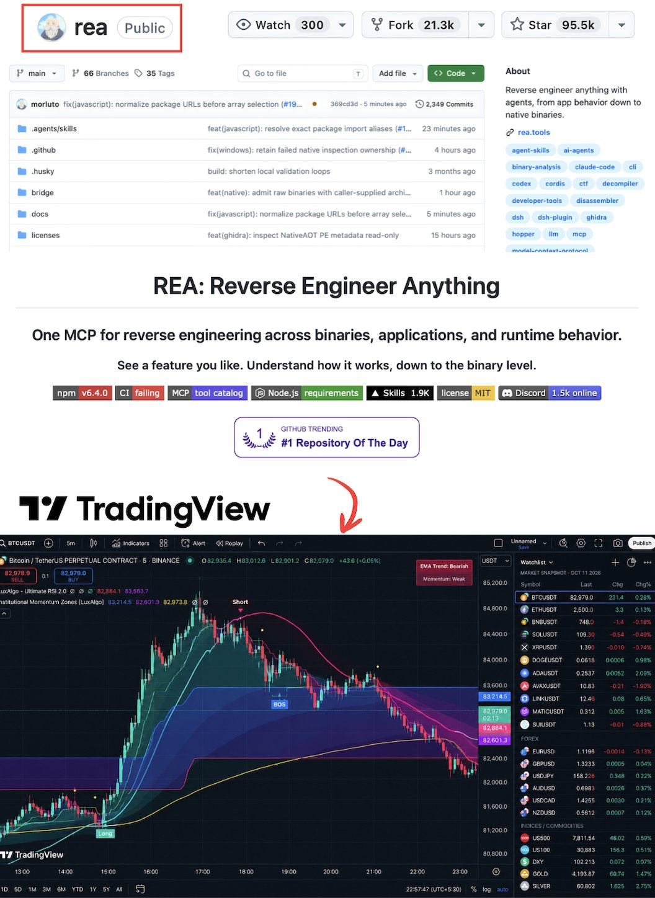

Links des Posts:

- https://x.com/RohOnChain/status/2109347169316839434/photo/1
- https://twitter.com/RohOnChain/status/2101311813908652069

Referenzierte Posts:

- quoted: https://x.com/i/status/2101311813908652069

## Zitierte Posts innerhalb der Einbettungen

Separat nachgeladen wurden die unmittelbar zitierten Posts der eingebetteten Tweets. Weitere Verschachtelungen werden als Links erhalten.

### @karpathy · 2042334451611693415

Quelle: https://x.com/karpathy/status/2042334451611693415 · Datum: 2026-04-09T20:10:52.000Z

Judging by my tl there is a growing gap in understanding of AI capability.

The first issue I think is around recency and tier of use. I think a lot of people tried the free tier of ChatGPT somewhere  last year and allowed it to inform their views on AI a little too much. This is a group of reactions laughing at various quirks of the models, hallucinations, etc. Yes I also saw the viral videos of OpenAI's Advanced Voice mode fumbling simple queries like "should I drive or walk to the carwash". The thing is that these free and old/deprecated models don't reflect the capability in the latest round of state of the art agentic models of this year, especially OpenAI Codex and Claude Code.

But that brings me to the second issue. Even if people paid $200/month to use the state of the art models, a lot of the capabilities are relatively "peaky" in highly technical areas. Typical queries around search, writing, advice, etc. are *not* the domain that has made the most noticeable and dramatic strides in capability. Partly,  this is due to the technical details of reinforcement learning and its use of verifiable rewards. But partly, it's also because these use cases are not sufficiently prioritized by the companies in their hillclimbing because they don't lead to as much $$$ value. The goldmines are elsewhere, and the focus comes along.

So that brings me to the second group of people, who *both* 1) pay for and use the state of the art frontier agentic models (OpenAI Codex / Claude Code) and 2) do so professionally in technical domains like programming, math and research. This group of people is subject to the highest amount of "AI Psychosis" because the recent improvements in these domains as of this year have been nothing short of staggering. When you hand a computer terminal to one of these models, you can now watch them melt programming problems that you'd normally expect to take days/weeks of work. It's this second group of people that assigns a much greater gravity to the capabilities, their slope, and various cyber-related repercussions.

TLDR the people in these two groups are speaking past each other. It really is simultaneously the case that OpenAI's free and I think slightly orphaned (?) "Advanced Voice Mode" will fumble the dumbest questions in your Instagram's reels and *at the same time*, OpenAI's highest-tier and paid Codex model will go off for 1 hour to coherently restructure an entire code base, or find and exploit vulnerabilities in computer systems. This part really works and has made dramatic strides because 2 properties: 1) these domains offer explicit reward functions that are verifiable meaning they are easily amenable to reinforcement learning training (e.g. unit tests passed yes or no, in contrast to writing, which is much harder to explicitly judge),  but also 2) they are a lot more valuable in b2b settings, meaning that the biggest fraction of the team is focused on improving them. So here we are.

Links des Posts:

- https://twitter.com/staysaasy/status/2042063369432183238

Referenzierte Posts:

- quoted: https://x.com/i/status/2042063369432183238

### @firesidealpha · 2108756295876780127

Quelle: https://x.com/firesidealpha/status/2108756295876780127 · Datum: 2026-10-10T03:07:34.000Z

David Sacks says Anthropic is run by a "religious cult" and is doing the very things it says it fears most, like opening a wet lab while warning of bio risk, and that there's an argument for sending in a federal SWAT team

"But I do think that there are potential externalities from having the number one frontier model company run by a religious cult."

"So, for example, they are opening a Claude-powered wet lab in the middle of San Francisco. But at the same time, they're warning of bio risk. At the same time, they say that we have to pace the frontier, they're extending the frontier. At the same time that they are saying that there's a risk of superintelligence growing beyond our control, they're programming it to grow beyond our control."

"I think there are potentially huge externalities to the way they approach these things. And it's, like, insane that they call these decisions "safety." These are not safe decisions. These are crazy decisions, it seems to me."

"This is why I've called this a schizophrenic company, is they appear to be not only hypocritical, but they're doing the things that they say they are most afraid of."

"Like, what is going on here? This is bizarre. And I don't know where this all leads. I do think there's an argument for a federal SWAT team to come blasting in there."

[Video lokal: 01-video.mp4](medien/2026-10-12-0xcodila-2109623431763292649/eingebettet/2108756295876780127/01-video.mp4)

Links des Posts:

- https://x.com/firesidealpha/status/2108756295876780127/video/1
- https://twitter.com/firesidealpha/status/2108752858309161419

Referenzierte Posts:

- quoted: https://x.com/i/status/2108752858309161419

### @RohOnChain · 2101311813908652069

Quelle: https://x.com/RohOnChain/status/2101311813908652069 · Datum: 2026-09-19T14:05:51.000Z

Jev is the FASTEST AI model ever built for trading

It makes calibrated buy/sell decisions in under 100 ms

That is one real decision on every single block, 24/7

In this article I've shown EXACTLY how to build HFT trading system with Jev (from scratch) https://t.co/4hmZDzN00Z

#### Artikeltext dieser Zusatzquelle

How to Use Jev to Build a 24/7 HFT Trading System

I will break down the exact framework to build a millisecond speed 24/7 HFT trading system with Jev, along with the exact resources that helped me personally.
Let's get straight to it.
Bookmark This - 
if you are building HFT trading bots, wire your agents with AgenKit at agenkit.xyz. It turns one prompt into a FULL Quant Engineering Team that ships production trading code. START HERE.
If you are building your own trading system with Jev, DM me your current setup and i will personally review the first 10. MOVE FAST.
On September 15, TypeSafe AI came out of 2 years of stealth with $40M led by DCVC and released a new class of AI model called Jev.
 
The founder is Diogo Almeida, who co-invented ChatGPT and InstructGPT at OpenAI.
Jev does not generate text. 

You send it market state plus typed questions, it returns calibrated decisions in 70 to 500 milliseconds, at $0.042 per million input tokens, output free.
That latency is the whole story for trading.
An LLM takes 3 to 30 seconds to reason about an order book. By the time it answers, the book has moved 40 times. 

Jev answers before the next block lands.
And the proof it works for trading arrived within 72 hours of launch.
Jarrod Watts shipped a live market making bot on Monad that reads the Kuru MON-USDC order book, fires a Jev decision every 300 millisecond block and posts a real post-only limit order one tick inside the touch.
 
1000+ stars in 3 days. Decisions landing in 81 milliseconds. Live dashboard streaming in public.
That repo is the existence proof. 

One thing to understand before we go further, because it shapes everything below.
Jev is the decision engine. But a decision engine is not a trading system.
Someone still has to build the state engine, the policy gates, the risk vetoes, and the 24/7 loop around it, at production quality.
That's why I am using AgenKit for. It turns one prompt into a full quant engineering team that ships the code Jev plugs into.
Jev decides. AgenKit builds the system that calls it.
Everything below is the blueprint. AgenKit is how you ship it without writing every layer by hand.

This article is the full engineering manual.
By the end of this you will know:
You will be able to build a 24/7 HFT trading bot at hedge fund quality using the fastest decision model available right now, Jev.
How to split a trading system into deterministic code and probabilistic judgment, the split that actually works.
How to run a full battery of parallel judgments on every block in one call, at single-question latency.
The complete from-scratch setup, from waitlist to your first typed decision, in 10 minutes.
Exactly what Jev replaces in your stack and what it does not, stated precisely enough to hold me to.
Let's get into it.
 
Part 1: What Jev Is and Why It Fits HFT
Jev is not an LLM. It does not generate text or explain itself.
TypeSafe calls it a System One model, after Kahneman's fast intuitive thinking. 

The bet: most decisions inside software are System 1 judgments (which bucket, is this urgent, is this toxic) and we have been renting slow System 2 chat models to make them.

UNDERSTAND JEV EASILY WITH THIS VISUAL:
 
The mental model:

LLM: state to text. 
Jev: state to decision distribution.
 
You send a state (any JSON, like an order book snapshot) plus typed questions with predefined answer spaces. Jev returns typed answers with probabilities and confidence. No prose, no parsing, no JSON repair.
Three primitives, straight from docs.typesafe.ai:
Noul returns a 0 to 1 value. Is the flow toxic? → 0.83
Choice picks one option from a list, up to 255. Which regime? → trending 0.63, mean_reverting 0.22, chaotic 0.15
Score rates the state on a rubric you define. Quote environment 0 to 3? → 2.3
All three mix in one call. Every question is evaluated in parallel and in isolation. Adding questions barely moves latency, and there is no context-rot because each is evaluated independently.
Two facts explain the speed.
Jev is not autoregressive. An LLM decodes token by token, sequentially. Jev computes probability distributions across all your choices in parallel passes. Six questions cost the same latency as one.
Jev is trained with RLCD, Reinforcement Learning for Calibrated Decisions. It optimizes probabilities against real outcomes, not human preference. Higher confidence really does mean higher accuracy in aggregate.
Context is 32,000 tokens. Enough for a dense snapshot and recent trades. Not your strategy doc, and that is the point. Jev answers narrow questions about compact state. Code owns the rest.
Where does Jev fit in a latency budget?
Colocated equities run in microseconds. Jev has no business there. FPGA and C++ keep that lane.
On-chain order books run at block cadence. Monad blocks every 300ms, Solana slots around 400ms. Jev fits inside one block with room for execution.
Tactical reads (regime, toxicity, strategy selection) have horizons of seconds. Jev is perfect there on cost.
The cost that changes the architecture: one fully loaded decision every block, 24/7, runs $10 to $25 a month. The same loop on a frontier LLM costs $50 to $150 per hour.
 
On TypeSafe's own four-workflow eval, Jev scores 67.8% agreement with a frontier consensus at $0.0004 per case, versus GPT-5.6 Terra at 67.9% and $0.0304. Same accuracy, 76x cheaper. Vendor numbers, directional, but the direction is not subtle.
 
Part 2: The Architecture That Separates Systems From Demos
One principle carries the whole build.
Jev should not own the trading system. It should own selected judgments inside it.
Every failed AI bot i have reviewed asked the model to trade. 
Look at BTC, tell me what to do. That question is unanswerable at any latency.
The correct decomposition:
Code calculates the state. Jev interprets the state. Code applies policy. Execution places the order.
Everything computable stays in code. Mid, spread, imbalance, realized vol, inventory, drawdown, VWAP, queue position. Never spend a Jev call on arithmetic. This matches TypeSafe's own methodology: deterministic facts in code, models for fuzzy judgment.
Everything that is a judgment goes to Jev. Is this regime trending or mean-reverting? Is this flow informed or noise? Is this a good setup? Has execution degraded?
And the official design rule for the questions: atomic questions, composed in code. If a question needs reasoning or weighs multiple factors, decompose it. Ask each factor separately, combine with your own weights. When priorities change, you edit a coefficient, not a prompt.
 
The hard risk layer always wins. Part 5 covers it.
 
 
Part 3: Setting Up Jev From Scratch in 10 Minutes
No cloned repos. Ground up, pulled from the official quickstart.
 
1. Join the waitlist. Apply at typesafe.ai. People are getting approved the same day.
2. Install the official skill so your agent writes correct Jev calls.
 
 
On Claude Code it is two commands. The marketplace add alone installs nothing.
 
3. Create an API key in the dashboard.
 
4. Install the SDK. Python needs 3.10+.
 
In an agent, one sentence routes it: say "use the TypeSafe skill" in your prompt.
5. Fire your first decision. The client reads TYPESAFE_API_KEY and calls jev-latest by default.
 
Two setup notes that save you later.
For HFT use the direct API, POST https://api.typesafe.ai/v1/systemone. Gateways (OpenRouter as ~typesafe/jev-latest, Vercel AI Gateway as typesafe-ai/jev, LiteLLM passthrough) each add round trip you cannot recover.
Pin your model version and log the version in each response. Your confidence gates are calibrated to one model. A silent upgrade with unpinned thresholds breaks systems quietly.
 
Part 4: The State Engine and the Parallel Judgment Battery
Two build steps, because they are the heart of the system.
The state engine is pure deterministic code and where most builders underinvest. On every block, compute a compact snapshot under 400 tokens:
 
Three rules. Keep it dense and numeric, you pay per input token. Timestamp discipline is absolute, every field uses only information strictly before the decision. Log every snapshot with its decision, that triple is your calibration data later.
The judgment battery is where a system beats a demo. One question is a demo. The full battery in one call is the professional pattern, and the batching economics reward it 12x over.
This is exactly how elite prop traders think. 

Not one buy/sell call, a battery of simultaneous reads.
 
Six judgments, one call, one latency, about $0.00001 per block.
Then the policy engine, yours in code forever:
 
Three points to internalize:

Thresholds live in your code, not the model, exactly as TypeSafe's confidence docs prescribe. 

Write one threshold per action scaled to what being wrong costs, not one for the whole system. 

And fractional Kelly, (2p - 1) capped at quarter, is only defensible because RLCD makes p mean something. With LLM logprobs it is fiction.
 
 
Part 5: The 24/7 Loop, Risk Engine, and Fallback Ladder
Now assemble the loop that justifies 24/7.
 
The deterministic half of market making is 50 year old math and stays in code. Your pricing engine computes the Avellaneda-Stoikov reservation price and spread every block:
 
Jev answers only what the formula cannot: is this an environment worth quoting into at all?
The full loop:
 
That is nine stages, each a tested module with its own failure modes. This is exactly the point where a hand-built system turns into a month of debugging. 

Point AgenKit at this loop spec and it ships each layer with test-first discipline, spec to review to deploy, so you are calibrating a working system by the weekend instead of still wiring the WebSocket.

Two details decide whether this survives reality.
The block deadline rule: if the Jev decision has not returned before the next block, hold. Never post a quote on stale state. jev-trader handles this exact case.
The gas honesty check: the jevons critique fork ran the numbers and showed naive every-block cancel-replace loses money structurally, roughly 428 MON per hour in gas against a 3.5 bps spread. Your loop needs a wider spread, longer resting times, or a real directional edge from the battery. Run this math before your first live order.
The risk engine never delegates to Jev. Hard-coded deterministic vetoes, checked before every order, zero negotiation:
 
Every limit must be checkable by something other than the model's own claim. File exists at path X. Metric below Y in the output. Never trust the system says it ran.
The fallback ladder is why most "24/7" bots are actually 24/7-until-2AM bots:
 
With this ladder the system is autonomous. Without it, it is AI-powered until the first network partition.
Where retail can actually run this today: on-chain order books at block cadence (Monad via Kuru, Solana DEXs, Hyperliquid) and prediction markets with 200 to 500 bps spreads. What is locked: top US equities, owned by Citadel Securities and Jane Street at microsecond speed. Do not bring a 300ms loop to a microsecond fight.
 
Part 6: Calibration and the Honest Contract
Calibration first, because it is the step that makes quants trust the system.
Do not backtest "did Jev predict price". Test the whole policy. 

Four baselines on identical data, features, costs, and limits: hand-written rules, a frontier LLM layer, a Jev layer, and Jev plus confidence gating. Measure Sharpe, Sortino, max drawdown, hit rate, slippage, adverse selection, cost per million decisions and coverage.
The Jev-plus-gating versus plain-Jev comparison is the real research question: does abstaining when uncertain improve the book? On a calibrated model it should. That is the entire bet.
Then verify calibration itself. 

If Jev says P(up) = 0.80, do 80%-tagged events happen 80% of the time on your venue? Plot predicted probability against empirical frequency, compute Brier score, log loss and Expected Calibration Error from your logged triples. RLCD calibrates against TypeSafe's distribution, not yours. If your reliability curve bends, apply Platt scaling in the policy layer.
The honest contract. Screenshot this.
Jev CAN: return typed calibrated decisions in 70 to 500ms, evaluate dozens of parallel questions at single-question latency, handle 255 choices and 32K state, sit inside a 300ms block loop, replace fuzzy rules and LLM classification and heuristic scoring and regime classifiers and guardrails, drive fractional Kelly after you verify calibration, and run a full battery every block for $10 to $25 a month.
Jev CANNOT: generate text or design your strategy, chain dependent judgments in one call (questions are isolated, dependencies are a second request), compete in the microsecond lane, replace market data infra or numerical computation or exchange connectivity or hard risk controls, guarantee vendor numbers on your workload, or turn a losing strategy into a winning one. Jev makes decisions cheap and fast. Edge is still your job.
That second list is not hedging. It is the reason the first list is believable.
 
Closing
Jev is not a smarter LLM. 

It is a different species, a decision engine that returns calibrated probabilities in the budget of a single block.
 
The system that wins is not the one that asks Jev to trade. It computes everything computable in code, sends one compact state with a full battery of atomic questions, gates every action on calibrated confidence, prices with deterministic math and keeps hard risk rules with absolute veto power.
I did not use Jev because it is the newest model on the timeline. 

I decomposed a trading system into deterministic computation and probabilistic judgment, then tested whether a calibrated decision model fits the second half. 

So far the answer is yes and the logs proving it are the calibration data the system needs anyway.
In my previous articles i broke down the mathematical trading models on GPT-6 Astra, the one-person hedge fund architecture and the market making layer. This one adds the millisecond judgment engine between the state and the order.
 
So here is the question.
Are you still sending your order book to a chat model and waiting 8 seconds for prose or asking 6 typed questions and getting 6 calibrated answers back before the next block lands?
There is no wrong answer. But there are very revealing ones.

#### Code- und Prompt-Blöcke

Originalblock 1/13

```
                MARKET DATA
                     ↓
              FEATURE ENGINE
                     ↓
         DETERMINISTIC STATE SNAPSHOT
                     ↓
                    JEV
          ┌──────────┼──────────┐
       REGIME     TOXICITY   DIRECTION
       QUALITY    LIQUIDITY  RISK STATE
          └──────────┼──────────┘
                     ↓
              PROBABILITY VECTOR
                     ↓
               POLICY ENGINE
                     ↓
          ┌──────────┴──────────┐
     HARD RISK RULES       TRADE SIGNAL
          └──────────┬──────────┘
                     ↓
                 EXECUTION
```

Originalblock 2/13

```bash
export TYPESAFE_API_KEY="your-key"
```

Originalblock 3/13

```python
def compose_action(ans, snap, limits):
    if snap["drawdown"] > limits.max_drawdown:        return KILL
    if ans["toxic_flow"].noul > 0.6:                  return PULL_QUOTES
    if ans["liquidity_stressed"].noul > 0.7:          return WIDEN

    q = ans["quote_environment"]
    if q.score >= 2.0 and q.confidence > 0.80:
        skew = inventory_skew(ans["inventory_pressure"].score)
        return quote_both_sides(skew=skew)
    if q.score >= 1.0:
        return quote_wide()
    return STAND_DOWN
```

Originalblock 4/13

```plaintext
reservation r = mid - inventory * gamma * sigma^2 * (T - t)
half spread   = gamma * sigma^2 * (T - t) + (2/gamma) * ln(1 + gamma/kappa)
```

Originalblock 5/13

```bash
npx skills add typesafe-ai/skills --skill typesafe-ai
```

Originalblock 6/13

```bash
pip install typesafe-sdk        # Python
npm install @typesafe-ai/sdk    # TypeScript
cargo add typesafe-ai-rs        # Rust, for the execution layer
```

Originalblock 7/13

```python
response = client.system_one(
    state=snapshot,
    questions={
        "regime": Choice(instructions="Regime?",
            criteria={"trending": None, "mean_reverting": None,
                      "high_vol": None, "crisis": None}),
        "direction": Choice(instructions="Bias next 10 blocks?",
            criteria={"up": None, "down": None, "neutral": None}),
        "toxic_flow": Noul(instructions="Is aggressive flow informed?"),
        "liquidity_stressed": Noul(instructions="Book thinner than 24h norm?"),
        "quote_environment": Score(instructions="Favorable to provide liquidity?",
            legend={"0": "No", "1": "Marginal", "2": "Standard", "3": "Excellent"}),
        "inventory_pressure": Score(instructions="Urgency to cut inventory?",
            legend={"0": "None", "1": "Mild", "2": "Skew hard", "3": "Reduce now"}),
    },
)
```

Originalblock 8/13

```python
from typesafe_sdk import Choice, Noul, Score, TypeSafeClient

client = TypeSafeClient()

state = {
    "mid": 3.4127, "spread_bps": 3.5, "imbalance": 0.71,
    "realized_vol_5m": 0.034, "inventory": -120,
    "aggressive_buy_ratio": 0.63
}

response = client.system_one(
    state=state,
    questions={
        "regime": Choice(
            instructions="What market regime does this state describe?",
            criteria={"trending": None, "mean_reverting": None, "chaotic": None},
        ),
        "toxic_flow": Noul(
            instructions="Is aggressive flow likely informed rather than noise?",
        ),
        "quote_environment": Score(
            instructions="How favorable is this state for providing liquidity?",
            legend={"0": "Do not quote", "1": "Marginal",
                    "2": "Standard", "3": "Excellent"},
        ),
    },
)
```

Originalblock 9/13

```bash
claude plugin marketplace add typesafe-ai/skills
claude plugin install typesafe@typesafe-ai
```

Originalblock 10/13

```plaintext
PRICE     mid, microprice, returns 1m/5m/30m
BOOK      spread bps, depth 3 levels, imbalance, queue position
FLOW      aggressive buy/sell volume, trade + cancel intensity
VOL       realized vol short + medium, vol vs 24h regime
CROSS     divergence vs reference venue, basis, funding
BOOK PnL  inventory, unrealized PnL, drawdown, position age
HEALTH    fill ratio, reject rate, slippage, last 10 latencies
```

Originalblock 11/13

```plaintext
Block event (WebSocket newHeads + polling backstop)
  → read L2 book (best bid/ask/depth)
  → compute state snapshot (deterministic, < 400 tokens)
  → fire Jev battery (six judgments, one call)
  → policy engine composes action
  → A-S pricing computes reservation + spread
  → risk engine checks hard limits (absolute veto)
  → cancel old quotes, post new post-only orders
  → log, await fills, book PnL, update inventory
  → next block
```

Originalblock 12/13

```plaintext
healthy + high confidence  → normal operation
healthy + low confidence   → reduce size or observe
late past block deadline   → hold, no stale quotes
Jev unavailable            → deterministic fallback only
hard limit breached        → kill switch, flatten, alert
```

Originalblock 13/13

```plaintext
max position   max daily loss    max drawdown
max order size max inventory age max stale-data age
max leverage   max API errors    max decision latency
```

#### Links aus den Artikel-Entities

- agenkit.xyz
- docs.typesafe.ai
- typesafe.ai
- https://api.typesafe.ai/v1/systemone
- https://agenkit.xyz
- https://api.typesafe.ai/v1/systemone

#### Weitere Einbettungen dieser Zusatzquelle

Diese Verweise gehören zu einer weiteren Ebene und wurden nicht rekursiv abgerufen.

- https://x.com/i/status/2100190746389135772
- https://x.com/i/status/2099500150939127945
- https://x.com/i/status/2100356151468585346
- https://x.com/i/status/2099925682726002904

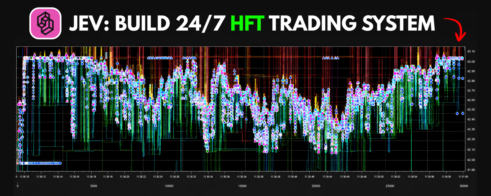

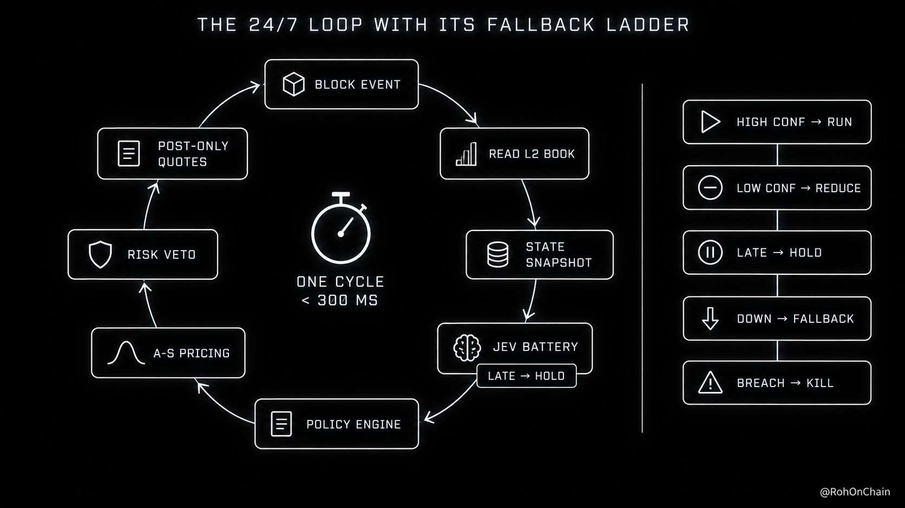

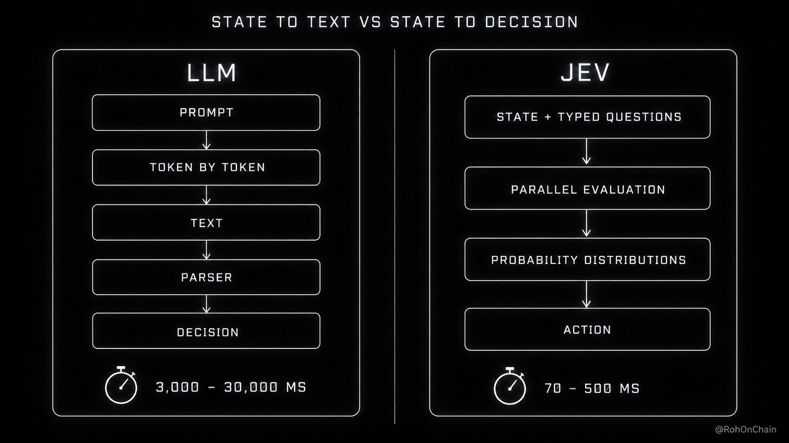

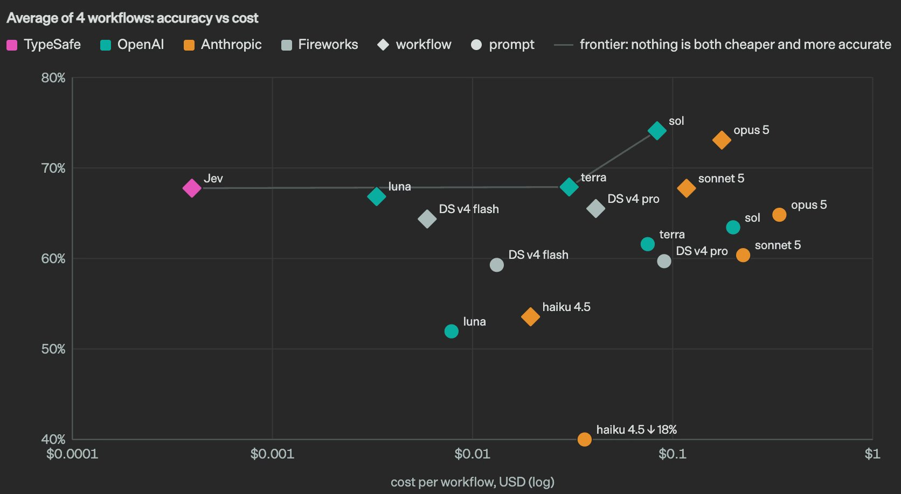

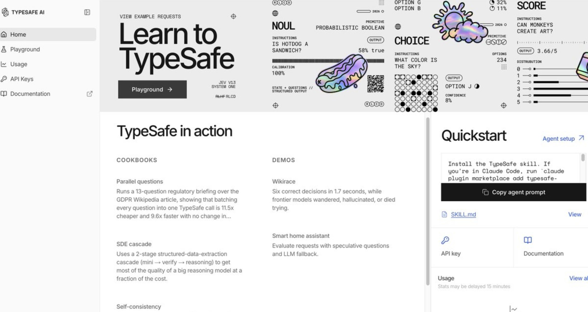

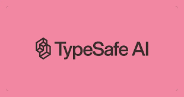

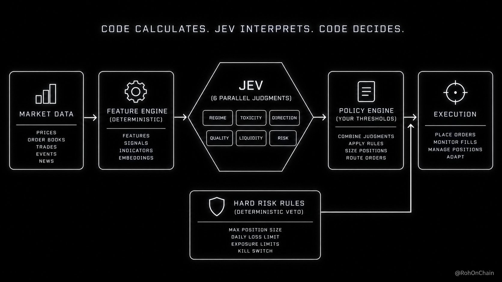

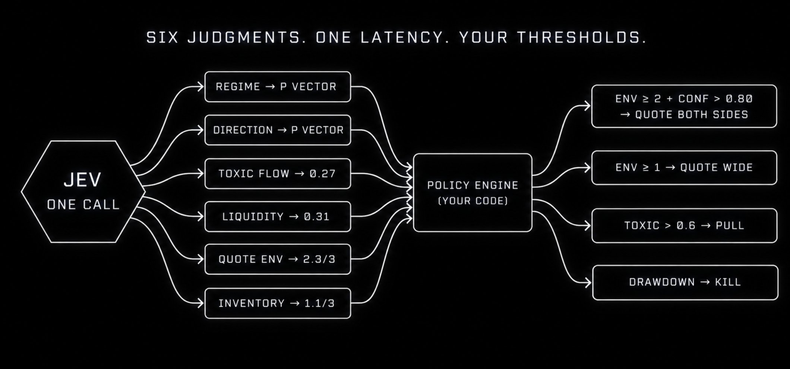

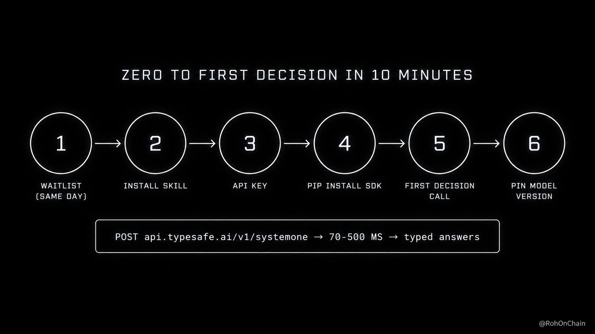

Links des Posts:

- https://x.com/i/article/2100887343809110016

## Weitere Zitatverweise aus der API-Antwort

Für diese weitere Ebene wird nur der bereits mitgelieferte Text erhalten. Ihre Medien und weiteren Verweise wurden nicht unabhängig nachgeladen.

### Autor-ID 1254131357774733312 · 2042063369432183238

https://x.com/i/status/2042063369432183238

The degree to which you are awed by AI is perfectly correlated with how much you use AI to code.

### @firesidealpha · 2108752858309161419

https://x.com/i/status/2108752858309161419

David Friedberg says AI consciousness is "probably the birth of a new religion," a belief system that can't be proven and spreads via narrative not proof

"I think what we're watching is probably the birth of a new religion. And it probably, it's not going to be called a religion, but it's going to follow sort of the same principles, and it's going to have the same effects, which will ultimately be camps that have conflict with one another for aggregation of power."

"The thing about consciousness is it cannot be derived from logic and pure mathematics. Like, you can't prove consciousness. It's a debate, and you can have a rich debate with anyone over consciousness. You can't prove it, you can't disprove it."

"And when humans prove something to be true using math, science, we use empiricism, which is data and logic, the connection of the sequence of things to derive something to be true or not."

"So in scientific disciplines, when you have a new idea, and it's not proven, and it's not disproven, it's a theory. And then it's either proven or disproven later. Otherwise, it remains a theory."

"Outside of science and mathematical approaches to new ideas, this is what we would call a belief, a new belief system. Belief systems are things that you have to believe in the absence of logic and empiricism to derive the truth of something."

"And belief systems are the foundation of things like religion. And the idea that you can prescribe or describe AI as being conscious is effectively the creation of a new belief system, a system that doesn't actually spread via proof. It spreads via narrative."

## Archivierungsstand und Grenzen

- Hauptartikel: 16612 Zeichen aus der API; 34 separate Code-/Prompt-Blöcke ergänzt.
- Direkte Einbettungen: 12/13 Posts abrufbar.
- Unmittelbar zitierte Zusatzposts: 3 nachgeladen.
- Konversationsposts des Hauptautors: 9 erfasst; darunter können einzelne Antworten an Dritte sein.
- Keine Transkription oder inhaltliche Verifikation der Videos.
- 2091221918561317355: Authorization Error; Text und Medien fehlen
- 2101311813908652069: 4 weitere Artikel-Einbettungen nur verlinkt
- 2 weitere Zitatposts: nur mitgelieferter Text und Link, Medien nicht nachgeladen

[Technisches Archiv-Manifest](medien/2026-10-12-0xcodila-2109623431763292649/archiv-manifest.json)
