# How to Reverse Engineer Anything with Opus 5.5 ( Full-Course)

> Automatisch per `npm run ingest:x` erfasst. Quelle: [x.com/0xMovez/status/2109604520770548146](https://x.com/0xMovez/status/2109604520770548146)

## Artikel-Volltext

Most people who try to reverse-engineer a binary open it in a hex editor, scroll for twenty minutes, and quit. 
They don't know which tool loads the file. They don't know which prompt pulls the logic out. They don't know how to turn a wall of assembly into something they can actually rebuild.
This 11-step course will turn Claude Opus 5.5 into an open-source anything machine.
Follow my Substack to get fresh AI alpha: movez.substack.com
Reverse engineering is not about cracking. It is about understanding a thing well enough to build your own.
On October 7, 2026 Amjad Masad, the CEO of Replit, posted a single line:
 
under it, a developer called @morluto replied with the receipt: a set of tools that let agents drive Hopper and Ghidra and go very far. 
That project is REA, and it crossed 110,000 GitHub stars in days.
 
The claim is not hype. The same week, an open-source project called WordCraft shipped a clean-room rebuild of Microsoft & Adobe in pure Rust: 
 
It was built by observing Word & Adobe behavior and reading public file-format specs, never its code. 
 
This course shows you the whole path from a sealed binary to a rebuild like that, with Opus 5.5 doing the reading.
 

01. The engine - how an agent reads a binary
Opus 5.5 cannot run a disassembler on its own. It reads text and writes text. 
Reverse engineering with an agent works because a tool sits between the model and the binary: it loads the file into a real disassembly engine, exposes the results as callable functions, and lets the model ask questions.
 
That tool is REA, and the engine underneath is Hopper, Ghidra or IDA.
The loop is simple and it repeats: the model asks REA to inspect the target, REA returns findings with the exact evidence behind them (addresses, bytes, pseudocode, call sites), and the model uses those findings to ask the next question or to write and test a reimplementation. 
 
Everything runs locally on your machine. Nothing is uploaded except the findings the model needs to reason, and every conclusion is tagged as an observation, an inference, or an unknown.
 

02. The install - rea-agents plus one disassembler
Setup registers REA's MCP server with your agent and installs the matching workflow instructions. 
One command does it, it shows you every change before writing anything, and it backs up what it touches. 
 
You bring your own disassembler: Hopper on macOS is the easiest path, Ghidra is free and cross-platform, IDA if you already own it.
 
Requirements are modest: Node.js 22 or newer and npm. Native analysis needs one of the three engines; static JavaScript and .NET inspection need no engine at all. Keep REA current, because releases ship frequent fixes.
 
Opus 5.5 ships five effort levels: low, medium, high, xhigh and max. Use:
Medium to inspect and navigate
High to annotate ordinary functions
Max for obfuscated code and anything with heavy pointer math. 
Effort is the single biggest quality knob in this whole course.
 

03. The router - 20 target types, one tool each
The first mistake beginners make is reaching for a disassembler when the target is an Electron app whose JavaScript is sitting right there. 
REA routes the target to the right tool, and so should your first prompt. Name the file, name the feature, and let the agent pick the entry tool.
 
 
Pointing REA at an Electron app returns modules, imports and IPC boundaries in seconds with no disassembler at all. 
Pointing it at a native Mach-O or ELF opens a Hopper database and gives you the harder but deeper native path. Knowing which one you are in saves hours.
 
 

04. Recon - overview, strings and the call graph
Do not open any code yet. First ask REA for a map of the whole file. One command tells you what kind of machine it runs on, how many functions are inside, and all the readable text buried in it. 
That text is the fastest clue you have: web addresses, error messages and feature names tell you what the app does before you read a single line of code.
 
REA also counts how many times each function gets called (that count is called its cross-references, or xrefs).
 
A function called 147 times is the heart of the app and deserves your best effort. One called twice is a small helper you can ignore until it matters. Start at the top of that list and work down.
 

05. Decompile - one function into pseudocode
Now pick one of those busy functions and turn it into something you can read. A decompiler takes the raw machine instructions and rewrites them as code close to C. 
It looks rough: names like var_28, tangled logic, casts everywhere. But you can read it, and readable is all Opus 5.5 needs. 

Run it from the command line to save the result, or from inside a chat.
 
 
REA's own showcase follows a sound call in the old game DX-Ball down to the helper that decides left-right audio balance, then turns the half-finished pseudocode into C. 
 
The result passes all 3,205 original test cases and reproduces every one of the 63 compiled bytes. 
 
Full walk-through on rea.tools/showcase.
 

06. Annotate - make Opus name every variable
That rough code is only half the job. Now hand it to Opus 5.5 and ask it to explain and clean it up. 
It renames the cryptic variables to real ones, says in a sentence what the function is for, spots the pattern it follows, and even flags bugs the original app left in. 
Paste this prompt with the Claude:
 
Decompilation gives you what the code does. Opus 5.5 gives you why, and the names to rebuild it.
 
Not every target needs a disassembler. REA's Notion showcase finds the clipboard feature in the app's JavaScript, follows it through the Electron layers into the main process, and shows exactly how it builds the rich clipboard, a full trace with no assembly at all. See
 

07. Obfuscation - the Tigress benchmark
Some apps are built to resist exactly what you are doing. Their code is scrambled on purpose: the logic is shuffled, the text is encrypted, and fake branches are added to waste your time. 
This is called obfuscation, and it is the one place even the best model struggles. Elastic Security Labs measured it, pointing Claude Opus at the Tigress scrambler across 20 tasks. Keep these numbers in mind.
 
Two practical lessons sit in those numbers. 
First, a failed attempt costs about twice a successful one, because the model keeps trying harder and harder before it gives up, so set a spending limit per function and stop early. 
Second, strip the junk out of the decompiled code before you send it (a free tool called Caveman removes about 75% of it) so the model spends its attention on the real logic, not the filler.
The five tricks you will actually meet, and what each looks like when you open the code:
 
 
 

08. The swarm - a controller running workers
A single chat cannot read 500 functions well. It forgets what it saw, calls the same thing by three different names, and starts contradicting itself. 
The fix is a small team: one controller chat that hands out the work, and several worker chats that each take one function. 
The controller holds the big picture and stitches the pieces back together. 
 
You do not build anything special for this, the two prompts below are the whole setup.
 
 
 
 

09. Clean room - four rules that keep it legal
A clean-room rebuild means you copy what the app does, never the code inside it. Get this right and what you ship is fully yours. Get it wrong and you are carrying someone else's copyright. 
 
Four rules keep you on the safe side, and the WordCraft team checks all four automatically on every build.
Observe, never copy. Run the target black-box, watch what it does, screenshot only its own window. Never read, disassemble or paste its code. Never copy wording beyond plain feature names.
Specs, not sources. File formats come from public standards (OOXML is ECMA-376 / ISO 29500, plus the published RTF and ODF specs), never from reading a competitor's parser or any GPL/LGPL code.
Original assets only. Every icon, font, template and sound is drawn in code, public-domain, or openly licensed, with a row in an attribution file. A CI check fails the build otherwise.
Separate the two jobs. One agent recovers behavior and writes a spec. A different context implements from the spec alone, never looking at the original analysis. This separation is the clean-room boundary.
 
Working from a description is not just legal cover. It lets you make the right choices for your own language and needs, instead of inheriting decisions the original author made decades ago. 
 
WordCraft is faster than Word in places precisely because it did not copy Word's insides.
 

10. Crafting Apps - twelve pro tools, one method
WordCraft is not a one-off. It is one app in a shelf of twelve from the ArtCraft team, each a clean-room rebuild of a tool you already pay for, all written from scratch in Rust and shipped free and open on GitHub. 
Their own line is "Twelve apps. One craft", and the one craft is the method from step 9: watch the original, read the public specs, build a fresh version from behavior alone.
 
The payoff of that shared method is the same everywhere. No Electron: each app is native on macOS, Windows and Linux, and all but FilmCraft also run in a browser tab through WebAssembly. 
And because every action inside them is a named command, all twelve are drivable by an AI agent straight away.
Every Craft app is built the same way, and the shape is worth copying. Each is stacked in layers, each layer using only the one beneath it, from basic measurements at the bottom to the on-screen window at the top. 
Here are WordCraft's layers:
 
And every action is just a named command, so a person clicking, a keyboard shortcut, and an AI agent all trigger the exact same thing. That is what makes any of them drivable by an agent.
 
 
 

11. Verify and ship - prove parity, expose MCP
You never had the original's source code, so you cannot compare it line by line. 
You compare behavior instead: give both the original and your rebuild the same inputs and check they produce the same output. 
 
This is also the most convincing proof you can show anyone (the RE slot at the very top of the article).
 
Then release your rebuild the same way REA and WordCraft did: as an MCP server, so the next person's agent can drive it just like you drove REA. 
Give each function a clear name and description, wrap it in a simple command-line tool, and make it install in one line. 
 
And test as you go, not at the end, because a mistake found after you have built three layers on top of it is far more expensive to fix.
 

Six mistakes that waste a weekend
Opening a disassembler on an Electron app.If the JavaScript is right there, route to analyze_javascript_application and skip the native path entirely.
Dumping everything before reading anything.Ask REA for a summary first. Pulling the whole app at once buries the real logic in noise and runs up your bill.
Reading functions in file order.Sort by cross-reference count. The 147-xref function is the architecture; the 2-xref helper can wait.
Grinding stage-3 obfuscation.The benchmark solves 0% of multi-layer. Set a budget, bank the context from neighbors, come back later.
Letting the model copy code into your rebuild.That breaks the clean room. Spec first in one context, implement from the spec in another.
Shipping without a parity report."I think it matches" is not evidence. 50 behavioral tests and a match rate are.
 

Conclusion: 
Install REA. Read the binary. Rebuild it as your own.
Route the target, map its surface, decompile the hot functions, let Opus 5.5 name everything, break the obfuscation worth breaking, scale it with a swarm, then spec it clean and ship the rebuild over MCP. 
Eleven steps. One model. Zero copied code.

## Bilder

<!-- Reihenfolge wie von der API geliefert (Cover zuerst). Die Position im Artikeltext gibt die API nicht mit. -->

**Cover**

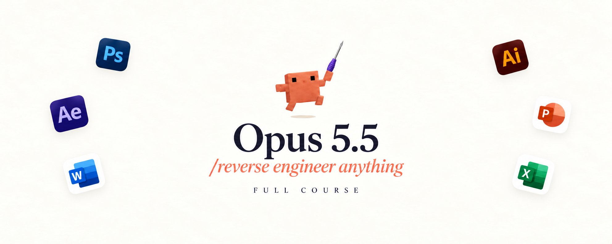

**photo**

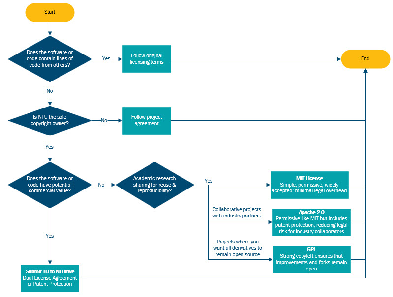

**photo**

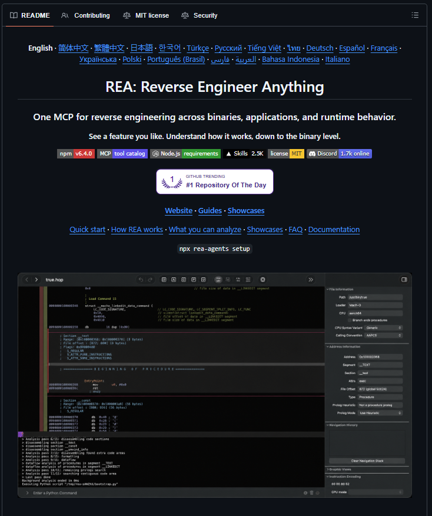

**photo**

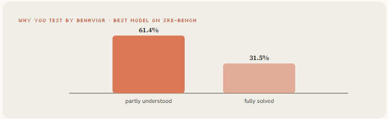

**photo**

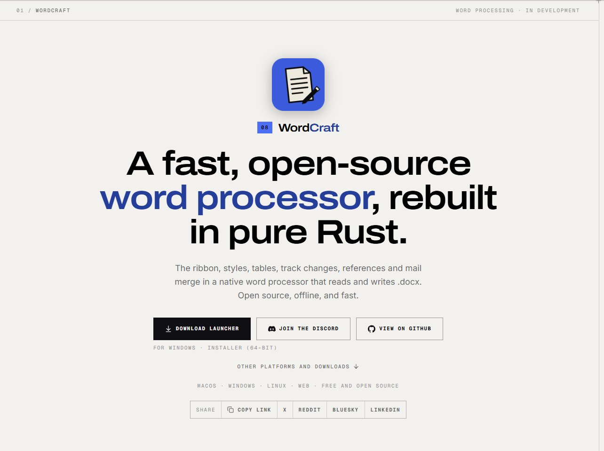

**photo**

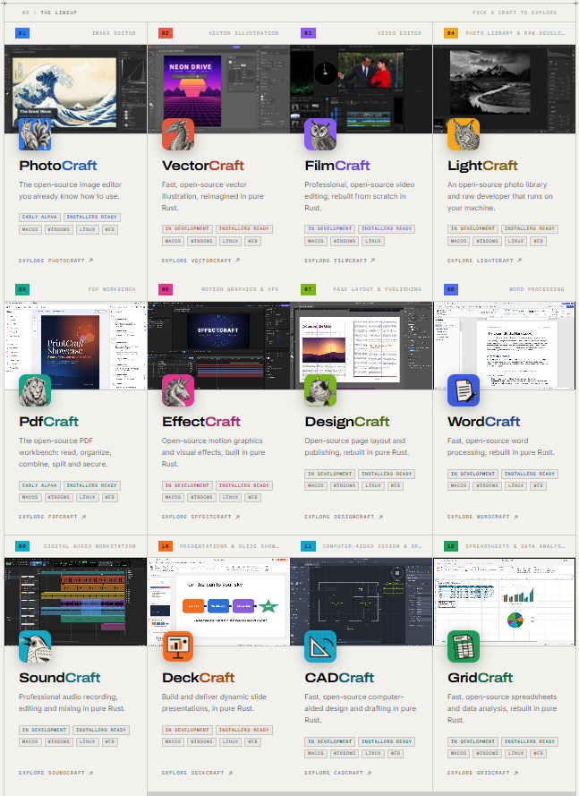

**photo**

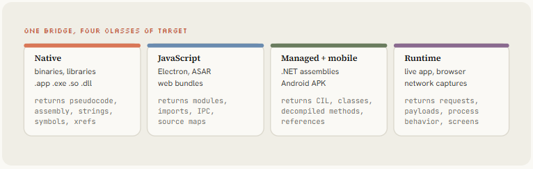

**photo**

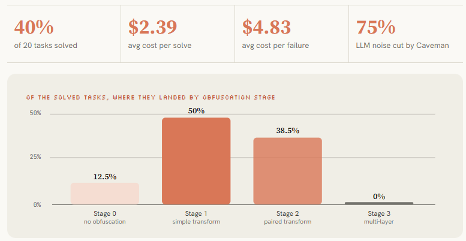

**photo**

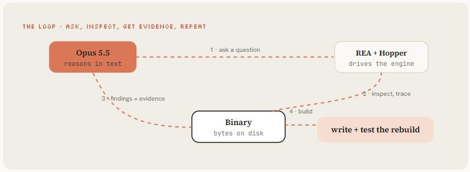

**photo**

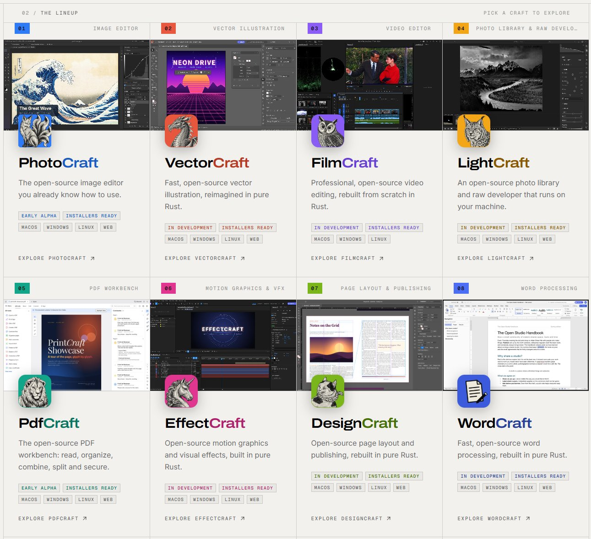

**photo**

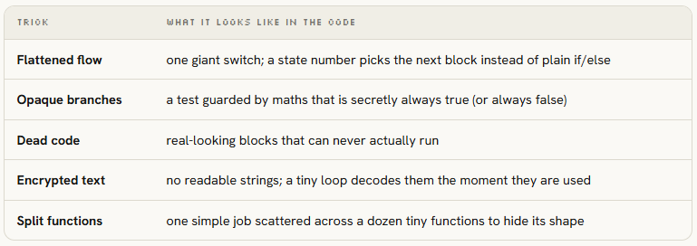

**photo**

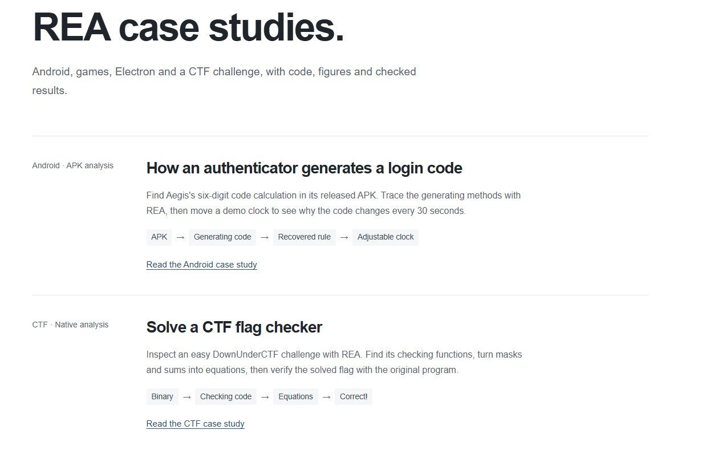

**photo**

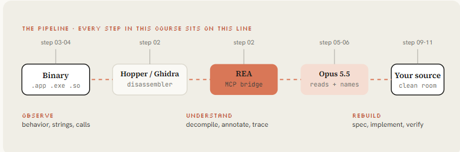

**photo**


**photo**

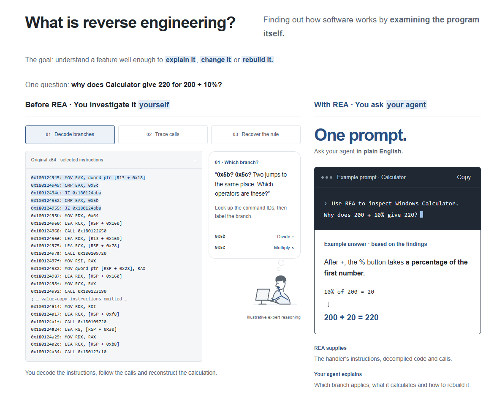

**photo**

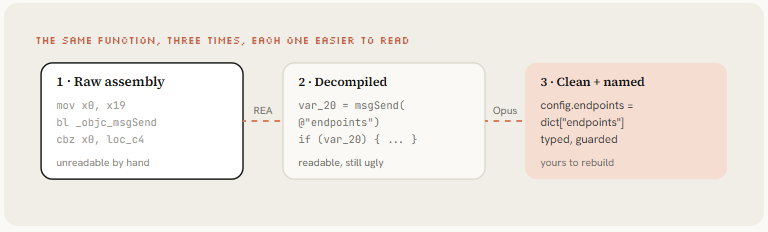

**photo**

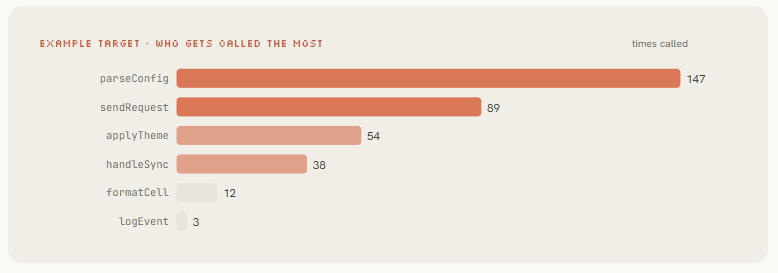

**photo**

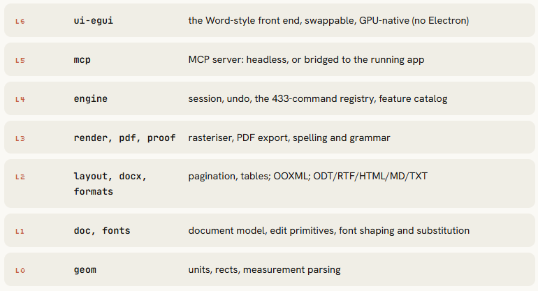

**photo**

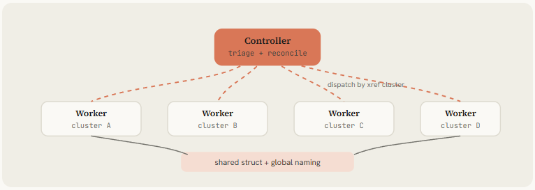

## Post-Text

https://t.co/LCLhoxByi3

## Links

- [x.com/i/article/2109…](https://x.com/i/article/2109583646684315648)

## Ergänzungen aus Artikel-Entities

Die folgenden Originalbestandteile wurden aus den X-API-Entities ergänzt. Die API liefert keine verlässlichen Positionen für Code-Blöcke, Bilder und eingebettete Tweets im Artikeltext; sie stehen deshalb separat. Die Reihenfolge folgt den gelieferten Entities und rekonstruiert keine Artikelpositionen. Videos werden lokal archiviert, aber nicht transkribiert.

### Code- und Prompt-Blöcke

Originalblock 1/13

```python
You are a reverse-engineering controller. The function map is in functions.json
(address, name, size, xref_count).

1. Cluster functions by call-graph proximity; order clusters by xref count.
2. Dispatch each cluster to a worker. Never analyze a function yourself.
3. Inject already-resolved structs into each worker's brief so names stay consistent.
4. When a worker returns confidence below 6, queue a second pass with context
   from its resolved neighbors.
5. Track cumulative token spend and report it after each cluster.
```

Originalblock 2/13

```python
# Reverse-engineering house rules ( CLAUDE.MD )

## Authority
- Only analyze targets I own or am authorized to examine. State the basis once.
- Every claim is tagged: observation (saw it), inference (deduced it), or unknown.
- Cite the evidence: address, bytes, pseudocode or call site. No unsourced claims.

## Workflow
- Start with the smallest overview, not a full dump. Expand only on a concrete gap.
- Reuse the open session; never re-run an identical analysis.
- Separate static facts from runtime facts. Never imply execution from static reads.

## Reconstruction
- Build from BEHAVIOR and public specs, never from copied code or assets.
- Keep an obligation ledger: every recovered behavior needs a passing test before "done".
```

Originalblock 3/13

```python
drive WordCraft over MCP

# Headless document automation
claude mcp add wordcraft -- wordcraft-cli mcp

# Or drive the running desktop app
wordcraft --control 7981 &
claude mcp add wordcraft-app -- wordcraft-cli mcp --connect 127.0.0.1:7981

# Tools: list_commands, execute, batch, type_text, select_text,
#        inspect_document, render_page, save_document (+ screenshot/click/key live)
> Open report.docx, make every heading 14pt bold, export to PDF
  ✓ select.all-headings -> 12 selected
  ✓ format.font-size 14 · format.bold
  ✓ export report.pdf (selectable text, bookmarks kept)
```

Originalblock 4/13

```python
Here is decompiled pseudocode from a function with 147 cross-references.

For this function:
1. Rename every variable to a meaningful name based on how it is used.
2. State its purpose in one sentence.
3. List the data structures it reads and writes.
4. Name the pattern (singleton, factory, state machine, observer...).
5. Rewrite it as clean, idiomatic Swift (or the language the calling
   conventions imply), with doc comments.
6. Flag any missing error handling, input validation or security check.

Think it through at xhigh effort before answering: reason about what each
value is before you commit to names. Mark anything you are unsure of.

[paste pseudocode]
```

Originalblock 5/13

```python
You are a worker. You get one decompiled function and the structs resolved so far.
Return exactly: address, purpose, confidence (1-10), structs_used, structs_new,
clean_source, flags. Reuse existing struct names; never invent a second name for
a struct the controller already gave you. One function only. Stop when done.
```

Originalblock 6/13

```python
# 1. Register REA with your agent (Claude Code, Codex, Cursor, Gemini CLI...)
npx rea-agents setup            # shows planned changes, asks before writing

# 2. A deep-analysis provider. Hopper is the smoothest on macOS;
#    setup can install it after approval. Ghidra and IDA are bring-your-own.
# 3. Install the rea CLI for terminal use and scripting
npm install --global rea-agents
rea --help

# 4. Restart your agent, then confirm the tools are live
claude
> /mcp
  rea: connected
    open_binary, binary_overview, analyze_function, decompile,
    list_procedures, search, xrefs, trace, inspect_artifact,
    analyze_javascript_application, inspect_managed_artifact ...
```

Originalblock 7/13

```python
// 0x100012ab0  xrefs: 147
void sub_100012ab0(void* arg0) {
    void* var_20 = objc_msgSend(cls_NSJSONSerialization,
        sel_JSONObjectWithData_options_error, arg0, 0x0, 0x0);
    if (var_20 != 0x0) {
        void* var_28 = objc_msgSend(var_20, sel_objectForKey, @"endpoints");
        void* var_30 = objc_msgSend(var_20, sel_objectForKey, @"auth_mode");
        void* var_38 = objc_msgSend(var_20, sel_objectForKey, @"retry_count");
        objc_msgSend(g_sharedConfig, sel_setEndpoints, var_28);
        objc_msgSend(g_sharedConfig, sel_setAuthMode, var_30);
        objc_msgSend(g_sharedConfig, sel_setRetryCount,
            objc_msgSend(var_38, sel_intValue));
    }
}
```

Originalblock 8/13

```python
From the completed analysis, write a clean-room specification for a reimplementation.

Describe BEHAVIOR only. Include: every public interface, the data model, each
user-visible feature as a testable requirement, the file formats read and written
(by observed behavior and public spec), and the error-handling behavior.

Do NOT include: addresses or offsets, variable names from the decompile, assembly,
or anything copied from the original. A developer who never saw the binary must be
able to implement a compatible version from this document alone.

Output markdown with sections: Architecture, Data Model, Public API, File Formats,
Test Cases.
```

Originalblock 9/13

```python
rea.open_binary        { path: "/Applications/Target.app/Contents/MacOS/Target" }
rea.binary_overview    {}
  arch:        arm64
  functions:   1,284 identified
  segments:    __TEXT __DATA __LINKEDIT
  entry:       _main @ 0x1000051c0

rea.search             { query: "http" }  # strings + code refs
  0x10004a2c0  "https://api.target.app/v3/sync"
  0x10004a300  "Authorization: Bearer "
  0x10004a330  "offline cache miss, falling back"

rea.xrefs              { address: "0x100012ab0" }  # who calls this?
  147 references  ->  core config loader, called everywhere
```

Originalblock 10/13

```python
I want to understand how [FEATURE] works in [APP], which lives at [ABSOLUTE PATH].

First, tell me what kind of target this is (native, Electron/JS, .NET, Go, APK, WASM)
and pick the right REA tool to open it. Do not start deep analysis yet.

Then give me a one-paragraph map: what the app is built with, how big it is, and
where you would look first for [FEATURE]. Keep observations, inferences and unknowns
separate, and cite evidence for anything you claim.
```

Originalblock 11/13

```python
Build a behavioral test harness comparing the original binary and my rebuild.

Generate 50 inputs: 30 normal, 10 edge (empty, max size, unicode, special chars),
10 error (malformed, missing fields, corrupt). Run each through both. Compare output
byte-for-byte where possible, semantically otherwise. Report match rate, a divergence
list, and a severity for each (cosmetic / behavioral / critical). Save to report.md.
```

Originalblock 12/13

```python
This function looks obfuscated. Work at max effort.

1. Identify the techniques present (control-flow flattening, opaque predicates,
   dead code, string encryption, function splitting) and point to where each shows
   up in this specific code.
2. Resolve them: remove dead branches, evaluate opaque predicates, unflatten the
   dispatch, decrypt inline strings if the key is recoverable.
3. Show the clean function that remains.
4. Rate your confidence 1-10. Below 6, tell me exactly which parts are uncertain
   and what neighboring context would resolve them. Do not guess silently.

[paste obfuscated pseudocode]
```

Originalblock 13/13

```python
# Decompile one function by address, as JSON you can pipe or save
rea decompile /Applications/Target.app/.../Target 0x100012ab0 \
  --provider hopper --json > fn_config_loader.json

# Or search for a function by name and follow references
rea function /path/to/Target parseConfig --provider hopper --json
rea xrefs    /path/to/Target 0x100012ab0 --provider hopper --json
rea trace    /path/to/Target "sync" --provider hopper --json
```

### Links aus den Artikel-Entities

- movez.substack.com
- rea.tools/showcase
- https://rea.tools/showcase/
- https://movez.substack.com/

## Eingebettete Tweets

Zusatzquellen anderer Autoren; ihre Aussagen sind nicht dem Hauptautor zuzuordnen.

### @yuhasbeentaken · 2109235513102057828

Quelle: https://x.com/yuhasbeentaken/status/2109235513102057828 · Datum: 2026-10-11T10:51:48.000Z

after spending another 12 hours testing REA, a few more things started to stand out:

1. i can give it a high-level instruction like “rebuild this app” and let the agent decide which reverse-engineering tools it needs.

2. the workflow is iterative. it gathers pseudocode, evidence and unknowns, then keeps going until it understands enough to recreate the feature.

3. i tested the same app with and without REA, and vanilla opus actually finished first.

4. REA still reproduced a complete version with zoom, sharing, drawing, rotation, annotations and saving.

5. the bigger takeaway for me is agents becoming capable of operating specialist tools themselves.

REA (Reverse Engineer Anything) is useful today...

but i think this entire workflow eventually becomes native to coding agents.

Links des Posts:

- https://twitter.com/yuhasbeentaken/status/2109038503497527420

Referenzierte Posts:

- quoted: https://x.com/i/status/2109038503497527420

### @_vmlops · 2106690704244420687

Quelle: https://x.com/_vmlops/status/2106690704244420687 · Datum: 2026-10-04T10:19:38.000Z

Want to know how a feature works in an app, down to the binary level...?

Meet REA (Reverse Engineer Anything) an open-source toolkit that brings reverse-engineering capabilities straight to your AI agent via MCP and CLI

🔹 Decompile apps & native binaries
🔹 Trace execution & inspect evidence
🔹 Recreate features for your own stack

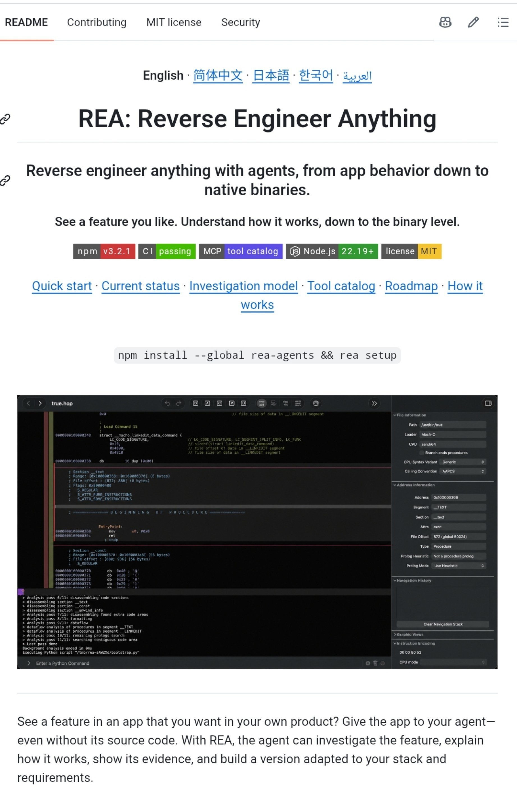

Links des Posts:

- https://x.com/_vmlops/status/2106690704244420687/photo/1

### @0xMovez · 2108884063515746410

Quelle: https://x.com/0xMovez/status/2108884063515746410 · Datum: 2026-10-10T11:35:16.000Z

Adobe empire just got destroyed by a solo vibe-coder with Opus 5.5.

He got mad at Adobe's cancellation fee.  

So he rebuilt the entire Creative Cloud. In pure Rust. For free.  

• Photoshop → PhotoCraft 
• Illustrator → VectorCraft 
• Premiere Pro → FilmCraft 
• After Effects → EffectCraft 
• Lightroom → LightCraft 
• InDesign → DesignCraft 
• Acrobat → PdfCraft  

no subscription. open source. native on macOS, windows and linux.  

24K GitHub stars in the first week.  

Adobe spent decades building this empire. He's speedrunning it with one Opus 5.5 & a grudge.  

→ https://t.co/TdjK0dQxAk  

Explore it today, then read the full guide on motion design with Opus 5.5 in the article below ↓

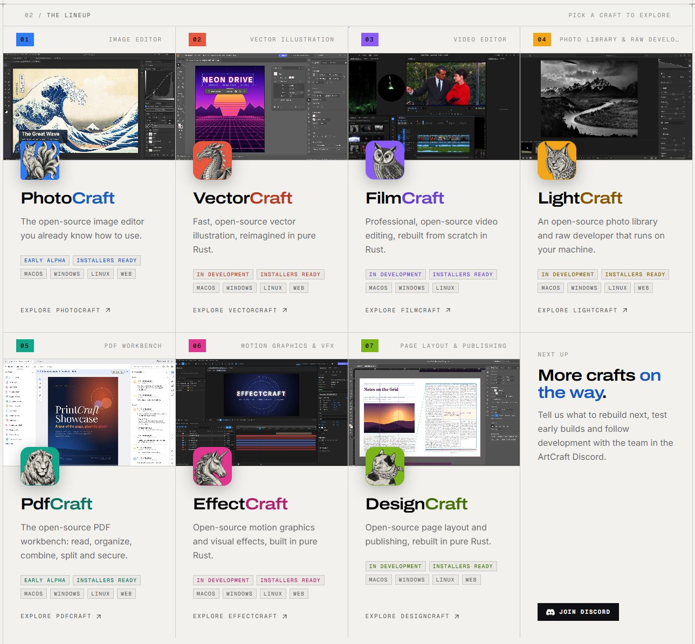

Links des Posts:

- http://getartcraft.com/apps

Referenzierte Posts:

- quoted: https://x.com/i/status/2104216919033192746

### @victor_explore · 2109466356454510612

Quelle: https://x.com/victor_explore/status/2109466356454510612 · Datum: 2026-10-12T02:09:06.000Z

🔓 Bookmark these 10 GitHub repos that let your AI agent reverse engineer apps and games

1. Ghidra (84K stars, Apache 2.0)
https://t.co/pwe0sdSOSQ
The free decompiler from the NSA. It turns a finished program back into code you can read. Most AI reverse engineering tools plug into it.

2. ImHex (55K stars, GPL 2.0)
https://t.co/aqDbTGYK3w
A hex editor for looking inside any file, byte by byte. It now has a built-in MCP server, off by default, so your agent can open files and read them.

3. mitmproxy (45K stars, MIT)
https://t.co/tMcbFRciQr
Sits between an app and the internet and records every request. Your agent reads the traffic and maps the app's hidden API.

4. ILSpy (27K stars, MIT)
https://t.co/9bJ3jX62c1
Turns .NET programs back into C# code. Works on many Windows apps and on games built on .NET.

5. Frida (22K stars, wxWindows license)
https://t.co/6o9DgjiCHS
Hooks into a running app on your computer or phone and shows what it does as it runs. Your agent can drive it from the command line. Phones need root or a jailbreak.

6. GhidraMCP (11K stars, Apache 2.0)
https://t.co/0cZkFJSgtB
Connects your agent to Ghidra. It can decompile a program, list its functions and rename them as it learns. Runs with or without the Ghidra window.

7. Android Reverse Engineering skill (8K stars, Apache 2.0)
https://t.co/NPp6lSJzJ2
A Claude Code skill. Give it an Android app file and it decompiles the app, then lists the web APIs the app calls and how it logs in.

8. Universal Modder (7K stars, MIT)
https://t.co/lWTogippyz
Skills and shared notes that let a coding agent mod PC games you own, including mashups of two games. Its art tools use a paid fal key.

9. Cpp2IL (3K stars, MIT)
https://t.co/fpfK6p806z
Many Unity games are compiled to C++. This turns them back into .NET files that ILSpy can read. Still a work in progress.

10. IDA MCP (998 stars, MIT)
https://t.co/IXfpqIGwmv
The official server from the makers of IDA, with plugins for Claude Code and Codex. It needs a paid IDA licence.

One warning: a program can hide text that takes over your agent when it reads the decompiled code. Open unknown programs in a virtual machine and keep the agent's script tools off.

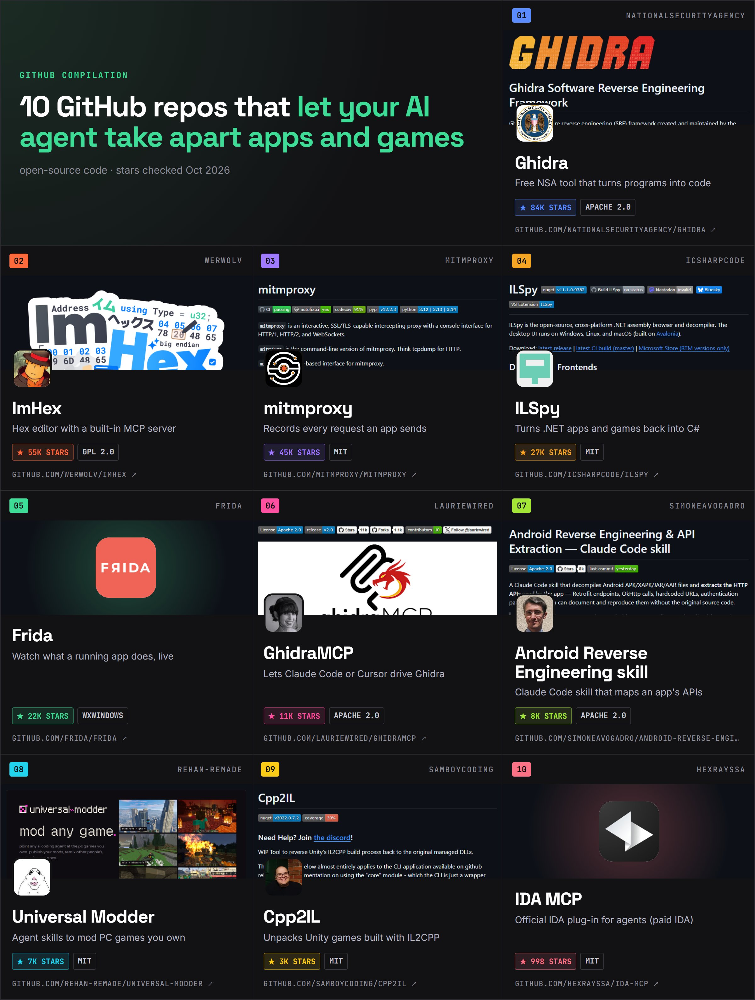

Links des Posts:

- https://github.com/NationalSecurityAgency/ghidra
- https://github.com/WerWolv/ImHex
- https://github.com/mitmproxy/mitmproxy
- https://github.com/icsharpcode/ILSpy
- https://github.com/frida/frida
- https://github.com/LaurieWired/GhidraMCP
- https://github.com/SimoneAvogadro/android-reverse-engineering-skill
- https://github.com/rehan-remade/universal-modder
- https://github.com/SamboyCoding/Cpp2IL
- https://github.com/HexRaysSA/ida-mcp

### @amasad · 2107671204639465961

Quelle: https://x.com/amasad/status/2107671204639465961 · Datum: 2026-10-07T03:15:48.000Z

What’s happening in the AI-powered reverse engineering and decompilation is absolutely insane. Pretty soon all software will be de facto open-source.

AI is coming for everything and everyone.

### @0x0SojalSec · 2108389060192706674

Quelle: https://x.com/0x0SojalSec/status/2108389060192706674 · Datum: 2026-10-09T02:48:18.000Z

IDA Pro into an AI-Reverse engineering workstation:

- Instant function explanations + security analysis
- Semantic knowledge graph of the entire binary
- Autonomous ReAct agent, Extended thinking levels
- Full MCP tool integration
- Smart rename suggestions 
- Interactive Q&A with tool-calling
- RAG over your own docs
- Multi-provider LLM support (including local models)

Fully open source for IDA Pro 9.0+
- https://t.co/2bSI0k1dkD

[Video lokal: 01-video.mp4](medien/2026-10-12-0xmovez-2109604520770548146/eingebettet/2108389060192706674/01-video.mp4)

Links des Posts:

- http://github.com/symgraph/IDAssist

Referenzierte Posts:

- quoted: https://x.com/i/status/2108031166502896035

## Zitierte Posts innerhalb der Einbettungen

Separat nachgeladen wurden die unmittelbar zitierten Posts der eingebetteten Tweets. Weitere Verschachtelungen werden als Links erhalten.

### @yuhasbeentaken · 2109038503497527420

Quelle: https://x.com/yuhasbeentaken/status/2109038503497527420 · Datum: 2026-10-10T21:48:57.000Z

a few more things about REA that surprised me:

1. i can give an agent a printer driver or old windows binary and let it figure out how the hardware/software interface actually works.

2. the same workflow can be used to inspect firmware, drivers and weird legacy systems that normally need very specialized knowledge.

3. it makes custom compatibility fixes much more realistic, things like getting unsupported hardware acceleration working or adapting old software to modern systems.

4. i can use it to answer very specific questions about a binary without fully decompiling the whole thing first.

Links des Posts:

- https://twitter.com/yuhasbeentaken/status/2109008778209177942

Referenzierte Posts:

- quoted: https://x.com/i/status/2109008778209177942

### @0xMovez · 2104216919033192746

Quelle: https://x.com/0xMovez/status/2104216919033192746 · Datum: 2026-09-27T14:29:42.000Z

https://t.co/4qTQfdoerp

#### Artikeltext dieser Zusatzquelle

How to build motion design studio with Opus 5.5 ( Full-course ) 

Most people who try motion design with Opus 5.5 end up with the same video: centered text on a gradient, everything fading in, a logo at the end. 
They don't give it a reference, don't give it a render engine, don't ask it to look at its own frames.
This is the 12-step course that turns that mess into a repeatable studio pipeline. The prompt is 10% of the video. The other 90% is the harness. 
Follow my Substack to get fresh AI alpha: movez.substack.com
 
On September 22, 2026 Anthropic shipped Claude Opus 5.5. 
Within hours the timeline filled with showreels, launch videos, music videos and five-minute history films, all of them rendered from code. 
Captions said "one prompt". Replies said "motion designers are cooked".
Both are half true. Some clips really came from a 30-word prompt. 

Others came from a 9,500-character director's brief, a folder of skills, two API keys and a 12-hour autonomous run. 
Thariq from the Claude Code team summed up the gap in one line: the post says one-shot, the prompt is 10k characters with skills, examples, keys.
 
This course shows you both ends and everything in between. 
You'll read every one of the 9 posts that defined the trend, copy the prompt pattern each one used, and then build the engine yourself. 
 
A seek(t) renderer, closed-form springs, a beat grid, synthesized sound, and a critique loop that makes Opus fix its own frames.
 
Part 1 ·  What is actually happening

01. Pixels - model writes a program, not a video
Opus 5.5 takes text and images in and puts text out. It cannot emit an MP4. Every video in this trend is a program that Opus wrote, and something else turned that program into frames.
The core trick is determinism. Opus writes a single function, draw(t) or seek(t), that paints the exact frame for any moment in time. 
A headless browser calls it 900 times for 15 seconds at 60 fps, screenshots each frame, and ffmpeg stitches them. 
Nothing depends on a timer, so the render is identical every run and a change is a one-line edit plus a re-render.
 
Tommy Rossi dug into the one-shot output and found Opus prefers route A with zero dependencies: one index.html, a seek function called through eval, Playwright capturing frame by frame, ffmpeg encoding. 
 
It skipped Remotion and HyperFrames even when available. If you want a framework, say so explicitly.
 
 

02. Setup - install the studio in 10 minutes
The chat app can write an animation, but only Claude Code (or any agent with a shell) can render it, listen to it and look at its own frames. 
That feedback loop is the whole difference between the "mid" first try people complain about and the viral ones.
 
Then drop a house-rules file in the project root. Claude Code reads CLAUDE.md on every run, so these rules apply to every video you make here without repeating them.
 
Opus 5.5 defaults to medium effort and always thinks before answering. Every viral one-shot in the list ran on xhigh or max. 
Use medium for small fixes and re-renders, xhigh for new films, max when the first 3 seconds have to carry a launch.
 
Part 2 · Prompting like a director

03. One-liner - showreel prompt and why it works
Four of the nine posts used the same sentence. It's worth understanding why a single line produced 15 seconds of camera moves, kinetic type and audio.
 
"showreel for a résumé" sets a genre with known rules: fast cuts, a new technique every shot, the best work first. Opus already knows what a reel looks like.
"what an incredible motion designer you are" makes the model the subject, so it shows techniques instead of explaining a product. No content to get wrong.
"15-second" is short enough to finish in one pass and long enough for 6 to 8 shots.
"go all out" works as an effort multiplier on top of xhigh or max.
 
The original 15-second résumé reel on Max effort. The source of the prompt. Put it directly under the anatomy diagram.
 
Same prompt on xhigh, one-shot including audio. Shows xhigh is enough, and that the sound was not added in post.
 

The weakness: the athemeroy dataset calls it "brief contagion". Hundreds of identical prompts produced reels that rhyme with each other. Use it to test your setup, then move on. Variants that shipped and worked:
 
 
A one-liner tests the engine. It never tests the idea, because it doesn't contain one.
 

04. Brand - point the reel at your product
Tony Dinh's post is the most useful for anyone selling something. He paid over $1,000 for a similar launch video a year ago; this took under 30 minutes. 
Three extra lines did it: the product URL, "use actual product screenshot, logo, assets", and "must have music". Opus went to the site and gathered the assets itself.
Rob Hallam proved the second half: after his first reel, he asked for a product ad in the same chat, and it came out faster because the renderer, audio synth and export pipeline already existed. 
Keep one session per brand.
 

Shows: TypingMind reel in under 30 minutes, replacing a $1,000+ agency video. Full prompt is in the second reply.
 
Why here: Place under the brand prompt so readers can compare his 3 extra lines with the template.

Shows: Pocketsflow reel with a talking character voiced through ElevenLabs.
 
Why here: Illustrates the voice + mascot upgrade in the next paragraph.
achxvi took the same idea further with a talking character: the Pocketsflow version passed an ElevenLabs key and asked for a character who explains the product. Voice plus mascot is what he now sells as a service.
Put API keys in .env and write "the ElevenLabs key is ELEVENLABS_API_KEY in .env". Never paste a real key into a prompt you'll screenshot. achxvi's public prompt used a joke placeholder for exactly this reason.
 

05. Reference - name a look, feed a frame
Without a reference, Opus falls back to its default: centered text, gradient background, everything fading in. 
Rexan Wong went through dozens of viral clips and found the same thing: naming a style beats describing one, and a reference video or frame gives the model pacing, type and transitions to copy.
Pleometric's two posts show the ladder. The pure-code TikTok piece started from a single frame of another viral animation. 
The Donald-style piece pointed Opus at his own PC-98 image gallery. Your own library is a reference nobody else can copy.
A frame: screenshot one frame of a video you love, attach it, say what to take (palette, type, grain) and what not to take (subject).
A video: give Opus the file or link and ask it to extract frames with ffmpeg and describe pacing shot by shot before writing code.
A library: a folder of your images or past work. Ask Opus to write a style_guide.md from it first.
Sources: whatships.com (launch videos), Dribbble motion, your competitors' launch films.
 
 
Pleometric suggested p5.js and Opus chose to write its own paper renderer. When you give a reference, let the model pick the technique. 
Specify the look and the constraints, not the library, unless you need a specific framework for reuse.
Shows: Why most "one prompt" videos look the same, and the reference + framework + components fix.
 
"Its TikTok feed" animation, pure code, started from one frame of another viral piece. The single-frame reference in action.
 

 

06. Spec  - write the state list, not the vibe
The most-bookmarked prompt of the week wasn't a one-liner. 
@twoclipping's UI morph (907K views, 19K bookmarks) and @verbove's MakerMap film both used an XML spec: inputs to ask for, direction, a beat-by-beat state list, build rules, and gotchas. NFT_Chen's editor film is the same idea as a story: a fake UI is a set where every element has a known state.
 
The concept behind them: one shape, never cut. A single element morphs size, radius and color from state to state (button, loader, player, slider, chart, command palette), a cursor drives each change with real clicks, and the last frame equals the first so it loops.
Here is my own template built on that structure; the originals are linked in the resources.
 
 

The UI morph loop (907K views) with the open-sourced XML template in the thread. The original of the spec pattern. Put it right after Fig 2.
 

MakerMap: one shape morphing through the whole product, real data, one HTML file. Shows the same spec applied to a real product.
 

Opus codes a cartoon video editor and edits inside it: timeline, waveform, export button, all drawn. 
 
UI as a film set, the story version of the spec approach.
 
Part 3 · Build the engine

07. Engine - build the seek(t) renderer
This is route A, the one Opus picks by default, written out cleanly. Two files. The page paints any moment on demand, the renderer walks time and pipes frames into ffmpeg.
 
 
 

Prefer a framework? Same prompt, route B
 
 

08. Springs - make motion feel expensive
Cheap motion eases from A to B on a fixed curve. Expensive motion has mass: it accelerates, overshoots a hair, settles. 
The morph films all specify closed-form springs because they stay a pure function of time, which keeps seek(t) deterministic.
The trick that most people miss: when a value changes target several times (a cursor, a container's width), you don't restart the spring.
You add one spring per change, each starting at its own time. The motion stays continuous, and you can still render frame 812 without simulating frames 0 to 811.
 

Snappy UI: buttons, toggles, leading edges
Default: cards, containers, camera
Heavy: big type, 3D objects, logo lockups
Playful: mascots, stickers (visible overshoot)"
 
Replace every easing curve with closed-form springs from lib/motion.js. Tiny overshoot on UI, none on type. Any value with more than one target uses track()." Opus refactors the whole file in one pass.
 

09. Sound - score it to the beat
Rob Hallam thought the audio was added in post. It wasn't.
@oozn's Steve Jobs film synthesized its soundtrack in Node with every cut locked to 120 BPM
Vox's "small print" piece synthesized music in Python and then polished the render second by second against it. Sound is where "AI video" starts feeling like a film.
 
Two paths. If you supply a track, measure it. If you don't, synthesize it on the same timeline as the picture.
 
 

Steve Jobs biopic: Remotion + SVG, 23 transitions, soundtrack synthesized in Node, cuts on 120 BPM. 
Proof that code-synthesized music can carry a 2-minute film.
 

"Small print": story, frames and music all by Opus, rendered with HyperFrames. Python-synthesized music, then a second-by-second polish pass.
 
 
Part 4 · From one clip to a studio

10. Overnight - write the director's brief
Donald dictated for five minutes, went to sleep, and woke up to a 142-second music video with 2.1M views. 
His public prompt runs about 9,500 characters. @pradeepXkapoor's "Pip" robot film used a 19,000-character brief. Read either and you see the same skeleton: they don't describe a video, they hire a crew.
Film in one line. The logline and the joke, so every decision can be checked against it.
References. Source video, song, image library, a GitHub repo of prior work. What to keep, what to push.
Tools & keys. Skills to load, APIs available (image, video, voice), budget, where docs live. "Spend it economically."
Character bible. Proportions, palette sampled from a sheet, expressions, an identity lock that survives every style change.
Beat sheet. Acts with timestamps, a visual payoff every 3 to 5 seconds, a hook in the first 2.
Text on screen. When lyrics or captions go huge, when they sit like subtitles. Composition leaves room for them.
Workflow gates. Plan → rig → stills → animatic → full pass → polish → audio → render. Don't skip gates.
Critique loop. Render stills, score them, write the 3 worst problems, fix, repeat until every score is 8+.
Deliverables. Final MP4, loop check, poster frame, contact sheet, clean source with a README
 
The key move in Donald's brief is generate-then-trace. Seedance 2.5 renders base shots with characters and physics, then Opus redraws the whole video in JavaScript on top, so the viewer only sees the code-drawn layer. 
Video models give motion that's hard to hand-code; the JS layer gives a consistent, ownable look. Pleometric re-ran the same brief with his own gallery and got a completely different film.
Spoke to my computer for 5 mins, Claude worked for 12 hours." The Claude Pop music video, 2.1M views. The headline example of L4.
 
The full ~9,500-character dictated brief. Readers compare it against the director-brief template below.
 
Donald's brief re-run with a PC-98 gallery; a mixed flow with bugs left in to keep it one-pass.
 
 
John Heibel's PDoom repo (1.1K stars) shows the subagent pattern for real: Opus wrote ANIMATION_GUIDE.md to brief the subagents it ran in parallel and STORYBOARD.md after the first generation, with nine chapters in src/ch/. Ask for both files by name.
 
 

11. Critique - make Opus watch its own frames
Opus 5.5 reads images. That means it can look at what it rendered, and this single habit separates the clips that went viral from the ones posted with "it's a bit mid".

 @mablesjoseph's watercolor short was upfront about it: 163 model calls and nearly seven hours, not one shot. Drew's launch-day piece had visible cleanup rounds too. Iteration is the method, not a failure.
 
 
 

Launch-day piece, 1.7M views, with visible cleanup rounds. Iteration is the method. Pair it with the next embed.
 

Watercolor short, openly not one-shot: 163 model calls, about 6¾ hours. The honest counterweight to "one prompt" claims.
 
 

12. Ship - formats, a skill, and a service
Three last moves turn a good clip into a repeatable business. Export every format from one timeline. Package your pipeline as a skill so the next video is a sentence. And, if you want, do what achxvi did the same week: sell it.
Every format from one timeline
Write the scenes against a layout function, not fixed pixels, and ask Opus to render 9:16, 1:1 and 16:9 in parallel. 
The MakerMap spec asked for exactly this. Reframe type and UI per format, don't crop a 16:9 render to vertical.
 

Package it as a skill
 
Now the whole course collapses into /motion-reel for [URL], 20s, vertical, reference ./refs/frame.png. Share the skill folder with your team or publish it as a plugin like buildwithhanif did.

Turn it into revenue
achxvi's offer is a good template: music, a mascot in any style, product features, an offer at the end, any language, up to 3 edits. 
Tony Dinh's number anchors the price: people paid around $1,000 for this a year ago. A skill plus a critique loop lets you deliver in an afternoon.
 
38-second vertical product film in 45 minutes, plus the reply offering it as a paid service. The "turn it into revenue" proof. Place directly under this paragraph.
 
Repos to clone
Music video: https://github.com/JohnHeibel/PDoomVideo
Starter: https://github.com/JohnHeibel/ClaudeAnimationBase
Node canvas: https://github.com/buildwithhanif/claude-animation-skill
Framework (html): https://github.com/heygen-com/hyperframes
Framework (react): https://www.remotion.dev/docs/ai/skills
Long form: https://github.com/WinterArc21/Battle-of-Austerlitz-Film
Prompt library: https://github.com/guanmo-ai/awesome-ai-motion
Dataset: https://github.com/athemeroy/awesome-opus-5-5-videos
 
Conclusion: 
The one-liner gets you a clip. The harness gets you a studio.
Install the stack, steal a reference, write the state list, own the seek(t) engine, and make Opus watch its own frames until every score is 8. 
Then package it as a skill and never write the long prompt again.
Follow my Substack to get the latest articles on AI, vibe-coding, and agentic systems.

#### Code- und Prompt-Blöcke

Originalblock 1/17

```python
// node sfx.mjs cues.json out/sfx.wav     cues: [{"t":0.5,"type":"click"}, ...]
import { readFileSync, writeFileSync } from 'node:fs';
const SR = 48000, cues = JSON.parse(readFileSync(process.argv[2], 'utf8'));
const buf = new Float32Array(Math.ceil((Math.max(...cues.map(c => c.t)) + 2) * SR));

let s = 42; const noise = () => (s = (s * 1664525 + 1013904223) >>> 0) / 2147483648 - 1;
const VOICES = {
  click:  [0.05, t => Math.sin(2 * Math.PI * 1800 * t) * Math.exp(-t * 90) * 0.5],
  pop:    [0.15, t => Math.sin(2 * Math.PI * (600 + 900 * t) * t) * Math.exp(-t * 30) * 0.4],
  thump:  [0.50, t => Math.sin(2 * Math.PI * (90 - 60 * t) * t) * Math.exp(-t * 9) * 0.9],
  whoosh: [0.35, t => noise() * Math.sin(Math.PI * Math.min(1, t / 0.35)) * 0.25],
};
for (const c of cues) {
  const [len, fn] = VOICES[c.type], start = Math.floor(c.t * SR);
  for (let i = 0; i < len * SR && start + i < buf.length; i++) buf[start + i] += fn(i / SR);
}

const n = buf.length, b = Buffer.alloc(44 + n * 2);      // 16-bit mono WAV
b.write('RIFF', 0); b.writeUInt32LE(36 + n * 2, 4); b.write('WAVEfmt ', 8);
b.writeUInt32LE(16, 16); b.writeUInt16LE(1, 20); b.writeUInt16LE(1, 22);
b.writeUInt32LE(SR, 24); b.writeUInt32LE(SR * 2, 28); b.writeUInt16LE(2, 32); b.writeUInt16LE(16, 34);
b.write('data', 36); b.writeUInt32LE(n * 2, 40);
for (let i = 0; i < n; i++) b.writeInt16LE(Math.round(Math.max(-1, Math.min(1, buf[i])) * 32767), 44 + i * 2);
writeFileSync(process.argv[3], b);
```

Originalblock 2/17

```python
make a dynamic 15-second motion graphics video that shows what an 
incredible motion designer you are, like it's your showreel for a résumé. 
go all out.

```

Originalblock 3/17

```python
Make a dynamic 20-second motion graphics video for [PRODUCT] ([URL]), with the energy
of a motion designer's showreel. Go all out.

Assets
- Visit the site. Use real screenshots (Playwright), the real logo, real colors and fonts.
  Save everything to ./assets and list what you found before you animate.
- Never redraw the product UI from imagination. Crop and animate the real thing.

Story (one beat each, 2 to 4 seconds)
1. Hook: the problem in 5 words of huge kinetic type.
2. The product appears, the UI assembles itself piece by piece.
3. Three features, each as a UI moment with a cursor doing a real action.
4. One number that proves it works: [METRIC].
5. Logo lockup + [CTA].

Sound
- Original music, 120 BPM, synthesized in code. UI clicks and whooshes on the beat.

Format: 1080x1920 (9:16) first, then 1:1 and 16:9 from the same timeline.
Before the full render, show me a contact sheet of one frame per beat.
```

Originalblock 4/17

```python
// keys: [[time, value], ...] sorted by time. Returns the value at t.
export function track(t, keys, k = 170, d = 26) {
  let v = keys[0][1];
  for (let i = 1; i < keys.length; i++)
    v += (keys[i][1] - keys[i - 1][1]) * spring(t - keys[i][0], k, d);
  return v;
}

// A tab indicator that stretches: leading edge is stiffer than trailing edge
export function indicator(t, stops) {             // stops: [[time, x], ...]
  const lead  = track(t, stops, 320, 30);
  const trail = track(t, stops, 140, 22);
  return { left: Math.min(lead, trail), right: Math.max(lead, trail) + 120 };
}

// Text inside a morphing box: in after the morph starts, out before the next one
export function swapAlpha(t, tIn, tOut) {
  return Math.min(clamp((t - tIn - 0.08) / 0.12), clamp((tOut - 0.1 - t) / 0.1));
}

// Seamless loop: pin the last frame to the first
export const loopT = (t, dur) => ((t % dur) + dur) % dur;
```

Originalblock 5/17

```python
# 1. Runtime: Node 22+, ffmpeg, Python for audio analysis
brew install node ffmpeg python          # macOS; apt install on Linux
pip install numpy librosa soundfile

# 2. A clean project and a headless browser
mkdir motion-studio && cd motion-studio && npm init -y
npm i -D playwright && npx playwright install chromium

# 3. Framework skills (optional, route B)
npx skills add remotion-dev/skills       # /remotion-create, /remotion-render ...
npx skills add heygen-com/hyperframes    # /hyperframes router + GSAP skills

# 4. Hand-drawn look (optional): Node canvas rigs, pens, synthesized sound
claude plugin marketplace add buildwithhanif/claude-animation-skill
claude plugin install claude-animation@claude-animation-skill

# 5. Start Claude Code on Opus 5.5 at high effort
claude --model claude-opus-5-5
> /model   # pick Opus 5.5, then set effort to xhigh for one-shots, max for flagship pieces
```

Originalblock 6/17

```python
# python beats.py song.wav > beats.json   (the animation reads this file)
import sys, json, numpy as np, librosa

y, sr = librosa.load(sys.argv[1], sr=None, mono=True)
tempo, frames = librosa.beat.beat_track(y=y, sr=sr, units="frames")
beats = librosa.frames_to_time(frames, sr=sr).round(3).tolist()

onset = librosa.onset.onset_strength(y=y, sr=sr)
peaks = librosa.util.peak_pick(onset, pre_max=3, post_max=3, pre_avg=3,
                               post_avg=5, delta=0.5, wait=10)
json.dump({
    "bpm": float(np.atleast_1d(tempo)[0]),
    "beats": beats,                                   # state changes go here
    "downbeats": beats[::4],                          # big moments go here
    "hits": librosa.frames_to_time(peaks, sr=sr).round(3).tolist(),  # SFX go here
}, sys.stdout, indent=1)
```

Originalblock 7/17

```python
// node render.mjs --fps 60 --dur 15 --sub 4
import { chromium } from 'playwright';
import { spawn } from 'node:child_process';
import { mkdirSync } from 'node:fs';

const arg = (k, d) => { const i = process.argv.indexOf('--' + k); return i > 0 ? Number(process.argv[i + 1]) : d; };
const FPS = arg('fps', 60), DUR = arg('dur', 15), SUB = arg('sub', 4);
mkdirSync('out', { recursive: true });

const browser = await chromium.launch();
const page = await browser.newPage({ viewport: { width: 1080, height: 1920 }, deviceScaleFactor: 1 });
await page.goto('file://' + process.cwd() + '/index.html');
await page.evaluate(() => document.fonts.ready);       // canvas text needs loaded fonts

// tmix averages SUB consecutive subframes; select keeps the last of each group
const vf = `tmix=frames=${SUB},select='eq(mod(n\\,${SUB})\\,${SUB - 1})',setpts=N/${FPS}/TB`;
const ff = spawn('ffmpeg', ['-y', '-f', 'image2pipe', '-framerate', String(FPS * SUB), '-i', '-',
  '-vf', vf, '-r', String(FPS), '-c:v', 'libx264', '-crf', '16', '-pix_fmt', 'yuv420p', 'out/silent.mp4'],
  { stdio: ['pipe', 'inherit', 'inherit'] });

const total = Math.round(DUR * FPS * SUB);
for (let i = 0; i < total; i++) {
  await page.evaluate((t) => window.seek(t), i / (FPS * SUB));
  const png = await page.locator('#c').screenshot({ type: 'png' });
  if (!ff.stdin.write(png)) await new Promise((r) => ff.stdin.once('drain', r));
  if (i % (FPS * SUB) === 0) console.log(`rendered ${i / (FPS * SUB)}s / ${DUR}s`);
}
ff.stdin.end();
await new Promise((r) => ff.on('close', r));
await browser.close();
```

Originalblock 8/17

```python
Reference: ./refs/launch.mp4 (and ./refs/frames/*.png)

1. Extract one frame every 0.5s with ffmpeg. Study them.
2. Write ./docs/style_guide.md: palette (hex), type (family, weight, tracking),
   shot lengths, transition types, camera moves, texture/grain, how text enters and exits.
3. Write ./docs/shotlist.md for a [DURATION]s video about [SUBJECT] in THAT style.
   Take the grammar of the reference, never its content, logos or characters.
4. Show me both files. Wait for my OK before any code.
```

Originalblock 9/17

```python
# Longer, with a sound bar (pattern from @kloss_xyz's 90-second piano reel)
make a dynamic 16:9, 60-second motion graphics showreel that shows your real creative limits.
S-tier sound design, no generic synth pads. Compose an original piano score and sync every
cut to it. Export 1080p MP4.

# Anti-slop guardrail (pattern from @1littlecoder)
make a dynamic 10-second motion graphics video that introduces who you are as Opus 5.5.
Avoid frames and text in the corners, the usual giveaways of AI-made video.

# Story instead of techniques (pattern from @sonnylazuardi)
use your showreel energy, but tell a story: the history of [TOPIC] from [START] to today,
surprise me with the storyboard. 45 seconds, vertical 9:16.

# Agency persona
make a 30-second showreel as if you were a niche branding studio for startup founders.
Create every graphic from scratch. One accent color. Every shot is a different technique.
```

Originalblock 10/17

```python
# Motion studio rules

## Render contract
- Every film is a pure function of time: `window.seek(t)` paints frame t.
- No CSS transitions, no setTimeout, no requestAnimationFrame in render mode,
  no state carried between frames. Seeded noise only (mulberry32), never Math.random.
- Render with `node render.mjs`, encode H.264 yuv420p, CRF 16.

## Look
- Banned defaults: centered title on gradient, everything fading in,
  corner labels and frame borders, glow on UI chrome, generic particle bursts.
- One display face, one UI face. One accent color unless the brief says otherwise.
- Every 2 to 4 seconds something new must happen on screen.

## Sound
- Score and SFX are synthesized in code unless a track is supplied.
- Place hits on the measured beat grid (beats.json). Loudness -14 LUFS.

## Loop before you show me anything
1. Render one frame per beat as a contact sheet and LOOK at it.
2. Score it 1-10 on: hook in first 2s, readability at phone size,
   motion quality, variety, brand accuracy, sound sync.
3. Fix the 3 worst problems. Repeat until every score is 8+.
4. Only then do the full render.
```

Originalblock 11/17

```python
# Contact sheet: 2 frames per second, 6 across
ffmpeg -i out/final.mp4 -vf "fps=2,scale=270:-1,tile=6x5" -frames:v 1 out/contact.png

# Strip: 12 consecutive frames around a fast action at 4.2s (catch pops and overlaps)
ffmpeg -ss 4.1 -i out/final.mp4 -vf "scale=320:-1,tile=12x1" -frames:v 1 out/strip.png

# Phone test: how it reads at 360 px wide
ffmpeg -i out/final.mp4 -vf "fps=1,scale=360:-1,tile=5x3" -frames:v 1 out/phone.png

# Loop check: play it twice back to back and watch the seam
ffmpeg -stream_loop 1 -i out/final.mp4 -c copy out/loop_check.mp4

# Determinism check: frame 300 rendered twice must hash the same
node render.mjs --dur 5 --fps 60 --sub 1 && md5 out/silent.mp4   # run twice, compare
```

Originalblock 12/17

```python
<style>html,body{margin:0;background:#141413}canvas{display:block}</style>
<canvas id="c" width="1080" height="1920"></canvas>
<script>
const W = 1080, H = 1920, DUR = 15;
const g = document.getElementById('c').getContext('2d');
const clamp = (x, a = 0, b = 1) => Math.min(b, Math.max(a, x));

// Closed-form damped spring, 0 → 1. Pure function of time (step 08 explains it).
function spring(t, k = 170, d = 26) {
  if (t <= 0) return 0;
  const w0 = Math.sqrt(k), z = d / (2 * w0);
  if (z < 1) {
    const wd = w0 * Math.sqrt(1 - z * z);
    return 1 - Math.exp(-z * w0 * t) * (Math.cos(wd * t) + (z * w0 / wd) * Math.sin(wd * t));
  }
  return 1 - Math.exp(-w0 * t) * (1 + w0 * t);      // z >= 1 treated as critical
}

// Seeded noise, never Math.random: the render must be identical every run
function rng(seed) { return () => { seed |= 0; seed = seed + 0x6D2B79F5 | 0;
  let t = Math.imul(seed ^ seed >>> 15, 1 | seed);
  t = t + Math.imul(t ^ t >>> 7, 61 | t) ^ t; return ((t ^ t >>> 14) >>> 0) / 4294967296; }; }

const SCENES = [
  { from: 0, to: 3, draw(t) {                        // kinetic title
      const s = spring(t - 0.1, 220, 22);
      g.save(); g.translate(W / 2, H / 2); g.scale(0.6 + 0.4 * s, 0.6 + 0.4 * s);
      g.globalAlpha = clamp(t * 4);
      g.fillStyle = '#F0EEE6'; g.font = '700 190px "Source Serif 4", serif';
      g.textAlign = 'center'; g.fillText('MOTION', 0, 0);
      g.fillStyle = '#D97757'; g.fillRect(-320 * s, 50, 640 * s, 18);
      g.restore();
  }},
  { from: 3, to: 6, draw(t) {                        // grid of squares on a stagger
      const r = rng(7);
      for (let i = 0; i < 48; i++) {
        const x = (i % 6) * 170 + 115, y = Math.floor(i / 6) * 170 + 360;
        const s = spring(t - i * 0.03 - r() * 0.1, 260, 20);
        g.fillStyle = i % 7 ? '#F0EEE6' : '#D97757';
        g.fillRect(x - 60 * s, y - 60 * s, 120 * s, 120 * s);
      }
  }},
  // ... more scenes: Opus appends here, one object per shot
];

function draw(t) {
  g.fillStyle = '#141413'; g.fillRect(0, 0, W, H);
  for (const s of SCENES) if (t >= s.from && t < s.to) s.draw(t - s.from);
}
window.seek = (t) => { draw(t); return true; };

// Live preview in a normal browser, off during headless render
if (!navigator.webdriver) {
  const t0 = performance.now();
  (function loop() { draw(((performance.now() - t0) / 1000) % DUR); requestAnimationFrame(loop); })();
}
</script>
```

Originalblock 13/17

```python
Open out/contact.png, out/strip.png and out/phone.png and look at them properly.
Be a harsh motion director, not a proud author.

Score 1-10: hook in first 2s · readability at phone size · motion quality (springs,
no dead frames) · variety (new thing every 2-4s) · composition · brand accuracy · sound sync.

List the 3 biggest problems with timestamps. Hunt specifically for: text overlapping during
swaps, anything sliding instead of easing, corner labels and frame borders, centered-on-gradient
shots, blurry scaled text, a dead beat with nothing happening, a stutter at the loop seam.

Fix them, re-render only the affected seconds, show me the new contact sheet and new scores.
```

Originalblock 14/17

```python
You are the director, animator, sound designer and render engineer for a [DURATION] film
made in code. Treat this as a multi-session production. Don't rush to a final render.

## The film in one line
[LOGLINE. What the viewer should feel at the end.]

## References and inputs
- ./refs/ : [video / frames / image library]. Take the grammar, never the content.
- ./audio/track.wav : use it unchanged. Measure beats with beats.py first.
- Skills available: [/remotion-best-practices | /hyperframes | /claude-animation].
- APIs in .env: [ELEVENLABS_API_KEY, FAL_KEY]. Budget: [$X]. Be economical.

## Look
[3-5 lines: palette, type, texture, camera language. Banned looks.]

## Beat sheet
0:00-0:02  hook: [the single most striking image]
0:02-0:10  [act 1]
...        a new visual payoff every 3-5 seconds
[END]      the last frame sets up the first frame (loop)

## Workflow, with gates
1. Write docs/style_guide.md and docs/shotlist.md (every shot: frames, camera, text, SFX).
   Show me the shot list. Then continue without waiting if I don't answer in 10 minutes.
2. Build stills for every shot. Contact sheet. Critique.
3. Animatic at 960x540 with placeholder audio. Fix pacing before polish.
4. Full animation, polish pass, sound pass, final render.
5. Split work across subagents per chapter. Write docs/ANIMATION_GUIDE.md first
   so every subagent codes in the same style.

## Critique loop (every shot, at least 3 rounds)
Render 3-5 stills, score 1-10 on: hook, readability at 360px wide, motion, composition,
depth, sound sync, polish. Log scores + 3 biggest problems in docs/review_log.md. Fix. Repeat
until all are 8+.

## Deliverables
out/final.mp4 · out/loop_check.mp4 · out/poster.png · out/contact.png · README.md
```

Originalblock 15/17

```python
# Remotion (React): best for series, templates, data-driven videos
npx create-video@latest launch-film && cd launch-film
npx skills add remotion-dev/skills
claude
> /remotion-create a 20s 9:16 launch film for [PRODUCT], springs only, one accent color
npx remotion studio                 # live timeline preview
npx remotion render Main out/launch.mp4

# HyperFrames (HTML + GSAP): best when you think in web pages
npx hyperframes init my-video && cd my-video
npx hyperframes skills update
claude
> Using /hyperframes, turn ./notes.md into a 45-second pitch video with kinetic captions
npx hyperframes preview && npx hyperframes render
```

Originalblock 16/17

```python
<inputs>
Ask me for: my product + URL, 8 to 12 UI states that tell its story, the real data shown in
each state, brand colors + fonts + one accent, a royalty-free track near 120 BPM, formats.
</inputs>

<direction>
Product-film UI motion. One container never cuts: every state is the same element changing
size, radius and fill while its content swaps behind a short blur. A cursor drives every change.
Warm neutral canvas, one accent. Springs with at most a tiny overshoot.
Banned: bouncy easing, glows, gradients on UI chrome, particle bursts, dead time.
</direction>

<structure>
120 BPM, 8 bars, something happens on every beat.
logo → CTA button → email field (typed) → loader → success check → dashboard card
→ chart draws itself → tooltip on hover → ⌘K palette → toast → logo.
</structure>

<build>
1. One HTML file, one canvas, window.seek(t). No CSS transitions, no timers, no carried state.
2. Closed-form springs. A value with many targets = sum of one spring per change.
3. Text inside a morphing container enters after the morph starts, leaves before the next one.
4. Tab indicators: leading and trailing edges on different springs so they stretch.
5. Beat grid from the track (numpy/librosa). Start on a downbeat. UI sounds on measured peaks.
6. Render in headless Chrome at 60 fps, 4 subframes per frame, blended for motion blur.
</build>

<gotchas>
Never use will-change on anything the camera scales (blurry text).
The last frame must equal the first, cursor position and velocity included.
</gotchas>

<start>
Ask for the inputs, then show me the state list on the beat grid before writing code.
</start>
```

Originalblock 17/17

```python
---
name: motion-reel
description: Make a product or showreel motion video rendered from code. Use when the
  user asks for a launch video, showreel, product reel, animated explainer or motion ad.
---

# Motion reel

## Inputs to collect first
Product + URL, duration, formats (9:16 / 1:1 / 16:9), brand colors + fonts,
a reference (frame, video or image folder), music (file or "synthesize").

## Pipeline
1. Gather assets from the URL with Playwright into ./assets. List them.
2. If a reference exists, write docs/style_guide.md from it.
3. Measure or synthesize music. beats.py → beats.json.
4. Write docs/shotlist.md on the beat grid. Show it and wait for OK.
5. Build index.html with window.seek(t) using lib/motion.js springs. Follow CLAUDE.md.
6. Contact sheet → critique-pass (see prompts/critique-pass.txt) → fix. 3 rounds minimum.
7. node render.mjs → sfx.mjs → mix to -14 LUFS → out/final.mp4, all formats.
8. Deliver final.mp4, contact.png, poster.png. Say what you'd improve next.

## Hard rules
- Real product UI only. Never invent screens.
- No Math.random, no timers, no CSS transitions in render mode.
- Banned: corner labels, centered title on gradient, everything fading in.
```

#### Links aus den Artikel-Entities

- movez.substack.com
- whatships.com
- https://github.com/JohnHeibel/PDoomVideo
- https://github.com/JohnHeibel/ClaudeAnimationBase
- https://github.com/buildwithhanif/claude-animation-skill
- https://github.com/heygen-com/hyperframes
- https://www.remotion.dev/docs/ai/skills
- https://github.com/WinterArc21/Battle-of-Austerlitz-Film
- https://github.com/guanmo-ai/awesome-ai-motion
- https://github.com/athemeroy/awesome-opus-5-5-videos
- https://movez.substack.com/

#### Weitere Einbettungen dieser Zusatzquelle

Diese Verweise gehören zu einer weiteren Ebene und wurden nicht rekursiv abgerufen.

- https://x.com/i/status/2102801469976248500
- https://x.com/i/status/2103875898349088830
- https://x.com/i/status/2102681172367323300
- https://x.com/i/status/2102572941699354900
- https://x.com/i/status/2102801274173587569
- https://x.com/i/status/2103482545111232946
- https://x.com/i/status/2102436464323661880
- https://x.com/i/status/2103918792845963545
- https://x.com/i/status/2103483957266268381
- https://x.com/i/status/2102435511222890900
- https://x.com/i/status/2103495232637882858
- https://x.com/i/status/2103707054108299437
- https://x.com/i/status/2103465246014746943
- https://x.com/i/status/2103315922098470926
- https://x.com/i/status/2102531681450119426
- https://x.com/i/status/2103273003555402193
- https://x.com/i/status/2104014659615392078
- https://x.com/i/status/2103703135902740699
- https://x.com/i/status/2102870353781641416
- https://x.com/i/status/2103485566570369333
- https://x.com/i/status/2103082510607610023


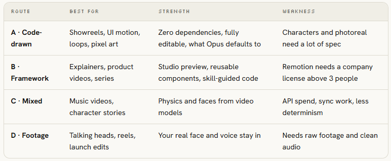

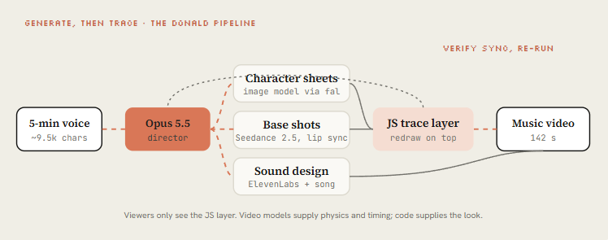

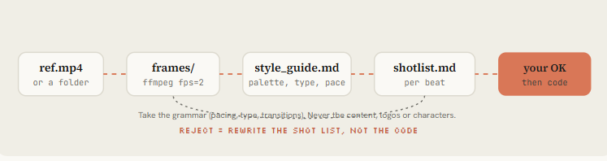

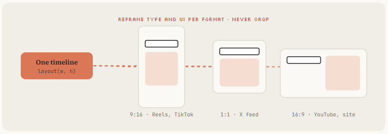

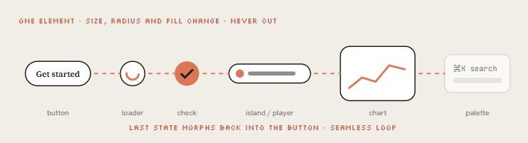

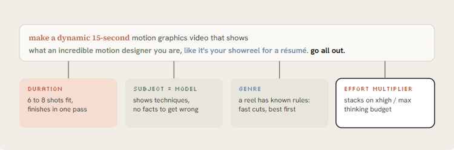

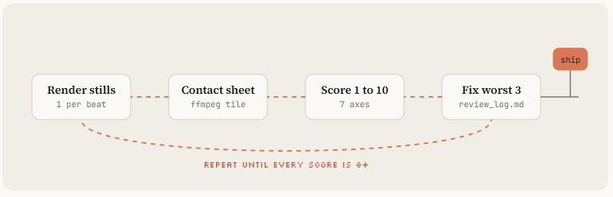

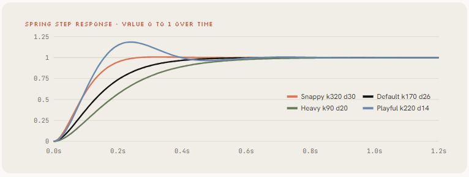

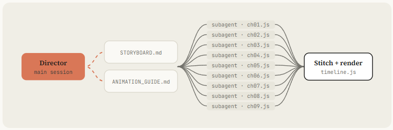

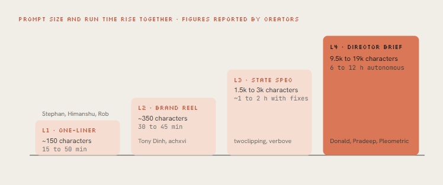

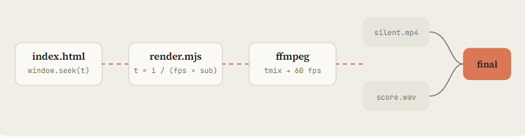

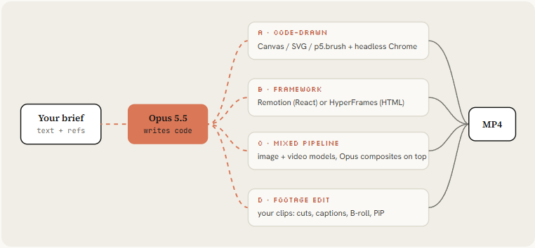

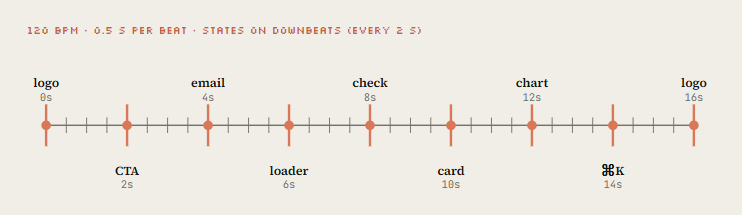

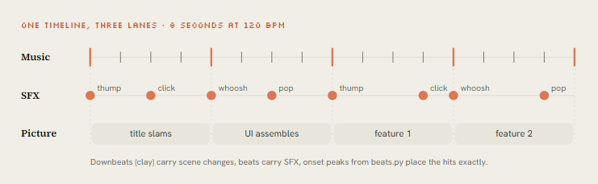

Links des Posts:

- https://x.com/i/article/2104196832637210624

### @0x0SojalSec · 2108031166502896035

Quelle: https://x.com/0x0SojalSec/status/2108031166502896035 · Datum: 2026-10-08T03:06:10.000Z

AI reverse-engineer games and binaries through Ghidra with 200+ tools.

Ghidra MCP gives AI agents deep access to Ghidra’s capabilities for game binaries and complex software binary analysis.

- https://t.co/WPn87vgOBo https://t.co/CFZp1TZmxY

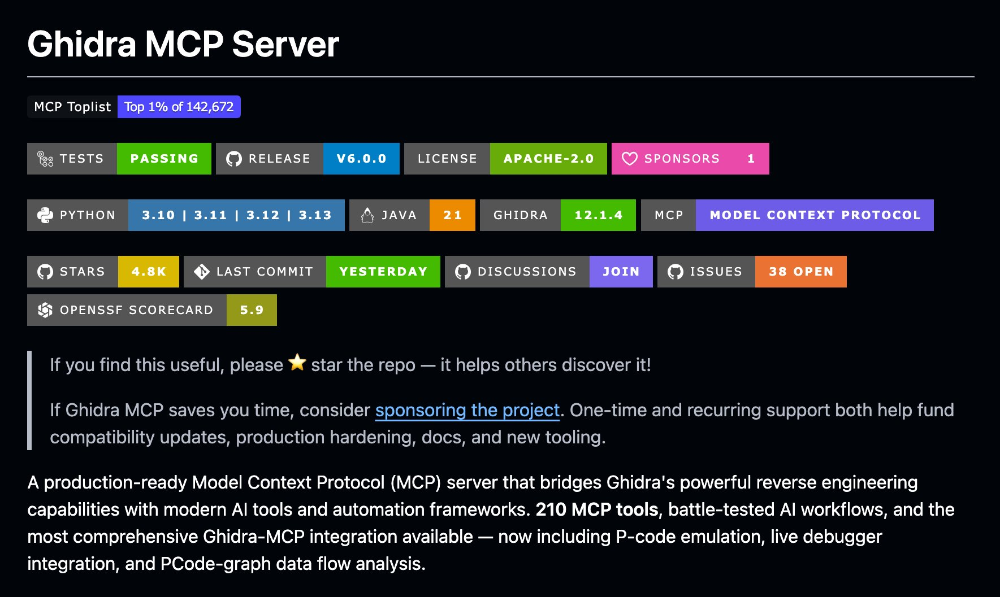

Links des Posts:

- https://github.com/bethington/ghidra-mcp
- https://x.com/0x0SojalSec/status/2108031166502896035/photo/1

## Weitere Zitatverweise aus der API-Antwort

Für diese weitere Ebene wird nur der bereits mitgelieferte Text erhalten. Ihre Medien und weiteren Verweise wurden nicht unabhängig nachgeladen.

### @yuhasbeentaken · 2109008778209177942

https://x.com/i/status/2109008778209177942

i’ve been testing REA, and this feels like one of the more important agentic coding tools i’ve tried recently.

a few things that worth to be mentioned:

1. i can connect my coding agent directly to ghidra and let it trace program flow, rename functions and inspect binaries.

2. i can describe a bug in plain english and have the agent work backwards through the executable to find the relevant code.

3. i can use it for old games and abandoned software where the original source code is gone, and get clean decomps much faster than doing it manually.

4. i can also use it for things like undocumented functions, binary patching and understanding how proprietary software actually works.

5. the biggest limitation is legal. for personal debugging, preservation and abandonware this is useful, but i’d be much more careful using it around commercial software.

reverse engineering is starting to feel like another task i can hand to an agent.

## Archivierungsstand und Grenzen

- Hauptartikel: 11744 Zeichen aus der API; 13 separate Code-/Prompt-Blöcke ergänzt.
- Direkte Einbettungen: 6/6 Posts abrufbar.
- Unmittelbar zitierte Zusatzposts: 3 nachgeladen.
- Konversationsposts des Hauptautors: 5 erfasst; darunter können einzelne Antworten an Dritte sein.
- Keine Transkription oder inhaltliche Verifikation der Videos.
- 2104216919033192746: 21 weitere Artikel-Einbettungen nur verlinkt
- 1 weitere Zitatposts: nur mitgelieferter Text und Link, Medien nicht nachgeladen

[Technisches Archiv-Manifest](medien/2026-10-12-0xmovez-2109604520770548146/archiv-manifest.json)
