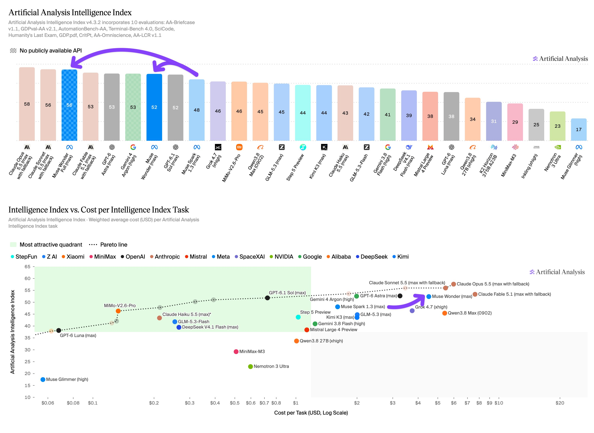
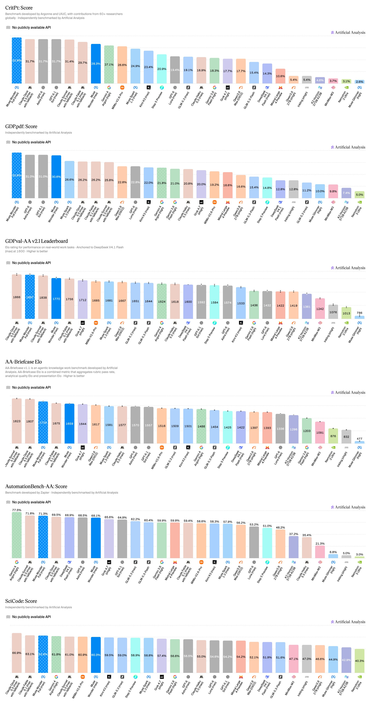
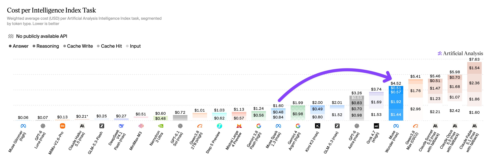
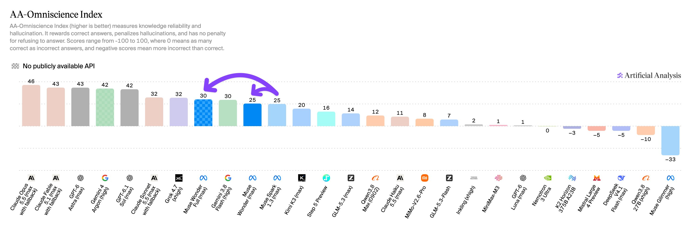
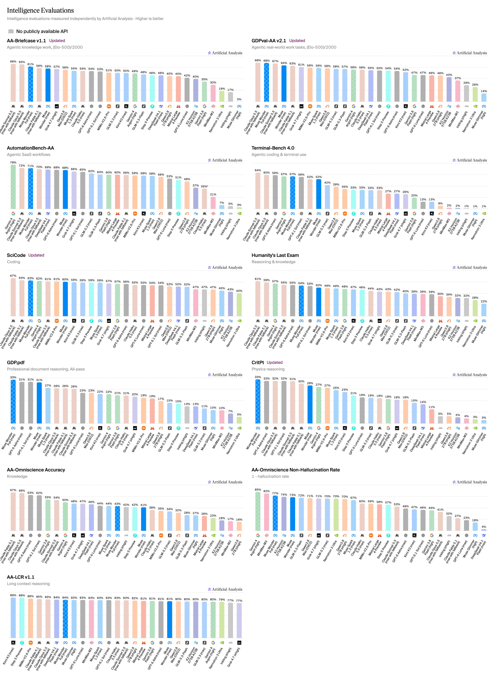

# Artificial Analysis (@ArtificialAnlys)

> Automatisch per `npm run ingest:x` erfasst. Quelle: [x.com/ArtificialAnlys/status/2109697083519447118](https://x.com/ArtificialAnlys/status/2109697083519447118)

## Bilder

<!-- Reihenfolge wie von der API geliefert (Cover zuerst). Die Position im Artikeltext gibt die API nicht mit. -->

**photo**

## Post-Text

Meta has released Muse Wonder and Muse Wonder Full, achieving Artificial Analysis Intelligence Index v4.3 scores of 52 and 56 at max reasoning effort - each a material gain over Muse Spark 1.3 (max) at 48, with a release gap of only 6 weeks

Muse Wonder is available for users on Meta’s first-party API, while Muse Wonder Full is currently only available for Muse Code users. Meta notes that each model is designed for personal and professional agent use

Congratulations to @AIatMeta, @finkd, and @alexandr_wang on the release!

Key Takeaways:

➤ Both models exhibit a material jump in overall Intelligence Index score. Muse Wonder Full (max) improves on Muse Spark 1.3 (max) across all ten Intelligence Index evaluations, gaining 8 points to 56. The largest gains were seen in agentic evaluations: Terminal-Bench 4.0 (+24 points, 33% to 57%), GDPval-AA v2.1 (+176 Elo, 1681 to 1857), and AA-Briefcase (+148 Elo, 1581 to 1729). Muse Wonder (max) gains 4 Intelligence Index points and lands at 52, with notable improvements vs. Muse Spark 1.3 (max) in Terminal-Bench 4.0 (33% to 52%) and AutomationBench-AA (58% to 68%)

➤ Muse Wonder Full (max) places in the top three on six of the ten Intelligence Index evaluations, and is particularly strong in agentic knowledge work and scientific reasoning. In agentic knowledge work, it narrowly leads on GDP.pdf (33%), ranks #2 on GDPval-AA v2.1 (1857 Elo), and #3 on both AA-Briefcase (1729 Elo) and AutomationBench-AA (71%). In scientific reasoning, it tops the CritPt leaderboard at 33% and ranks #3 on SciCode with 63%. This builds on the relative strengths of Muse Spark 1.3 (max), which also showed particular ability in these two domains

➤ Both models use fewer output tokens than Muse Spark 1.3 (max). Muse Wonder (max) and Muse Wonder Full (max) each use around 54k output tokens per Intelligence Index task, down ~10% from Muse Spark 1.3 (max, 60k). This usage is lower than similarly intelligent models Gemini 4 Argon (high, 62k) and Claude Fable 5.1 (max w/ fallback, 78k), but higher than GPT-6.1 Sol (max, 38k) and GPT-6 Astra (max, 27k). Muse Wonder Full (max) uses 16% fewer input tokens per Intelligence Index task than Muse Wonder (max) (6.44M vs 7.69M), meaning it is both more intelligent and more token-efficient

➤ Cost per Task for Muse Wonder (max) lands higher than most similarly intelligent models. Despite efficient output token use, premium API pricing ($4 per million input tokens, $20 per million output tokens) and high input token use (7.69M per task) push Muse Wonder (max)’s cost to $4.52 per Intelligence Index task. This is lower than Claude Fable 5.1 (max w/ fallback, $7.63), Claude Opus 5.5 (max w/ fallback, $5.98), and Claude Sonnet 5.5 (max w/ fallback, $5.46), but higher than GPT-6 Astra (max, $3.26), Gemini 4 Argon (high, $1.99), GPT-6.1 Sol (max, $0.72), and its predecessor Muse Spark 1.3 (max, $1.60). Per-token pricing is not currently available for Muse Wonder Full, so no Cost per Task figure can be estimated at this stage

➤ Both models gain significantly in Coding Agent performance. Muse Wonder Full achieves 68 on the Artificial Analysis Coding Agents Index at max effort in Muse Code, alongside Claude Code with Sonnet 5.5 (max, 68) and Opus 5.5 (max, 66). Muse Wonder (max) scores 63. These represent material gains over Muse Code with Muse Spark 1.3 (max), which scores 54

Other details for the two new models:

➤ Context windows: 1M tokens each, unchanged from Muse Spark 1.3
➤ Pricing: for Muse Wonder, $4 input / $0.20 cached input / $20 output per 1M tokens. Pricing per token is not yet announced for Muse Wonder Full
➤ Input modalities: text, image, video, and audio
➤ Output modalities: text
➤ Availability: Muse Wonder is available on Meta's first-party API and Muse Code at launch, while Muse Wonder Full is only available to Muse Code users

## Thread

### 1/6

Meta has released Muse Wonder and Muse Wonder Full, achieving Artificial Analysis Intelligence Index v4.3 scores of 52 and 56 at max reasoning effort - each a material gain over Muse Spark 1.3 (max) at 48, with a release gap of only 6 weeks

Muse Wonder is available for users on Meta’s first-party API, while Muse Wonder Full is currently only available for Muse Code users. Meta notes that each model is designed for personal and professional agent use

Congratulations to @AIatMeta, @finkd, and @alexandr_wang on the release!

Key Takeaways:

➤ Both models exhibit a material jump in overall Intelligence Index score. Muse Wonder Full (max) improves on Muse Spark 1.3 (max) across all ten Intelligence Index evaluations, gaining 8 points to 56. The largest gains were seen in agentic evaluations: Terminal-Bench 4.0 (+24 points, 33% to 57%), GDPval-AA v2.1 (+176 Elo, 1681 to 1857), and AA-Briefcase (+148 Elo, 1581 to 1729). Muse Wonder (max) gains 4 Intelligence Index points and lands at 52, with notable improvements vs. Muse Spark 1.3 (max) in Terminal-Bench 4.0 (33% to 52%) and AutomationBench-AA (58% to 68%)

➤ Muse Wonder Full (max) places in the top three on six of the ten Intelligence Index evaluations, and is particularly strong in agentic knowledge work and scientific reasoning. In agentic knowledge work, it narrowly leads on GDP.pdf (33%), ranks #2 on GDPval-AA v2.1 (1857 Elo), and #3 on both AA-Briefcase (1729 Elo) and AutomationBench-AA (71%). In scientific reasoning, it tops the CritPt leaderboard at 33% and ranks #3 on SciCode with 63%. This builds on the relative strengths of Muse Spark 1.3 (max), which also showed particular ability in these two domains

➤ Both models use fewer output tokens than Muse Spark 1.3 (max). Muse Wonder (max) and Muse Wonder Full (max) each use around 54k output tokens per Intelligence Index task, down ~10% from Muse Spark 1.3 (max, 60k). This usage is lower than similarly intelligent models Gemini 4 Argon (high, 62k) and Claude Fable 5.1 (max w/ fallback, 78k), but higher than GPT-6.1 Sol (max, 38k) and GPT-6 Astra (max, 27k). Muse Wonder Full (max) uses 16% fewer input tokens per Intelligence Index task than Muse Wonder (max) (6.44M vs 7.69M), meaning it is both more intelligent and more token-efficient

➤ Cost per Task for Muse Wonder (max) lands higher than most similarly intelligent models. Despite efficient output token use, premium API pricing ($4 per million input tokens, $20 per million output tokens) and high input token use (7.69M per task) push Muse Wonder (max)’s cost to $4.52 per Intelligence Index task. This is lower than Claude Fable 5.1 (max w/ fallback, $7.63), Claude Opus 5.5 (max w/ fallback, $5.98), and Claude Sonnet 5.5 (max w/ fallback, $5.46), but higher than GPT-6 Astra (max, $3.26), Gemini 4 Argon (high, $1.99), GPT-6.1 Sol (max, $0.72), and its predecessor Muse Spark 1.3 (max, $1.60). Per-token pricing is not currently available for Muse Wonder Full, so no Cost per Task figure can be estimated at this stage

➤ Both models gain significantly in Coding Agent performance. Muse Wonder Full achieves 68 on the Artificial Analysis Coding Agents Index at max effort in Muse Code, alongside Claude Code with Sonnet 5.5 (max, 68) and Opus 5.5 (max, 66). Muse Wonder (max) scores 63. These represent material gains over Muse Code with Muse Spark 1.3 (max), which scores 54

Other details for the two new models:

➤ Context windows: 1M tokens each, unchanged from Muse Spark 1.3
➤ Pricing: for Muse Wonder, $4 input / $0.20 cached input / $20 output per 1M tokens. Pricing per token is not yet announced for Muse Wonder Full
➤ Input modalities: text, image, video, and audio
➤ Output modalities: text
➤ Availability: Muse Wonder is available on Meta's first-party API and Muse Code at launch, while Muse Wonder Full is only available to Muse Code users

### 2/6

Muse Wonder Full (max) places in the top three on six of the ten Artificial Analysis Intelligence Index v4.3 evaluations:

➤ #1 on CritPt (33%) and GDP.pdf (33%)

➤ #2 on GDPval-AA v2.1 (1857 Elo)

➤ #3 on AA-Briefcase (1729 Elo), AutomationBench-AA (71%) and SciCode (63%)

The leads on CritPt and GDP.pdf are narrow, with the nearest competitors scoring 31-32%. On GDPval-AA v2.1, its result is within the confidence intervals of Claude Opus 5.5 (max w/ fallback, 1866) and Claude Sonnet 5.5 (max w/ fallback, 1838)

Its largest improvement over Muse Spark 1.3 is Terminal-Bench 4.0: 33% to 57%, bringing it level with Gemini 4 Argon (high)

### 3/6

Muse Wonder (max) costs $4.52 per Artificial Analysis Intelligence Index task, 2.8x Muse Spark 1.3 (max, $1.60), driven by higher per-token prices and higher input token use

➤ Token pricing: $4 per 1M input tokens, $0.20 cached and $20 output, up from $1.25 / $0.15 / $4.25 for Muse Spark 1.3. This matches Claude Opus 5.5, is double each of Claude Sonnet 5.5, Gemini 4 Argon, and GPT-6.1 Sol ($2/$10), and is 60% below GPT-6 Astra and Claude Fable 5.1 ($10/$50)

➤ Input: 7.69M input tokens per task, 28% more than Muse Spark 1.3 (max, 6.03M) and 2-7x Gemini 4 Argon (high), GPT-6.1 Sol (max) and GPT-6 Astra (max). Input is $3.43 (76%) of its cost per task, composed of $1.92 cache writes, $1.44 cache hits and $0.07 uncached input

➤ Output: around 54k output tokens per task ($1.08), 10% fewer than Muse Spark 1.3 (max, 60k)

### 4/6

Knowledge remains a relative weakness for both models, but this is mitigated by very low hallucination rates. On AA-Omniscience, Muse Wonder Full (max) scores 30 and Muse Wonder (max) scores 25, level with Muse Spark 1.3 (max), below e.g. Claude Opus 5.5 (46), GPT-6 Astra (43), Gemini 4 Argon (42), and Claude Sonnet 5.5 (32)

Muse Wonder Full (max)'s 5-point gain comes from lowering its hallucination rate (33% to 23%), which places it among the least-hallucinating models tested: it has the second-lowest hallucination rate of any model scoring 45 or more on the Intelligence Index, behind only Gemini 4 Argon (high, 15%). Muse Wonder (max) is third at 27%

### 5/6

Full Artificial Analysis Intelligence Index results for Muse Wonder Full (max) and Muse Wonder (max): https://t.co/PvEK9QAcKz

### 6/6

Compare Muse Wonder Full (max) and Muse Wonder (max) with other leading models at:

https://t.co/46PAzDsMxA
https://t.co/w7KMbQI8RZ

## Erfassungsnachweis vom 24.10.2026

Angefragter Post: https://x.com/ArtificialAnlys/status/2109697083519447118

Im geprüften API-Abruf enthalten: 6 Post(s). Die Zahl ist kein Nachweis eines vollständigen Threads.

- [Post 2109697083519447118](https://x.com/ArtificialAnlys/status/2109697083519447118)
- [Post 2109697086543581411](https://x.com/ArtificialAnlys/status/2109697086543581411)

### Medien aus Post 2109697086543581411

- [Post 2109697089123102867](https://x.com/ArtificialAnlys/status/2109697089123102867)

### Medien aus Post 2109697089123102867

- [Post 2109697091685793816](https://x.com/ArtificialAnlys/status/2109697091685793816)

### Medien aus Post 2109697091685793816

- [Post 2109697094391124252](https://x.com/ArtificialAnlys/status/2109697094391124252)

### Medien aus Post 2109697094391124252

- [Post 2109697096811233494](https://x.com/ArtificialAnlys/status/2109697096811233494)
