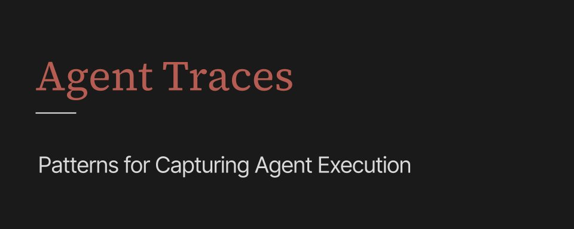

# Agent Traces: Patterns for Capturing Agent Execution 

> Automatisch per `npm run ingest:x` erfasst. Quelle: [x.com/JoshARosen/status/2109649928276341191](https://x.com/JoshARosen/status/2109649928276341191)

## Artikel-Volltext

It’s one thing to log every model and tool call, but it’s another thing to understand what an agent spent the last hour doing. Agent tracing is its own art that involves trying to watch an agent make decisions, take actions, and delegate work, while somehow painting a coherent picture of the execution.
Agent tracing is no longer confined to the agent loop. Increasingly, it’s about tracing across multiple sessions and processes, and across the systems the agent is modifying.
The architectural challenge is that no single instrumentation point necessarily has the whole picture. Because of this, we’re seeing a range of patterns emerge for solving this visibility problem, and a whole ecosystem of companies and projects have popped up with their own take on how to trace an agent.
But these systems aren’t all observing the same thing. Let’s look at the different architectures underneath agent tracing to see what they are observing and how.
Watching the Model
The model API is the easiest place to start collecting traces, which is why it was one of the earliest and remains one of the most common approaches to agent tracing. You can instrument it without knowing much about the rest of the application.
Weave can automatically instrument supported model libraries, while Langfuse, Braintrust, and AgentOps have similar integrations. Another variation is to put a gateway such as LiteLLM or Helicone between the application and model provider.
This gives you the messages, responses, model configuration, latency, token usage, cost, and errors. Tool requests are usually visible in the model response as well, so for simple agents you can reconstruct quite a bit of the trajectory from successive model calls.
But you’re still observing the agent through its conversation with the model. If the model asks to run a command, the model API doesn’t know whether it actually ran and whether the command changed one file or fifty.
The Instrumented Harness
The agent harness can see considerably more because it’s the thing actually running the loop. It can record the operations directly rather than reconstructing them later from model calls.
The OpenAI Agents SDK records agent runs, generations, function calls, handoffs, guardrails, and custom operations. LangSmith gets similar information through LangChain and LangGraph, while Google’s Agent Development Kit and Microsoft’s agent tooling expose tracing from inside their runtimes as well.
 
Lifecycle hooks, which almost all major coding harnesses provide, offer another way into the loop without owning the harness. Claude Code hooks, for example, expose events around tool use and other parts of the agent lifecycle to external systems. Managed agent infrastructure from OpenAI and Anthropic also provides hooks and tracing from inside their hosted runtimes, where they control the agent runtime and models.
Even with harness tracing, there are still holes. There are often blind spots inside tool calls, especially when those tools are changing external systems. Sometimes a tool call is actually an API to another agent, which further clouds what’s happening.
Native Execution Records
Claude Code, Codex, Pi, Deep Agents, and other coding agents already persist structured histories of their sessions. They use this state for conversation persistence, resuming work, compaction, context management, and increasingly for durability across longer-running tasks. Those same records are also useful for tracing.
Messages, tool requests and results, and other session events can be read after the agent has finished rather than being exported to an observability system during the run. Hugging Face Agent Traces is a good example here. It ingests native agent session files, including JSONL histories from coding agents, and turns them into traces that can be inspected and shared.
In other words, the tracing system can operate entirely after the fact based on state the agent already has. It reads the execution history the agent already wrote and interprets that record without requiring a separate tracing integration during the run.
Distributed Tracing
Agent execution is increasingly distributed across processes, services, and remote tools, so a single agent run might involve several different systems, each with its own instrumentation. This is especially true when agents create subagents or tools call into other systems.
OpenTelemetry gives those operations a way to stay connected. Arize’s OpenInference adds AI-specific conventions and instrumentation on top of OpenTelemetry, while Traceloop’s OpenLLMetry uses OpenTelemetry as the basis for automatically instrumenting LLM and agent applications. Langfuse, Braintrust, Microsoft, Datadog, HoneyHive, and others also support OpenTelemetry in different parts of their stacks.
The emerging OpenTelemetry Generative AI semantic conventions add shared concepts for model invocations, agents, tools, and other parts of execution. 
The harness and MCP layer might both observe the same tool execution, while another operation isn’t instrumented at all. Two frameworks can emit perfectly valid OpenTelemetry traces while exposing very different amounts of information about what their agents actually did.
OpenTelemetry makes it possible to connect those traces across frameworks, processes, tools, and observability backends, even when the systems producing them expose different levels of detail.
Environment Evidence
A tool call only tells you so much. A coding agent can run a shell command and get exit code zero, but the trace might know nothing about the ten files the command changed. A browser agent can click a button without the trace preserving what happened to the page afterward.
The trace can also be paired with evidence from the environment around the agent. For coding agents, that can include git diffs, filesystem changes, test results, compiler output, and repository state. Browser agents can preserve screenshots and page state, while database agents can record the rows or state that actually changed.
This also introduces data that doesn’t fit particularly well into a conventional trace. Git diffs, screenshots, test reports, and snapshots are more naturally stored as artifacts, with the trace preserving which operation produced them and where they fit into the execution.
Semantic Enrichment
One limitation in all of the approaches above is that they capture a lot of raw data while often missing the forest for the trees. A trace might show an agent calling the same tool six times or inspecting fifteen files before making a change. Neither tells us whether the agent was stuck or whether that exploration was reasonable.
Tracing platforms are increasingly running models over traces to make those judgments. LangSmith can run evaluators against production traces, Langfuse can attach scores to observations, traces, and sessions, and Braintrust and Phoenix similarly connect traces with evaluation systems.
An evaluator can determine whether the agent followed instructions, chose appropriate tools, completed the task efficiently, or exhibited a particular failure mode. Smaller decision and classification models, like Jev and its alternatives, can do similar analysis cheaply enough to run over much larger trace volumes.
This adds semantics to the agent trace and creates an improvement loop. Prompts, skills, tools, and other parts of the agent can be changed based on semantic behavior across traces, rather than optimizing around lower level metrics alone.
Trace Datasets
Production traces are also increasingly feeding directly into evaluation datasets. LangSmith, Langfuse, Braintrust, Phoenix, and Weave all connect traces with evaluation or experimentation workflows. Failed executions can become regression cases, while successful executions provide examples for testing changes to prompts, models, tools, and harnesses.
A trace isn’t necessarily replayable because environments change and model outputs aren’t deterministic. But it doesn’t need to reproduce every detail of the original execution to become a useful test case. The traces generated by agents in production can increasingly become part of the test set used to evaluate subsequent versions of those agents.
Where Tracing Is Going
Agent tracing will need to adapt as models become more sophisticated. More consequential decisions can happen inside the model, where they’re difficult or impossible to observe directly. Instrumenting the harness will only take us so far, and we can’t let agents evolve beyond our ability to understand what they’re doing.
At the same time, adoption of the tracing technologies we already have is still early. There is a lot we can learn from the visibility these tools already give us.
As agents take on longer and more complicated work, we’ll also have to figure out how to reconstruct an increasingly large and fragmented amount of execution data into something humans can actually comprehend.

## Bilder

<!-- Reihenfolge wie von der API geliefert (Cover zuerst). Die Position im Artikeltext gibt die API nicht mit. -->

**Cover**

## Post-Text

https://t.co/N1cpmx12SY

## Links

- [x.com/i/article/2109…](https://x.com/i/article/2109413179226750976)

## Ergänzte Artikel-Verweise

Original-Entities ohne rekonstruierte Positionen im Artikel.
### Links

- https://typesafe.ai/
- https://www.langchain.com/
- https://docs.langchain.com/oss/python/deepagents/overview
- https://github.com/traceloop/openllmetry
- https://www.litellm.ai/
- https://platform.claude.com/docs/en/managed-agents/session-observability
- https://learn.microsoft.com/en-us/agent-framework/agents/observability
- https://www.langchain.com/langgraph
- https://phoenix.arize.com/
- https://github.com/Arize-ai/openinference
- https://learn.microsoft.com/en-us/agent-framework/agents/observability
- https://www.braintrust.dev/
- https://docs.anthropic.com/en/docs/claude-code/hooks
- https://langfuse.com/
- https://www.langchain.com/langsmith
- https://docs.anthropic.com/en/docs/claude-code/overview
- https://www.helicone.ai/
- https://google.github.io/adk-docs/observability/
- https://opentelemetry.io/
- https://www.braintrust.dev/
- https://openai.github.io/openai-agents-python/tracing/
- https://langfuse.com/
- https://langfuse.com/docs/observability/overview
- https://wandb.ai/site/weave/
- https://developers.openai.com/codex/
- https://www.braintrust.dev/
- https://developers.openai.com/api/docs/guides/agents-api/observability
- https://langfuse.com/
- https://wandb.ai/site/weave/
- https://huggingface.co/docs/hub/agent-traces
- https://www.datadoghq.com/
- https://www.braintrust.dev/
- https://phoenix.arize.com/
- https://github.com/badlogic/pi-mono
- https://www.langchain.com/langsmith
- https://www.langchain.com/langsmith
- https://opentelemetry.io/docs/specs/semconv/gen-ai/
- https://www.agentops.ai/
- https://www.honeyhive.ai/

### Eingebetteter Post

https://x.com/JoshARosen/status/2108932614291628307

Autor: @JoshARosen

Here’s the data I’d want to capture from every iteration of every coding agent loop:

- architectural decisions and alternatives rejected
- assumptions about the codebase confirmed or overturned
- dependencies, constraints, and undocumented behavior discovered
- bugs identified, root causes, and fixes considered
- tests performed and evidence gathered
- code changes made and their downstream implications
- shortcuts taken, technical debt introduced, and unresolved risks

Some of this can be observed. Some has to be explicitly surfaced by the agent.
