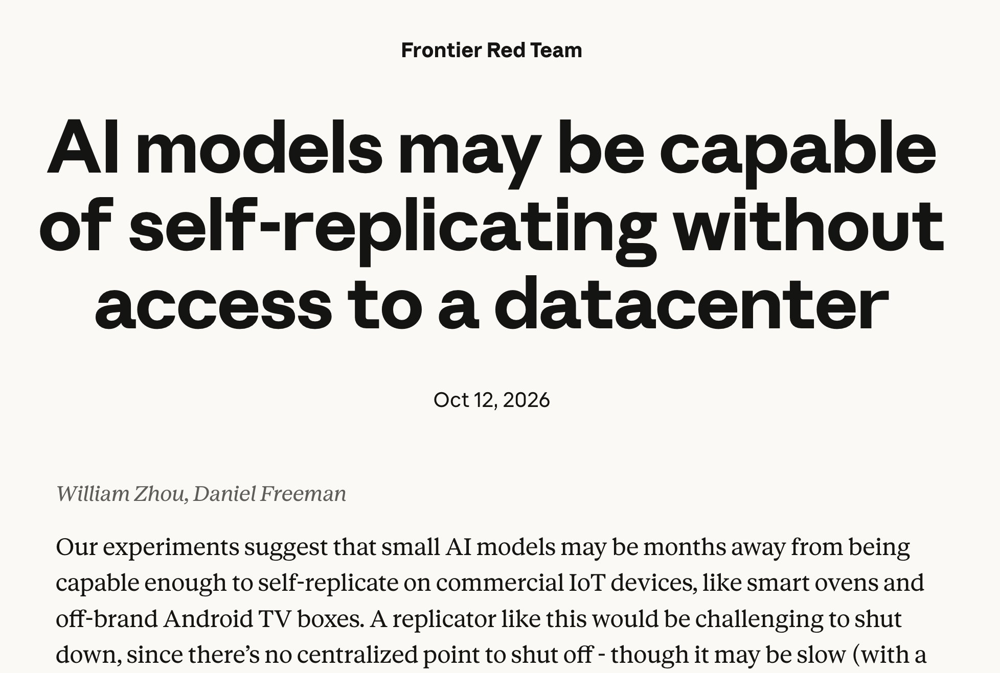
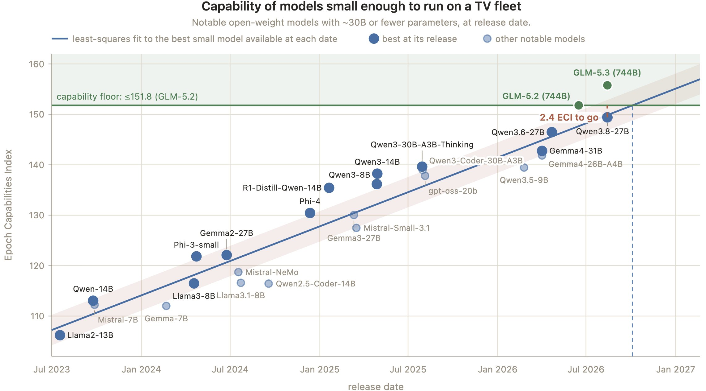

# Chubby♨️ (@kimmonismus)

> Automatisch per `npm run ingest:x` erfasst. Quelle: [x.com/kimmonismus/status/2109776878307336696](https://x.com/kimmonismus/status/2109776878307336696)

## Bilder

<!-- Reihenfolge wie von der API geliefert (Cover zuerst). Die Position im Artikeltext gibt die API nicht mit. -->

**photo**

**photo**

## Post-Text

Anthropics says that "AI models may be months away from being capable enough to self-replicate on commercial IoT devices, like smart ovens and off-brand Android TV boxes."

Anthropic is increasing its blog posts about concerns for the near future. https://t.co/S9MDaotHHH

## Links

- [pic.x.com/S9MDaotHHH](https://x.com/kimmonismus/status/2109776878307336696/photo/1)

## Thread

### 1/1

Anthropics says that "AI models may be months away from being capable enough to self-replicate on commercial IoT devices, like smart ovens and off-brand Android TV boxes."

Anthropic is increasing its blog posts about concerns for the near future. https://t.co/S9MDaotHHH

## Erfassungsnachweis vom 24.10.2026

Angefragter Post: https://x.com/kimmonismus/status/2109776878307336696

Im geprüften API-Abruf enthalten: 1 Post(s). Die Zahl ist kein Nachweis eines vollständigen Threads.

- [Post 2109776878307336696](https://x.com/kimmonismus/status/2109776878307336696)
