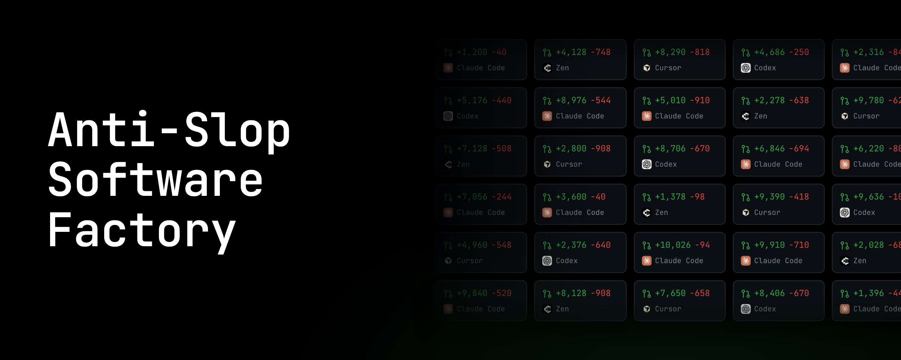
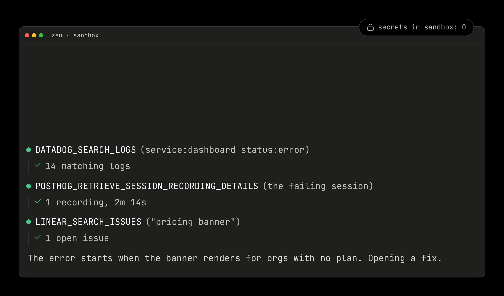
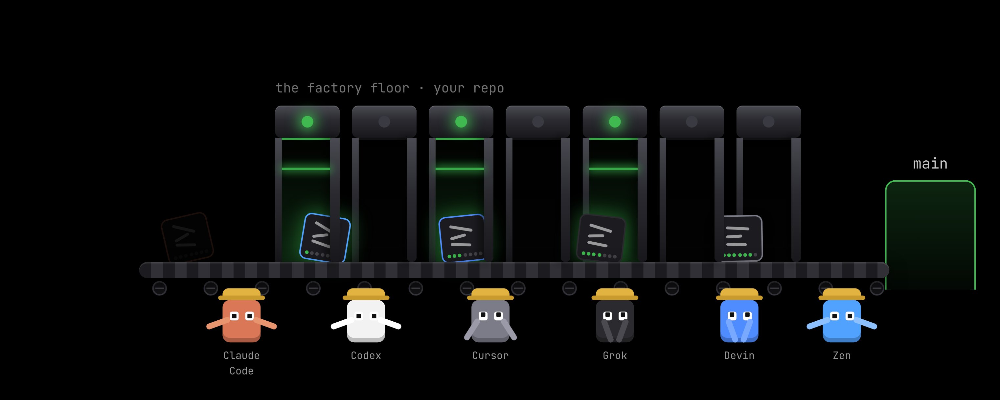
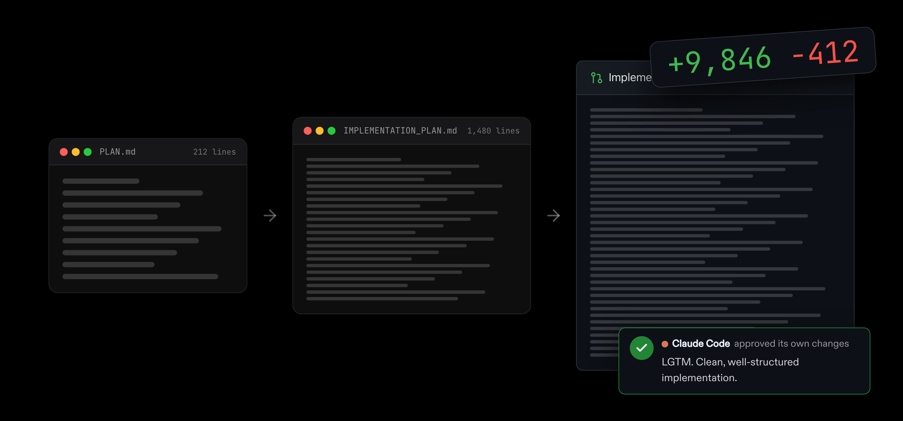
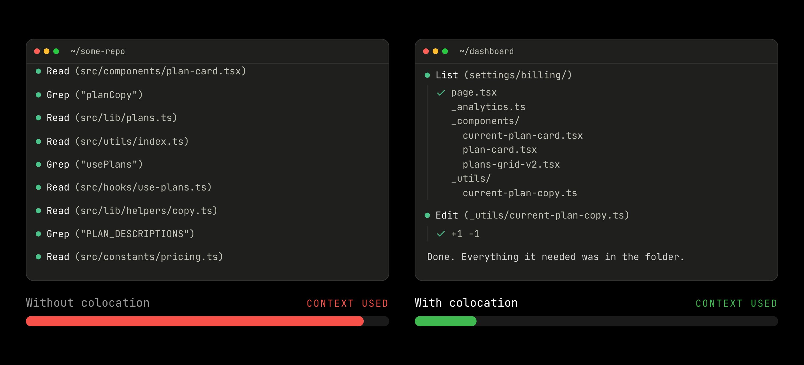
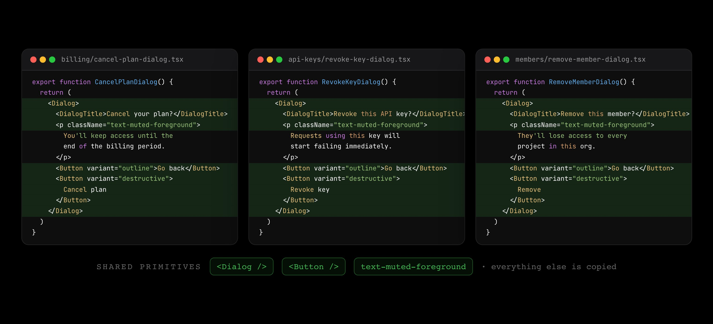

# How to build an anti-slop software factory for teams of 30+

> Automatisch per `npm run ingest:x` erfasst. Quelle: [x.com/sarahfim/status/2109736893198016898](https://x.com/sarahfim/status/2109736893198016898)

## Artikel-Volltext

I had a lot of interest in my recent video where I talk about all the practical things I did to create a software factory that consistently ships reliable code to production across a large team of engineers, product folks and marketing folks that are all using their own personal agents.
 
So I wanted to create a blog-version for those of you that prefer writing over yapping.
My name is Sarah, I lead product engineering at Composio (@composio), and in February I created the Composio dashboard. This was right after Claude Code got super popular, and I got to design the repository from the ground up for agents.
It now has almost 50 contributors across engineering, marketing and product, and I can confidently say that most changes have become one-shot-able and really easy to approve.
Slop Compounds
You've probably heard a few different versions of what a software factory is. I think a lot of people think about agent swarms and Kanban boards.
The problem a lot of software factories are dealing with right now is that slop compounds. If you have a cloud agent working in a repository with a lot of slop in it, you're essentially asking it to slop a plan, slop an implementation according to that plan, and then self-review its own slop.
 
Now, if you do that again and again with cloud agents at scale, the slop is exponential.
In my opinion, that is not a very good software factory. Changes become slower to approve, and your velocity slows down over time.
Agents ≠ Factory
The way I like to think about it is this: a good software factory is not about the agent, the harness or the skills. It's actually about your repository.
So your repository is the factory. It has all this machinery in it: your CI, your lint rules, all of these things. The goal is that anyone should be able to bring their own personal agent, regardless of what harness or model it's using, and you have to make it almost impossible for that agent to write bad code.
 
Now, that is a pretty big feat. So here are the seven practical things I did to make it happen.
1. Co-location
The first one is the most underrated thing, and I don't think I've heard anyone talk about it before: co-location.
Before an agent contributes, it first has to ls and grep the repo to understand how to use it. The more distributed the files are, the more it has to search, and the more it floods its context. If everything a feature needs is in one folder, the agent will for sure find it.
 
The Next.js App Router has served us really well here. A route owns its components, its helpers and its tests; everything sits right next to the thing that uses it. Another huge benefit of co-locating is that when you're reviewing PRs, you can see exactly the scope of what that PR touches.
I believe in this so strongly that I literally banned the lib folder and the utils folder.
2. Type Safety
Next is type safety. Your types should go as end-to-end as possible.
I'm a big fan of tRPC and OpenAPI, because if the schema changes, the compiler tells the agent exactly which places have to change along with it.
3. Duplication is OK
Moving on to my hottest take, which is actually what makes co-location possible: duplication is actually okay.
I think Tailwind showed us this when we stopped writing shared classes and just listed the styles every time, and it was just fine. And now code generation is just as cheap. So if you need the same helper, just generate it twice.
I think creating a shared component for something like a confirmation modal is just not worth it. Just copy, paste and handle the UX on a case-by-case basis.
 
Now, a big exception to this, of course, is global primitives: things like buttons and style tokens. Any shared global primitive should exist, but it should also be enforced by lint rules.
4. Lint Rules
Why Not Skills? A skill is a set of instructions, and agents just ignore instructions. You have to assume that every rule you write in a skill will be broken by someone's agent, if not your own.
Skills also go out of date very quickly. Models improve, and the pitfalls of one model aren't the pitfalls of the next. Every skill that we've written in our repo has eventually gone out of date and become tech debt, or context debt, for other agents.
If you've noticed, I've spoken about lint rules quite a lot. Theming is a lint rule. Global primitives is a lint rule. Banning the lib folder is a lint rule.
That's because a skill can tell the agent a rule, but a lint rule tells the agent it broke the rule right away, and exactly how to fix it. That closes the loop, not just for your agent but for everyone else's agent too.
We now have 38 custom lint rules in the dashboard. Basically, every time an agent gets something wrong, you lint it away.
And you don't have to write them all yourself. I'm really excited about the React Doctor project, which automatically checks for React best practices. I'm also pretty optimistic about the anti-slop projects, which look for common anti-patterns that agents tend to use.
I am so extreme about my lint rules that I've actually banned useState and useEffect entirely. If an agent wants to use one, it has to provide a comment with a valid reason why it can't just use React Query, React Hook Form, nuqs or any of the other hooks that exist in the repository.
5. End-to-End Tests
Now, the next step you might be thinking about is agent self-verification. But I want to focus today on things that apply globally, which is why we set up end-to-end tests.
We've been piloting Meticulous, which records real sessions in staging and preview and replays them exhaustively, so we can actually see the visual differences across the app.
We also really like using MCPJam to test the MCP protocol against our MCP servers.
6. Bugbots
Then, and only then, do we talk about bugbots.
I think people rely on them a little bit too much. They often have a lot of false positives, and the loop is much, much slower than something like a lint rule. Where they can help is those complex bugs that you can't really check for deterministically.
I really like the concept of BUGBOT.md, where you write down your own best practices to be referenced by the bugbot, because that's essentially a sub-agent self-review that's enforced on every PR.
7. Fast CI
The last one, which is also super underrated, is keeping CI fast.
I am not going to set up the local dev environment on every marketer's computer. That means they're using preview deployments 100% of the time, so the build and the checks are the whole loop for them.
Moving to Blacksmith has been a genuine game changer. We've cut some checks by 50%, and some by over 70%.
8. Cloud Agents
Then, and only then, do we talk about cloud agents. Once you have your repos set up like this, the next level is creating your own cloud agent that anyone can use.
Zen is ours. We built it internally. It can be triggered from a Slack message, a Linear issue, a Datadog alert or a cron job. Since February, Zen has merged over 1,300 PRs across all of our repos; in September alone, it was 245.
I think what makes these cloud agents so useful is access to context through Composio. They can read Datadog logs, PostHog sessions and Linear tickets, and that makes them really effective at debugging. Because they can access this context safely through Composio's managed auth, you can give them a really vague prompt, and they can search through the services to get on the same page as you quite quickly.
 
That Is the Factory
I hope some of the things I learned were interesting, and that they inspire you to try them in your own software factories.
I'm not sponsored by anything I've mentioned here. These are tools we really use and have seen a lot of success with. If you have any questions, I'll be answering them in the comments.

## Bilder

<!-- Reihenfolge wie von der API geliefert (Cover zuerst). Die Position im Artikeltext gibt die API nicht mit. -->

**Cover**

**photo**

**photo**

**photo**

**photo**

**photo**

## Post-Text

https://t.co/kWcgzApsxG

## Links

- [x.com/i/article/2108…](https://x.com/i/article/2108633271882145792)

## Thread

### 1/1

https://t.co/kWcgzApsxG

## Ergänzte Artikel-Verweise

Original-Entities ohne rekonstruierte Positionen im Artikel.
### Links

- https://www.react.doctor/
- https://trpc.io
- https://www.blacksmith.sh
- https://github.com/47ng/nuqs
- https://www.openapis.org
- https://tanstack.com/query
- https://www.meticulous.ai
- https://tailwindcss.com
- https://composio.dev/
- https://github.com/MCPJam/inspector
- https://react-hook-form.com
- https://composio.dev
- https://dashboard.composio.dev/
- https://cursor.com/help/ai-features/bugbot
- https://nextjs.org/docs/app
- https://claude.com/claude-code

### Eingebetteter Post

https://x.com/sarahfim/status/2108298553823203613

Autor: @sarahfim

i built an anti-slop software factory for ~50 contributors (and all their agents), from engineering to marketing, and i am sharing everything i learned

there is a lot of discourse around software factories, and though they sound amazing in theory, in practice, it can get exponentially sloppy if you are not careful. to keep the slop out, a lot of "good practices" we learned about software development get turned on their head.

in this video:
> why i banned useState and useEffect
> why code duplication is ok
> why skills aren't enough
> how to stop slop from compounding

btw this is not sponsored, i mention a few tools we use: @trpcio (e2e typesaftey), @vercel (app router), @aidenybai (react doctor), @meticulousgabe (frontend tests), @mcpjams (MCP tests), @cursor_ai (bugbot), @useblacksmith (fast CI), @composio (agent triggers & tools)

[Video lokal](medien/2026-10-12-sarahfim-2109736893198016898/eingebettet/2108298553823203613/01-video.mp4)

