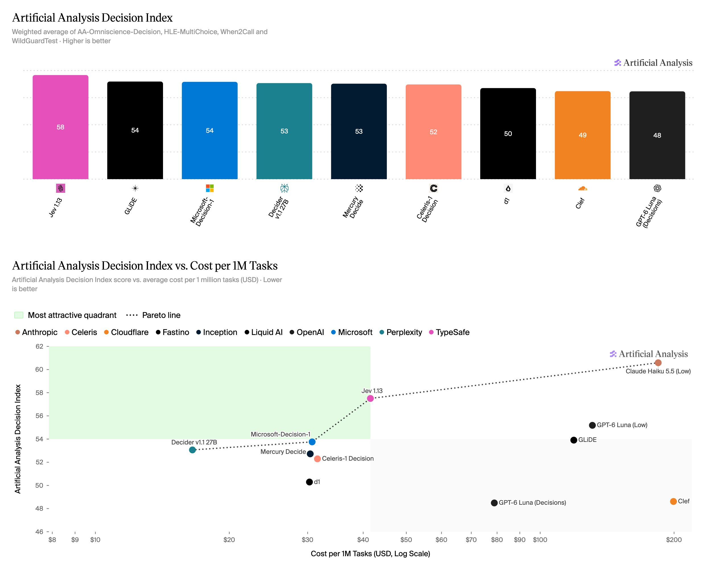
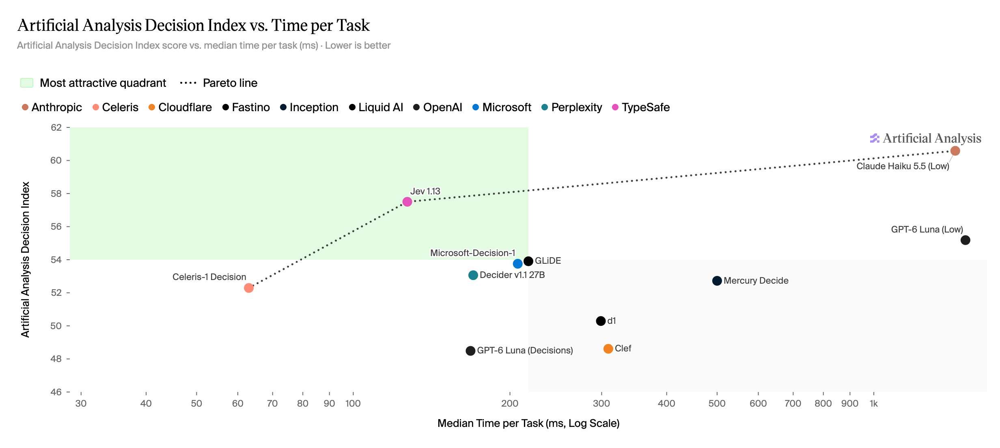
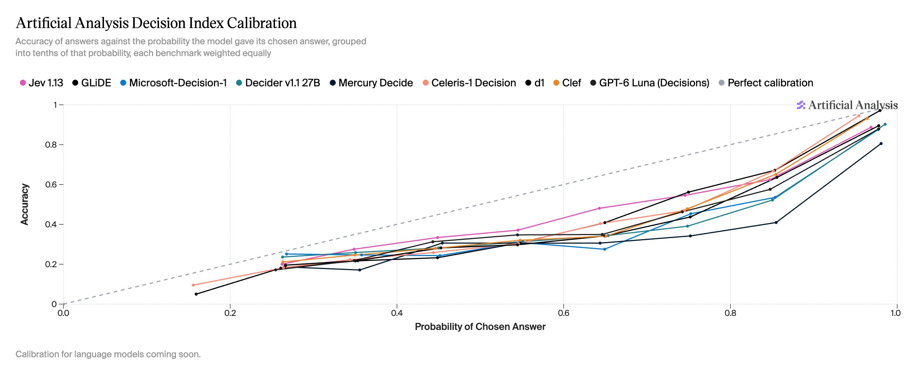
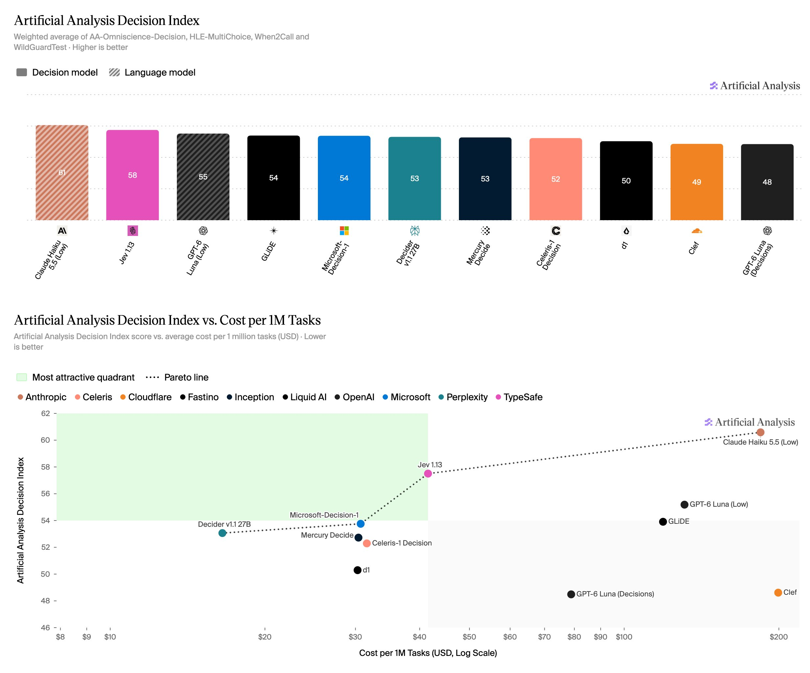

# Artificial Analysis (@ArtificialAnlys)

> Automatisch per `npm run ingest:x` erfasst. Quelle: [x.com/ArtificialAnlys/status/2110046565691949058](https://x.com/ArtificialAnlys/status/2110046565691949058)

## Bilder

<!-- Reihenfolge wie von der API geliefert (Cover zuerst). Die Position im Artikeltext gibt die API nicht mit. -->

**photo**

## Post-Text

Introducing the Artificial Analysis Decision Index, benchmarking decision models across classification, tool calling, knowledge and reasoning. Jev leads among decision models; language models such as Claude Haiku 5.5 still deliver higher accuracy, but at much higher cost and latency

Decision models deliver structured answers or classifications with associated probabilities, offering faster responses and lower costs than using language models. The Artificial Analysis Decision Index v1.0 compares the capability, cost, and speed of decision models and also compares to language models.

Benchmarks in the Artificial Analysis Decision Index v1.0:

➤ AA-Omniscience-Decision: A private dataset of 500 questions adapted from the proprietary AA-Omniscience benchmark, measuring decision models’ knowledge and tendency to hallucinate

➤ HLE-MultiChoice: 513 text-only multiple-choice questions from Humanity’s Last Exam, testing decision models’ reasoning capabilities

➤ When2Call: A tool-calling benchmark from NVIDIA, testing whether models can correctly decide to call a tool, request clarification, decline to answer, or respond directly, evaluating capabilities relevant to agentic workflows and tool routing

➤ WildGuardTest: A safety benchmark evaluating models’ classification capabilities across harmful user requests, assistant refusals, and harmful responses. We use a subset of 835 of the original 1,725 test rows where all three human annotators agreed on all three labels, after excluding questions that consistently trigger model refusals

Key results:

➤ Jev 1.13 leads the Decision Index, and sits on the Capability vs. Cost Pareto frontier: Jev 1.13 from @typesafeai scores 58 on the Artificial Analysis Decision Index, ahead of GLiDE (54) from @fastinoAI and Microsoft-Decision-1 (54) from @Microsoft. Decider v1.1 27B from @perplexity_ai has the lowest Cost per 1M Tasks at $17, with Microsoft-Decision-1 ($31) and Jev 1.13 ($42) also on the Capability vs. Cost Pareto frontier. Celeris-1 Decision has the fastest Time per Task at 0.06 seconds, more than 2x faster than Jev 1.13 (0.13 seconds per task)

➤ Decision models are poorly calibrated on knowledge and reasoning tasks: Across almost all probability levels for chosen answers, accuracy falls below that probability for all decision models. This gap is largest on AA-Omniscience-Decision and HLE-MultiChoice, while most models are relatively well-calibrated on WildGuardTest (classification) and When2Call (tool calling)

➤ Decision models offer significant speed and cost advantages over language models, but trail on knowledge and reasoning: On classification and tool-calling tasks, leading decision models perform comparably to language models while being significantly faster and cheaper. However, language models substantially outperform on knowledge and reasoning. Claude Haiku 5.5 (Low) scores 61 on the Decision Index, 3 points ahead of Jev 1.13, but takes 1.4 seconds per task vs. 0.13 seconds (11x slower) and costs $184 per 1M Tasks vs. $42 for Jev 1.13 (4.4x more expensive)

We will continue to develop the Artificial Analysis Decision Index to help developers and companies better understand when and how to use decision models.

## Thread

### 1/5

Introducing the Artificial Analysis Decision Index, benchmarking decision models across classification, tool calling, knowledge and reasoning. Jev leads among decision models; language models such as Claude Haiku 5.5 still deliver higher accuracy, but at much higher cost and latency

Decision models deliver structured answers or classifications with associated probabilities, offering faster responses and lower costs than using language models. The Artificial Analysis Decision Index v1.0 compares the capability, cost, and speed of decision models and also compares to language models.

Benchmarks in the Artificial Analysis Decision Index v1.0:

➤ AA-Omniscience-Decision: A private dataset of 500 questions adapted from the proprietary AA-Omniscience benchmark, measuring decision models’ knowledge and tendency to hallucinate

➤ HLE-MultiChoice: 513 text-only multiple-choice questions from Humanity’s Last Exam, testing decision models’ reasoning capabilities

➤ When2Call: A tool-calling benchmark from NVIDIA, testing whether models can correctly decide to call a tool, request clarification, decline to answer, or respond directly, evaluating capabilities relevant to agentic workflows and tool routing

➤ WildGuardTest: A safety benchmark evaluating models’ classification capabilities across harmful user requests, assistant refusals, and harmful responses. We use a subset of 835 of the original 1,725 test rows where all three human annotators agreed on all three labels, after excluding questions that consistently trigger model refusals

Key results:

➤ Jev 1.13 leads the Decision Index, and sits on the Capability vs. Cost Pareto frontier: Jev 1.13 from @typesafeai scores 58 on the Artificial Analysis Decision Index, ahead of GLiDE (54) from @fastinoAI and Microsoft-Decision-1 (54) from @Microsoft. Decider v1.1 27B from @perplexity_ai has the lowest Cost per 1M Tasks at $17, with Microsoft-Decision-1 ($31) and Jev 1.13 ($42) also on the Capability vs. Cost Pareto frontier. Celeris-1 Decision has the fastest Time per Task at 0.06 seconds, more than 2x faster than Jev 1.13 (0.13 seconds per task)

➤ Decision models are poorly calibrated on knowledge and reasoning tasks: Across almost all probability levels for chosen answers, accuracy falls below that probability for all decision models. This gap is largest on AA-Omniscience-Decision and HLE-MultiChoice, while most models are relatively well-calibrated on WildGuardTest (classification) and When2Call (tool calling)

➤ Decision models offer significant speed and cost advantages over language models, but trail on knowledge and reasoning: On classification and tool-calling tasks, leading decision models perform comparably to language models while being significantly faster and cheaper. However, language models substantially outperform on knowledge and reasoning. Claude Haiku 5.5 (Low) scores 61 on the Decision Index, 3 points ahead of Jev 1.13, but takes 1.4 seconds per task vs. 0.13 seconds (11x slower) and costs $184 per 1M Tasks vs. $42 for Jev 1.13 (4.4x more expensive)

We will continue to develop the Artificial Analysis Decision Index to help developers and companies better understand when and how to use decision models.

### 2/5

Across the four benchmarks in the Artificial Analysis Decision Index v1.0, Perplexity’s Decider v1.1 27B has the lowest Cost per 1M Tasks at $17. It sits alongside Microsoft-Decision-1 ($31) and Jev 1.13 ($42) on the Capability vs. Cost Pareto frontier. Celeris-1 Decision has the fastest Time per Task at 0.06 seconds, 2x faster than Jev 1.13 (0.13 seconds), which is 11x faster than Claude Haiku 5.5 (Low) (1.4 seconds)

### 3/5

Decision models are poorly calibrated on knowledge and reasoning tasks. Across almost all probability levels for chosen answers, accuracy falls below that probability for all decision models. This gap is largest on AA-Omniscience-Decision and HLE-MultiChoice, while most models are relatively well-calibrated on WildGuardTest (classification) and When2Call (tool calling)

### 4/5

Decision models offer significant speed and cost advantages over language models, but trail on knowledge and reasoning. On classification and tool-calling tasks, leading decision models perform comparably to language models while being significantly faster and cheaper. However, language models outperform on knowledge and reasoning. Claude Haiku 5.5 (Low) scores 61 on the Decision Index, 3 points ahead of Jev 1.13, but takes 1.4 seconds per task vs. 0.13 seconds (11x slower) and costs $184 per 1M Tasks vs. $42 for Jev 1.13 (4.4x more expensive)

### 5/5

View our full methodology at https://t.co/83igY5N73M

Explore the full results on Artificial Analysis: https://t.co/egA1Vz0le2

## Erfassungsnachweis vom 24.10.2026

Angefragter Post: https://x.com/ArtificialAnlys/status/2110046565691949058

Im geprüften API-Abruf enthalten: 5 Post(s). Die Zahl ist kein Nachweis eines vollständigen Threads.

- [Post 2110046565691949058](https://x.com/ArtificialAnlys/status/2110046565691949058)
- [Post 2110046568669904987](https://x.com/ArtificialAnlys/status/2110046568669904987)

### Medien aus Post 2110046568669904987

- [Post 2110046571194876122](https://x.com/ArtificialAnlys/status/2110046571194876122)

### Medien aus Post 2110046571194876122

- [Post 2110046573635960993](https://x.com/ArtificialAnlys/status/2110046573635960993)

### Medien aus Post 2110046573635960993

- [Post 2110046575833776197](https://x.com/ArtificialAnlys/status/2110046575833776197)
