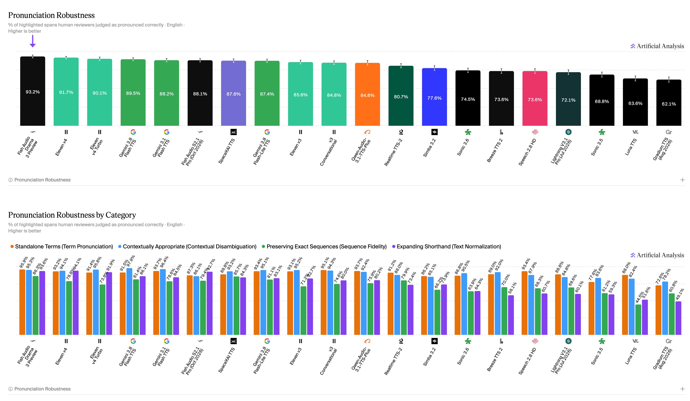
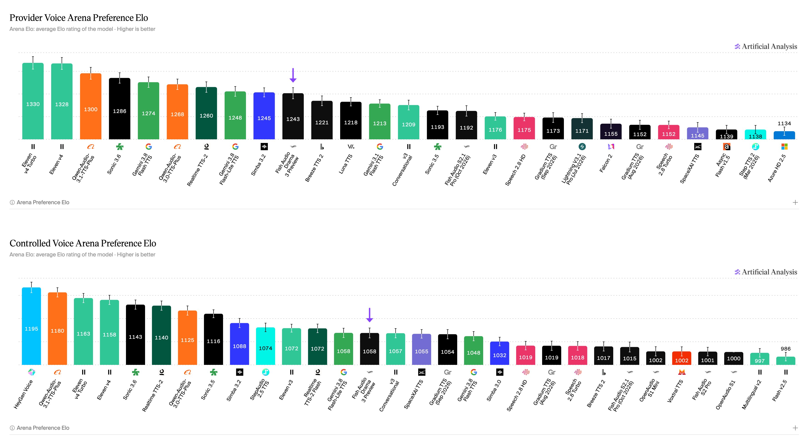

# Artificial Analysis (@ArtificialAnlys)

> Automatisch per `npm run ingest:x` erfasst. Quelle: [x.com/ArtificialAnlys/status/2110081938140582085](https://x.com/ArtificialAnlys/status/2110081938140582085)

## Bilder

<!-- Reihenfolge wie von der API geliefert (Cover zuerst). Die Position im Artikeltext gibt die API nicht mit. -->

**animated_gif**

## Post-Text

Fish Audio's Drama 3 Preview is the new #1 open-weights Text to Speech model on the Artificial Analysis Text to Speech leaderboard. The model also leads all models in our Pronunciation Robustness leaderboard, ahead of Eleven v4 and Eleven v4 Turbo

Drama 3 Preview is the new open weights Text to Speech model from @FishAudio, built for multi-character scenes and long-form content with voice cloning and natural-language control. Weights are available on Hugging Face under the Fish Audio Community License.

Key takeaways:

➤ Pronunciation Robustness: Drama 3 Preview scores 93.2%, ranking #1 ahead of Eleven v4 at 91.7% and Eleven v4 Turbo at 90.1%. It ranks #1 in Standalone Terms and Preserving Exact Sequences and #2 in Expanding Shorthand.

➤ Provider Voice: Drama 3 Preview has an Elo of 1,243 (+16/-16) across 1,857 appearances, ranking #10, a 101 point gain on the previous Fish Audio S2.1 Pro at 1,142.

➤ Controlled Voice: Drama 3 Preview ranks #14 with an Elo of 1,058 (+15/-15) across 1,804 appearances.

➤ Open weights: Drama 3 Preview is the #1 open weights model on all three of our Text to Speech leaderboards. On Pronunciation Robustness it leads the next open weights model, Mistral's Voxtral TTS at 78.1%, by 15 points, and in the Provider Voice Arena it is ahead of Breeze TTS 2 at 1,221. Drama 3 is a 35B parameter mixture-of-experts model (3B active) supporting 83 languages, available on Hugging Face.

➤ Pricing: Drama 3 Preview is available via the Fish Audio API at $15/1M characters, the same as S2.1 Pro, compared to Eleven v4 at $80/1M characters and Eleven v4 Turbo at $40/1M characters.

See more details and listen to samples below 🧵

## Thread

### 1/6

Fish Audio's Drama 3 Preview is the new #1 open-weights Text to Speech model on the Artificial Analysis Text to Speech leaderboard. The model also leads all models in our Pronunciation Robustness leaderboard, ahead of Eleven v4 and Eleven v4 Turbo

Drama 3 Preview is the new open weights Text to Speech model from @FishAudio, built for multi-character scenes and long-form content with voice cloning and natural-language control. Weights are available on Hugging Face under the Fish Audio Community License.

Key takeaways:

➤ Pronunciation Robustness: Drama 3 Preview scores 93.2%, ranking #1 ahead of Eleven v4 at 91.7% and Eleven v4 Turbo at 90.1%. It ranks #1 in Standalone Terms and Preserving Exact Sequences and #2 in Expanding Shorthand.

➤ Provider Voice: Drama 3 Preview has an Elo of 1,243 (+16/-16) across 1,857 appearances, ranking #10, a 101 point gain on the previous Fish Audio S2.1 Pro at 1,142.

➤ Controlled Voice: Drama 3 Preview ranks #14 with an Elo of 1,058 (+15/-15) across 1,804 appearances.

➤ Open weights: Drama 3 Preview is the #1 open weights model on all three of our Text to Speech leaderboards. On Pronunciation Robustness it leads the next open weights model, Mistral's Voxtral TTS at 78.1%, by 15 points, and in the Provider Voice Arena it is ahead of Breeze TTS 2 at 1,221. Drama 3 is a 35B parameter mixture-of-experts model (3B active) supporting 83 languages, available on Hugging Face.

➤ Pricing: Drama 3 Preview is available via the Fish Audio API at $15/1M characters, the same as S2.1 Pro, compared to Eleven v4 at $80/1M characters and Eleven v4 Turbo at $40/1M characters.

See more details and listen to samples below 🧵

### 2/6

Pronunciation Robustness measures whether Text to Speech models correctly pronounce challenging text across four categories, with human reviewers judging each clip against pre-agreed accepted pronunciations. Drama 3 Preview leads overall at 93.2%.

➤ Standalone Terms: Drama 3 Preview ranks #1 at 95.9%, ahead of Eleven v3 Conversational at 95.1% and Gemini 3.1 Flash TTS at 93.7%.

➤ Preserving Exact Sequences: Drama 3 Preview ranks #1 at 86.3%, ahead of SpaceXAI TTS at 85.7% and HeyGen Voice at 83.4%.

➤ Expanding Shorthand: Drama 3 Preview ranks #2 at 93.6%, behind Eleven v4 at 94.1% and ahead of Eleven v4 Turbo at 91.9%.

➤ Contextually Appropriate: Drama 3 Preview scores 95.3%, with Gemini 3.8 Flash TTS leading at 97.9%.

### 3/6

Sample prompt on Drama 3 Preview: "Revenue from the capital markets business, which houses its trading desks, rose 7.1% to $892.2 million from the previous quarter." https://t.co/H6RZAAXkib

### 4/6

Sample prompt on Drama 3 Preview: "Your gut microbiome contains trillions of bacteria that influence digestion, immunity, and even mental health through the gut-brain axis." https://t.co/J68UCoODkf

### 5/6

In the Provider Voice Arena, Drama 3 Preview has an Elo of 1,243 across 1,857 appearances, ranking #10 just behind Speechify's Simba 3.2 at 1,245 and ahead of Breeze TTS 2 at 1,221. That is a 101 point gain on the previous Fish Audio S2.1 Pro at 1,142. https://t.co/IlTkZOR6Ib

### 6/6

See the top models on the Artificial Analysis Pronunciation Robustness leaderboard: https://t.co/3Rvf7iNMkR

Provider Voice TTS leaderboard: https://t.co/LcFfZj9aC7

Vote for models in the Speech Arena: https://t.co/NxOeBgRauE

Explore sample clips in the Speech Explorer: https://t.co/kZVoKVqvO1

## Ergänzende Thread-Medien

Aus den bereits abgerufenen API-Daten lokal archiviert; die Post-Links ordnen Medien ihren Folgeposts zu.

### Post 2110081941487992932

[Originalpost](https://x.com/ArtificialAnlys/status/2110081941487992932)

### Post 2110081945103372603

[Originalpost](https://x.com/ArtificialAnlys/status/2110081945103372603)

### Post 2110081947976294579

[Originalpost](https://x.com/ArtificialAnlys/status/2110081947976294579)

### Post 2110081951348740292

[Originalpost](https://x.com/ArtificialAnlys/status/2110081951348740292)

