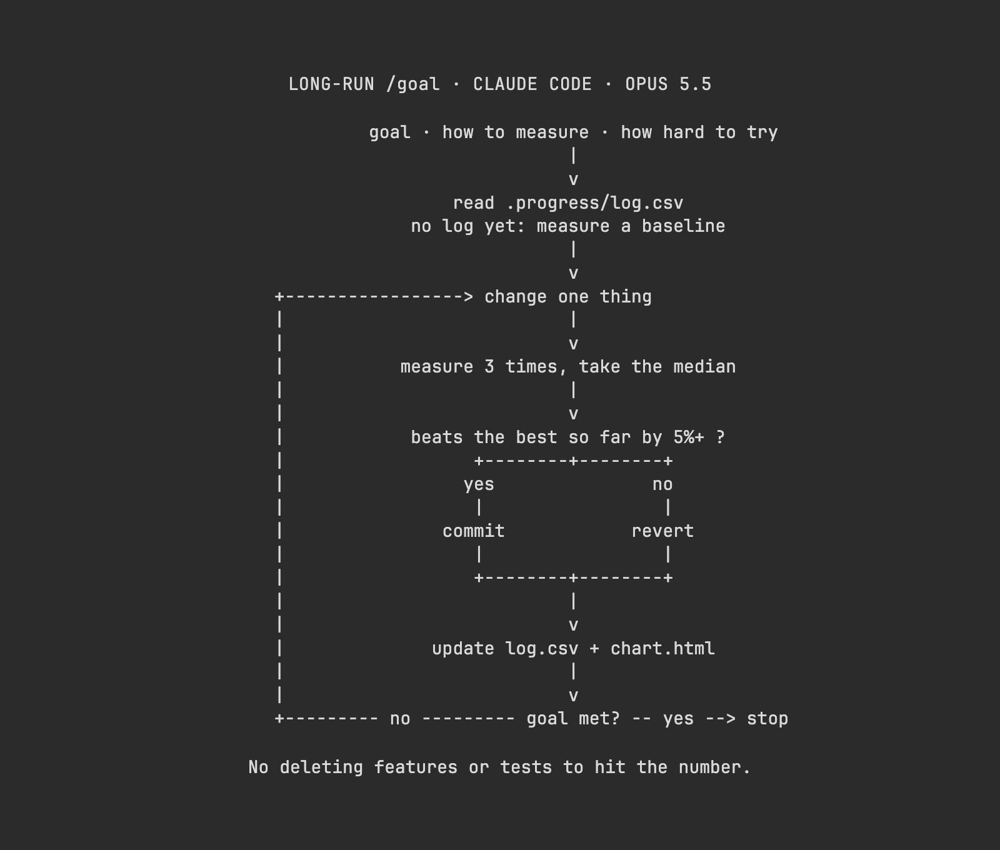

# Vox (@Voxyz_ai)

> Automatisch per `npm run ingest:x` erfasst. Quelle: [x.com/Voxyz_ai/status/2109977464201957531](https://x.com/Voxyz_ai/status/2109977464201957531)

## Bilder

<!-- Reihenfolge wie von der API geliefert (Cover zuerst). Die Position im Artikeltext gibt die API nicht mit. -->

**photo**

## Post-Text

Karpathy estimates 𝗼𝗻𝗹𝘆 𝟬.𝟮% 𝗼𝗳 𝗽𝗲𝗼𝗽𝗹𝗲 have watched an agent finish weeks or months of work from a single prompt.

The creator of Claude Code gives the model 𝗷𝘂𝘀𝘁 𝘁𝗵𝗿𝗲𝗲 𝘁𝗵𝗶𝗻𝗴𝘀 for long jobs like this: the goal, how to measure it, and how hard to try. Write those three into a /goal and Opus 5.5 changes, measures and keeps going on its own for days, updating a progress chart after every measurement. One look at the chart in the morning tells you how far it still has to go.

For the goal, pick whatever bugs you most, like:
→ your homepage shows up within 2 seconds on a phone, measured with Lighthouse
→ no page scrolls sideways at phone width, checked with a screenshot of each page
→ npm run build finishes in under a minute, timed every run

Left running long enough, it may delete features just to hit the number. Type /goal in Claude Code, paste this after it and fill in the brackets with your own. 𝗔𝗻 𝗮𝗹𝗹-𝗽𝘂𝗿𝗽𝗼𝘀𝗲 𝘁𝗲𝗺𝗽𝗹𝗮𝘁𝗲 you can reuse anytime 👇

Goal: [the homepage shows up within 2 seconds on a phone]
How to measure: [after each change, run Lighthouse in mobile mode three times and take the median LCP]. Paste all three numbers. It only counts as met when the median hits the goal.
1. Make a new branch and only work there. First read .progress/log.csv and pick up where you left off. If there's no log yet, measure the current number as the baseline, log it, and add .progress/ to .gitignore.
2. Change one thing at a time. A change only counts as better if it beats the best result so far by 5% or more. Commit it if it's better, revert it if not. Add a line to log.csv after every measurement.
3. After every measurement, update .progress/chart.html with the data written into the page, so it opens with a double-click: one progress line, one goal line, and how far is left at the top.
4. Never delete features, delete tests or skip tests to hit the number. Don't deploy, don't delete data, don't touch secrets. If you're unsure about something, note it in .progress/questions.txt and work on something else.
5. If the goal isn't met after 50 turns, stop and write down where you're stuck.

## Links

- [pic.x.com/mfB7QKXFsN](https://x.com/Voxyz_ai/status/2109977464201957531/photo/1)
- [x.com/Voxyz_ai/statu…](https://twitter.com/Voxyz_ai/status/2109267779685937477)

## Thread

### 1/1

Karpathy estimates 𝗼𝗻𝗹𝘆 𝟬.𝟮% 𝗼𝗳 𝗽𝗲𝗼𝗽𝗹𝗲 have watched an agent finish weeks or months of work from a single prompt.

The creator of Claude Code gives the model 𝗷𝘂𝘀𝘁 𝘁𝗵𝗿𝗲𝗲 𝘁𝗵𝗶𝗻𝗴𝘀 for long jobs like this: the goal, how to measure it, and how hard to try. Write those three into a /goal and Opus 5.5 changes, measures and keeps going on its own for days, updating a progress chart after every measurement. One look at the chart in the morning tells you how far it still has to go.

For the goal, pick whatever bugs you most, like:
→ your homepage shows up within 2 seconds on a phone, measured with Lighthouse
→ no page scrolls sideways at phone width, checked with a screenshot of each page
→ npm run build finishes in under a minute, timed every run

Left running long enough, it may delete features just to hit the number. Type /goal in Claude Code, paste this after it and fill in the brackets with your own. 𝗔𝗻 𝗮𝗹𝗹-𝗽𝘂𝗿𝗽𝗼𝘀𝗲 𝘁𝗲𝗺𝗽𝗹𝗮𝘁𝗲 you can reuse anytime 👇

Goal: [the homepage shows up within 2 seconds on a phone]
How to measure: [after each change, run Lighthouse in mobile mode three times and take the median LCP]. Paste all three numbers. It only counts as met when the median hits the goal.
1. Make a new branch and only work there. First read .progress/log.csv and pick up where you left off. If there's no log yet, measure the current number as the baseline, log it, and add .progress/ to .gitignore.
2. Change one thing at a time. A change only counts as better if it beats the best result so far by 5% or more. Commit it if it's better, revert it if not. Add a line to log.csv after every measurement.
3. After every measurement, update .progress/chart.html with the data written into the page, so it opens with a double-click: one progress line, one goal line, and how far is left at the top.
4. Never delete features, delete tests or skip tests to hit the number. Don't deploy, don't delete data, don't touch secrets. If you're unsure about something, note it in .progress/questions.txt and work on something else.
5. If the goal isn't met after 50 turns, stop and write down where you're stuck.

## Erfassungsnachweis vom 24.10.2026

Angefragter Post: https://x.com/Voxyz_ai/status/2109977464201957531

Im geprüften API-Abruf enthalten: 1 Post(s). Die Zahl ist kein Nachweis eines vollständigen Threads.

- [Post 2109977464201957531](https://x.com/Voxyz_ai/status/2109977464201957531)
