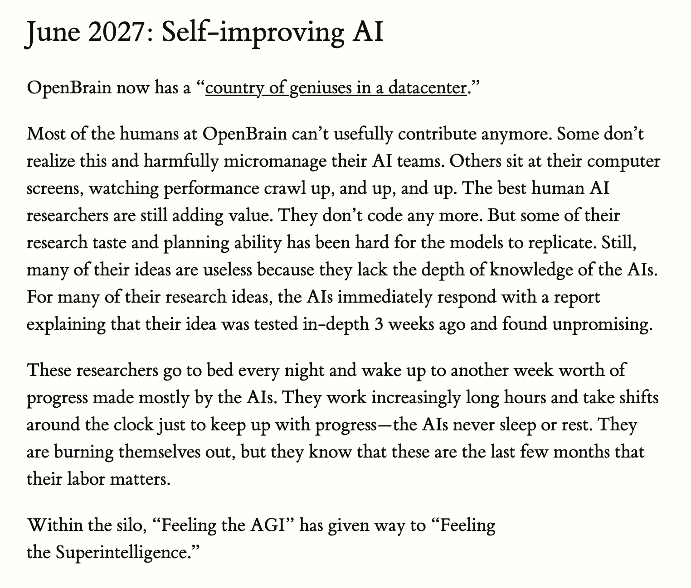

# Chubby♨️ (@kimmonismus)

> Automatisch per `npm run ingest:x` erfasst. Quelle: [x.com/kimmonismus/status/2110279443998445652](https://x.com/kimmonismus/status/2110279443998445652)

## Bilder

<!-- Reihenfolge wie von der API geliefert (Cover zuerst). Die Position im Artikeltext gibt die API nicht mit. -->

**photo**

## Post-Text

And again: It's truly surprising how on point AI2027 was with their analysis. Jack Clark's assumption now aligns with AI2027's RSI prediction. https://t.co/GpyPymKivw https://t.co/N2Nkht3PSC

## Links

- [pic.x.com/GpyPymKivw](https://x.com/kimmonismus/status/2110279443998445652/photo/1)
- [x.com/kimmonismus/st…](https://twitter.com/kimmonismus/status/2110127438374277368)

## Thread

### 1/1

And again: It's truly surprising how on point AI2027 was with their analysis. Jack Clark's assumption now aligns with AI2027's RSI prediction. https://t.co/GpyPymKivw https://t.co/N2Nkht3PSC
