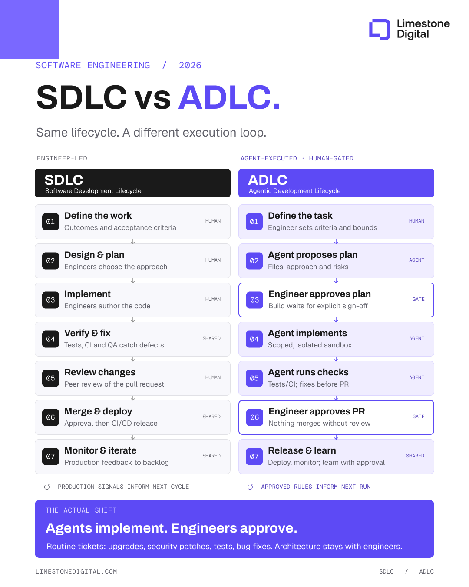

# Mark Ajzenstadt (@mardehaym)

> Automatisch per `npm run ingest:x` erfasst. Quelle: [x.com/mardehaym/status/2110763129885835505](https://x.com/mardehaym/status/2110763129885835505)

## Bilder

<!-- Reihenfolge wie von der API geliefert (Cover zuerst). Die Position im Artikeltext gibt die API nicht mit. -->

**photo**

## Post-Text

The software development lifecycle (SDLC) is transforming into the ADLC: the agentic development lifecycle.

But that doesn’t mean the ADLC is a shorter loop.

The bottleneck shifted. Writing code got cheap. 

Holding senior-engineer quality on every change didn’t, and the hardest change to get right is the security patch.

For routine tickets, our agent pipeline at @LimestoneHQ  runs like this:

1. An engineer writes the ticket with clear acceptance criteria. Security patches and dependency upgrades come in the same way.
2. The agent proposes a plan: files, approach, risks.
3. An engineer approves the plan.
4. The agent builds in a sandbox that can reach the model and nothing else.
5. CI runs the same checks on every change, and the agent fixes what fails.
6. An engineer reviews the PR. Nothing reaches main without that approval.
7. Approved review feedback becomes a rule for the next run.

Agents write the code. Engineers approve it.

## Thread

### 1/5

The software development lifecycle (SDLC) is transforming into the ADLC: the agentic development lifecycle.

But that doesn’t mean the ADLC is a shorter loop.

The bottleneck shifted. Writing code got cheap. 

Holding senior-engineer quality on every change didn’t, and the hardest change to get right is the security patch.

For routine tickets, our agent pipeline at @LimestoneHQ  runs like this:

1. An engineer writes the ticket with clear acceptance criteria. Security patches and dependency upgrades come in the same way.
2. The agent proposes a plan: files, approach, risks.
3. An engineer approves the plan.
4. The agent builds in a sandbox that can reach the model and nothing else.
5. CI runs the same checks on every change, and the agent fixes what fails.
6. An engineer reviews the PR. Nothing reaches main without that approval.
7. Approved review feedback becomes a rule for the next run.

Agents write the code. Engineers approve it.

### 2/5

Book a call to ship AI-native: https://t.co/o3WC81HJFF

### 3/5

If you found this useful, check out our guide on AI transformation for operations

Get it for free:
https://t.co/bEl8G9fPJO

### 4/5

@free_ai_guides thank you

### 5/5

@Charlie01748449 100%
