# Stop Hitting Claude Code Limits: 7 Best Practices, Tested on 945 Runs

> Automatisch per `npm run ingest:x` erfasst. Quelle: [x.com/0xKense1/status/2111105138290987198](https://x.com/0xKense1/status/2111105138290987198)

## Artikel-Volltext

I’m tired. I want to try everything, but instead of working, I wait for my limit to refill. I burned 90% of my 5-hour Claude limit in 11 minutes while doing some simple task. So I measured the popular tips: 945 Claude Code runs, every answer graded. One command I already had cut the next questions by 79%. 
In 10 minutes, you can learn about the steps that worked. If you have waited out a reset and then gone looking for tips, every thread says the same things: clear more, compact more, use subagents, turn effort down, keep CLAUDE.md short, switch to Haiku.
People are waiting for Fable 5.5, but it already has no limits. What will it be like when it comes out?
 
The most popular tips everyone repeats: short chats instead of long ones, a lean instructions file, low effort, Haiku for the easy parts, the caveman skill for short answers. None of them came with measurements, so I took every tip that applies to Claude Code and measured it. 

When Claude extends limits, I am happier than on my birthday.
 
So here is what I did: 12 tips, 945 runs, every answer graded. 5 tips cut tokens with a clear margin. 5 made no difference I could measure. 2 cost more tokens but paid off in a different way. All 945 runs, the test harness and every chart are public on GitHub: check the first comment under the post.
 
The 10-minute version
1. Type `/clear` when you switch to an unrelated task. Use `/compact` when the next task builds on the last one.
2. Move long rules out of CLAUDE.md into a skill and leave a one-line pointer.
3. Keep effort at medium. Use low for lookups on Opus, high only for hard tasks.
4. Name the file and function when you know them.
5. Turn off MCP servers you do not use.
 
Below are the 7 best practices that held up, each with its exact config and its numbers. After them come the five popular tips you can stop paying for, and how to measure a tip on your own setup.
How I tested
A codebase the model has never seen. Claude has read Flask many times in training, so questions about Flask can be answered from memory. I built a renamed copy called "Tessel": the classes and functions the questions ask about got new names (handle_user_exception became route_user_fault, for example). Claude has to open the files, the same way it would in your private repo.
Real questions with right answers. 10 questions of the "how does X work in this repo" kind. For example: "In this repo, when a view raises an exception, how does Tessel decide which error handler runs? List the methods involved in call order, with file paths. Be brief." An answer counts as right only if it names the exact functions in the answer key.
A clean session every time. Every run is a new claude -p process with an explicit --model and --effort, started in a fresh copy of the folder. No run inherits anything from the one before it.
Fair comparisons. Each tip runs against the default on the same questions, in shuffled order, and the two sides are paired question by question. A slow hour or a cache hiccup hits both sides.
A realistic default. Sonnet 5.5 at effort medium, with my normal Claude Code install: user skills listed and claude.ai connectors connected.
Tokens as the unit. Input, output, cache reads and cache writes, subagents included, read from modelUsage. I switched Claude accounts in the middle of the campaign, so I do not compare plan percentages.
The whole campaign used 118 million tokens, about $72 at API list prices. Every number below comes with its run count and a 95% confidence interval. If the interval crosses zero, I call it no clear effect, even when the average looks good.
First, what eats your tokens
A bare "ok" in Claude Code cost 19,100 tokens on my setup before it opened a single file. That is the system prompt, the tool definitions, the list of your skills, the connected MCP tools and your CLAUDE.md.
A normal question then took about 6 steps: read a file, search, read another file, answer. Each call sends the whole base again plus everything read so far. The average question cost 110,000 tokens, while the context at its last call was only about 24,000. The same tokens get counted again on every call.
That is why 87% of all tokens were cache reads, and only about 1% was the answer Claude wrote. Questions also varied a lot: the cheapest averaged 61,000 tokens and the most expensive 213,000, on the same setup.
 
 
So there are only two ways to save: make the base smaller, or make Claude carry less history from call to call. Every tip that worked in this test does one of the two. Tips that shorten what Claude writes are working on the 1%.
Anthropic's own cost guide describes the same mechanism: Claude Code "sends your full conversation with every request" and re-reads that history at the cached token rate, "so a one-line question in a session that has been open all day still draws usage for the whole conversation". Cache reads are cheaper than fresh input, and Thariq Shihipar from the Claude Code team wrote that a high cache hit rate "helps us create more generous rate limits for our subscription plans". How exactly cache reads count toward your plan limit is not published, which is why I report raw tokens.
1. /clear before you switch tasks
The popular claim is that long chats are a silent killer, and three short chats beat one long one. The data agrees, and the effect is bigger than any other tip here.
I built chats of 5, 15 and 30 turns about the codebase. Then I forked each chat three ways (keep going, /clear, or /compact) and asked the same 3 new questions in each fork.
5 turns (51k tokens of history): /clear cut the next 3 questions by 47%.
15 turns (107k): 76% less.
30 turns (155k): 79% less, from 1.37M tokens to 285k. 95% interval: 62% to 96% less, over 3 chains.
The cost of one question shows why. After 30 turns, a question about blueprints cost 544,000 tokens if I kept going, and 99,000 after /clear. Same question, same answer. The 445,000 difference is old chat that rode along on every call.
All 81 answers were right in every fork, because the new questions did not need the old chat. That is the condition where /clear is free: the next task does not depend on the last one.
 
How to use it: type /clear at the moment you change topic, not after every question. Inside one task, the history is what lets Claude skip re-reading files, so keep it.
This is also the first habit in Anthropic's cost guide: "Use /clear to start fresh when switching to unrelated work. Stale context wastes tokens on every subsequent message." The same guide adds a trick worth copying: run /rename before clearing, "so you can find the session later, then /resume to return to it".
2. /compact when you need to keep the thread
Some guides suggest a "mega prompt" handoff: ask for a summary, then paste it into a new chat. /compact is the built-in version, and it has the same catch. Writing the summary means reading the whole chat once more.
On my chats the /compact call itself cost 55k, 113k and 162k tokens. What it produced was small: 51k of history became about 3k, 107k became about 9k, and 155k became about 13k.
Even with the cost of the call counted, the next 3 questions were 39%, 58% and 60% cheaper than keeping going. The cost is paid once, and the savings repeat on every later call.
My rule now: /clear when the next task is unrelated, /compact when it builds on what you just did. Keeping going past 100k tokens of history on an unrelated question was the most expensive thing in the whole test.
The docs describe the same trade-off: "/compact reads the conversation it summarizes, so compacting a large context is itself a large request. When you want a fresh start instead of continuity, /clear costs nothing." Two related tips from the docs that I did not test: /compact Focus on ... tells Claude what to keep in the summary, and when you went down a path you want to drop, /rewind to an earlier turn "truncates back to a prefix that is already cached".
 
3. Move long rules out of CLAUDE.md into a skill
The other common advice is a lean instructions file plus a memory file that grows over time. The growing part is where tokens leak. CLAUDE.md loads into every call of every task. A skill loads only its one-line description until Claude decides it needs the rest.
I put the same 16 KB of rules in two places:
In CLAUDE.md: +46% tokens per question vs no file (interval +17% to +74%).
In a skill, with a one-line pointer in CLAUDE.md: +1%, within noise of having no file.
Head to head on the same questions, the skill version used 31% fewer tokens (interval 12% to 49%, n=20).
The cost grows with size: 8 KB of unneeded rules added 21%, 16 KB added 46%, and on Opus 5.5 the 16 KB file added 39%. Measured on a bare "ok", the 8 KB file adds 3,346 tokens to every call and the 16 KB file adds 6,466.
 
The setup, with a neutral name for the skill. The skill file goes in `.claude/skills/<name>/SKILL.md`:
 
And CLAUDE.md keeps one line:

 
Check your own size with wc -c CLAUDE.md. As a rough guide, 4 characters are about 1 token, and you pay that on every call.
Anthropic recommends exactly this move: "Skills load on-demand only when invoked, so moving specialized instructions into skills keeps your base context smaller. Aim to keep CLAUDE.md under 200 lines by including only essentials". The memory docs add that "Longer files consume more context and reduce adherence", which fits the two wrong answers I got with the big files below. Two options from the same page that I did not test: path-scoped rules in .claude/rules/, which load only when Claude works with matching files, and @imports, which "help you organize a long file but don't reduce its context cost, because imported files also load at launch".

One caution on scope: my 8 and 16 KB files were rules for a different project, unrelated to the code, so they cost tokens without helping. A big file full of rules that matter for the task may earn some of its cost back. The big files also got 2 answers wrong out of 40, against 0 of 20 with no file. That is too few to call, but it is the opposite of help.

A short repo guide in CLAUDE.md (0.9 KB: where things live, how to run tests) averaged 17% fewer tokens than no file. The interval runs from 36% less to 2% more, so I cannot claim it. Keep it short if you keep one.

 
4. Effort low, on Opus
"Turn effort down" is the most common one-line tip. It depends on the model.
Opus 5.5, low vs medium: 17% fewer tokens (interval 5% to 28%, n=20), all 20 answers still right.
Sonnet 5.5, low vs medium: 4% less, interval from 18% less to 9% more. No clear saving.
Sonnet 5.5, high vs medium: 20% more (interval +7% to +33%) for the same 20/20 answers.

 
How to set it. Per session with the flag I used:
 
Or as a default per model in your user settings (~/.claude/settings.json), which is how my baseline was set:
 
My setting: medium by default, low for lookups on Opus, high only when a task is hard enough to need it. High effort on easy questions bought nothing in this test.
You can also change effort in the middle of a session without paying for it. On Opus 5.5, Sonnet 5.5 and Haiku 5.5, "changing effort keeps the cache" when you use an API key or a Claude subscription. Switching models is the opposite, as the next sections show.
5. A flat notes map for your second brain, with a catch
I gave Claude a folder of short notes about the codebase (architecture, request flow, sessions, config, CLI, where things live) and a CLAUDE.md with an index and one rule:

 
It used 32% fewer tokens (interval 9% to 55%). It also got 2 of 20 answers wrong, against 20 of 20 without the notes.
Both misses were the same question: how the session stores tuples and dates in a JSON cookie. The note named the serializer class but not the base class that each type tag is built on. Claude trusted the note, never opened json/tag.py, and gave an answer that was half complete.
Use this when your notes are kept up to date, and let Claude open the code when the answer matters.
This is the same idea as the Obsidian second brain I set up in an earlier article: notes in a vault, an index in CLAUDE.md, Claude reads the note first.

 
Since then I measured that setup in a smaller, earlier test (10 to 15 runs per arm, not part of the 945, all answers correct). Two changes I made to it:
Read the vault as files, not through Obsidian MCP. The same notes cost 34% more tokens through the MCP plugin on one setup and 42% more on a second one. Each MCP call adds a tool result that passes through the model, while Claude Code can open a .md file directly. In Claude Desktop or claude.ai, where Claude cannot read your disk, MCP is still the way in.
Keep the index flat. A README that points to a section index that points to a note saved nothing (+4%). One index with a line per note was the version that cut tokens.
My own vault now works this way: Claude reads and writes the notes as files, and Obsidian picks up the changes.
6. Name the file: more tokens, far fewer wrong answers
This one did not save tokens, and I would still do it every time.
I asked 10 debugging questions in two versions. The vague one: "Users say that session data they change inside a nested dict (session['cart']['items'].append(x)) is lost on the next request. In this repo, where would you look and why? Be brief." The named one starts with "Look at SignedCookieSession and SessionInterface.cookie_needs_write in src/tessel/sessions.py" and then asks the same question.
Named: 20 of 20 right, 13% more tokens (interval 3% less to 28% more).
Vague: 8 of 20 right.
The named version spent its extra tokens reading the right code more closely. The vague version stopped early in the wrong place. A cheap wrong answer that you have to ask again costs more than a slightly longer right one.
Anthropic's guide recommends the same habit for a token reason: "Vague requests like "improve this codebase" trigger broad scanning". On my small, focused questions the token difference went the other way, and the real gain was the right answer.
7. Right model for the job: Haiku uses more tokens and costs far less
Model stacking is a common tip: Haiku for the easy parts, Sonnet or Opus for the hard ones. On my code questions:
Haiku 5.5 used 33% more tokens than Sonnet (interval +16% to +50%). It takes more steps to find the same answer.
It still cost about 12x less per question at list prices: $0.007 vs $0.081.
Accuracy was the same on these questions: 19 of 20 for Haiku, 19 of 20 for Sonnet, 20 of 20 for Opus.

 
What this means for your limit depends on how your plan meters usage, and Anthropic does not publish the exact conversion. If it follows price, Haiku is the biggest saving in this test. If it follows raw tokens, it is a loss. I tested lookups only, not planning or writing code, so this says nothing about Haiku as a planner.
How to use it: claude --model haiku for a session of lookups. Pick the model at the start of a session. "Each model has its own cache", so a switch with /model means the next request "reads the entire conversation history with no cache hits". Thariq Shihipar gives the extreme case: "if you're 100k tokens into a conversation with Opus and want to ask a question that is fairly easy to answer, it would actually be more expensive to switch to Haiku than to have Opus answer".
The five tips that saved nothing
Subagents
The claim: hand the heavy step to a subagent and the main chat stays small. I ran a task (run the test suite and diagnose the failures) plus 3 follow-up questions, with and without "use a subagent to run the suite and report back a short summary".
Plain task: 3% less in total (interval from 23% less to 16% more), n=10.
A heavier version where every traceback had to be read: 6% more (interval 2% less to 14% more), n=10.
All 80 answers were right in both setups, and Claude delegated in 10 of 10 runs.
The anatomy explains it. On the plain task, delegating cost 45,000 extra tokens on the task itself: the subagent starts from zero and reads everything again. The follow-ups then saved about 54,000, because the main chat was lighter. The two roughly cancel out.
What the subagent did buy is a smaller main chat: 22k vs 32k tokens on the heavy task. That is worth having in a long session, even though the total did not drop.
The docs explain both halves. A subagent that is not a fork "starts fresh and may need time to gather context", and its first request does not read the parent's cache. What the docs recommend it for is the part that held up: verbose output "stays in the subagent's context while only a summary returns to your main conversation".
 
Turning off unused MCP servers
Connected servers add to the base of every call. With my 4 claude.ai connectors off (--strict-mcp-config), a bare "ok" was 1,691 tokens lighter. On real questions the total was 8% lower, with an interval from 24% less to 9% more. It is free and it shrinks the base, so I do it, but it is a small lever.
The docs explain why the lever is small: MCP tool definitions "are deferred by default, so only tool names and server instructions enter context until Claude uses a specific tool". The same guide says CLI tools such as gh are "still more context-efficient than MCP servers because they don't add any per-tool listing".
A deny rule on a big vendor folder
I added a vendor folder with 10 old copies of the repo and 2,400 minified build files, then compared runs with and without this in .claude/settings.json:
 
Without the rule, vendor paths showed up in Claude's search results in 13 of 20 runs. With it, in 1 of 20. The total changed by 0.1%, because those hits were a few lines of search output, not whole files. The rule also does not stop a grep through Bash. Use it to keep Claude out of folders it should not read.
The caveman skill
The caveman skill makes Claude answer in short, clipped sentences. On 10 explanation questions:
Output tokens fell 9% (interval 2% to 16%), and the answers were 21% shorter.
Total tokens rose 6% (interval 6% less to 19% more). The skill adds its own text to the context, and output was only about 1% of the total to begin with.
In 10-turn chats the total was 7% higher, and the short style held only for the first two turns. From turn 3 on, the answers were about as long as without it.
All 40 answers were right with and without it. If you like short answers, keep it. It does not help your limit.
Effort low on Sonnet
Covered above: on Sonnet 5.5, no clear saving.
Measure before you copy a tip
My numbers come from my codebase. Yours can differ, and measuring takes 10 minutes. Run one question five times as you work now, change one thing, and run it again.
 
Before you script anything, run /usage. On Pro, Max, Team and Enterprise plans it attributes your recent usage to skills, subagents, plugins and individual MCP servers, and flags long context or cache misses when they pass 10% of your usage.
Three things I learned the hard way:
Change one thing per comparison, and compare medians, not single runs. The same question on the same setup varied by tens of thousands of tokens.
Count modelUsage, not the top-level usage field. The top-level field leaves out subagent tokens.
Do not compare --resume calls directly. Their usage is cumulative for the whole chain, so take the difference from the call before.
What this test does not show
Most runs used Sonnet 5.5. Opus 5.5 was checked for effort and CLAUDE.md size only. I did not test Fable 5.
One Python codebase and code-reading questions. I did not measure Claude writing or refactoring code, and I did not test Plan Mode.
Tokens, not your plan meter. Most counted tokens are cache reads, which count toward limits at a lower rate, and the exact conversion is not published.
Chat settings in the claude.ai app, such as thinking or response style, are outside Claude Code and were not tested.
The session results come from 3 chains per length. The effects are large enough to clear the noise, but the intervals are wide.
Claude Code 2.1.296 to 2.1.301, 14 to 16 October 2026.
Verdict
What drains the limit is the base context, multiplied by the number of calls and by the history you carry. /clear between unrelated tasks was the biggest saving in the whole test, and /compact is the next best when you need the thread. After that: move long rules into skills, keep effort at medium, and name the file when you know it.
Subagents, deny rules and short-answer skills each have a good use. Saving tokens was not one of them in my runs.
Everything is public: the raw log of each of the 945 runs (prompt, tool calls, answer, grade, tokens), the harness, the renaming script and the charts. github.com/kenseii1/claude-code-limits-tests
What do you keep in your CLAUDE.md that could live in a skill?

## Bilder

<!-- Reihenfolge wie von der API geliefert (Cover zuerst). Die Position im Artikeltext gibt die API nicht mit. -->

**Cover**

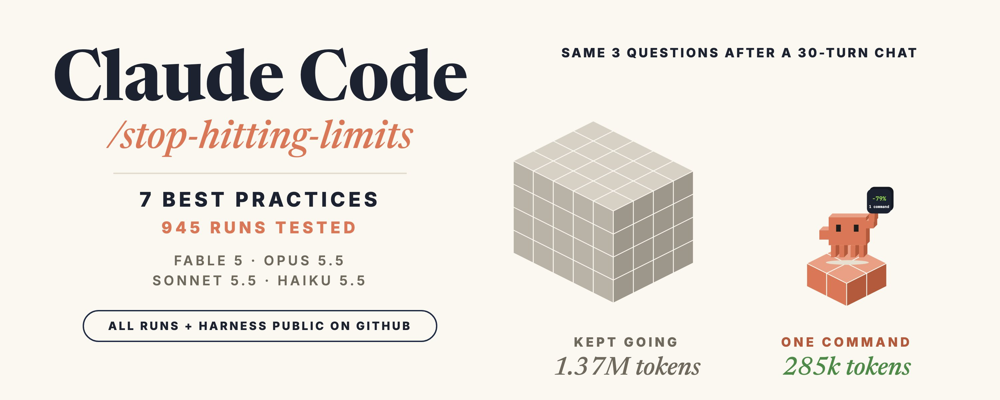

**photo**

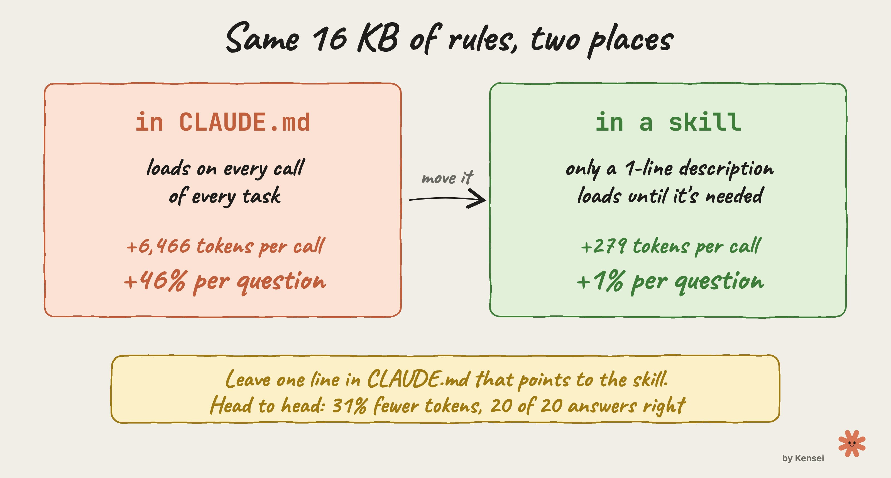

**photo**

**photo**

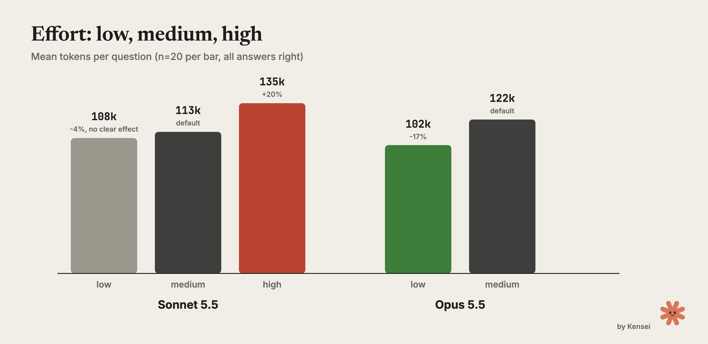

**photo**

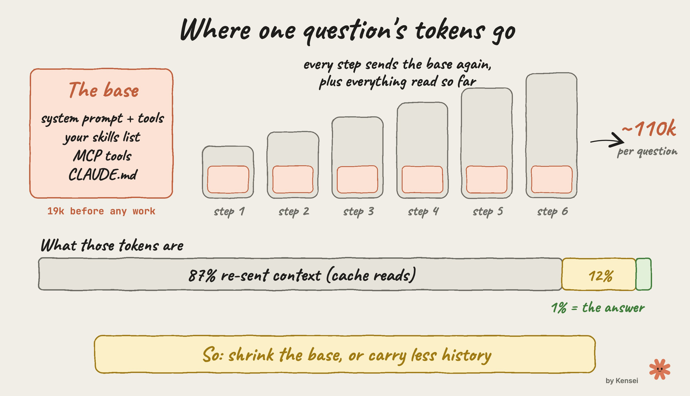

**photo**

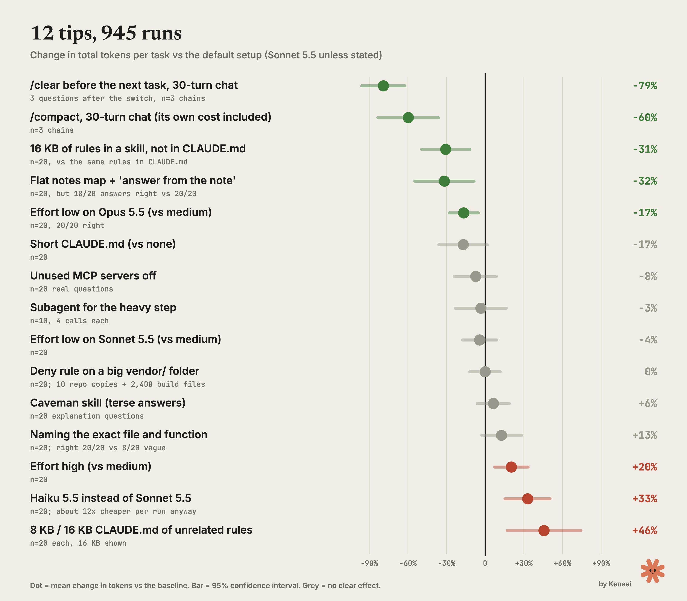

**photo**

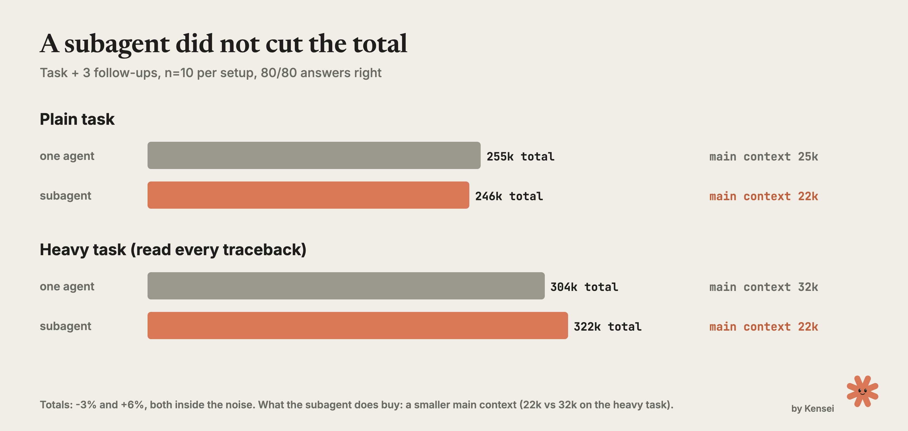

**photo**

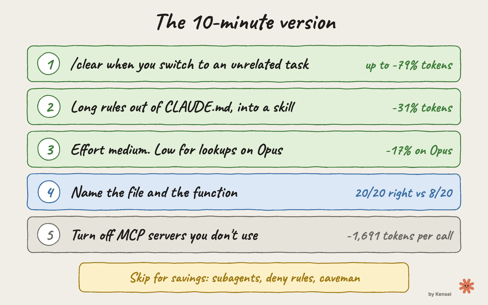

**photo**

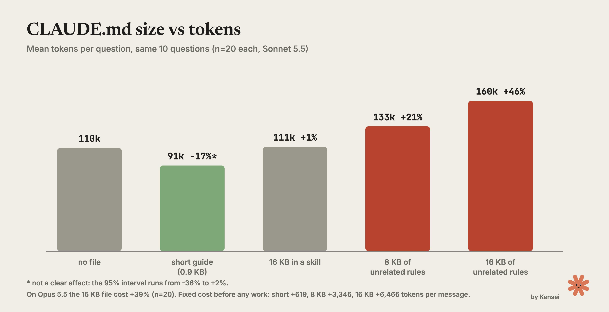

**photo**

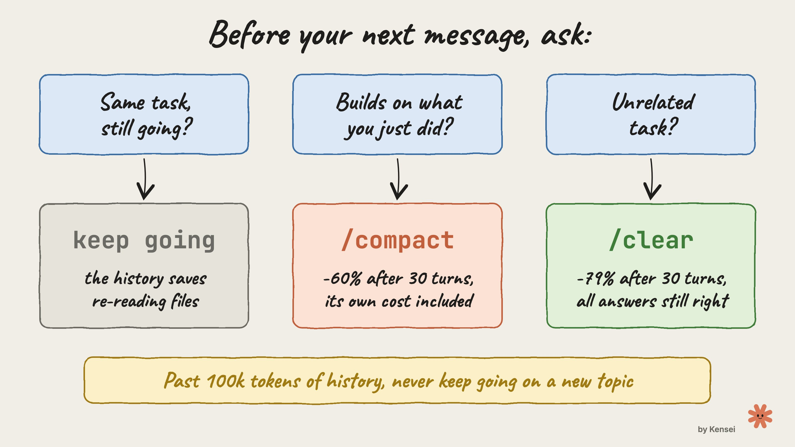

**photo**

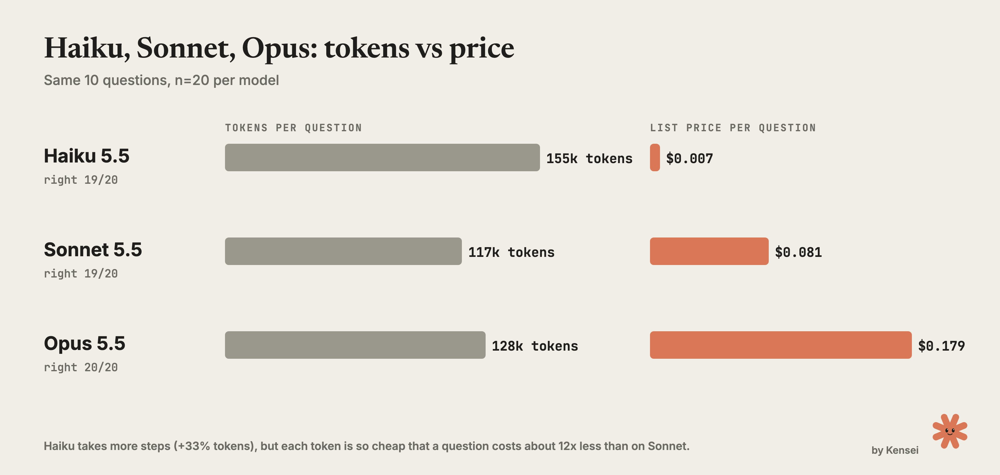

**photo**

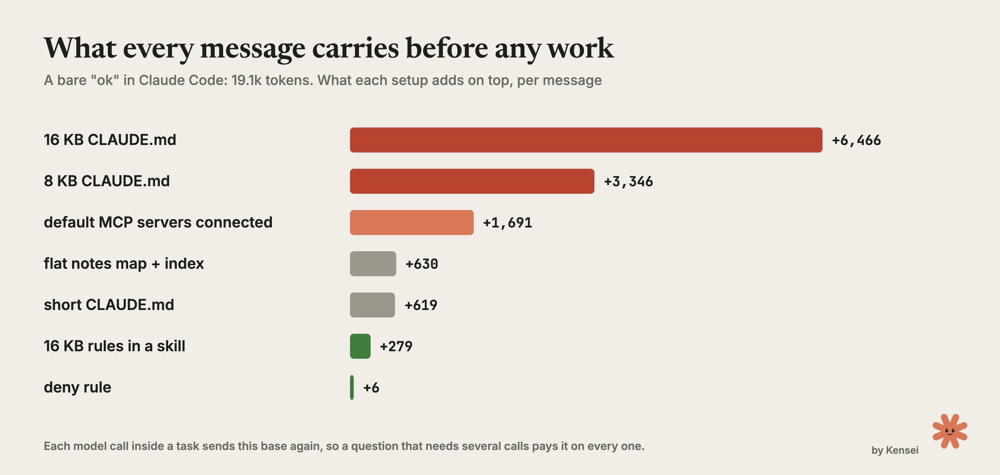

## Post-Text

https://t.co/WUk7rWCYuZ

## Links

- [x.com/i/article/2111…](https://x.com/i/article/2111093932159389696)

## Thread

### 1/3

https://t.co/WUk7rWCYuZ

### 2/3

The raw log of all 945 runs: every prompt, every tool call, every answer and its grade, with the token counts Claude Code reported. Plus the harness and the charts:

https://t.co/ufZ8GFeeuT

python3 verify_runs.py checks every number in the tables against the logs. The README maps each claim in the article to its files.

### 3/3 · Geprüfte Ergänzung des Autors

good read, and the logs back you up. both misses were the same question, in both reps: the session serializer. the model opened only the sessions note, named the right top class, and missed the tag class because the note never listed it. it never opened the source.

the rule I gave it was "answer from the note, open the source only if the note doesn't have it", and the note looked complete enough to trust.

your variant is the right next test: same notes as a map, source required before naming classes. my guess is it fixes that question and keeps a good part of the saving, since the note still points straight at the right file.
