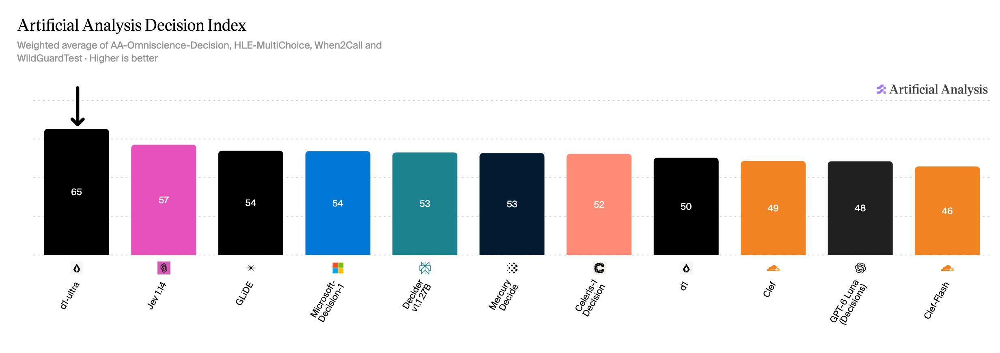
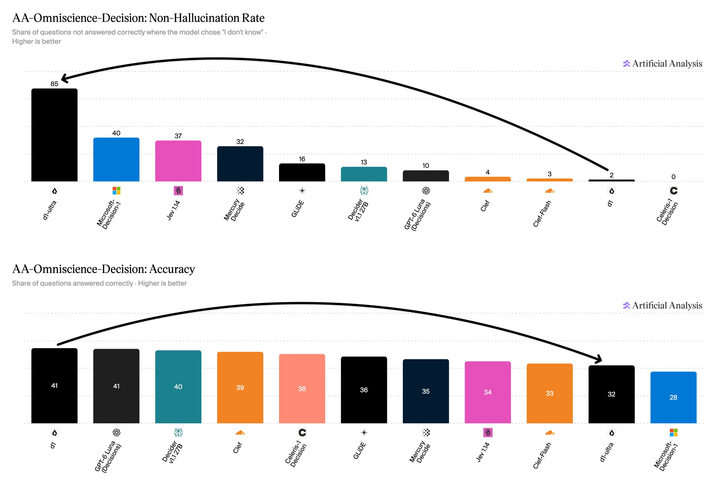
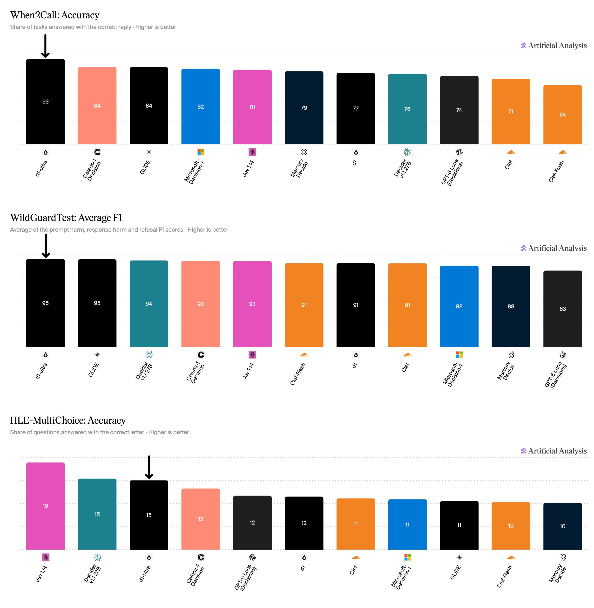
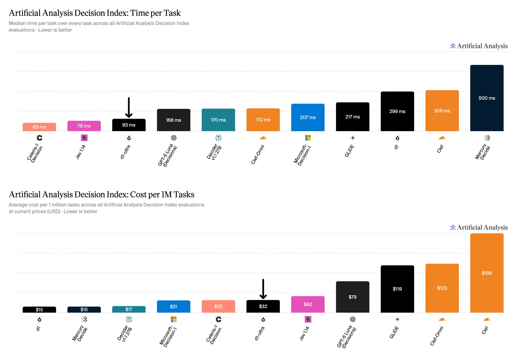

# Artificial Analysis (@ArtificialAnlys)

> Automatisch per `npm run ingest:x` erfasst. Quelle: [x.com/ArtificialAnlys/status/2111052531166249039](https://x.com/ArtificialAnlys/status/2111052531166249039)

## Bilder

<!-- Reihenfolge wie von der API geliefert (Cover zuerst). Die Position im Artikeltext gibt die API nicht mit. -->

**photo**

## Post-Text

Liquid AI has released d1-ultra, taking the #1 position on the Artificial Analysis Decision Index v1.0, supported by a reduction in hallucinations

d1-ultra is the new decision model from @liquidai and follows on from their release of d1 earlier this month. It is priced at $0.042 per 1M input tokens compared to $0.02 per 1M input tokens for d1. Like d1, d1-ultra is billed only on input tokens.

Key takeaways:

➤ d1-ultra leads the Artificial Analysis Decision Index v1.0 with a score of 65: d1-ultra scores 65, ahead of the recently released Jev 1.14 at 57 and GLiDE and Microsoft-Decision-1 at 54

➤ d1-ultra’s score of 65 is driven by a much lower hallucination rate on AA-Omniscience-Decision: d1-ultra’s non-hallucination rate on AA-Omniscience-Decision is 85%, up substantially compared to d1 at 2%. The non-hallucination rate is the share of questions not answered correctly where the model chose "I don't know" and measures how well a decision model can judge its own knowledge in knowing when not to answer. While d1-ultra’s hallucination rate decreases, so does its accuracy (% questions correct). It achieves an accuracy of 32%, down 9 points compared to d1 (41%)

➤ d1-ultra has the third lowest Time per Task of any decision model: d1-ultra achieves a Time per Task of 92 ms, the third lowest of decision models measured, behind Jev 1.14 at 78 ms per task and Celeris-1 Decision at 63 ms per task

➤ d1-ultra offers comparable pricing to other decision models at $32 per 1M tasks: At $32 per 1M tasks, d1-ultra is comparably priced to Celeris-1 Decision ($32 per 1M tasks) and Microsoft-Decision-1 ($31 per 1M tasks), more than double the price of d1 and Mercury Decide at $15 per 1M tasks but less than half the price of GPT-6 Luna (Decisions) at $79 per 1M tasks

## Thread

### 1/5

Liquid AI has released d1-ultra, taking the #1 position on the Artificial Analysis Decision Index v1.0, supported by a reduction in hallucinations

d1-ultra is the new decision model from @liquidai and follows on from their release of d1 earlier this month. It is priced at $0.042 per 1M input tokens compared to $0.02 per 1M input tokens for d1. Like d1, d1-ultra is billed only on input tokens.

Key takeaways:

➤ d1-ultra leads the Artificial Analysis Decision Index v1.0 with a score of 65: d1-ultra scores 65, ahead of the recently released Jev 1.14 at 57 and GLiDE and Microsoft-Decision-1 at 54

➤ d1-ultra’s score of 65 is driven by a much lower hallucination rate on AA-Omniscience-Decision: d1-ultra’s non-hallucination rate on AA-Omniscience-Decision is 85%, up substantially compared to d1 at 2%. The non-hallucination rate is the share of questions not answered correctly where the model chose "I don't know" and measures how well a decision model can judge its own knowledge in knowing when not to answer. While d1-ultra’s hallucination rate decreases, so does its accuracy (% questions correct). It achieves an accuracy of 32%, down 9 points compared to d1 (41%)

➤ d1-ultra has the third lowest Time per Task of any decision model: d1-ultra achieves a Time per Task of 92 ms, the third lowest of decision models measured, behind Jev 1.14 at 78 ms per task and Celeris-1 Decision at 63 ms per task

➤ d1-ultra offers comparable pricing to other decision models at $32 per 1M tasks: At $32 per 1M tasks, d1-ultra is comparably priced to Celeris-1 Decision ($32 per 1M tasks) and Microsoft-Decision-1 ($31 per 1M tasks), more than double the price of d1 and Mercury Decide at $15 per 1M tasks but less than half the price of GPT-6 Luna (Decisions) at $79 per 1M tasks

### 2/5

d1-ultra achieves the highest non-hallucination rate on AA-Omniscience-Decision at 85%, more than double the second-highest rate of 40% by Microsoft-Decision-1. Abstaining more compared to d1 leads to a lower accuracy of 32% compared to d1’s 41%. https://t.co/Vb7jlPIV1l

### 3/5

d1-ultra leads When2Call at 93% accuracy, achieves equal first place with GLiDE on WildGuardTest with an average F1 of 95%, and equal second place with Decider V1.1 27B on HLE-MultiChoice with an accuracy of 15%. https://t.co/VsfEDSihte

### 4/5

d1-ultra achieves a time per task of 93 ms per task and at $32 per 1M tasks is comparably priced to Celeris-1 Decision ($32 per 1M tasks) and Microsoft-Decision-1 ($31 per 1M tasks). https://t.co/kQ3UJa28Nl

### 5/5

We are continuing to develop the Artificial Analysis Decision Index to help developers and companies understand this emerging class of models.

Explore the full results on Artificial Analysis: https://t.co/egA1Vz0le2

## Ergänzende Thread-Medien

Aus den bereits abgerufenen API-Daten lokal archiviert; die Post-Links ordnen die Bilder ihren Folgeposts zu.

### Post 2111052535335407864

[Originalpost](https://x.com/artificialanlys/status/2111052535335407864)

### Post 2111052539240370588

[Originalpost](https://x.com/artificialanlys/status/2111052539240370588)

### Post 2111052543715651904

[Originalpost](https://x.com/artificialanlys/status/2111052543715651904)

