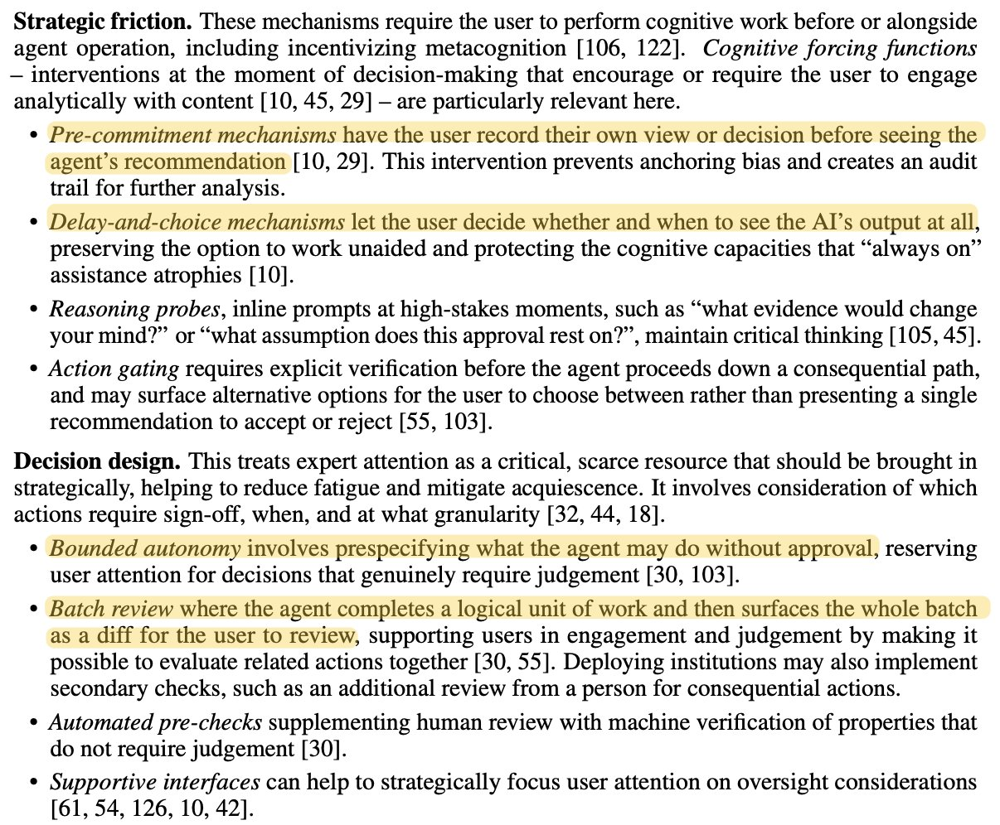
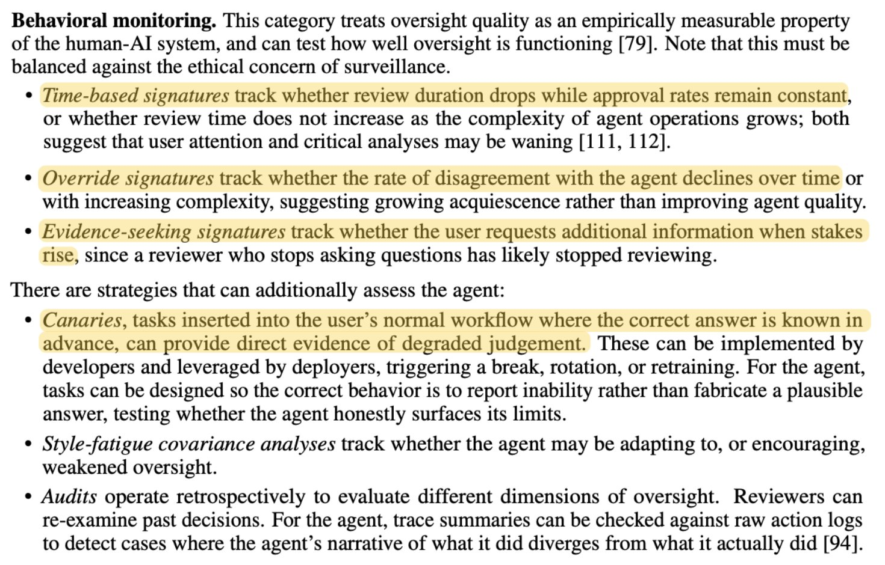

# Rachel Thomas (@math_rachel)

> Automatisch per `npm run ingest:x` erfasst. Quelle: [x.com/math_rachel/status/2111238648188584306](https://x.com/math_rachel/status/2111238648188584306)

## Post-Text

Human-in-the-loop (HITL) is widely recommended for oversight &amp; safety, yet current AI agent design requires humans to keep up with unreasonable volume &amp; complexity, promotes fatigue &amp; disengagement, and degrades the very humans skills it relies on.  1/ https://t.co/lvRAErbp9P

## Links

- [arxiv.org/abs/2608.23642](https://arxiv.org/abs/2608.23642)

## Thread

### 1/10

Human-in-the-loop (HITL) is widely recommended for oversight &amp; safety, yet current AI agent design requires humans to keep up with unreasonable volume &amp; complexity, promotes fatigue &amp; disengagement, and degrades the very humans skills it relies on.  1/ https://t.co/lvRAErbp9P

### 2/10

"Current AI agent design centers the agent: Systems are built to surface their own processing to the user on their own terms. 

"Effective oversight requires centering the user: They must be able to understand and maintain focus"  2/

-- @mmitchell_ai @samirpassi @evijit

### 3/10

With the current design of AI systems, "users approve plans they have not meaningfully reviewed, accept rationales they have not independently evaluated, &amp; certify actions whose consequences they can't anticipate." 3/

### 4/10

Overseers of AI systems [that were designed with humans as an afterthough] experience: deskilling, intuition rust, reduced vigilance, overreliance, cognitive dependence, cognitive debt, or cognitive surrender.  

This degrades the capacities oversight requires. 4/

### 5/10

"In the limit, this is not human oversight at all: It is a superficial actor in a system they cannot meaningfully penetrate... [We need to treat] cognitive support for human overseers as a first-class concern in AI agent system development, on par with capability."  5/

### 6/10

@ksouth Lying implies that AI models have morality or act with moral intention. Rather, AI is trained to produce text that sounds plausible, and the training process tends to reward "fluent, agreeable, and confidence-inducing outputs".  1/

### 7/10

@ksouth The paper argues we'll always need human oversight of AI, bc "'perfect' agents are neither realistic nor desirable: Failures are fundamental to acting in human worlds, and a direct result of systems that are flexible to different users’ (potentially conflicting) needs" 2/

### 8/10

We will always need human oversight of AI, since " 'perfect' agents are neither realistic nor desirable: Failures are fundamental to acting in human worlds, and a direct result of systems that are flexible to different users’ (potentially conflicting) needs" 6/

### 9/10

I recommend reading the paper in full.  The authors offer 20+ strategies towards addressing HITL issues, spanning strategic friction, decision design, behavioral monitoring, trainings, role design, &amp; more. 7/ https://t.co/B3nIQb9B3I

### 10/10

Strategies to assess how well human-in-the-loop oversight is functioning include: having humans pre-register their views before seeing agent recommendation, tracking if the rate of disagreement declines over time, "canaries" (tasks with known answers), &amp; batch review. 8/ https://t.co/V7j95VDcM2

## Ergänzende Thread-Medien

Aus den bereits abgerufenen API-Daten lokal archiviert; die Post-Links ordnen die Bilder ihren Folgeposts zu.

### Post 2111580712587661341

[Originalpost](https://x.com/math_rachel/status/2111580712587661341)

### Post 2111581688765829153

[Originalpost](https://x.com/math_rachel/status/2111581688765829153)

