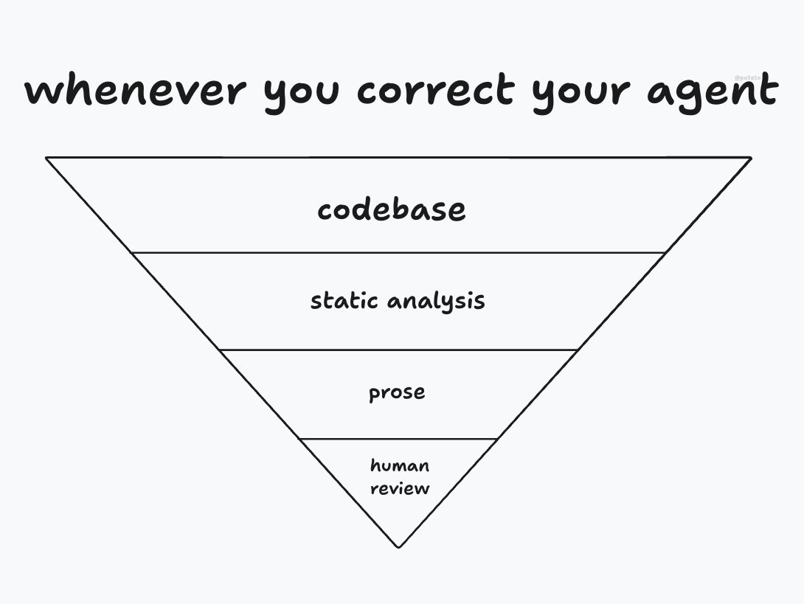

# lauren (@poteto)

> Automatisch per `npm run ingest:x` erfasst. Quelle: [x.com/poteto/status/2111133080526495985](https://x.com/poteto/status/2111133080526495985)

## Bilder

<!-- Reihenfolge wie von der API geliefert (Cover zuerst). Die Position im Artikeltext gibt die API nicht mit. -->

**photo**

## Post-Text

how do you trust your agents' work more? copy this post/link and give it to your @bot or agent!

1. codebase improvements: this is just good software engineering - better architecture, stronger types and invariants, clear boundaries. agents love to copy what exists and take the shortest path, so make the easy thing the right thing. categorically eliminate problems through code and you won't need to think about it again.
2. static analysis: lint rules, tests, CI, verification (eg TLA+). very token efficient ways to catch issues ahead of time.
3. prose: comments, rules, AGENTS.md, skills - anything that can't be enforced and requires agent judgment. use it minimally, but do use /create-verification-skill.
4. human review: the hardest to scale. at the rate agents land code, it's pretty much impossible to thoroughly review every PR, so spend that effort on the highest leverage point, designing an environment where agents do the right thing by default.

this forms an inverse pyramid: you want most of your effort at the top, least at the bottom. codebase improvements are deterministic, making it more token efficient, and lets you sleep more soundly at night.

install https://t.co/u9xIlN3eN0 and create a new Project:
1. look through my slack/chat messages and code review comments where i've given feedback on PRs, code, architecture
2. use /recall on my past transcripts to learn how i steer agents
3. /poteto-mode use /correct and /architect on past commits to find the most common pitfalls agents fall into, then propose a plan to rearchitect the code i own so it's more agent friendly. answer open questions with prototyping rather than defer to me, and back the plan with real data. 
4. before you begin, use /sharpen + /in-your-own-words and confirm this prompt with me

## Links

- [github.com/cursor/plugins…](https://github.com/cursor/plugins/tree/main/pstack)
