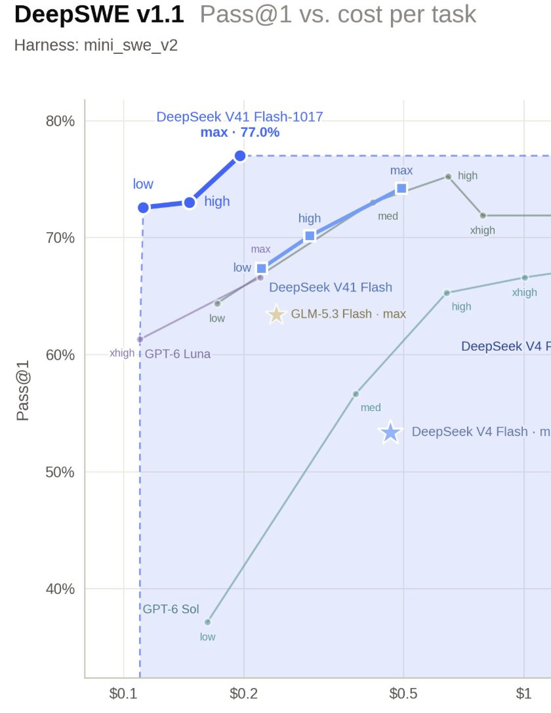
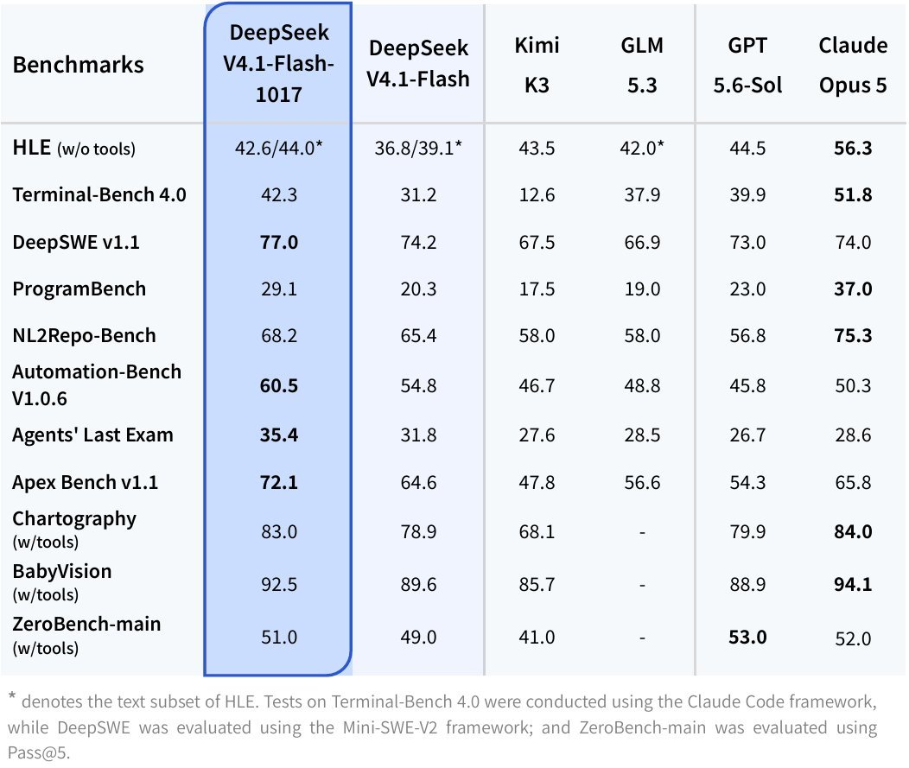

# Chubby♨️ (@kimmonismus)

> Automatisch per `npm run ingest:x` erfasst. Quelle: [x.com/kimmonismus/status/2111385805449048181](https://x.com/kimmonismus/status/2111385805449048181)

## Bilder

<!-- Reihenfolge wie von der API geliefert (Cover zuerst). Die Position im Artikeltext gibt die API nicht mit. -->

**photo**

**photo**

## Post-Text

DeepSeek V4.1 Flash‑1017 beats GPT‑5.6 Sol and Opus 5 on selected coding and agent benchmarks, at much lower token prices. Super duper impressive!

API pricing per million tokens, uncached input / output:

- DeepSeek Flash‑1017: $0.15 / $0.60 off-peak; $0.30 / $1.20 peak.
- GPT‑6 Luna: $0.10 / $0.50.
- GPT‑5.6 Sol: $4 / $20.
- Claude Opus 5: $5 / $25.

Luna is cheaper per uncached token. Flash is substantially cheaper than Sol and Opus, while beating them on some of DeepSeek’s reported tests.

Key benchmarks:
- DeepSWE: 77.0 vs 74.2 for the previous Flash, 73.0 for GPT‑5.6 Sol and 74.0 for Opus 5.
- Terminal-Bench 4.0: 42.3 vs 31.2 for the previous Flash, 39.9 for GPT‑5.6 Sol and 51.8 for Opus 5.
- Automation-Bench: 60.5 vs 54.8 for the previous Flash, 45.8 for GPT‑5.6 Sol and 50.3 for Opus 5.

DeepSeek also reports faster task completion and shorter outputs. Open weights under MIT, with a 1M-token context window.

So yeah, super impressive price-performance launch!

## Links

- [pic.x.com/ewtZvuZuzn](https://x.com/kimmonismus/status/2111385805449048181/photo/1)
- [x.com/deepseek_ai/st…](https://twitter.com/deepseek_ai/status/2111375640717033777)

## Thread

### 1/1

DeepSeek V4.1 Flash‑1017 beats GPT‑5.6 Sol and Opus 5 on selected coding and agent benchmarks, at much lower token prices. Super duper impressive!

API pricing per million tokens, uncached input / output:

- DeepSeek Flash‑1017: $0.15 / $0.60 off-peak; $0.30 / $1.20 peak.
- GPT‑6 Luna: $0.10 / $0.50.
- GPT‑5.6 Sol: $4 / $20.
- Claude Opus 5: $5 / $25.

Luna is cheaper per uncached token. Flash is substantially cheaper than Sol and Opus, while beating them on some of DeepSeek’s reported tests.

Key benchmarks:
- DeepSWE: 77.0 vs 74.2 for the previous Flash, 73.0 for GPT‑5.6 Sol and 74.0 for Opus 5.
- Terminal-Bench 4.0: 42.3 vs 31.2 for the previous Flash, 39.9 for GPT‑5.6 Sol and 51.8 for Opus 5.
- Automation-Bench: 60.5 vs 54.8 for the previous Flash, 45.8 for GPT‑5.6 Sol and 50.3 for Opus 5.

DeepSeek also reports faster task completion and shorter outputs. Open weights under MIT, with a 1M-token context window.

So yeah, super impressive price-performance launch!
