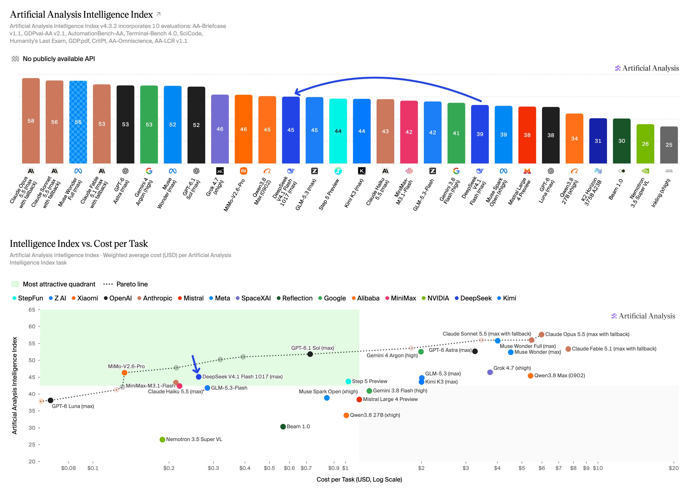
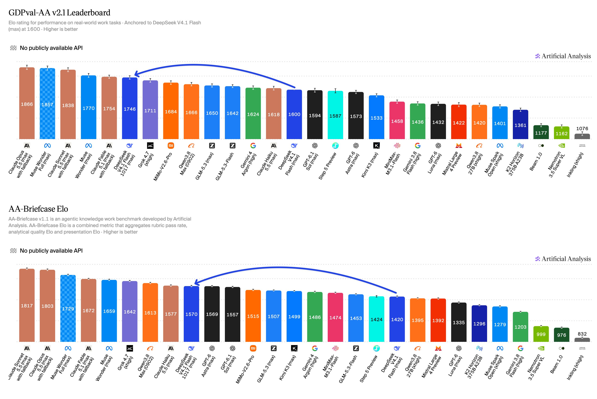
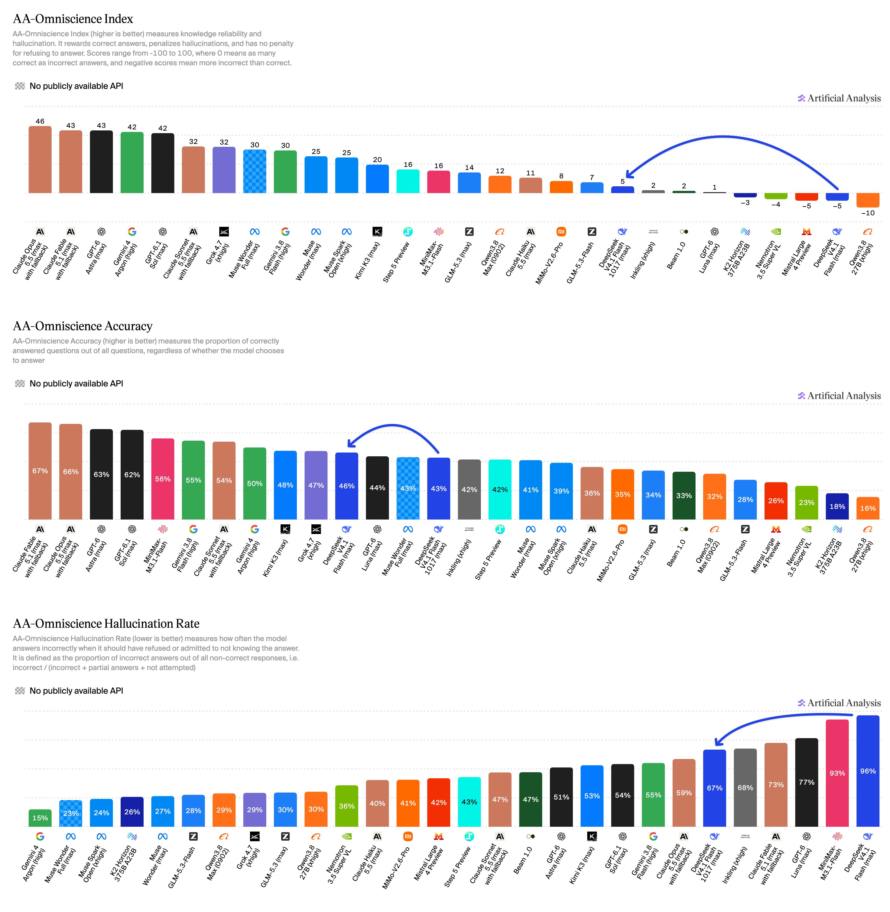
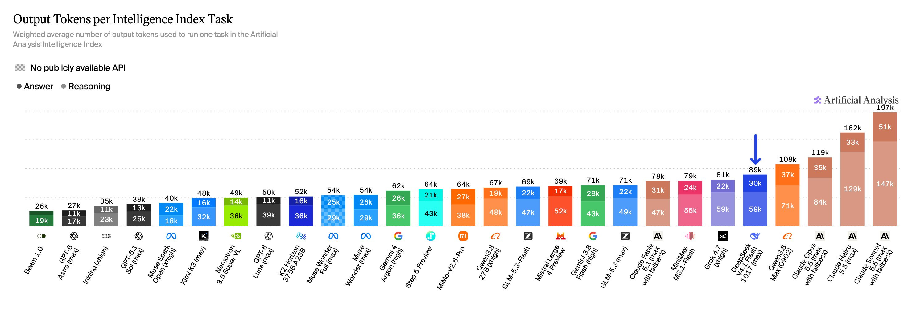
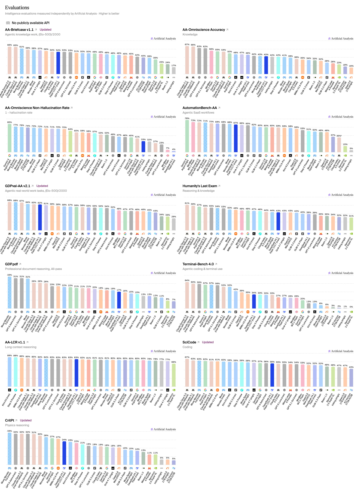

# Artificial Analysis (@ArtificialAnlys)

> Automatisch per `npm run ingest:x` erfasst. Quelle: [x.com/ArtificialAnlys/status/2112218661432000694](https://x.com/ArtificialAnlys/status/2112218661432000694)

## Bilder

<!-- Reihenfolge wie von der API geliefert (Cover zuerst). Die Position im Artikeltext gibt die API nicht mit. -->

**photo**

## Post-Text

DeepSeek V4.1 Flash 1017 scores 45 on the Artificial Analysis Intelligence Index, improving on DeepSeek V4.1 Flash by 6 points, and is the equal #2 open-weights model

@deepseek_ai has released DeepSeek V4.1 Flash 1017, an update on their flagship model DeepSeek V4.1 Flash. On the first-party API, DeepSeek V4.1 Flash 1017 is priced at $0.30 per 1M input tokens and $1.20 per 1M output tokens during peak hours, with off-peak pricing half of peak rates, the same pricing as DeepSeek V4.1 Flash.

Key results:
➤ DeepSeek V4.1 Flash 1017 makes gains in agentic capabilities, knowledge and scientific reasoning. DeepSeek V4.1 Flash 1017’s Elo rating on GDPval-AA v2.1 is 1746, an increase of 146 points from DeepSeek V4.1 Flash’s rating of 1600. On AA-Briefcase v1.1, its Elo rating increases by 150 points from 1420 to 1570. On AA-Omniscience, its non-hallucination rate is 33%, a 29-point improvement from DeepSeek V4.1 Flash’s 4%, while seeing an improvement in accuracy from 43% to 46%, pushing its overall AA-Omniscience Index score from -5 to +5. On CritPt, DeepSeek V4.1 Flash 1017 scores 24%, up from 14% for DeepSeek V4.1 Flash.

➤ DeepSeek V4.1 Flash 1017 is now the #2 open-weights model alongside GLM-5.3. With a score of 45 on the Artificial Analysis Intelligence Index, DeepSeek V4.1 Flash 1017 is behind MiMo-V2.6-Pro by only 1 point and ahead of other open-source models like Step 5 Preview and Kimi K3 (both at 44).

➤ With a Cost per Task of $0.26, DeepSeek V4.1 Flash 1017 sits in the most attractive quadrant of Capability vs. Cost. With a Cost per Task of $0.26 and Intelligence Index score of 45, DeepSeek V4.1 Flash 1017 compares favorably to GLM-5.3-Flash at $0.28 per task and a score of 42. At the same time, MiMo-V2.6-Pro (46) at $0.13 per task and GPT-6.1 Sol (medium, 48) at $0.21 per task both offer higher capability at a lower Cost per Task.

Additional model details:
➤ Context window: 1M tokens (equivalent to DeepSeek V4.1 Flash)
➤ Pricing: $0.30 per 1M input tokens and $1.20 per 1M output tokens, unchanged from DeepSeek V4.1 Flash. Cache hit price of $0.006 per 1M tokens, a 98% discount
➤ Size: 552B total parameters (16B active)
➤ License: MIT
➤ Providers: Available through DeepSeek’s first-party API, @FireworksAI_HQ , @baseten, @DeepInfra , @wafer_ai , @Cloudflare and others

## Thread

### 1/6

DeepSeek V4.1 Flash 1017 scores 45 on the Artificial Analysis Intelligence Index, improving on DeepSeek V4.1 Flash by 6 points, and is the equal #2 open-weights model

@deepseek_ai has released DeepSeek V4.1 Flash 1017, an update on their flagship model DeepSeek V4.1 Flash. On the first-party API, DeepSeek V4.1 Flash 1017 is priced at $0.30 per 1M input tokens and $1.20 per 1M output tokens during peak hours, with off-peak pricing half of peak rates, the same pricing as DeepSeek V4.1 Flash.

Key results:
➤ DeepSeek V4.1 Flash 1017 makes gains in agentic capabilities, knowledge and scientific reasoning. DeepSeek V4.1 Flash 1017’s Elo rating on GDPval-AA v2.1 is 1746, an increase of 146 points from DeepSeek V4.1 Flash’s rating of 1600. On AA-Briefcase v1.1, its Elo rating increases by 150 points from 1420 to 1570. On AA-Omniscience, its non-hallucination rate is 33%, a 29-point improvement from DeepSeek V4.1 Flash’s 4%, while seeing an improvement in accuracy from 43% to 46%, pushing its overall AA-Omniscience Index score from -5 to +5. On CritPt, DeepSeek V4.1 Flash 1017 scores 24%, up from 14% for DeepSeek V4.1 Flash.

➤ DeepSeek V4.1 Flash 1017 is now the #2 open-weights model alongside GLM-5.3. With a score of 45 on the Artificial Analysis Intelligence Index, DeepSeek V4.1 Flash 1017 is behind MiMo-V2.6-Pro by only 1 point and ahead of other open-source models like Step 5 Preview and Kimi K3 (both at 44).

➤ With a Cost per Task of $0.26, DeepSeek V4.1 Flash 1017 sits in the most attractive quadrant of Capability vs. Cost. With a Cost per Task of $0.26 and Intelligence Index score of 45, DeepSeek V4.1 Flash 1017 compares favorably to GLM-5.3-Flash at $0.28 per task and a score of 42. At the same time, MiMo-V2.6-Pro (46) at $0.13 per task and GPT-6.1 Sol (medium, 48) at $0.21 per task both offer higher capability at a lower Cost per Task.

Additional model details:
➤ Context window: 1M tokens (equivalent to DeepSeek V4.1 Flash)
➤ Pricing: $0.30 per 1M input tokens and $1.20 per 1M output tokens, unchanged from DeepSeek V4.1 Flash. Cache hit price of $0.006 per 1M tokens, a 98% discount
➤ Size: 552B total parameters (16B active)
➤ License: MIT
➤ Providers: Available through DeepSeek’s first-party API, @FireworksAI_HQ , @baseten, @DeepInfra , @wafer_ai , @Cloudflare and others

### 2/6

DeepSeek V4.1 Flash 1017’s Elo rating on GDPval-AA v2.1 is 1746, an increase of 146 points from DeepSeek V4.1 Flash’s rating of 1600. On AA-Briefcase v1.1, its Elo rating increases by 150 points from 1420 to 1570. https://t.co/MYdx1UTjeu

### 3/6

On AA-Omniscience, DeepSeek V4.1 Flash 1017’s non-hallucination rate is 33%, a 29 point improvement from DeepSeek V4.1 Flash, while seeing an improvement in accuracy from 43% to 46%, pushing its overall AA-Omniscience Index score from -5 to +5. https://t.co/ZoNkgif3oY

### 4/6

DeepSeek V4.1 Flash 1017 uses 89K output tokens per Intelligence Index task. https://t.co/ZYHyMg9gws

### 5/6

Full results for DeepSeek V4.1 Flash 1017 across the Artificial Analysis Intelligence Index v4.3.2 evaluations: https://t.co/P3yztnyUMZ

### 6/6

See Artificial Analysis for further details and benchmarks: https://t.co/drwVdEDlkz

## Ergänzende Thread-Medien

Beim Ingest nachträglich aus den bereits abgerufenen API-Daten lokal archiviert. Die Post-Links ordnen die Bilder ihren Folgeposts zu.

### Post 2112218664225444072

[Originalpost](https://x.com/ArtificialAnlys/status/2112218664225444072)

### Post 2112218666637152762

[Originalpost](https://x.com/ArtificialAnlys/status/2112218666637152762)

### Post 2112218669749342322

[Originalpost](https://x.com/ArtificialAnlys/status/2112218669749342322)

### Post 2112218671901004164

[Originalpost](https://x.com/ArtificialAnlys/status/2112218671901004164)

