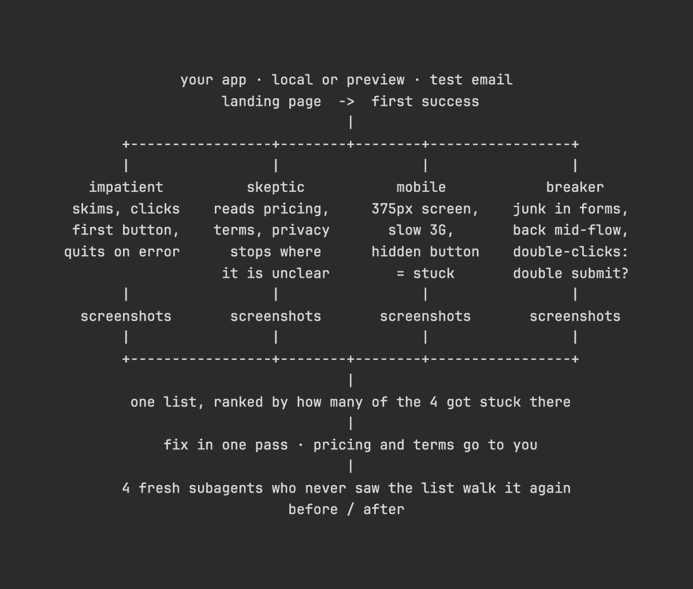

# Vox (@Voxyz_ai)

> Automatisch per `npm run ingest:x` erfasst. Quelle: [x.com/Voxyz_ai/status/2112302775547679169](https://x.com/Voxyz_ai/status/2112302775547679169)

## Bilder

<!-- Reihenfolge wie von der API geliefert (Cover zuerst). Die Position im Artikeltext gibt die API nicht mit. -->

**photo**

## Post-Text

Claude Code tip: before you launch, have Opus 5.5 𝘀𝗲𝗻𝗱 𝟰 𝘀𝘂𝗯𝗮𝗴𝗲𝗻𝘁𝘀 𝗶𝗻 𝗮𝘀 𝗳𝗶𝗿𝘀𝘁-𝘁𝗶𝗺𝗲 𝘂𝘀𝗲𝗿𝘀, from opening your landing page all the way to their first success.
Wherever one of them gets confused, stuck or wants to close the tab, 𝗶𝘁 𝗹𝗮𝗻𝗱𝘀 𝗶𝗻 𝗼𝗻𝗲 𝘁𝗮𝗯𝗹𝗲 𝘄𝗶𝘁𝗵 𝗮 𝘀𝗰𝗿𝗲𝗲𝗻𝘀𝗵𝗼𝘁:

→ The impatient one: skims, clicks the first button, closes the tab at the first error
→ The skeptic: reads pricing, terms and the privacy policy before signing up, and stops at anything unclear
→ The phone user: a 375px screen on slow 3G; a hidden button or sideways scrolling counts as stuck
→ The breaker: junk in every form, hits back halfway, double-clicks buttons to see if anything submits twice

The table is ranked by how many of them hit each issue. Fix what can be fixed in one pass, then send in 𝟰 𝗳𝗿𝗲𝘀𝗵 𝘀𝘂𝗯𝗮𝗴𝗲𝗻𝘁𝘀 𝘄𝗵𝗼 𝗻𝗲𝘃𝗲𝗿 𝘀𝗮𝘄 𝘁𝗵𝗲 𝘁𝗮𝗯𝗹𝗲 to walk it again and see if anyone still gets stuck.

To get that table before you launch, send this to Claude Code 👇
"My product is about to launch. Help me find where my first users will get stuck. First check that you can use a browser MCP; if you can't, stop and give me the command to install the Playwright MCP. Work out from the code which step counts as 'first success' and put it at the top of the report. Then send 4 subagents in as first-time users, taking turns with the browser, one finishing before the next starts: an impatient one who skims, clicks the first button and closes the tab at the first error; a skeptic who reads pricing, terms and the privacy policy before signing up and stops wherever something is unclear; a phone user on a 375px screen and slow 3G (if you can't throttle the network, say so); and a breaker who puts junk in forms, hits back halfway and double-clicks buttons. Each one goes from the landing page to first success. Screenshot every spot where they get confused, stuck or want to close the tab, save it in qa/first-users/, and note the step, what they saw and what they were trying to do. At the end, each one says whether they'd come back and how many clicks it took to succeed. Run only on local or preview, sign up with a test email, and use test mode for payments. Count issues at the same spot on the same page as one, ranked by how many users hit it. Pricing, terms and privacy issues: just write them down for me. Fix everything else in one pass, then send 4 new subagents who haven't seen the issue list through with the same setup, and give me a before/after comparison."

## Links

- [pic.x.com/IzKz8FMIke](https://x.com/Voxyz_ai/status/2112302775547679169/photo/1)
- [x.com/Voxyz_ai/statu…](https://twitter.com/Voxyz_ai/status/2111079716832886886)

## Thread

### 1/1

Claude Code tip: before you launch, have Opus 5.5 𝘀𝗲𝗻𝗱 𝟰 𝘀𝘂𝗯𝗮𝗴𝗲𝗻𝘁𝘀 𝗶𝗻 𝗮𝘀 𝗳𝗶𝗿𝘀𝘁-𝘁𝗶𝗺𝗲 𝘂𝘀𝗲𝗿𝘀, from opening your landing page all the way to their first success.
Wherever one of them gets confused, stuck or wants to close the tab, 𝗶𝘁 𝗹𝗮𝗻𝗱𝘀 𝗶𝗻 𝗼𝗻𝗲 𝘁𝗮𝗯𝗹𝗲 𝘄𝗶𝘁𝗵 𝗮 𝘀𝗰𝗿𝗲𝗲𝗻𝘀𝗵𝗼𝘁:

→ The impatient one: skims, clicks the first button, closes the tab at the first error
→ The skeptic: reads pricing, terms and the privacy policy before signing up, and stops at anything unclear
→ The phone user: a 375px screen on slow 3G; a hidden button or sideways scrolling counts as stuck
→ The breaker: junk in every form, hits back halfway, double-clicks buttons to see if anything submits twice

The table is ranked by how many of them hit each issue. Fix what can be fixed in one pass, then send in 𝟰 𝗳𝗿𝗲𝘀𝗵 𝘀𝘂𝗯𝗮𝗴𝗲𝗻𝘁𝘀 𝘄𝗵𝗼 𝗻𝗲𝘃𝗲𝗿 𝘀𝗮𝘄 𝘁𝗵𝗲 𝘁𝗮𝗯𝗹𝗲 to walk it again and see if anyone still gets stuck.

To get that table before you launch, send this to Claude Code 👇
"My product is about to launch. Help me find where my first users will get stuck. First check that you can use a browser MCP; if you can't, stop and give me the command to install the Playwright MCP. Work out from the code which step counts as 'first success' and put it at the top of the report. Then send 4 subagents in as first-time users, taking turns with the browser, one finishing before the next starts: an impatient one who skims, clicks the first button and closes the tab at the first error; a skeptic who reads pricing, terms and the privacy policy before signing up and stops wherever something is unclear; a phone user on a 375px screen and slow 3G (if you can't throttle the network, say so); and a breaker who puts junk in forms, hits back halfway and double-clicks buttons. Each one goes from the landing page to first success. Screenshot every spot where they get confused, stuck or want to close the tab, save it in qa/first-users/, and note the step, what they saw and what they were trying to do. At the end, each one says whether they'd come back and how many clicks it took to succeed. Run only on local or preview, sign up with a test email, and use test mode for payments. Count issues at the same spot on the same page as one, ranked by how many users hit it. Pricing, terms and privacy issues: just write them down for me. Fix everything else in one pass, then send 4 new subagents who haven't seen the issue list through with the same setup, and give me a before/after comparison."
