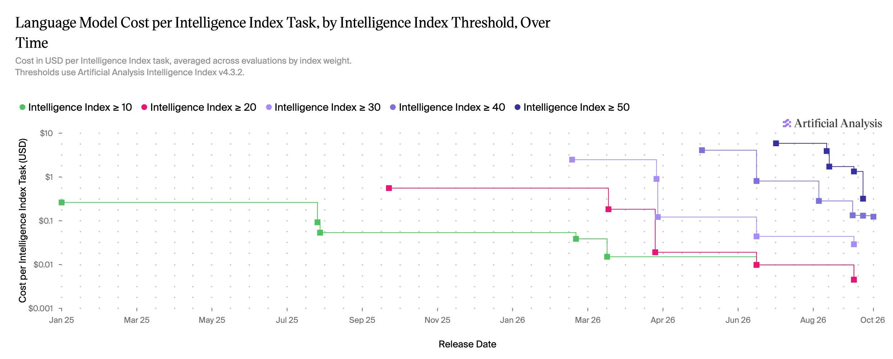

# Artificial Analysis (@ArtificialAnlys)

> Automatisch per `npm run ingest:x` erfasst. Quelle: [x.com/ArtificialAnlys/status/2112582116651466965](https://x.com/ArtificialAnlys/status/2112582116651466965)

## Bilder

<!-- Reihenfolge wie von der API geliefert (Cover zuerst). Die Position im Artikeltext gibt die API nicht mit. -->

**animated_gif**

## Post-Text

Once Intelligence Index thresholds are reached, the cost of accessing that level of intelligence reduces fast. Reaching 30 on the Intelligence Index now costs 86x less per task than when first reached

Existing intelligence thresholds have become cheaper to reach, while the highest-scoring model costs more than the highest-scoring from one year ago.

Key takeaways:

➤ Reaching 20 is 123x cheaper than ~13 months ago; reaching 40 is 33x cheaper than ~5 months ago: measured models first reached these thresholds in September 2025 and May 2026.

➤ GPT-6 Luna (high) reaches 30 for $0.03/task: @OpenAI's model is 86x cheaper per task than @AnthropicAI's Claude Sonnet 4.6 (Adaptive Reasoning, Max Effort), which first reached 30 in February 2026 at $2.49/task.

➤ Claude Haiku 5.5 (xhigh) is now cheapest to reach 40: it scores 41 at $0.12/task, 5% below GPT-6.1 Sol (low).

➤ Reaching 50 is 18x cheaper than when first reached: GPT-6.1 Sol (high) reaches it for $0.32/task.

➤ The highest measured score has risen from 21 to 58 in a year, at ~11x the cost: Claude Opus 5.5 (Adaptive Reasoning, Max Effort, Default Fallback) costs $5.98/task.

As of October 20, 2026, using measured v4.3.2 results and current prices, including for historical models.

## Thread

### 1/3

Once Intelligence Index thresholds are reached, the cost of accessing that level of intelligence reduces fast. Reaching 30 on the Intelligence Index now costs 86x less per task than when first reached

Existing intelligence thresholds have become cheaper to reach, while the highest-scoring model costs more than the highest-scoring from one year ago.

Key takeaways:

➤ Reaching 20 is 123x cheaper than ~13 months ago; reaching 40 is 33x cheaper than ~5 months ago: measured models first reached these thresholds in September 2025 and May 2026.

➤ GPT-6 Luna (high) reaches 30 for $0.03/task: @OpenAI's model is 86x cheaper per task than @AnthropicAI's Claude Sonnet 4.6 (Adaptive Reasoning, Max Effort), which first reached 30 in February 2026 at $2.49/task.

➤ Claude Haiku 5.5 (xhigh) is now cheapest to reach 40: it scores 41 at $0.12/task, 5% below GPT-6.1 Sol (low).

➤ Reaching 50 is 18x cheaper than when first reached: GPT-6.1 Sol (high) reaches it for $0.32/task.

➤ The highest measured score has risen from 21 to 58 in a year, at ~11x the cost: Claude Opus 5.5 (Adaptive Reasoning, Max Effort, Default Fallback) costs $5.98/task.

As of October 20, 2026, using measured v4.3.2 results and current prices, including for historical models.

### 2/3

Reaching 40 or 50 became at least 50% cheaper within six weeks of first being reached. From the first measured model at each threshold, cost per task fell by at least 50% in 197 days for 10, 169 for 20, 65 for 30, 42 for 40, and 41 for 50.

### 3/3

Explore the cost of intelligence over time:

https://t.co/p7VTV70CnD

## Ergänzende Thread-Medien

Beim Ingest nachträglich aus den bereits abgerufenen API-Daten lokal archiviert. Die Post-Links ordnen die Bilder ihren Folgeposts zu.

### Post 2112582117100331138

[Originalpost](https://x.com/ArtificialAnlys/status/2112582117100331138)

