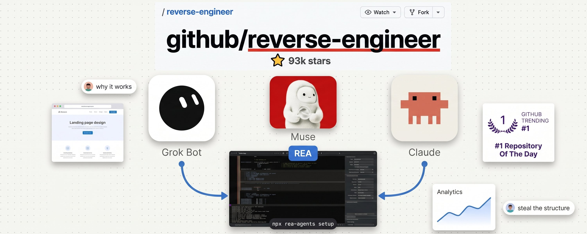
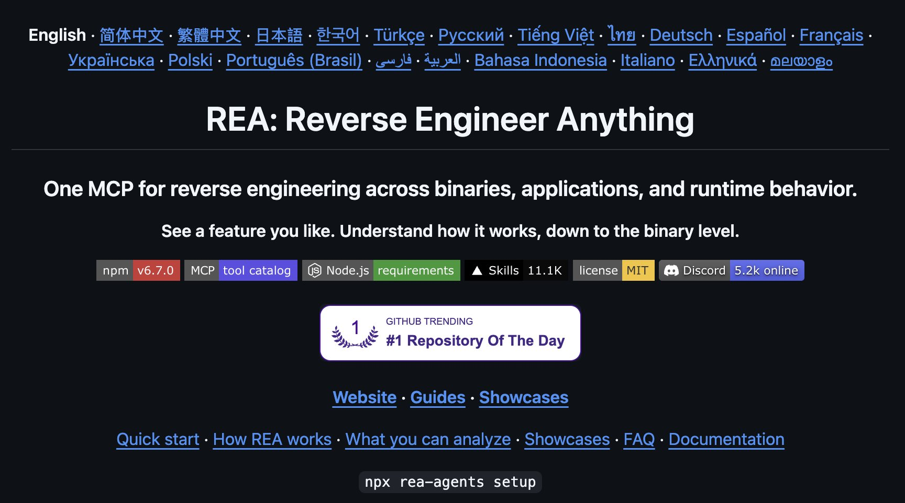
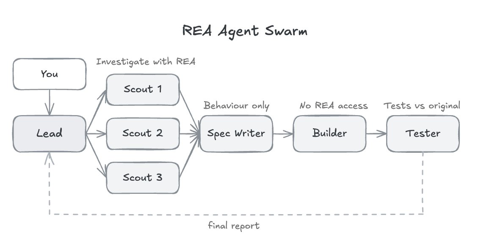
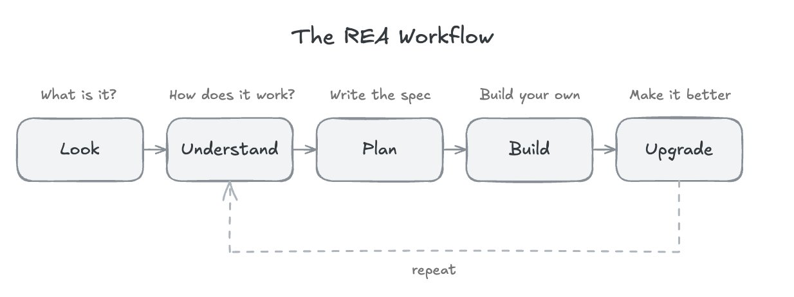
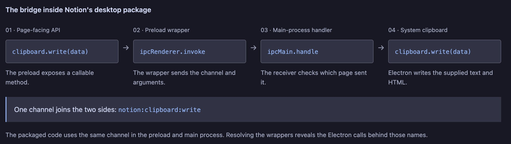
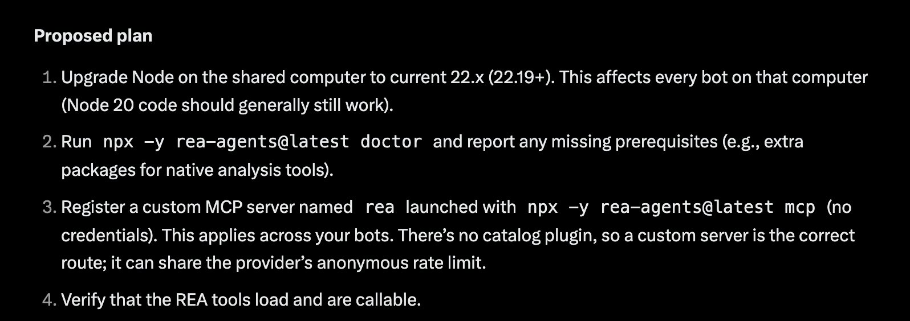
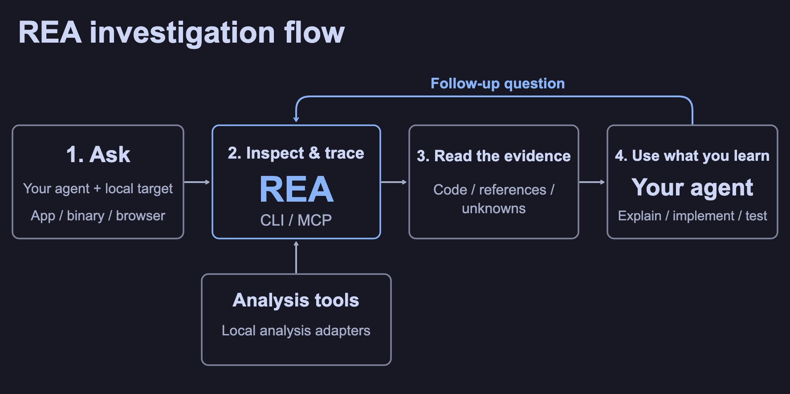

# How to Reverse Engineer Anything with AI (REA - FULL GUIDE) 

> Automatisch per `npm run ingest:x` erfasst. Quelle: [x.com/milesdeutscher/status/2112924796866699336](https://x.com/milesdeutscher/status/2112924796866699336)

## Artikel-Volltext

There’s a 335,000-star GitHub repo that lets your AI agent reverse-engineer literally any app, website, or feature you’ve ever wanted for yourself.
It's called REA (Reverse Engineer Anything), and it's extremely powerful.
Point Claude, or any agent, at a feature you like, and it’ll figure out exactly how it works, map out an implementation plan, and build you your own version.
Most people have no clue this exists, but I'm glad you've come across this article.
This is your full beginner's guide to REA - starting from scratch. 
Before we dive in, I have to highlight @0xMovez's article, which is how I discovered REA myself. 
You should check out his technical read:
 
My guide today will be more focused on implementation for beginners:
 
REA: ELI5
Simply put, REA is a free, open-source tool that lets your AI agent look inside software.
 
Claude is incredible at reading, reasoning, and writing code. But on its own, it can’t open an app on your computer and figure out how it works.
REA is essentially the way your agent can digest features, code, websites, apps, and so on.
After using REA to understand the broad architecture, your agent can use that information as a starting point. 
REA supports over 20 types of software, but for most people it comes down to four buckets:
 
Websites
Desktop apps: including apps like Notion, Slack, and Discord, which are built on web tech and are surprisingly easy to inspect
Mobile apps: Android apps 
Native software and games
Where REA is practically useful
The REA team published real case studies showing what it can do.
Including: Reverse-engineering Notion's custom clipboard feature, rebuilding 90s video games & more.
 
I've personally found the real unlock with REA is basically stealing features from your favorite apps and using them yourself.
How REA works 
Under the hood, REA plugs into your agent through MCP (Model Context Protocol), a universal adapter that lets AI agents use outside tools.
REA runs fully locally. 
 
 
How to set up REA  
This takes about 5 minutes. You only need two things: an AI agent and Node.js. You have two installation methods:
Terminal
To install in your terminal, run this:
 
While installing, you'll be prompted to choose which AI agent you want to connect.
You can pick from:
Grok Build
Claude Code
Codex 
Gemini CLI 
It adds REA to your agent along with a set of workflow instructions, so your agent knows how to actually use it. 
Optional: Install the terminal command
If you want to use REA outside your agent:
 
2.     Automated agent install
Your second installation option is to run this prompt. 
(this is the easiest method - it just tells your agent to do all the work for you)
 
After whichever install method you pick, run a health check.
Terminal health check:
 
Claude Code/ agent set up:
 
Once set up, you can begin prompting:
 
Tip: You can run this through your agent so it understands the full scope of the installation.
https://github.com/morluto/rea/blob/main/docs/installation.md
 
I personally tested the agentic setup on Grok Bot, and I like how it returned a proposed plan before installing anything:
 
 
How to use REA
My five-step framework for getting the most out of REA:
Look: figure out the general architecture of a feature
Understand: break down exactly how the feature works
Plan: turn that understanding into a spec
Build: use the spec to create a custom version 
Iterate: make it better
 
Step 1: Look
A prompt for your agent to gain an understanding of what it's working with:
 
Step 2: Understand "x-ray"
Investigate core features:
 
Step 3: Plan
Build a spec based on the feature:
 
Step 4: Build
Begin building the SPEC doc for your own custom feature:
 
Step 5 (optional): Upgrading & iterating 
Tip: You can even create /loops to automatically iterate.
 
You can also run REA as a skill in tools like Perplexity Computer.
Alternatively, you can turn REA into a Claude/Grok skill yourself, too. 
 
 
Launching a REA Agent Swarm
This is one of the coolest use cases for REA. You can launch an agent swarm team.
Agents that explore multiple features, build SPECs at the same time, and actually execute build plans simultaneously.
The good news is Claude already has this feature built in (subagents).
 
The team
Your swarm mirrors the workflow from the last section:
Scout: uses REA to investigate one feature and report back with evidence
Spec Writer: turns the scout reports into a behavior-only spec
Builder: builds from the spec, with zero access to the original app
Tester: compares your version against the original and reports the gaps
Step 1: Create the agents folder
In your project, create a folder called .claude/agents/.
Step 2: Add Four Agents (you can also add more)
 
Step 3: Launch the swarm
Back in Claude Code, you can start prompting.
"Investigate [app] with my agent swarm team." etc. 
Step 4: Watching the swarm work
I recommend setting up:
reports.md 
spec.md
comparison.md 
 
Closing Tips
Remember, you can use REA with a variety of agents (Opus 5.5 is the best generalist)
Remember, you can adjust the effort level of Opus (or your coding agent)
A cool use case: reverse-engineering your most-used apps 
You can copy/paste this entire article into your agent and have it digest, install, and run all the prompts & commands I've attached 
Build a spec library: it's worth building a spec database - this way you can store all the features you're building upon
I hope you found this guide valuable. I know there was a lot here, so feel free to come back to it as you build with REA.
If you like this content, be sure to follow me here @milesdeutscher. Every week I break down the AI tools, systems, and research that actually give you an edge - whether that's in your finances, business, or just general AI tooling.
For deeper AI insights, follow me over on @aiedge_.
I also have a 100% free Skool community where you can learn these tools.
👉 https://www.skool.com/milesdeutscher
 
-Miles💙

## Bilder

<!-- Reihenfolge wie von der API geliefert (Cover zuerst). Die Position im Artikeltext gibt die API nicht mit. -->

**Cover**

**video**

**photo**

**photo**

**video**

**photo**

**photo**

**photo**

**photo**

**photo**

## Post-Text

https://t.co/VbY2Ljuc6M

## Links

- [x.com/i/article/2112…](https://x.com/i/article/2112288496757129216)

## Thread

### 1/1

https://t.co/VbY2Ljuc6M

## Erfassungsnachweis

Angefragter Post: https://x.com/milesdeutscher/status/2112924796866699336

Im API-Abruf enthalten: 1 Post(s). Diese Zahl ist kein Nachweis eines vollständigen Threads.

- [Post 2112924796866699336](https://x.com/milesdeutscher/status/2112924796866699336)
