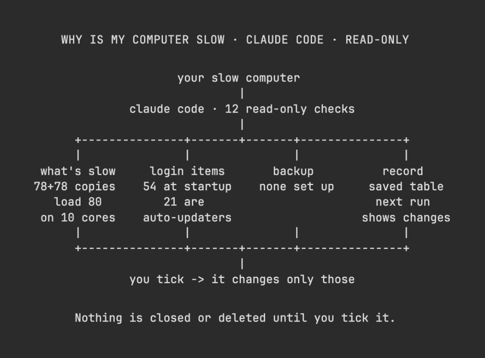

# Vox (@Voxyz_ai)

> Automatisch per `npm run ingest:x` erfasst. Quelle: [x.com/Voxyz_ai/status/2112986024955744544](https://x.com/Voxyz_ai/status/2112986024955744544)

## Bilder

<!-- Reihenfolge wie von der API geliefert (Cover zuerst). Die Position im Artikeltext gibt die API nicht mit. -->

**photo**

## Post-Text

Claude Code tip: when your computer gets slow, have Opus 5.5 𝗽𝗹𝗮𝘆 𝗜𝗧 𝘁𝗲𝗰𝗵 and run 𝘁𝗵𝗲𝘀𝗲 𝟭𝟮 𝗰𝗵𝗲𝗰𝗸𝘀:

What's slowing it down
→ List every process using more than 5% of CPU or memory right now, explain each one in a plain sentence, and flag anything it can't identify
→ List any program running lots of copies of itself. Ours had two Spotlight processes running 78 copies each
→ Divide the load average by the number of cores. Above 1 means tasks are queuing for the CPU. Ours has 10 cores and a load average of 80
→ Check how much memory is free and whether it's using swap (the disk standing in for memory, which slows things down a lot)

What starts at login and stays running
→ List everything that starts at login or runs in the background, and mark what's needed and what just slows startup
→ Put every app's auto-updater in its own group. Ours had 21 out of 54
→ Turn off only the ones you tick

Backup
→ Check whether there's a backup, where it goes and when it last ran. Ours turned out to have 𝗻𝗼𝗻𝗲 𝘀𝗲𝘁 𝘂𝗽 𝗮𝘁 𝗮𝗹𝗹
→ If there isn't one, give the simplest setup steps using what you already have

Keep a record
→ Put the results in a table: what it found, what it means in plain English, what to do about it, and whether it needs your OK
→ Flag separately anything a restart would fix
→ Save the table to a file. Next time, read it first and flag what changed

Send this whole post to Claude Code with this line at the end 👇
"Read-only the whole time: don't close, delete or change anything. For anything that needs changing, list the steps and wait for me to tick them."

## Links

- [pic.x.com/MMWI03DTTn](https://x.com/Voxyz_ai/status/2112986024955744544/photo/1)

## Thread

### 1/1

Claude Code tip: when your computer gets slow, have Opus 5.5 𝗽𝗹𝗮𝘆 𝗜𝗧 𝘁𝗲𝗰𝗵 and run 𝘁𝗵𝗲𝘀𝗲 𝟭𝟮 𝗰𝗵𝗲𝗰𝗸𝘀:

What's slowing it down
→ List every process using more than 5% of CPU or memory right now, explain each one in a plain sentence, and flag anything it can't identify
→ List any program running lots of copies of itself. Ours had two Spotlight processes running 78 copies each
→ Divide the load average by the number of cores. Above 1 means tasks are queuing for the CPU. Ours has 10 cores and a load average of 80
→ Check how much memory is free and whether it's using swap (the disk standing in for memory, which slows things down a lot)

What starts at login and stays running
→ List everything that starts at login or runs in the background, and mark what's needed and what just slows startup
→ Put every app's auto-updater in its own group. Ours had 21 out of 54
→ Turn off only the ones you tick

Backup
→ Check whether there's a backup, where it goes and when it last ran. Ours turned out to have 𝗻𝗼𝗻𝗲 𝘀𝗲𝘁 𝘂𝗽 𝗮𝘁 𝗮𝗹𝗹
→ If there isn't one, give the simplest setup steps using what you already have

Keep a record
→ Put the results in a table: what it found, what it means in plain English, what to do about it, and whether it needs your OK
→ Flag separately anything a restart would fix
→ Save the table to a file. Next time, read it first and flag what changed

Send this whole post to Claude Code with this line at the end 👇
"Read-only the whole time: don't close, delete or change anything. For anything that needs changing, list the steps and wait for me to tick them."

## Erfassungsnachweis

Angefragter Post: https://x.com/Voxyz_ai/status/2112986024955744544

Im API-Abruf enthalten: 1 Post(s). Diese Zahl ist kein Nachweis eines vollständigen Threads.

- [Post 2112986024955744544](https://x.com/Voxyz_ai/status/2112986024955744544)
