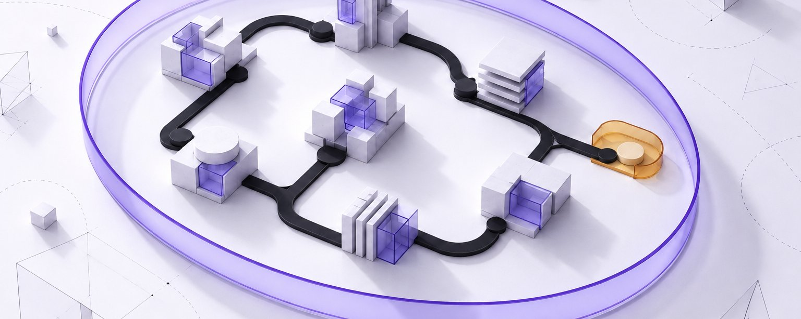
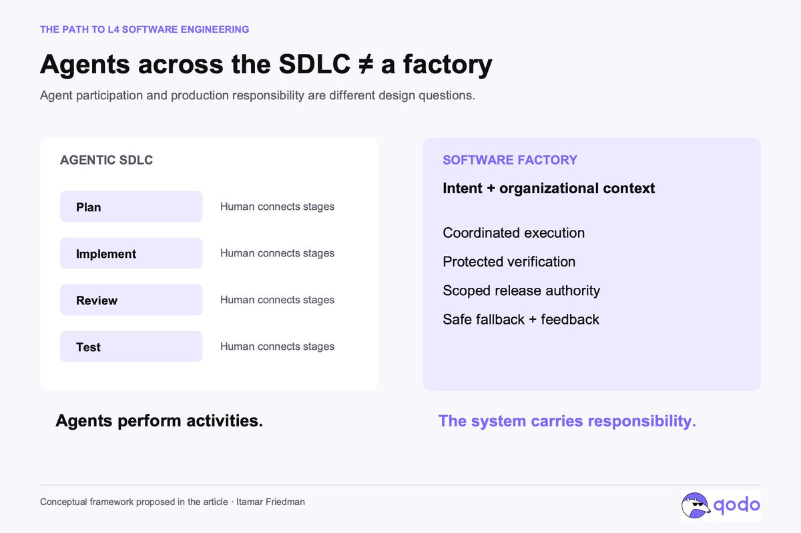
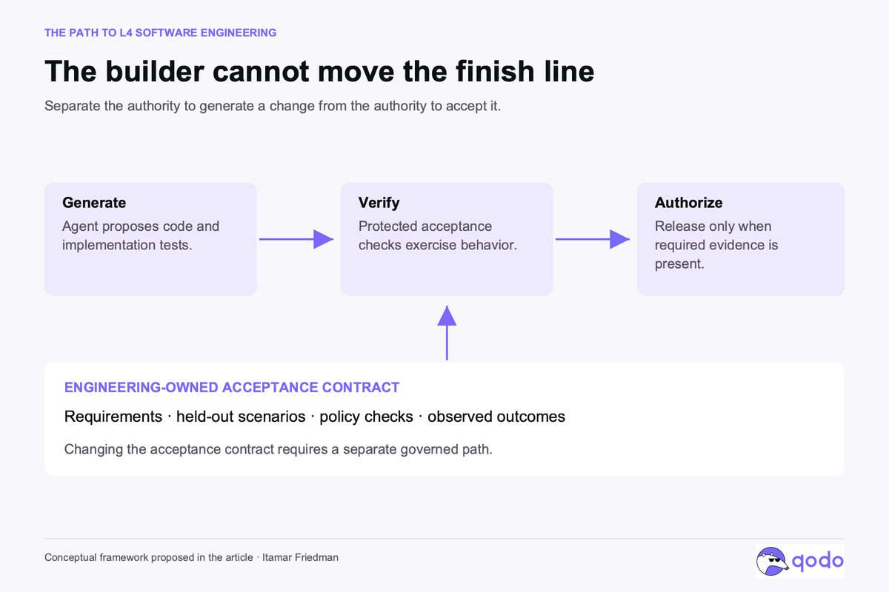

# The Path to L4 Software Engineering

> Automatisch per `npm run ingest:x` erfasst. Quelle: [x.com/itamar_mar/status/2113255396299128887](https://x.com/itamar_mar/status/2113255396299128887)

## Artikel-Volltext

Agentic SDLC is not a Software Factory per se, and engineering teams need to be thoughtful and own the difference.
An agent can write code, run tests, respond to review comments, and open a pull request while the engineer is doing something else. Connect several of these agents and you can cover much of the software development lifecycle (and, if poorly designed or sandboxed, perhaps accidentally create a digital civilization). Planning becomes agentic. Implementation becomes agentic. Review and testing become agentic.
That is a meaningful change. But I think we are moving too quickly from “agents participate across the SDLC” to “we have a software factory.”
The distance between those statements is where much of the software engineering work now sits (or is shifting). It is also where engineering teams can create their most durable advantage (including when much of the factory is purchased from a vendor).
I believe the software factory is the right direction for all of us to aim for. As implementation becomes cheaper, the opportunity is to boost the entire system that turns an idea into shippable, monitored, high-quality software. Importantly, the useful destination is bounded autonomy: a factory that can complete defined classes of work, produce evidence that the result meets its requirements, and handle failure without depending on an engineer to rescue every run.
I think of that destination as L4 software engineering.
Why the factory is the right unit of improvement
Faster implementation changes the economics of software development, but it does not automatically improve delivery. If generating a change takes minutes while understanding its consequences takes hours, generation has accelerated one part of a larger process. The remaining work includes deciding what should change, preserving architectural constraints, checking downstream effects, and establishing whether the result works for users.
A factory approach makes that larger process something we deliberately engineer. We can improve how requirements become executable checks, how organizational knowledge reaches the right agent, how changes are verified, and how failures become lessons for the next run. An improvement to that system can benefit thousands of future changes.
This is already visible in the strongest implementation reports. OpenAI’s account of harness engineering describes engineers investing in environments, repository knowledge, architectural constraints, and feedback loops around coding agents. The important shift is where engineering effort compounds.
For me, the priority is System > Agents > LLMs. Model capability matters, and agent design matters. The system determines what work those capabilities receive, what information they can use, what actions they can take, and what evidence is required before their output reaches production.
A stronger model can make that system better. It cannot, by itself, decide the organization’s acceptable risk.
Agentic SDLC describes participation. A factory defines responsibility.
An agentic SDLC can have agents in every stage while still depending on humans to connect the stages and resolve every difficult judgment. An engineer clarifies the requirement, corrects the plan, interprets a failing test, checks a downstream dependency, and decides whether the change is ready.
That workflow can be highly productive. It can also contain almost entirely agent-written code. Neither fact tells us how autonomously the delivery system operates.
Stripe’s Minions make this distinction concrete. Stripe describes unattended agents that take tasks through implementation and CI to pull requests ready for human review. That is substantial automation, with human review explicitly retained.
A software factory, as I use the term here, is the production system around this work: its inputs, context, execution environment, verification, permissions, delivery mechanisms, and feedback. Factories can operate with different degrees of autonomy. Adding agents across the lifecycle is an important step toward one, but does not establish which responsibilities the factory can carry.
The question is whether the system can carry a defined change through its authorized lifecycle without a person repeatedly supplying the missing judgment.
 

The useful lesson from autonomous driving
Software autonomy ladders already exist. @DanShapiro’s five-level essay is one example. I find the analogy useful, provided we are explicit that the software levels below are a proposed framework, not an industry standard.
The most useful automotive distinction is between L3 and L4. Under SAE’s framework, L3 automated driving operates under defined conditions but can require a person to take over. L4 operates under defined conditions without requiring human driving to mitigate risk. L5 extends automated driving to all conditions in which humans can drive.
L4 therefore does not mean doing everything, everywhere. Its operating boundary is fundamental to its capability.
Applied to software, I would describe L0 as human execution with conventional automation, and L1 as AI assistance on individual activities while the engineer directs the work. At L2, agents execute substantial tasks, but the engineer actively supervises, checks, and connects the results.
At L3 (agentic-SDLC), the system can run a delivery workflow under defined conditions, while a person remains a required approval or recovery dependency. At L4 (a lights-on software factory), it can complete the authorized lifecycle for a bounded class of changes, including verification, permitted release actions, and safe fallback, without requiring timely human intervention to contain failure. “Lights on” means engineers retain ownership of the factory’s boundaries and evolution.
L5 (a dark software factory) would extend that autonomy across the full range of software engineering work. That is a much broader proposition. It would still require objectives, authority, and accountability.
These levels should describe a particular workflow and operating domain. A team can target L4 for routine changes to a well-understood internal service while retaining close human control over changes to payment authorization. Calling the entire organization “L4” would hide the distinction that matters.
The extra step is engineering the boundary
Moving from agentic SDLC toward L4 requires us to specify the conditions under which autonomous execution is justified.
Start with the work itself. Which repositories, change types, dependencies, and environments are included? What permissions and spending limits apply? What makes a task ineligible? A routine dependency update and a change to a core authorization model should not inherit the same authority because the same agent can attempt both.
 

Then define success in a form the system can evaluate. A ticket is rarely a complete specification. Relevant requirements may live in architecture decisions, incident history, customer commitments, or an engineer’s memory. The factory needs access to that context, and a way to surface ambiguity before implementation turns an assumption into behavior.
Verification must also withstand the incentives of the generation process.  StrongDM’s factory account states two provocative rules: “Code must not be written by humans” and “Code must not be reviewed by humans.” The more instructive part is the machinery around those rules: scenarios, validation harnesses, and behavioral replicas of external dependencies. StrongDM describes scenarios held outside the codebase to reduce opportunities for agents to satisfy tests without delivering the intended behavior.
That points to a broader requirement. The agent producing a change should not be able to quietly redefine the conditions under which the change passes.
Independent verification involves protected acceptance criteria, separate authority, and checks grounded in observable behavior. Giving a second agent the title “reviewer” does not establish independence. Two agents can share the same mistaken assumption.
Anthropic’s work on generator and evaluator harnesses is useful here: separating evaluation helped, but evaluators still needed calibration and retained limitations. Verification is itself an engineering system that needs evaluation.
@DexHorthy’s “Harness Engineering is not Enough” raises a useful challenge here: passing short tasks and preserving a codebase’s maintainability over months are different objectives. I would not treat today’s green tests as evidence that the factory is preserving tomorrow’s ability to change the system. Architecture and program design need explicit constraints, and the effects of successive changes need to be observed over time.
 

Evidence > Confidence claims
A factory should produce an inspectable account of why a change was allowed to proceed: the requirement it addressed, the checks it passed, the relevant constraints, the deployment result, and the unresolved uncertainty.
Some evidence will come from deterministic checks. Some will come from simulations, adversarial tests, model-assisted review, and production observation. None offers universal proof of correctness. Together, they should support a specific decision within a specific boundary.
The same discipline applies to claims about the factory. Agent count, generated lines, and hours of unattended execution describe activity. I would want to know how often eligible work completes correctly, how much human effort remains, what escapes verification, and what failures cost. Rejected tasks and emergency interventions belong in that accounting.
Evidence must also support the factory’s response when a run goes wrong. This is the part of the L4 analogy I find most valuable.
For software, safe fallback might mean withholding a release, stopping a rollout, disabling a feature, or restoring a previous version. Rollback is not always available; a destructive migration can make it impossible. The operating boundary has to account for that before the factory starts.
The system can ask a human for help after reaching a safe state. What makes the workflow meaningfully L4 is that containing the failure does not depend on a person immediately reconstructing the run and taking over.
That is a more demanding standard than letting an agent work overnight.
 

Ownership > Implementation
If this is the direction, engineering teams need to own their software factories.
By ownership, I mean control over the decisions that determine what the factory produces and when its output is acceptable: organizational context, architecture, acceptance criteria, permissions, evidence, and operating boundaries. The team also needs the ability to diagnose failure and change the system that produced it.
A practical factory will combine the team’s own workflows with specialized agents and platforms. A dedicated code review agent, for example, needs context, tools, and evaluation designed for finding faults. Choosing one means evaluating how well it challenges changes against the wider system and the organization’s standards. Review quality is a capability to invest in and measure.
The same applies to the infrastructure around those agents. Findings, fixes, exceptions, and release decisions need to accumulate into an inspectable record, with reporting that shows where risk remains and whether quality is improving. Knowledge about dependencies, architectural decisions, and past failures needs to stay current and reach the agents that need it. Maintaining that record and context is ongoing engineering work.
For many teams, buying these specialized capabilities will be the sensible way to build the factory. A platform that maintains context, governs standards, or consolidates evidence can support many workflows and agents as parts of the team’s production system. Buying cloud services still leaves engineers responsible for designing the architecture, connecting components, writing application logic, and operating the result. A software factory requires the same kind of engineering: the purchased capabilities are building blocks for a system the team must create and run.
The engineering organization needs to design and implement the workflows that connect those capabilities, supply their context, and turn findings into actions. It must test the complete system, define the evidence and authority at each step, and build its monitoring and recovery mechanisms. Product teams contribute domain knowledge and responsibility for outcomes; platform and security teams provide shared infrastructure and controls. Together, they must be able to inspect results, challenge conclusions, and change the workflow when it falls short.
 

This connects closely to Kief Morris’s argument for humans working “on the loop”: engineers improve the mechanism that produces the work. When a failure occurs, fixing the immediate change is only part of the job. The deeper opportunity is to improve the context, constraint, verification, or workflow so that future runs behave better.
Repeated human judgments should become rules, tests, or persistent context wherever we can make them explicit. If the same architectural correction has to be supplied on every run, the factory has not yet absorbed what the team knows. Capturing that judgment is part of building the production system.
That knowledge is a strategic asset. It captures how the organization builds software, what it has learned from failure, and where it is willing to delegate decisions. As agents take on more implementation, ownership of that knowledge becomes more consequential.
Build toward bounded L4
I would start with one valuable class of work whose requirements and risks are sufficiently understood. Define its eligibility rules, establish verification, constrain its authority, and design its fallback. Run it with human supervision and measure where people still have to intervene.
Each intervention is evidence about a missing capability or an incomplete boundary. Some should lead to better tooling or context. Others should keep the work outside autonomous operation. The goal is to establish where the system has earned more responsibility.
A factory can then expand through demonstrated performance, while retaining narrower limits where consequences or uncertainty demand them. Every company will make different choices because its systems, obligations, and tolerance for failure differ.
That is why I favor bounded L4 over speculative L5 as the practical destination. It gives engineering teams a concrete system to build and a concrete standard against which to evaluate it.
Agentic SDLC helps us get there by making more of the lifecycle executable by agents. The software factory brings those capabilities into a production system with defined authority, evidence, and recovery.
The strategic opportunity for engineering teams is to own and continuously improve that system. Their advantage will increasingly come from how reliably it turns intent into software, and how effectively each result improves the next run.

## Bilder

<!-- Reihenfolge wie von der API geliefert (Cover zuerst). Die Position im Artikeltext gibt die API nicht mit. -->

**Cover**

**photo** — Specialized agents and platforms, purchased, shared, or built, provide review, context and standards, evidence and reporting, and learning and memory. Engineering builds on these capabilities: it designs workflows and custom logic, integrates agents and controls, validates the complete system, and operates and improves the factory. Engineering sets intent, acceptance criteria, authority, and boundaries. The resulting factory delivers changes, verifies outcomes, contains failures, and retains evidence. A connected return arrow routes evidence from factory operation back to engineering to refine workflows, standards, and context.

![Specialized agents and platforms, purchased, shared, or built, provide review, context and standards, evidence and reporting, and learning and memory. Engineering builds on these capabilities: it designs workflows and custom logic, integrates agents and controls, validates the complete system, and operates and improves the factory. Engineering sets intent, acceptance criteria, authority, and boundaries. The resulting factory delivers changes, verifies outcomes, contains failures, and retains evidence. A connected return arrow routes evidence from factory operation back to engineering to refine workflows, standards, and context.](medien/2026-10-22-itamar_mar-2113255396299128887/02-photo.jpg)

**photo** — Our proposed software analogy compares two failure paths: at L3 a person must intervene to contain the failure; at L4 the system stops, isolates, or restores safely before escalating for human judgment.

**photo** — An authorized operating domain encloses included work, required conditions, permitted actions, and safe fallback. Work outside that domain routes to a human before execution.

**photo** — Two panels compare agents operating across SDLC stages with a software factory that includes context, verification, authority, safe fallback, and feedback. Agent participation is not the same as production responsibility.

**photo** — Generation, protected verification, and release authorization are separate stages. An engineering-owned acceptance contract governs verification; changing that contract requires a separate governed path.

## Post-Text

Agents across the SDLC are a step toward a software factory. 
Then the harder work is engineering the system around them.

My take on the path to bounded L4 software engineering, and why engineering teams need to BUILD and OWN that SYSTEM. https://t.co/HfYgwUYd2Y

## Links

- [x.com/i/article/2112…](https://x.com/i/article/2112960939901480961)

## Thread

### 1/2

Agents across the SDLC are a step toward a software factory. 
Then the harder work is engineering the system around them.

My take on the path to bounded L4 software engineering, and why engineering teams need to BUILD and OWN that SYSTEM. https://t.co/HfYgwUYd2Y

### 2/2 · Geprüfte Ergänzung des Autors

"review” and “tests” fall into the same category: both act as adversarial checks and guaranties on the generative parts.

I would use tests only for mission-critical flows (which could be few or many), while “review” could include “testless testing” (e.g. dynamic agent-based testing)

## Erfassungsnachweis

Angefragter Post: https://x.com/itamar_mar/status/2113255396299128887

Für diese Quelle übernommen: 2 Post(s). Gesprächsantworten außerhalb der Inhaltsauswahl wurden entfernt; dies ist kein Vollständigkeitsnachweis.

- [Post 2113255396299128887](https://x.com/itamar_mar/status/2113255396299128887)
- [Post 2113266170400854190](https://x.com/itamar_mar/status/2113266170400854190)
